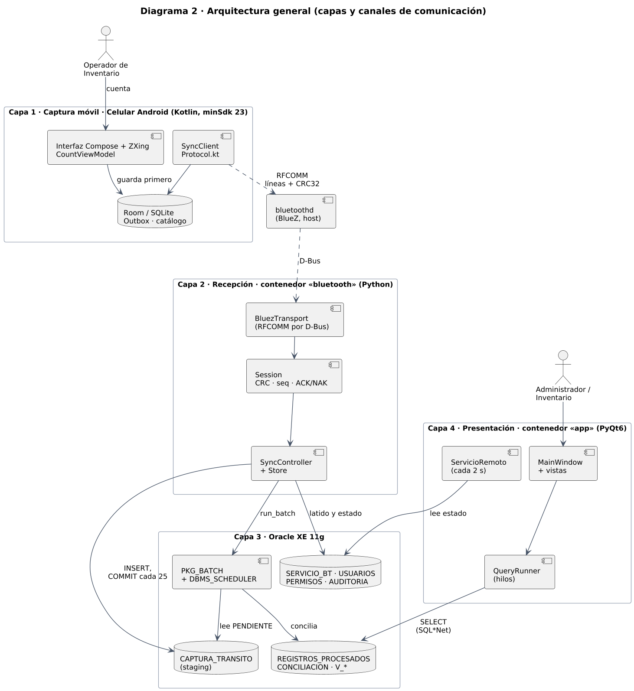
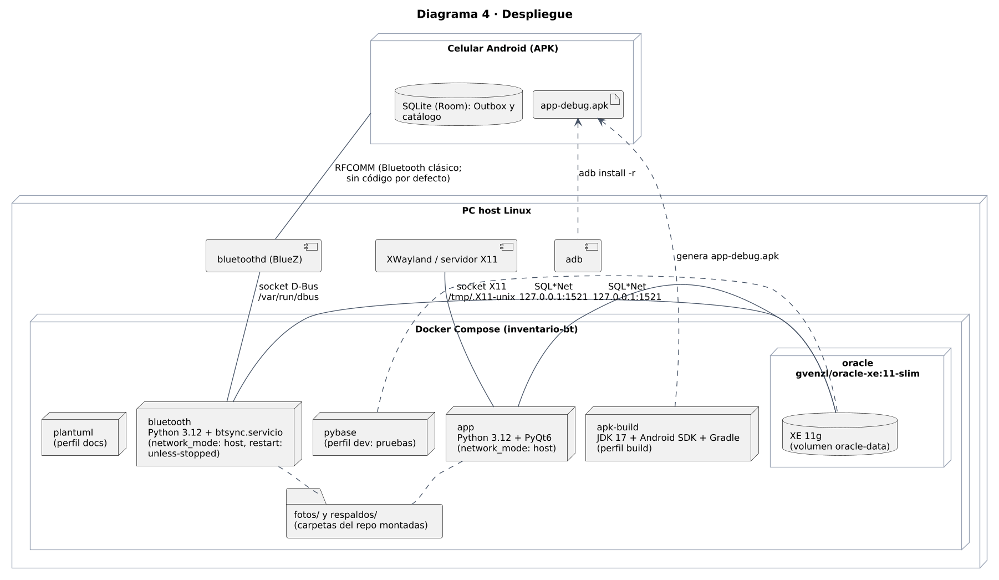
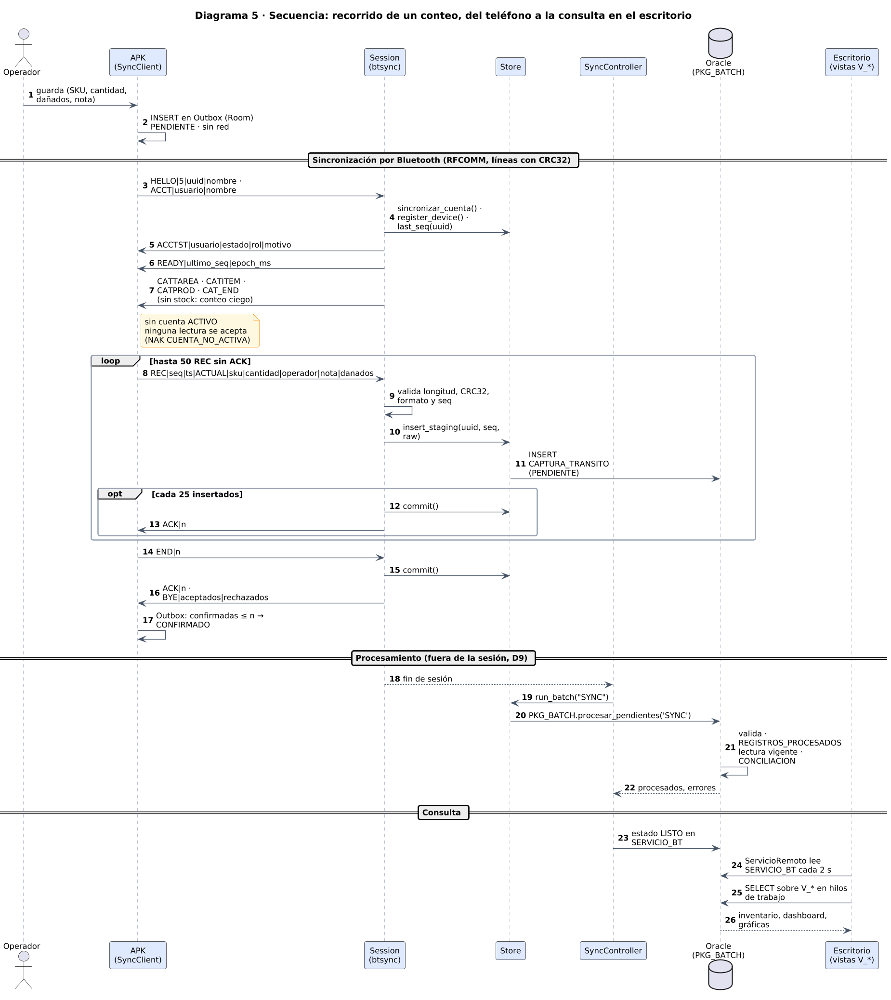
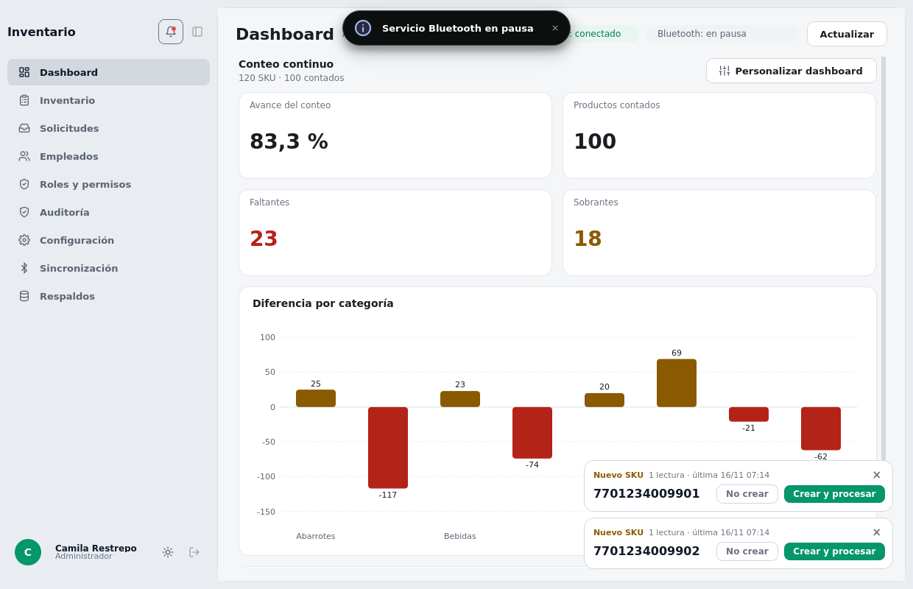
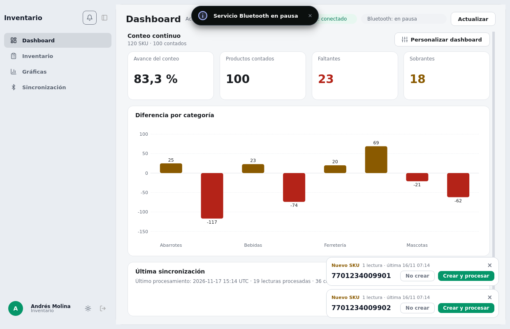
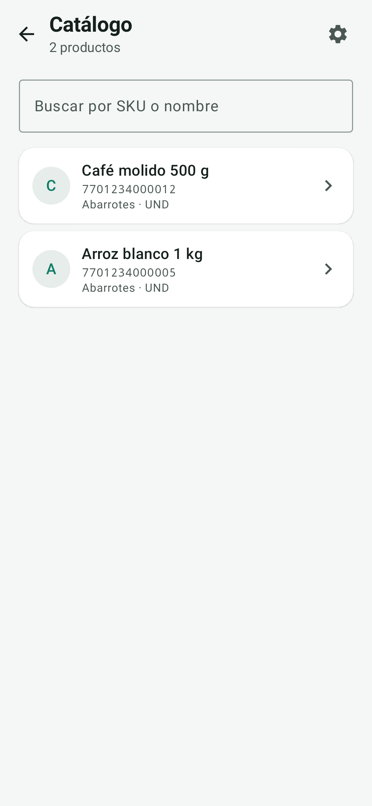
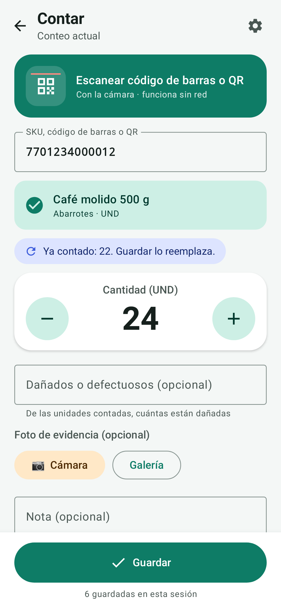

# Inventario físico offline: APK → Bluetooth → Oracle → App de escritorio

Sistema de toma de inventario físico para bodegas y tiendas sin red confiable. Un operador cuenta productos con una **APK
Android** sin conexión (escáner de códigos de barras o QR, o digitando el SKU). Cuando está cerca del PC, el conteo sube por
**Bluetooth** al PC, que lo guarda en **Oracle 11g** y dispara un **batch PL/SQL** que lo concilia contra el stock del
sistema. Una **aplicación de escritorio** muestra el resultado. El conteo es **continuo** (`ACTUAL`): siempre está abierto y el
inventario se actualiza a medida que el batch procesa las lecturas. Todo el lado PC corre en Docker sobre Linux.

> Las rutas del proyecto pueden tener espacios (`/home/t1an/movil oracle bluetooth`): entrecomíllalas.

## Contenido

[Problema](#problema-que-resuelve) · [Objetivos](#objetivos) · [Características](#características-principales) ·
[Arquitectura](#arquitectura-general) · [Tecnologías](#tecnologías-utilizadas) · [Estructura](#estructura-de-directorios) ·
[Instalación](#requisitos-de-instalación) · [Configuración](#configuración) · [Base de datos](#preparación-de-la-base-de-datos) ·
[Comunicación](#configuración-de-la-comunicación-entre-dispositivos) · [Ejecución](#instrucciones-de-ejecución) ·
[Módulos](#descripción-de-los-módulos) · [Roles](#roles-y-permisos) · [Pruebas](#pruebas) · [Diagramas](#diagramas) ·
[Capturas](#capturas-de-la-aplicación) · [Documentación](#documentación-complementaria) · [Problemas](#solución-de-problemas)

## Problema que resuelve

Contar inventario en una bodega obliga a recorrer pasillos donde el wifi no llega y a transcribir después las cantidades a
mano, con errores y sin trazabilidad. Este sistema deja que el operador cuente **sin red** (nada se pierde: cada lectura se guarda
primero en el teléfono), sincronice por Bluetooth al acercarse al PC y que el cálculo de diferencias lo haga la base de datos,
no una hoja de cálculo. El conteo es **ciego**: el catálogo que baja al teléfono nunca trae la cantidad del sistema.

## Objetivos

- Capturar lecturas de inventario en un teléfono Android sin conexión, sin perder ni duplicar ninguna.
- Transferirlas al PC por Bluetooth con un protocolo propio verificable (líneas con CRC32, confirmación acumulativa y reanudación tras cortes).
- Almacenarlas en Oracle y conciliarlas contra el stock del sistema con un batch PL/SQL.
- Mostrar inventario, diferencias, sincronización y gráficas en una aplicación de escritorio, con roles y permisos.
- Documentar la arquitectura con diagramas UML cuyos nombres coincidan con el código.

## Características principales

- **Captura offline** con bandeja de salida local (Room/SQLite), escáner ZXing sin Google Play Services, dañados, nota y foto por lectura.
- **Protocolo propio de líneas** `KIND|campo…*CRC32` (versión 5): `ACK` acumulativo, `NAK` con retroceso go-back-N y reanudación con `READY|seq`.
- **Servicio Bluetooth independiente** (`bluetooth` en Docker): sigue recibiendo aunque la ventana del escritorio esté cerrada; solo atiende un teléfono a la vez.
- **Batch PL/SQL** (`PKG_BATCH`): valida, decide la lectura vigente, concilia y trata los SKU nuevos sin tratarlos como error.
- **Escritorio PyQt6** con dashboard personalizable, inventario, gráficas, sincronización en vivo, notificaciones, respaldos y auditoría.
- **Cuentas, roles y permisos** (matriz de 12 módulos editable por el Administrador); tema claro/oscuro/sistema e idioma español/inglés por usuario.
- **Respaldos** completos (`.zip` con datos y fotos), manuales y automáticos, con restauración.

## Arquitectura general



Fuente: [`02_arquitectura_general.puml`](docs/documentacion/diagramas/plantuml/02_arquitectura_general.puml).

| Capa | Dónde | Qué hace |
|---|---|---|
| 1. Captura móvil | [`mobile/`](mobile/README.md) | Cuenta sin red; guarda **siempre primero** en la bandeja de salida |
| 2. Recepción Bluetooth | [`server/btsync`](server/btsync/README.md) | Acepta una conexión RFCOMM, valida cada línea, hace `COMMIT` cada 25 y responde `ACK`/`NAK` |
| 3. Staging y batch | [Oracle](db/README.md) (`CAPTURA_TRANSITO`, `PKG_BATCH`, `DBMS_SCHEDULER`) | Valida, mueve a `REGISTROS_PROCESADOS` y concilia `ACTUAL` |
| 4. Presentación | [`desktop/`](desktop/README.md) | Lee las vistas `V_*` y el estado del servicio; muestra y administra |

Las capas 2 y 4 son **dos procesos** que se comunican solo por Oracle. Más detalle: [`docs/arquitectura.md`](docs/arquitectura.md).



Fuente: [`04_despliegue.puml`](docs/documentacion/diagramas/plantuml/04_despliegue.puml).

## Tecnologías utilizadas

| Componente | Tecnología |
|---|---|
| App móvil | Kotlin 1.9.24, Jetpack Compose + Material 3, Room 2.6.1, ZXing embebido 4.3.0, coroutines; Android Gradle Plugin 8.5.2; `minSdk 23`, `targetSdk 34` |
| Servicio Bluetooth | Python ≥ 3.12, `python-oracledb`, `dbus-fast` (BlueZ por D-Bus), RFCOMM |
| Escritorio | Python 3.12, PyQt6 (≥ 6.6, < 7), pyqtgraph (≥ 0.13), pytest-qt |
| Base de datos | Oracle Database XE 11g (`gvenzl/oracle-xe:11-slim`), PL/SQL, `DBMS_SCHEDULER`, Instant Client 19.23 |
| Infraestructura | Docker y Docker Compose; BlueZ (`bluetoothd`) y `adb` en el host |
| Documentación | PlantUML 1.2024.7 (Docker), Word/PDF generados con scripts propios y LibreOffice |

## Estructura de directorios

```text
docker-compose.yml  .env.example
db/                 esquema, semilla, PKG_BATCH, jobs, vistas y migraciones          → db/README.md
server/btsync/      protocolo, sesión, controlador, store, servicio y transportes    → server/README.md
desktop/app/        aplicación de escritorio (PyQt6 + pyqtgraph)                     → desktop/README.md
mobile/             APK Android (Kotlin, Compose, Room, ZXing)                       → mobile/README.md
docker/             imagen base Python + Oracle Instant Client y arranque de la app   → docker/README.md
tools/              datos semilla, teléfono simulado, verificación y render de UML    → tools/README.md
docs/               arquitectura, protocolo, demo, interactividad, UML y documento técnico → docs/README.md
```

## Componentes principales

| Componente | Responsabilidad | Documentación |
|---|---|---|
| `SyncController` / `Session` / `Store` | Ventana de sincronización, una sesión por teléfono, acceso a Oracle | [`server/btsync/`](server/btsync/README.md) |
| `BluezTransport` / `TcpTransport` | Entrega de bytes por Bluetooth real o TCP | [`transports/`](server/btsync/transports/README.md) |
| `MainWindow` y las vistas | Ventana principal y pantallas por módulo | [`desktop/app/`](desktop/app/README.md), [`views/`](desktop/app/views/README.md) |
| `SyncClient` / `Outbox` / `CountViewModel` | Cliente de sincronización, bandeja de salida y reglas de captura | [`mobile/`](mobile/app/src/main/java/com/sebasarchive/kardex/README.md) |
| `PKG_BATCH` y vistas `V_*` | Procesamiento y conciliación en Oracle | [`db/`](db/README.md) |

## Requisitos de instalación

- Linux x86_64 con **Docker** y **Docker Compose** (Oracle XE 11g solo existe para x86_64).
- Para el **Bluetooth real**: BlueZ (`bluetoothd`) activo en el host y un adaptador (`hci0`) encendido.
  `bluetoothd` y `adb` viven en el host; el resto corre en contenedores.
- Para ver la ventana: una sesión gráfica X11 o Wayland con XWayland (`DISPLAY`).
- Para instalar la APK: `adb` en el host y un celular **Android 6.0 o superior** con la depuración USB activa.

## Dependencias

Todo lo que necesita el proyecto lo instalan las imágenes de Docker; no hace falta instalar Python, Qt, Oracle ni el SDK de Android en el host.

| Dónde | Dependencias | Se declara en |
|---|---|---|
| Servidor y escritorio | `oracledb ≥ 2.0`; `dbus-fast ≥ 5.2, < 6` (extra `bluez`); `pytest ≥ 8` (extra `dev`) | [`server/pyproject.toml`](server/pyproject.toml) |
| Escritorio | `PyQt6 ≥ 6.6, < 7`, `pyqtgraph ≥ 0.13`, `pytest-qt ≥ 4.4` | [`desktop/Dockerfile`](desktop/Dockerfile) |
| Imagen base | Python 3.12, `libaio1`, Oracle Instant Client 19.23 | [`docker/pybase/Dockerfile`](docker/pybase/Dockerfile) |
| APK | Room, Compose (BOM 2024.06.00), ZXing, coroutines, Roborazzi/Robolectric (pruebas) | [`mobile/app/build.gradle.kts`](mobile/app/build.gradle.kts) |

## Configuración

1. Copie la plantilla de entorno: `cp .env.example .env` (el `.env` no se versiona; los valores de la plantilla son solo de desarrollo local, cámbielos fuera de su máquina).
2. Ajuste, si lo necesita, `PUID`/`PGID` (usuario con el que corren los contenedores Python) y las variables `BT_*`.
3. Los parámetros de funcionamiento (intervalo del lote, tamaño máximo de foto, respaldos) **no** están en el `.env`: se guardan en la tabla `CONFIGURACION` y se editan en las pantallas **Configuración** y **Respaldos**.

### Variables de entorno

| Variable | Dónde se define | Para qué |
|---|---|---|
| `ORACLE_PASSWORD`, `APP_USER`, `APP_USER_PASSWORD` | `.env` | Creación de la base y del usuario dueño del esquema `APP` |
| `DB_USER`, `DB_PASSWORD` | `.env` | Credenciales con las que se conectan los contenedores Python |
| `PUID`, `PGID` | `.env` | UID/GID de los contenedores Python (evita archivos de root en el proyecto) |
| `DB_DSN`, `ORA_SDTZ`, `PYTHONPATH` | `docker-compose.yml` | Destino de Oracle y zona horaria de la sesión; los fija Compose por servicio |
| `BT_TRANSPORT` | shell o `.env` | `bluez` (por defecto, Bluetooth real) o `tcp` (pruebas y plan B) |
| `BT_TCP_HOST`, `BT_TCP_PORT` | shell o `.env` | Dirección (`127.0.0.1`) y puerto (`9000`) del transporte TCP |
| `BT_CON_CLAVE` | shell o `.env` | `1` exige emparejamiento con código; por defecto el socket es inseguro (D22) |
| `FOTOS_DIR`, `RESPALDOS_DIR` | `docker-compose.yml` | Carpetas de fotos y respaldos |
| `DISPLAY`, `XAUTHORITY` | sesión gráfica del host | Ventana de la app de escritorio por X11 |
| `APP_SIN_ANIMACIONES` | shell | `1` apaga las animaciones del escritorio (las pruebas lo usan) |

Detalle por aplicación: [servidor](server/README.md#variables-de-entorno), [escritorio](desktop/README.md#configuración), [docker](docker/README.md#variables-de-env).

## Preparación de la base de datos

La base se crea sola la primera vez: Oracle ejecuta [`db/init/`](db/init/) (esquema, semilla de 120 SKU, `PKG_BATCH`, jobs, vistas, permisos, configuración y
datos de demostración). No hay pasos manuales.

```bash
docker compose up -d --wait oracle      # varios minutos la primera vez; espera a que esté «healthy»
```

- **Sin datos de demostración:** borre `db/init/08_demo.sql` antes de crear la base.
- **Regenerar semilla y demo:** `python tools/gen_seed.py --seed 42 && python tools/gen_demo.py --seed 42`.
- **Base limpia** (borra todos los datos): `docker compose down && docker volume rm inventario-bt_oracle-data`.
- Esquema, modelo entidad-relación, `PKG_BATCH` y migraciones: [`db/README.md`](db/README.md).

## Configuración de la comunicación entre dispositivos

| Enlace | Medio | Configuración |
|---|---|---|
| Teléfono ↔ PC | Bluetooth clásico RFCOMM, UUID de servicio `7a1c0b52-4f0e-4d6a-9c3b-5e2a6d9f1b01`, canal 22 | El PC se anuncia como `gestion_inventario` mientras el servicio `bluetooth` esté activo y sin pausa. `bluetoothd` debe estar activo en el host y el adaptador (`hci0`) encendido |
| Servicio ↔ BlueZ | D-Bus del sistema | Compose monta `/var/run/dbus`; el contenedor usa `network_mode: host` y `NET_ADMIN` |
| Servicio y escritorio ↔ Oracle | SQL\*Net, `127.0.0.1:1521` | Puerto publicado solo en el loopback del host |
| Escritorio ↔ servicio | Tabla `SERVICIO_BT` en Oracle | No hay otro canal de red: el escritorio lee el estado cada 2 s y escribe pausa/respuesta |
| Pruebas sin radio | TCP `127.0.0.1:9000` | `BT_TRANSPORT=tcp docker compose up -d bluetooth`; el teléfono simulado es [`tools/fake_phone.py`](tools/README.md) |

La primera vez, en el celular se busca y se elige `gestion_inventario`; desde entonces conecta directo, sin claves ni códigos (D22). El
protocolo (versión 5) está en [`docs/protocolo.md`](docs/protocolo.md). Solo se sincroniza un teléfono a la vez (D19).



Fuente: [`05_secuencia_flujo_datos.puml`](docs/documentacion/diagramas/plantuml/05_secuencia_flujo_datos.puml).

## Instrucciones de ejecución

```bash
cp .env.example .env
```

```bash
docker compose up -d --wait oracle
```

La primera vez descarga la imagen y crea la base con el esquema, la semilla (conteo continuo `ACTUAL` con 120 SKU en 8 categorías),
el paquete `PKG_BATCH`, los jobs del Scheduler y las vistas: puede tardar varios minutos. El archivo `db/init/08_demo.sql` añade **13 meses de datos de demostración** para ver todas las pantallas y gráficas:
4 operadores con su teléfono, 615 sincronizaciones, ~950 lecturas con recuentos, dañados, errores, SKU nuevos pendientes de
decisión y corridas del batch. Cuentas del PC: `admin` (Administrador) e `inventario`, ambas con la contraseña de demostración definida en `CLAVE_DEMO` de `tools/gen_demo.py`;
`laura.mora` y `sofia.vega` quedan pendientes en Solicitudes. Para una base **sin** datos de demo, borra `08_demo.sql`
antes de crear la base; para regenerarlo: `python tools/gen_seed.py --seed 42 && python tools/gen_demo.py --seed 42`.

```bash
docker compose up -d bluetooth app
```

`bluetooth` es el **servicio de recepción**: corre aparte, recibe a los teléfonos aunque la ventana del escritorio esté
cerrada y vuelve a arrancar solo tras reiniciar el PC (si Docker arranca con el sistema). La pantalla
**Sincronización** muestra su estado y lo pausa o reanuda.

La aplicación de escritorio se abre **en tu pantalla** por X11 y muestra el acceso: crea la primera cuenta (queda como
Administrador y Activa) e inicia sesión. Con `up -d` no ves sus mensajes; para verlos usa `docker compose logs -f app`.

**Si tu sesión es Wayland sin XWayland** (no existe `/tmp/.X11-unix`), la ventana no puede abrirse por el compose
normal. En ese caso usa el lanzador incluido:

```bash
tools/run_escritorio_wayland.sh
```

Añade una capa de imagen con `libwayland-cursor0` (una sola vez), corre la app en la red interna de Compose para
llegar a `oracle:1521` y monta el socket Wayland de tu sesión. La ventana queda abierta en segundo plano; se cierra
cerrando la ventana o con `docker rm -f app-wayland`. El servicio Bluetooth no hace falta para abrirla: la app lee su
estado de Oracle.
El lanzador usa el mismo wrapper `docker/run-app.sh` que el servicio `app`, así que el arranque y el log
persistente (`./logs/app.log`) son los mismos.
Si el puerto publicado `127.0.0.1:1521` está atascado en tu Docker, este camino también lo evita.

Para no usar Bluetooth (pruebas y plan B de la demo):

```bash
BT_TRANSPORT=tcp docker compose up -d bluetooth app
```

### Compilar e instalar la APK

La APK se compila en Docker (JDK 17 + Android SDK + Gradle), sin instalar nada en el host:

```bash
docker compose --profile build run --rm apk-build ./gradlew assembleDebug
```

Con el celular conectado por USB:

```bash
adb install -r mobile/app/build/outputs/apk/debug/app-debug.apk
```

> **No desinstales la APK con lecturas pendientes:** la bandeja de salida vive en el teléfono y se borra con la
> aplicación (D18). Reinstalar crea un dispositivo nuevo con `seq` desde 1.
>
> **Toda cuenta nueva espera aprobación.** Las del PC quedan **PENDIENTES** hasta que el Administrador las apruebe en
> **Solicitudes**; solo la primera cuenta del PC es el Administrador y no se pueden crear más. Las del teléfono llegan
> al PC al sincronizar y solo pueden aprobarse como **Operador de Inventario**. Una cuenta rechazada o suspendida ve
> el motivo en la pantalla de estado. Las cuentas del PC piden correo obligatorio y único; las del teléfono lo aceptan
> opcional. El acceso es con usuario y contraseña: el correo es un dato de la cuenta. La contraseña del Operador es
> local y se recupera con su pregunta de seguridad.
>
> **El Operador no ve la cantidad del sistema.** El catálogo que baja al teléfono nunca lleva el stock; el conteo es
> ciego.
>
> **Solo se sincroniza un teléfono a la vez** (D19): un segundo teléfono recibe «PC ocupado» y debe esperar.

### Uso en una frase

En el celular: crear cuenta con usuario, nombre, correo opcional y pregunta de seguridad (queda pendiente: sincroniza
una vez y apruébala en **Solicitudes** del PC) o iniciar sesión → **Catálogo** → contar escaneando el código de barras
o el QR, o digitando el SKU → guardar (sin red). El PC se anuncia siempre como `gestion_inventario` mientras el
servicio `bluetooth` esté activo. En el celular: **Sincronizar**; la primera vez se busca y se elige
`gestion_inventario`, y desde entonces conecta directo, sin claves ni códigos (D22).

### Conteo continuo

El operador cuenta directamente del catálogo y el batch va conciliando contra `ACTUAL`. Si un SKU no tiene lectura, la cantidad contada se
muestra vacía (no en 0). El Dashboard muestra el avance (SKUs con lectura vigente sobre el total), el estado del batch y la diferencia por
categoría como referencia; el Inventario muestra SKU, producto, categoría, cantidad contada y cantidad del sistema,
sin diferencia, porcentaje ni clasificación en las filas.

Cuando una lectura llega al PC con un **SKU que no está en el catálogo**, ya no queda en error: aparece un **aviso flotante «Nuevo SKU»**
(arriba a la derecha, sobre el contenido, sin ocupar lugar en la pantalla) con el SKU, cuántas lecturas son y dos opciones:

- **Crear y procesar**: pide nombre y categoría (el SKU del aviso se muestra en solo lectura y en mayúsculas), crea el producto con stock 0,
  procesa la lectura y la deja reflejada en Inventario y Dashboard.
- **No crear**: tras confirmar, descarta la lectura; las descartadas no se cuentan ni aparecen en el Inventario.

El aviso muestra hasta 3 SKU (si hay más, «+N más») y se actualiza solo mientras haya sesión abierta. En **Sincronización** esas lecturas
aparecen como chip «Nuevos SKU» con su conteo y una ayuda, nunca como error; la tabla de errores queda solo para datos inválidos
(formato, cantidad o dañados), y el Administrador puede **Reprocesar errores** como antes.

Cada lectura pendiente de SKU nuevo deja además un aviso en la **campana** (Notificaciones, para el Administrador) que con «Ver» lleva a
**Sincronización**; se crea también si el teléfono sincronizó con la app cerrada, y no se duplica al volver a evaluarse.

### Configuración y respaldos

En **Configuración** (Administrador) se cambian el intervalo del lote y el tamaño máximo de foto. La carpeta de fotos
se muestra pero no se edita. En **Respaldos** se crea un respaldo (`.zip` con todos los datos y las fotos, en
`respaldos/`, o `RESPALDOS_DIR`), se programa el automático diario y se **restaura**: escribe `RESTAURAR` para
confirmar; antes se pausa el servicio Bluetooth y se guarda un respaldo del estado actual («Antes de restaurar»). Al
terminar se cierra la sesión; reanuda el servicio en **Sincronización**.

## Descripción de los módulos

Los doce módulos de la matriz de permisos son las pantallas del escritorio ([`desktop/app/views/`](desktop/app/views/README.md)); la APK tiene sus propias pantallas.

| Módulo | Qué hace |
|---|---|
| Dashboard | Avance del conteo (SKU con lectura vigente sobre el total), estado del batch y diferencia por categoría; personalizable por cada persona |
| Inventario | SKU, producto, categoría, cantidad contada y cantidad del sistema; doble clic abre las lecturas del producto |
| Gráficas | Seis gráficas del conteo continuo con filtros por categoría y por cantidad de resultados |
| Sincronización | Centro de control del servicio Bluetooth: estado, pausa/reanudación, actividad, errores, SKU nuevos y «Procesar ahora» |
| Notificaciones | Avisos del sistema (campana) por rol y por persona |
| Perfil | Foto, tema, idioma y contraseña |
| Solicitudes | Aprobar o rechazar cuentas nuevas y solicitudes de contraseña |
| Empleados | Cuentas aprobadas o suspendidas, rol y estado |
| Roles y permisos | Matriz rol × módulo (`NINGUNO`, `CONSULTA`, `GESTION`) |
| Auditoría | Quién hizo qué y cuándo (solo consulta) |
| Configuración | Intervalo del lote y tamaño máximo de foto |
| Respaldos | Crear, programar y restaurar respaldos completos |

Aplicaciones y componentes de apoyo, con su propio README: [servidor](server/README.md) · [escritorio](desktop/README.md) ·
[móvil](mobile/README.md) · [base de datos](db/README.md) · [Docker](docker/README.md) · [herramientas](tools/README.md).

## Roles y permisos

| Rol | Dónde entra | Qué puede hacer |
|---|---|---|
| **Administrador** | Solo escritorio | Todo: inventario completo, solicitudes, empleados, roles y permisos, auditoría, configuración, sincronización, respaldos, notificaciones y perfil. Hay **uno solo** y su fila de la matriz está bloqueada. |
| **Inventario** | Solo escritorio | Dashboard, inventario completo, gráficas, sincronización, notificaciones y perfil. No administra cuentas, permisos, configuración ni respaldos. |
| **Operador de Inventario** | Solo móvil | Catálogo, contar, contado, pendientes, sincronizar, notificaciones y mi cuenta. No ve la cantidad del sistema ni entra al escritorio. |

La captura es exclusiva del Operador: ni el Administrador ni Inventario cuentan desde el escritorio.

La matriz rol × módulo tiene **12 módulos**: Dashboard, Inventario, Gráficas, Sincronización, Notificaciones, Perfil,
Solicitudes, Empleados, Roles y permisos, Auditoría, Configuración y Respaldos. Los cambios rigen desde el próximo
inicio de sesión para la barra lateral y se revalidan en vivo en las acciones que cambian datos. **Perfil** se abre
desde el pie de la barra, y la campana aparece solo si el rol tiene acceso a Notificaciones.

## Foto, tema e idioma

En **Perfil** (escritorio) y **Mi cuenta** (móvil) cada usuario pone, edita o elimina su foto con un editor de rotar,
zoom, recortar y vista previa; el avatar se muestra circular y el archivo se guarda cuadrado. Se validan JPEG, PNG y
WebP; en el escritorio vale el tamaño máximo configurado (2 MB por defecto) y en el teléfono, 2 MB. El tema (claro, sistema u oscuro) y el idioma (español o inglés) se aplican de
inmediato y se guardan por usuario. En el móvil, el botón de apariencia de la barra superior abre el selector en
cualquier pantalla; Acceso, Inicio y Estado de cuenta lo llevan arriba. El cambio de contraseña del Administrador es directo; el de Inventario queda
pendiente de aprobación en **Solicitudes**. El Operador recupera su contraseña localmente con la pregunta de seguridad
del teléfono; el Administrador no puede resetearla desde el PC. Si el Administrador olvida la suya, en **Acceso** usa
«¿Olvidaste tu contraseña?» y responde su pregunta de seguridad; se aplica al momento, sin pasar por Solicitudes.

## Pruebas

```bash
docker compose run --rm pybase pytest server/tests -v
```

```bash
docker compose run --rm -e QT_QPA_PLATFORM=offscreen app pytest desktop/tests -v
```

```bash
docker compose --profile build run --rm apk-build ./gradlew testDebugUnitTest
```

| Suite | Pruebas aprox. | Detalle |
|---|---|---|
| Servidor (`server/tests`) | ~215 | [`server/README.md#pruebas`](server/README.md#pruebas) |
| Escritorio (`desktop/tests`) | ~400 | [`desktop/README.md#pruebas`](desktop/README.md#pruebas) |
| APK (`mobile/app/src/test`) | ~115 | [`mobile/README.md`](mobile/README.md#compilar-probar-e-instalar) |

Las pruebas que tocan Oracle usan tablas `_tst` y necesitan la base de desarrollo arriba. Los diagramas UML se regeneran con `tools/render_uml.sh`, y
`server/tests/test_uml.py` comprueba que las clases de los diagramas existen en el código. Resultados de una verificación integral:
[`docs/verificacion.md`](docs/verificacion.md).

## Diagramas

Cada diagrama existe como fuente PlantUML editable (`.puml`) y como imagen renderizada (`.png` y `.svg`). La galería completa, con
descripción de cada uno y cómo regenerarlos, está en [`docs/documentacion/diagramas/README.md`](docs/documentacion/diagramas/README.md).

| Diagrama | Imagen | Fuente |
|---|---|---|
| Casos de uso | [PNG](docs/documentacion/diagramas/renderizados/01_casos_uso.png) | [`01_casos_uso.puml`](docs/documentacion/diagramas/plantuml/01_casos_uso.puml) |
| Arquitectura general | [PNG](docs/documentacion/diagramas/renderizados/02_arquitectura_general.png) | [`02_arquitectura_general.puml`](docs/documentacion/diagramas/plantuml/02_arquitectura_general.puml) |
| Componentes | [PNG](docs/documentacion/diagramas/renderizados/03_componentes.png) | [`03_componentes.puml`](docs/documentacion/diagramas/plantuml/03_componentes.puml) |
| Despliegue | [PNG](docs/documentacion/diagramas/renderizados/04_despliegue.png) | [`04_despliegue.puml`](docs/documentacion/diagramas/plantuml/04_despliegue.puml) |
| Secuencia del flujo de datos | [PNG](docs/documentacion/diagramas/renderizados/05_secuencia_flujo_datos.png) | [`05_secuencia_flujo_datos.puml`](docs/documentacion/diagramas/plantuml/05_secuencia_flujo_datos.puml) |
| Secuencia de comunicación | [PNG](docs/documentacion/diagramas/renderizados/06_secuencia_comunicacion.png) | [`06_secuencia_comunicacion.puml`](docs/documentacion/diagramas/plantuml/06_secuencia_comunicacion.puml) |
| Clases y paquetes | [PNG](docs/documentacion/diagramas/renderizados/07_clases_paquetes.png) | [`07_clases_paquetes.puml`](docs/documentacion/diagramas/plantuml/07_clases_paquetes.puml) |
| Actividades | [PNG](docs/documentacion/diagramas/renderizados/08_actividades.png) | [`08_actividades.puml`](docs/documentacion/diagramas/plantuml/08_actividades.puml) |
| Estados | [PNG](docs/documentacion/diagramas/renderizados/09_estados.png) | [`09_estados.puml`](docs/documentacion/diagramas/plantuml/09_estados.puml) |
| Modelo de datos (ER) | [PNG](docs/documentacion/diagramas/renderizados/10_modelo_datos.png) | [`10_modelo_datos.puml`](docs/documentacion/diagramas/plantuml/10_modelo_datos.puml) |

Además hay seis variantes (paquetes, clases del escritorio y de Android, actividad del móvil, estados de fila y de cuenta) y los 22 diagramas
UML de [`docs/uml/`](docs/uml/README.md).

## Capturas de la aplicación

| Escritorio, Administrador | Escritorio, Inventario |
|---|---|
|  |  |

| APK: catálogo | APK: contar |
|---|---|
|  |  |

Todas las pantallas por rol: [`docs/documentacion/capturas/`](docs/documentacion/capturas/aplicacion/); las 29 capturas de la APK: [`docs/img/movil/`](docs/img/movil/).
Las de la APK se generan con el motor gráfico de Android y datos de ejemplo (no son fotos de un teléfono físico).

## Documentación complementaria

El índice general está en [`docs/README.md`](docs/README.md). Lo más útil para empezar:

- Documento técnico (Word, PDF y Markdown) y evidencias: [`docs/documentacion/`](docs/documentacion/README.md)
- Cómo está hecho (capas, decisiones, límites): [`docs/arquitectura.md`](docs/arquitectura.md)
- Protocolo de líneas: [`docs/protocolo.md`](docs/protocolo.md) · Bluetooth desde contenedor: [`docs/spikes/bluez.md`](docs/spikes/bluez.md)
- Guion de demo de 5 minutos: [`docs/demo.md`](docs/demo.md)
- Interactividad del escritorio (atajos, gestos móviles, estados, flujos y checklist): [`docs/interactividad/`](docs/interactividad/00-entorno-y-decisiones.md)

## Solución de problemas

Si la ventana no aparece, el servicio `app` deja su arranque en `./logs/app.log` del host (y en `docker compose logs app`):
cabecera con `DISPLAY`/`XAUTHORITY`/estado de la cookie, salida de Python y `rc` final. Si falla al arrancar se
reintenta solo hasta 5 veces; cerrar la ventana la deja parada. Si el contenedor se paró con
`docker compose stop`/`down` verás una cabecera sin la línea `fin rc=`: es una parada externa, normal. Tras agotar
los 5 reintentos, corrige la causa y vuelve a arrancarla con `docker compose up -d app`. Si el contenedor se creó
con un entorno X inválido, recréalo desde una terminal con `DISPLAY` y `XAUTHORITY` válidos:
`docker compose up -d --force-recreate app`.

| Síntoma | Qué hacer |
|---|---|
| «Bluetooth no disponible» / `NotReady` en la ventana de sincronización | El adaptador está bloqueado o apagado: `rfkill list`; si dice `Soft blocked: yes`, `rfkill unblock bluetooth`, y luego `bluetoothctl power on`. Comprueba `systemctl status bluetooth`. |
| «El servicio Bluetooth no está corriendo» | Arráncalo: `docker compose up -d bluetooth`; sus mensajes: `docker compose logs -f bluetooth`. |
| El celular no encuentra `gestion_inventario` | El servicio `bluetooth` debe estar activo y sin pausa (pantalla **Sincronización**). En Android 10 o anterior la **ubicación** del teléfono debe estar encendida para buscar dispositivos Bluetooth. |
| El celular dice «No se pudo conectar con el PC» | El PC está apagado, lejos, o el servicio está detenido o en pausa. La app reintenta 3 veces; vuelve a pulsar **Sincronizar** tras reanudarlo. |
| «El PC está atendiendo a otro teléfono» | Hay otra sincronización en curso (D19). Espera a que termine. |
| `could not connect to display` / la ventana no aparece | Compose monta el socket X11 y la cookie de `$XAUTHORITY`: comprueba `echo $DISPLAY $XAUTHORITY` en la terminal desde la que lanzas `docker compose`. Como último recurso, `xhost +local:` da acceso X a los usuarios locales (revierte con `xhost -local:`). |
| `ORA-12541`, `ORA-12514` o «connection refused» al abrir la app | Oracle aún no está listo: `docker compose ps` debe mostrar `oracle` como `healthy`; si no, `docker compose logs oracle`. |
| `ORA-12516` | Demasiadas conexiones simultáneas al listener. La app usa una conexión por hilo; si ocurre, `docker compose restart oracle` y vuelve a abrir la app. |
| `DPI-1050` u `ORA-28040` al conectar | Incompatibilidad del Instant Client con Oracle 11g: cambia `IC_DIR`, `IC_FILE` e `IC_FOLDER` en `docker/pybase/Dockerfile` al Instant Client 12.2 (hay un comentario con el plan B) y reconstruye con `docker compose build pybase`. |
| `adb install` falla con `INSTALL_FAILED_OLDER_SDK` | El celular es anterior a Android 6.0 (la APK exige `minSdk 23`). |
| Tras cerrar la app a la fuerza el PC sigue llamándose `gestion_inventario` | La siguiente vez que se abre la ventana lo detecta y restaura el nombre; a mano: `bluetoothctl system-alias <nombre del PC>`. |
| Quiero empezar con la base limpia | `docker compose down`, `docker volume rm inventario-bt_oracle-data` y `docker compose up -d --wait oracle` (**borra todos los datos de Oracle**; `docker compose down -v` borra además la caché de Gradle). |
