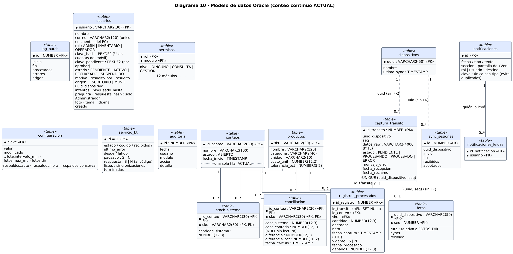
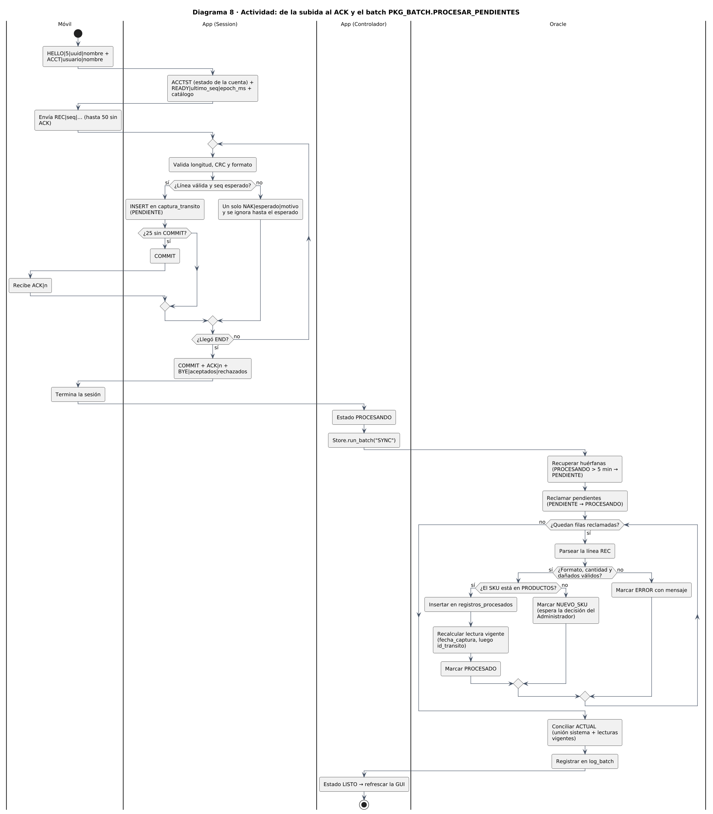
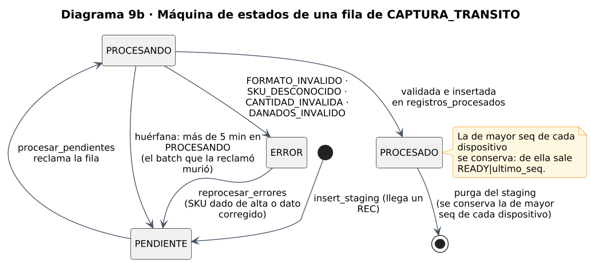

# Base de datos Oracle

Base de datos de **Kardex**: Oracle **XE 11g** (imagen `gvenzl/oracle-xe:11-slim`, solo x86_64). El contenedor ejecuta en orden alfabético los scripts de
[`init/`](init/) **solo al crear la base** (volumen `oracle-data` vacío), como `SYS`, y todo queda en el esquema `APP`.
Es la integración central del sistema: el servicio Bluetooth escribe aquí, el batch PL/SQL concilia y el escritorio consulta.

## Modelo de datos



Fuente: [`10_modelo_datos.puml`](../docs/documentacion/diagramas/plantuml/10_modelo_datos.puml) (vectorial:
[SVG](../docs/documentacion/diagramas/renderizados/10_modelo_datos.svg)).

El conteo es **continuo y único** (`CONTEOS.id_conteo = 'ACTUAL'`, la única fila posible por `ck_conteos_estado`).

| Grupo | Tablas | Rol |
|---|---|---|
| Catálogo y stock | `CONTEOS`, `PRODUCTOS`, `STOCK_SISTEMA` | Qué se cuenta y cuánto dice el sistema (el operador nunca ve `cantidad_sistema`) |
| Captura | `DISPOSITIVOS`, `CAPTURA_TRANSITO`, `SYNC_SESIONES`, `FOTOS` | Lo recibido por Bluetooth, sin interpretar (`datos_raw`), con `UNIQUE (uuid_dispositivo, seq)` |
| Resultado | `REGISTROS_PROCESADOS`, `CONCILIACION`, `LOG_BATCH` | Lecturas válidas (con `vigente`), diferencia contra el sistema y bitácora del batch |
| Cuentas y control | `USUARIOS`, `PERMISOS`, `AUDITORIA`, `CONFIGURACION`, `SERVICIO_BT`, `NOTIFICACIONES`, `NOTIFICACIONES_LEIDAS` | Roles, matriz de 12 módulos, bitácora, parámetros, estado del servicio y avisos |

Las 14 primeras tablas salen de `01_schema.sql`; `AUDITORIA`, `NOTIFICACIONES` y `NOTIFICACIONES_LEIDAS` las crea la aplicación
(`migrar()` en `desktop/app` y `btsync.notificaciones`) y, por seguridad, también `CONFIGURACION`, `PERMISOS` y `SERVICIO_BT`
se vuelven a verificar al arrancar con `ddl_tolerante`.

## Scripts de `init/`

| Script | Contenido |
|---|---|
| [`01_schema.sql`](init/01_schema.sql) | Permisos del usuario `app`, tablas, secuencias y triggers `BEFORE INSERT` (11g no tiene `IDENTITY`) |
| [`02_seed.sql`](init/02_seed.sql) | Semilla del conteo `ACTUAL` con 120 SKU en 8 categorías; generado por `tools/gen_seed.py --seed 42` |
| [`03_pkg_batch.sql`](init/03_pkg_batch.sql) | Paquete `PKG_BATCH` (ver abajo) |
| [`04_jobs.sql`](init/04_jobs.sql) | Jobs de `DBMS_SCHEDULER`: `JOB_PROCESAR_CAPTURAS` (cada minuto, `procesar_pendientes('JOB')`) y `JOB_PURGA_TRANSITO` (diario) |
| [`05_views.sql`](init/05_views.sql) | Vistas `V_RESUMEN_CONTEO`, `V_DIF_CATEGORIA`, `V_TOP_DESVIOS`, `V_ACTIVIDAD`, `V_ESTADO_BATCH`, `V_NUEVOS_SKU`, `V_ERRORES_CAPTURA`: los agregados se calculan en Oracle |
| [`06_permisos.sql`](init/06_permisos.sql) | Matriz inicial rol × módulo (3 roles × 12 módulos) |
| [`07_config.sql`](init/07_config.sql) | Configuración inicial y estado del servicio Bluetooth |
| [`08_demo.sql`](init/08_demo.sql) | 13 meses de datos de demostración; generado por `tools/gen_demo.py --seed 42`. **Bórrelo antes de crear la base** si la quiere vacía |

[`migraciones/001_nuevo_sku.sql`](migraciones/001_nuevo_sku.sql) actualiza una base ya creada con la versión anterior (estados
`NUEVO_SKU`/`DESCARTADO`, nuevos procedimientos y la vista `V_NUEVOS_SKU`). Una base nueva ya lo trae. Además, el servicio
recompila `PKG_BATCH` si está desactualizado (`btsync.esquema.migrar`).

## `PKG_BATCH`

| Procedimiento | Qué hace |
|---|---|
| `procesar_pendientes(p_origen, p_timeout_min)` | Procesa las filas `PENDIENTE` de `CAPTURA_TRANSITO` (recupera las que llevan más de 5 min en `PROCESANDO`); `COMMIT` y registro en `LOG_BATCH` |
| `conciliar(p_id_conteo)` | Recalcula `CONCILIACION` (idempotente) |
| `reprocesar_errores(p_id_conteo)` | Devuelve a `PENDIENTE` las filas en `ERROR` y las reprocesa |
| `purgar_transito(p_dias)` | Limpia del staging lo `PROCESADO`/`DESCARTADO` con más de 7 días (conserva la última por dispositivo y las que tienen foto) |
| `alta_sku`, `alta_y_procesar(...)` | Alta de un SKU llegado en una lectura (producto + stock 0) y proceso de la lectura |
| `descartar_nuevo_sku(p_sku)` | Descarta las lecturas de un SKU que el Administrador decide no crear |

Quien lo ejecuta: `Store.run_batch(origen)` al terminar cada sincronización, el job cada minuto (intervalo en `CONFIGURACION`,
clave `lote.intervalo_min`) y la pantalla Sincronización del escritorio (`procesar_ahora`, `reprocesar_errores`, `nuevo_sku_alta`).



Fuente: [`08_actividades.puml`](../docs/documentacion/diagramas/plantuml/08_actividades.puml).

### Estados de una fila de `CAPTURA_TRANSITO`

`PENDIENTE → PROCESANDO → PROCESADO | ERROR`, y `NUEVO_SKU → PROCESADO | DESCARTADO` cuando el SKU no existe y el Administrador decide.



Fuente: [`09b_estados_fila_transito.puml`](../docs/documentacion/diagramas/plantuml/09b_estados_fila_transito.puml).

## Conexión y configuración

| Variable (`.env`) | Uso |
|---|---|
| `ORACLE_PASSWORD` | Contraseña de `SYS`/`SYSTEM` al crear la base |
| `APP_USER`, `APP_USER_PASSWORD` | Usuario dueño del esquema (`app`) que crea la imagen |
| `DB_USER`, `DB_PASSWORD` | Credenciales con las que se conectan los contenedores Python (el mismo usuario de la aplicación) |
| `DB_DSN` | `oracle:1521/XE` dentro de la red de Compose; `127.0.0.1:1521/XE` con `network_mode: host`. Puerto publicado solo en `127.0.0.1:1521` |

`.env.example` trae valores de desarrollo; **cámbielos** fuera de una máquina local. `.env` no se versiona.

```bash
cp .env.example .env
docker compose up -d --wait oracle     # crea la base y ejecuta init/ (varios minutos la primera vez)
docker compose logs oracle             # ver el progreso o los errores de los scripts
```

Base limpia (**borra todos los datos**): `docker compose down && docker volume rm inventario-bt_oracle-data`.
Regenerar semilla y demo: `python tools/gen_seed.py --seed 42 && python tools/gen_demo.py --seed 42`.

Cliente: `python-oracledb` en modo *thick* con **Instant Client 19.23** (imagen `pybase`); si aparece `DPI-1050` u `ORA-28040` vea
[Solución de problemas](../README.md#solución-de-problemas). La app abre **una conexión por hilo** (XE responde `ORA-12516` si se
abren muchas seguidas).

## Pruebas relacionadas

`server/tests/test_schema.py`, `test_batch.py`, `test_conciliacion.py`, `test_oracle_connect.py` y `test_store.py`
([`../server/README.md#pruebas`](../server/README.md#pruebas)). Las pruebas usan tablas `_tst` y no tocan los datos reales.
