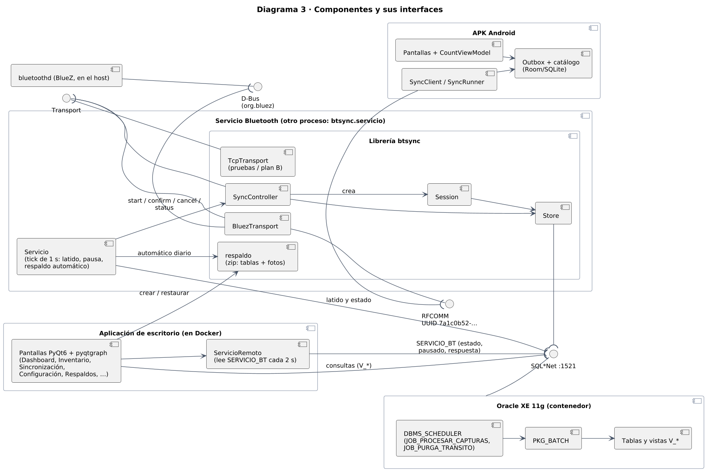
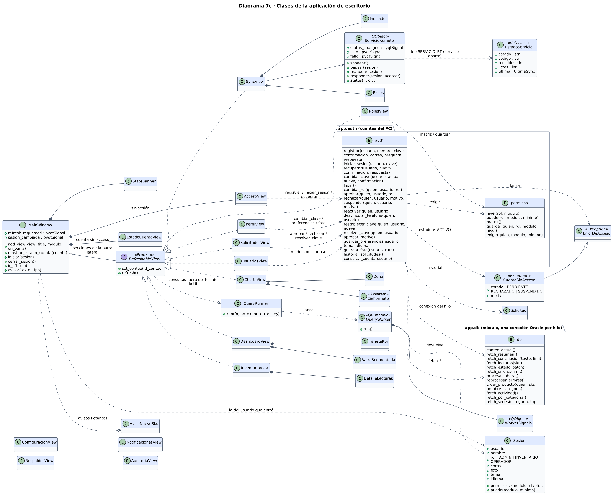

# Aplicación de escritorio (PyQt6)

Interfaz del **Administrador** y del rol **Inventario**: dashboard, inventario conciliado, gráficas, sincronización
Bluetooth, solicitudes de cuentas, empleados, roles y permisos, auditoría, configuración, respaldos, notificaciones y perfil.
El Operador de Inventario **no** entra aquí: cuenta con la APK ([`../mobile/README.md`](../mobile/README.md)).

Consulta Oracle directamente (sin servidor intermedio) y lee el estado del servicio Bluetooth desde la tabla
`SERVICIO_BT`; no abre el radio ni corre la sincronización: eso lo hace el servicio
([`../server/btsync/README.md`](../server/btsync/README.md)).

## Arquitectura



Fuente: [`03_componentes.puml`](../docs/documentacion/diagramas/plantuml/03_componentes.puml).

Patrón: una ventana (`MainWindow`) con barra lateral y una página por módulo permitido al rol; cada vista implementa
`refresh()` y **nunca consulta en el hilo de la interfaz**: usa `QueryRunner`, que ejecuta funciones de `app/db.py` en un
`QThreadPool` y entrega el resultado como señal. Cada hilo del pool guarda su propia conexión a Oracle (pocos hilos fijos,
porque Oracle XE 11g responde `ORA-12516` si se abren y cierran conexiones sin parar).



Fuente: [`07c_clases_escritorio.puml`](../docs/documentacion/diagramas/plantuml/07c_clases_escritorio.puml) (vectorial:
[SVG](../docs/documentacion/diagramas/renderizados/07c_clases_escritorio.svg)).

## Estructura

```text
desktop/
├── Dockerfile            imagen `app` (sobre pybase: PyQt6, pyqtgraph, pytest-qt y librerías xcb)
├── pyproject.toml        solo configura pytest (la app no se instala: corre con PYTHONPATH)
├── app/                  código de la aplicación → app/README.md
│   └── views/            pantallas y componentes visuales → app/views/README.md
├── scripts/              crear_usuarios_prueba.py: una cuenta de PC por rol (idempotente)
└── tests/                pruebas con pytest-qt (36 archivos `test_*.py`, ~400 pruebas)
```

## Dependencias

PyQt6 ≥ 6.6 (< 7), pyqtgraph ≥ 0.13 y pytest-qt ≥ 4.4 (los instala `desktop/Dockerfile`); `oracledb` y `btsync` vienen de
la imagen base `pybase` (`PYTHONPATH=/work/server:/work/desktop`).

## Configuración

| Variable | Efecto |
|---|---|
| `DB_DSN`, `DB_USER`, `DB_PASSWORD` | Conexión a Oracle (obligatorias; las fija `docker-compose.yml` desde `.env`) |
| `ORA_SDTZ` | Zona horaria de la sesión de Oracle (`+00:00` en compose) |
| `FOTOS_DIR`, `RESPALDOS_DIR` | Carpetas de fotos y respaldos |
| `DISPLAY`, `XAUTHORITY` | Pantalla X11 (Compose monta el socket y la cookie) |
| `XDG_CONFIG_HOME` | Dónde guarda `QSettings` las preferencias locales (usuario recordado, tema, idioma, disposición del dashboard y de las gráficas); `/work/config` en compose |
| `APP_SIN_ANIMACIONES=1`, `APP_MOVIMIENTO_REDUCIDO` | Apagan o reducen el movimiento (las pruebas lo apagan) |

La aplicación **no** lee las variables `BT_*`: el transporte Bluetooth lo elige el servicio (`bluetooth`), no la ventana.

## Ejecución

```bash
docker compose up -d --wait oracle
docker compose up -d app                 # ventana por X11; el arranque queda en logs/app.log
tools/run_escritorio_wayland.sh          # sesión Wayland sin XWayland
docker compose exec app python /work/desktop/scripts/crear_usuarios_prueba.py   # cuentas de prueba por rol
```

La primera cuenta que se crea en **Acceso** es el Administrador (Activa); las demás quedan pendientes en **Solicitudes**.
Detalles de arranque y solución de problemas: [README raíz](../README.md#solución-de-problemas).

## Pruebas

```bash
docker compose run --rm -e QT_QPA_PLATFORM=offscreen app pytest desktop/tests -v
```

Las pruebas necesitan Oracle arriba y usan tablas `_tst`. `APP_SIN_ANIMACIONES=1` es el valor por defecto de las pruebas;
con `APP_SIN_ANIMACIONES=0` se prueba el movimiento real. Un fallo conocido y anterior a esta documentación:
`tests/test_app.py::test_charts_follow_the_system_scheme_when_it_changes`.

## Documentación relacionada

- [`app/README.md`](app/README.md): módulos de datos y negocio. [`app/views/README.md`](app/views/README.md): pantallas.
- Interactividad (atajos, estados, flujos, checklist): [`../docs/interactividad/`](../docs/interactividad/00-entorno-y-decisiones.md).
- Capturas por rol: [`../docs/documentacion/capturas/roles/`](../docs/documentacion/capturas/roles/).
