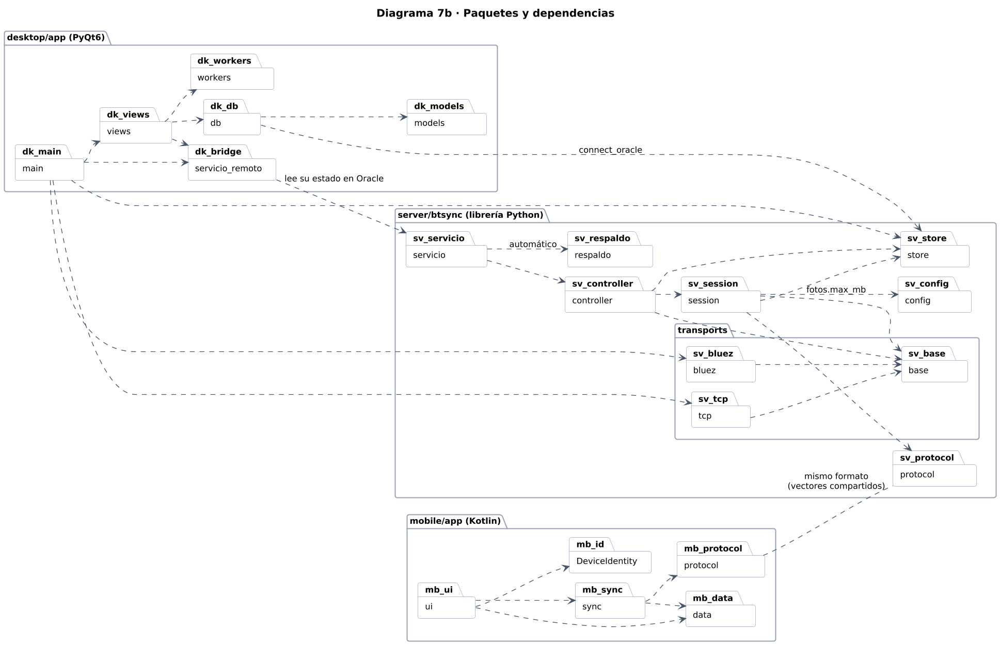
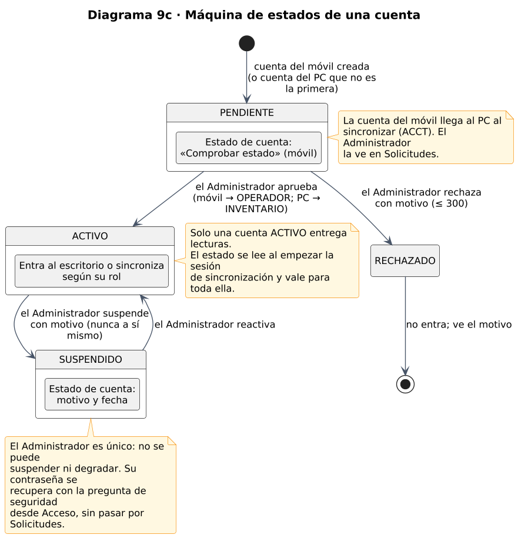

# `app`: datos, negocio y arranque

Paquete de la aplicación de escritorio. Aquí viven el arranque, la ventana principal y los módulos **sin interfaz** (acceso a
Oracle, cuentas, permisos, preferencias). Las pantallas están en [`views/`](views/README.md). Visión de la aplicación:
[`../README.md`](../README.md).

## Módulos

| Módulo | Responsabilidad | Piezas principales |
|---|---|---|
| [`main.py`](main.py) | Arranque (`python -m app.main`), ventana y navegación | `MainWindow` (señales `refresh_requested`, `cerrando`, `sesion_cambiada`), `build_window()`, `main()` |
| [`db.py`](db.py) | Consultas contra Oracle: resumen del conteo `ACTUAL`, inventario conciliado, lecturas, batch, SKU nuevos, series para gráficas. **Una conexión por hilo** | `fetch_resumen`, `fetch_conciliacion`, `fetch_lecturas`, `fetch_estado_batch`, `fetch_nuevos_sku`, `fetch_errores`, `procesar_ahora`, `reprocesar_errores`, `nuevo_sku_alta`, `descartar_nuevo_sku`, `fetch_actividad`, `fetch_por_categoria`, `fetch_series` |
| [`models.py`](models.py) | Filas que devuelve `db` (sin lógica; la conciliación la calcula Oracle) | `ResumenConteo`, `FilaInventario`, `Lectura`, `EstadoBatch`, `NuevoSkuFila`, `ErrorFila` |
| [`workers.py`](workers.py) | Trabajo fuera del hilo de la interfaz | `QueryWorker` (`QRunnable`), `WorkerSignals` (`finished`, `failed`) |
| [`auth.py`](auth.py) | Cuentas del PC: registro, inicio de sesión, aprobación, roles, contraseñas (PBKDF2), foto y preferencias | `Sesion`, `Usuario`, `Solicitud`, `registrar`, `iniciar_sesion`, `aprobar`, `rechazar`, `suspender`, `reactivar`, `cambiar_rol`, `recuperar`, `cambiar_clave`, `resolver_clave`, `ErrorDeAcceso`, `CuentaSinAcceso` |
| [`permisos.py`](permisos.py) | Matriz rol × módulo en Oracle (`NINGUNO`/`CONSULTA`/`GESTION`) | `MODULOS` (12), `puede`, `nivel`, `exigir`, `guardar`, `matriz`, `INTOCABLES` |
| [`auditoria.py`](auditoria.py) | Quién hizo qué y cuándo; se registra **en la misma transacción** que el cambio | `registrar`, consulta de solo lectura |
| [`configuracion.py`](configuracion.py) | Intervalo del lote y tamaño máximo de foto (usa `btsync.config`) | lectura/escritura con permisos y auditoría |
| [`respaldos.py`](respaldos.py) | Crear, listar, restaurar y programar respaldos con permisos, auditoría y pausa del servicio (el zip lo hace `btsync.respaldo`) | |
| [`servicio.py`](servicio.py) | El servicio Bluetooth visto desde el escritorio: leer `SERVICIO_BT`, pausar, reanudar, responder al código | `estado`, `pausar`, `reanudar`, `responder_codigo`, `EstadoServicio` |
| [`servicio_remoto.py`](servicio_remoto.py) | Puente a Qt: sondea el estado cada 2 s fuera del hilo de la interfaz | `ServicioRemoto` (señales `status_changed`, `listo`, `fallo`) |
| [`notificaciones.py`](notificaciones.py) | Notificaciones de la persona: las de su rol y las dirigidas a ella, leídas/no leídas | |
| [`sync_datos.py`](sync_datos.py) | Consultas de solo lectura de la pantalla Sincronización | `Actividad`, `ContadoresDia`, `fetch_actividad`, `fetch_contadores_dia` |
| [`dashboard_datos.py`](dashboard_datos.py), [`dashboard_prefs.py`](dashboard_prefs.py), [`graficas_prefs.py`](graficas_prefs.py) | Qué muestra el dashboard y las gráficas, en qué orden y tamaño (por usuario, en `QSettings`) | `Def`, `Item`, `predeterminado`, `construir`, `cargar`/`guardar` |
| [`tema.py`](tema.py), [`i18n.py`](i18n.py), [`fortaleza.py`](fortaleza.py) | Tema claro/oscuro/sistema, textos en español/inglés (`t()`), medidor de fuerza de contraseña | `resolver`, `aplicar`, `t`, `set_idioma`, `evaluar` |

## Cómo se relacionan



Fuente: [`07b_paquetes.puml`](../../docs/documentacion/diagramas/plantuml/07b_paquetes.puml).

```text
views/*  ──(QueryRunner)──▶ db.py / auth.py / permisos.py / ...  ──▶ Oracle (SQL*Net)
   ▲                              │
   └── señales Qt ◀── ServicioRemoto ──▶ servicio.py ──▶ tabla SERVICIO_BT ◀── servicio Bluetooth (otro proceso)
```

Reglas que atraviesan los módulos:

- **Ninguna función de `db`, `auth` o `permisos` se llama desde el hilo de la interfaz**; las vistas pasan por `QueryRunner`
  (con `key`, solo cuenta la última llamada de cada clave).
- **La matriz se valida dos veces**: las vistas ocultan lo que el rol no puede ver (`permisos.puede`) y cada función que cambia
  datos vuelve a comprobarlo (`permisos.exigir`). El Administrador conserva `GESTION` en los 12 módulos.
- **Auditoría transaccional**: las funciones que cambian datos llaman a `auditoria.registrar` con el mismo cursor, de modo que el
  cambio y su rastro se confirman o se deshacen juntos.
- **Los textos visibles pasan por `i18n.t()`**: el español es la clave; el inglés es la traducción.

## Ejemplo: consultar sin bloquear la interfaz

```python
from app import db
from app.workers import QueryWorker
from PyQt6.QtCore import QThreadPool

worker = QueryWorker(db.fetch_resumen)
worker.signals.finished.connect(mostrar)     # se entrega en el hilo de la interfaz
worker.signals.failed.connect(avisar_error)  # mensaje, p. ej. «ORA-12541: …»
QThreadPool.globalInstance().start(worker)   # conservar una referencia al worker hasta que termine
```

En las vistas se usa `QueryRunner` ([`views/base.py`](views/base.py)), que además descarta resultados atrasados.

## Roles

`ADMIN` (uno solo), `INVENTARIO` y `OPERADOR` (solo móvil). Estados de cuenta: `PENDIENTE`, `ACTIVO`, `RECHAZADO`, `SUSPENDIDO`.



Fuente: [`09c_estados_cuenta.puml`](../../docs/documentacion/diagramas/plantuml/09c_estados_cuenta.puml).

## Pruebas relacionadas

`test_db.py`, `test_auth.py`, `test_permisos.py`, `test_auditoria.py`, `test_configuracion.py`, `test_respaldos.py`,
`test_servicio.py`, `test_workers.py`, `test_notificaciones.py`, `test_idioma.py`, `test_fortaleza.py`, `test_tema_sistema.py`,
`test_dashboard_personal.py`. Cómo ejecutarlas: [`../README.md#pruebas`](../README.md#pruebas).
