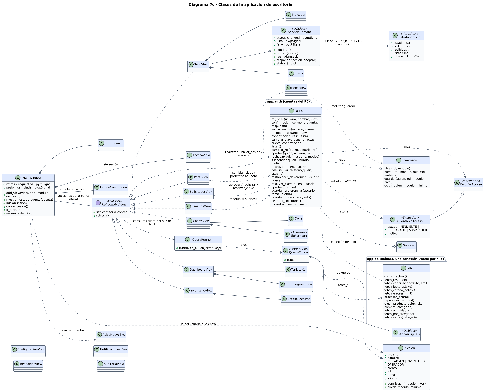

# `app.views`: pantallas y componentes visuales

Todo lo que se dibuja en la aplicación de escritorio. Las pantallas (una por módulo de la matriz de permisos) se registran en
`app/main.py::build_window()`; el resto son piezas compartidas: componentes, movimiento, avisos y gráficas. Capa de datos y
negocio: [`../README.md`](../README.md).

## Contrato de una pantalla

`MainWindow.add_view(vista, titulo, modulo, roles=None, en_barra=True, icono_id=...)` agrega la vista a la barra lateral solo
si el rol tiene acceso al `modulo` (clave de `permisos.MODULOS`). Cada vista implementa `refresh()` (protocolo
`RefreshableView`, [`base.py`](base.py)): vuelve a consultar y repinta **sin bloquear la interfaz**, usando `QueryRunner`.

```python
# views/auditoria.py: el patrón común de las pantallas
def refresh(self) -> None:
    if self._sesion is None or not self._sesion.puede("auditoria"):
        return
    self._runner.run(auditoria.listar, self._mostrar, self.banner.show_error, self._sesion, key="auditoria")
```

Las señales de las vistas las conecta `build_window()` con la ventana (por ejemplo `perfil.cerrar_sesion`, `perfil.tema_cambiado`,
`sync.datos_cambiados`, `respaldos.restaurado`, `avisos.ir_a`, `dashboard.filtro`).

## Pantallas por módulo

| Módulo (clave) | Vista | Archivo | Quién entra (matriz inicial) |
|---|---|---|---|
| `dashboard` | `DashboardView` | [`dashboard.py`](dashboard.py) (+ `dashboard_paneles.py`, `rejilla_personal.py`, `grafico_personal.py`) | Admin, Inventario |
| `inventario` | `InventarioView` y `lecturas.py` (ventana de lecturas de un producto) | [`inventario.py`](inventario.py) | Admin, Inventario |
| `graficas` | `ChartsView` (en la barra solo para Inventario) | [`charts.py`](charts.py) | Admin, Inventario |
| `sync` | `SyncView` | [`sync.py`](sync.py) (+ `sync_ui.py`, `bluetooth_vivo.py`) | Admin, Inventario |
| `notificaciones` | `NotificacionesView`, `PopoverNotificaciones`, `HojaNotificaciones` | [`notificaciones.py`](notificaciones.py), [`bandeja.py`](bandeja.py) | Admin, Inventario (sin pestaña: se abre con la campana) |
| `perfil` | `PerfilView` | [`perfil.py`](perfil.py) (+ `foto.py`) | Todos (se abre desde el pie de la barra) |
| `solicitudes` | `SolicitudesView` | [`solicitudes.py`](solicitudes.py) | Admin |
| `usuarios` (Empleados) | `UsuariosView` | [`usuarios.py`](usuarios.py) | Admin |
| `permisos` (Roles y permisos) | `RolesView` | [`roles.py`](roles.py) | Admin |
| `auditoria` | `AuditoriaView` | [`auditoria.py`](auditoria.py) | Admin |
| `configuracion` | `ConfiguracionView` | [`configuracion.py`](configuracion.py) | Admin |
| `respaldos` | `RespaldosView`, `DialogoRestaurar` | [`respaldos.py`](respaldos.py) | Admin |
| — (sin sesión) | `acceso.py`: tarjeta de acceso, registro y recuperación | [`acceso.py`](acceso.py) | Cualquiera |
| — (cuenta sin acceso) | `EstadoCuentaView`: `PENDIENTE` / `RECHAZADO` / `SUSPENDIDO` | [`estado_cuenta.py`](estado_cuenta.py) | Cuentas que no pueden entrar |

La matriz real vive en Oracle y la edita el Administrador en **Roles y permisos**; la columna es solo la inicial.

## Piezas compartidas

| Grupo | Archivos | Qué aportan |
|---|---|---|
| Base | [`base.py`](base.py) | `QueryRunner` (consultas fuera del hilo de la UI, descarta resultados atrasados, máx. 8 hilos), `RefreshableView`, `StateBanner`, estilo oscuro (`ESTILO`) |
| Componentes | [`components.py`](components.py), [`widgets.py`](widgets.py), [`selector_fecha.py`](selector_fecha.py), [`iconos.py`](iconos.py), [`diseno.py`](diseno.py), [`paleta.py`](paleta.py) | Tarjetas, drawer, confirmación, chips, KPI con cifras que cuentan, selector de fecha, iconos Lucide, tokens de diseño, paleta de comandos (`Ctrl+K`) y atajos (`?`) |
| Avisos y capas | [`isla.py`](isla.py), [`capas.py`](capas.py), [`aviso_nuevo_sku.py`](aviso_nuevo_sku.py), [`menu_flotante.py`](menu_flotante.py), [`vigilante.py`](vigilante.py) | La «Isla» (único canal de avisos), overlays flotantes, aviso «Nuevo SKU» con **Crear y procesar** / **No crear**, menús flotantes |
| Gráficas | [`graficas_interactivas.py`](graficas_interactivas.py), [`graficas_motion.py`](graficas_motion.py), [`grafico_personal.py`](grafico_personal.py) | Hover y drill-down de pyqtgraph, movimiento de datos, gráfico del dashboard (nueve tipos) |
| Movimiento | [`motion.py`](motion.py), [`motion_global.py`](motion_global.py) | Duraciones y curvas, scroll suave, transición de vistas y tema, `FilasVivas`, `entrada_cascada`. Documentado en [`../../../docs/interactividad/`](../../../docs/interactividad/08-motion-administrativo.md) |
| Fotos | [`foto.py`](foto.py), [`visor_foto.py`](visor_foto.py) | Editor de avatar (rotar, zoom, recortar) y visor de fotos de evidencia |

## Flujo de datos de una pantalla



Fuente: [`07c_clases_escritorio.puml`](../../../docs/documentacion/diagramas/plantuml/07c_clases_escritorio.puml).

1. `MainWindow` crea la vista y la agrega según el rol; un temporizador (`auto_refresh_ms`, 5000 ms) pide `refresh()` a la vista visible.
2. La vista lanza la consulta con `QueryRunner.run(fn, on_done, on_error, key=...)`; la función corre en el pool.
3. El resultado vuelve como señal al hilo de la interfaz y la vista se repinta; los fallos de Oracle se muestran en el
   chip de estado y la `StateBanner`, no como excepciones.
4. Al cambiar el tema o el idioma, `MainWindow` reconstruye las vistas (`_reconstruir_vistas`).

## Pruebas relacionadas

`desktop/tests/test_*_views.py` (por pantalla), `test_interactividad.py`, `test_dashboard_motion.py`, `test_motion_admin.py`,
`test_sync_motion.py`, `test_visor_foto.py`, `test_selector_fecha.py`, `test_capas.py`, `test_charts_views.py`. Ejecución:
[`../../README.md#pruebas`](../../README.md#pruebas). Atajos, gestos y checklist por vista:
[`docs/interactividad`](../../../docs/interactividad/05-checklist-por-vista.md).
