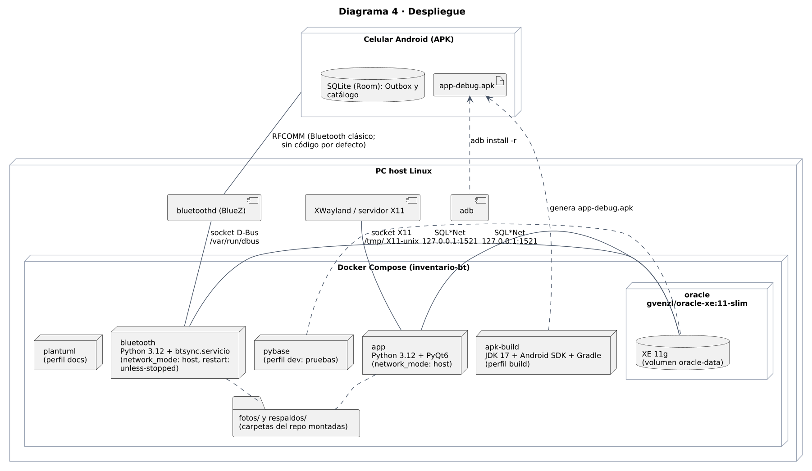

# `docker/` y `docker-compose.yml`: entorno de ejecución

Todo el lado PC corre en contenedores Docker sobre Linux; el único software del host es Docker, BlueZ (`bluetoothd`) y `adb`.

## Despliegue



Fuente: [`04_despliegue.puml`](../docs/documentacion/diagramas/plantuml/04_despliegue.puml).

## Servicios de `docker-compose.yml`

| Servicio | Perfil | Imagen / construcción | Función |
|---|---|---|---|
| `oracle` | (siempre) | `gvenzl/oracle-xe:11-slim`; monta `db/init` y el volumen `oracle-data`; publica `127.0.0.1:1521` | Base de datos; `healthcheck.sh` cada 10 s |
| `bluetooth` | (siempre) | `docker/pybase/Dockerfile` con extra `bluez`; `network_mode: host`, `NET_ADMIN`, `restart: unless-stopped` | Servicio de recepción: `python -m btsync.servicio` |
| `app` | (siempre) | `desktop/Dockerfile` (sobre `pybase`); host network, X11 y D-Bus montados, `restart: on-failure:5` | Aplicación de escritorio vía `docker/run-app.sh` |
| `pybase` | `dev` | `docker/pybase/Dockerfile` con extras `dev,bluez` | Pruebas del servidor (`pytest server/tests`) y herramientas |
| `apk-build` | `build` | `mobile/Dockerfile` (JDK 17, Android SDK 34, Gradle 8.7) | Compila y prueba la APK |
| `plantuml` | `docs` | `plantuml/plantuml:1.2024.7` | Renderiza diagramas (`tools/render_uml.sh`) |
| `bt-spike` | `spike` | `docker/pybase/Dockerfile` (`dev,bluez`), terminal interactiva | Experimento desechable de Bluetooth desde contenedor ([`docs/spikes/bluez.md`](../docs/spikes/bluez.md)) |

## Contenido de `docker/`

| Archivo | Descripción |
|---|---|
| [`pybase/Dockerfile`](pybase/Dockerfile) | Imagen base Python 3.12 (slim-bookworm) con `libaio1` y **Oracle Instant Client 19.23** (basiclite); instala `server/` con los extras indicados en el argumento `EXTRAS`. Si ocurre `DPI-1050`/`ORA-28040`, cambie `IC_DIR`, `IC_FILE` e `IC_FOLDER` (hay un plan B comentado) y reconstruya con `docker compose build pybase` |
| [`run-app.sh`](run-app.sh) | Arranca la aplicación dejando rastro en `logs/app.log` (cabecera con `DISPLAY`/`XAUTHORITY`, salida de Python y `rc` final; limita el log a 5 MiB) y propaga el código de salida para que `restart: on-failure:5` solo reintente los fallos |

## Variables de `.env`

Copie la plantilla y ajústela (el archivo `.env` no se versiona; los valores de `.env.example` son solo de desarrollo local):

```bash
cp .env.example .env
```

| Variable | Uso |
|---|---|
| `ORACLE_PASSWORD`, `APP_USER`, `APP_USER_PASSWORD` | Creación de la base y del usuario dueño del esquema |
| `DB_USER`, `DB_PASSWORD` | Credenciales con las que se conectan los contenedores Python |
| `PUID`, `PGID` | UID/GID con los que corren los contenedores Python (evita archivos de root en el proyecto) |
| `BT_TRANSPORT`, `BT_TCP_PORT`, `BT_CON_CLAVE` | Se leen con valor por defecto en compose: transporte (`bluez`/`tcp`), puerto TCP y emparejamiento con código |
| `DISPLAY`, `XAUTHORITY`, `XDG_RUNTIME_DIR` | De la sesión gráfica del host; compose monta el socket X11, la cookie y el bus D-Bus |

## Comandos habituales

```bash
docker compose up -d --wait oracle            # base de datos lista (healthy)
docker compose up -d bluetooth app            # servicio de recepción y ventana de escritorio
docker compose ps                             # estado de los servicios
docker compose logs -f bluetooth              # mensajes del servicio (también: app, oracle)
docker compose --profile docs run --rm plantuml -version   # comprobar PlantUML
docker compose down                           # detiene (los datos de Oracle se conservan en el volumen)
```

Para una base vacía, el volumen es `inventario-bt_oracle-data` (`docker volume rm …` **borra todos los datos**). Problemas
frecuentes: [README raíz](../README.md#solución-de-problemas).
