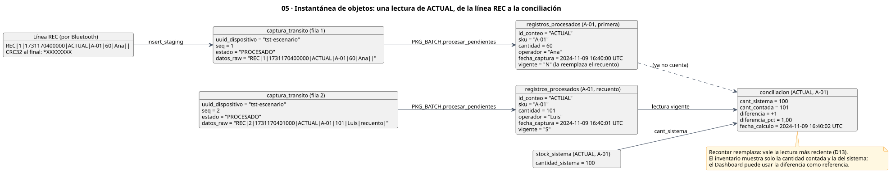
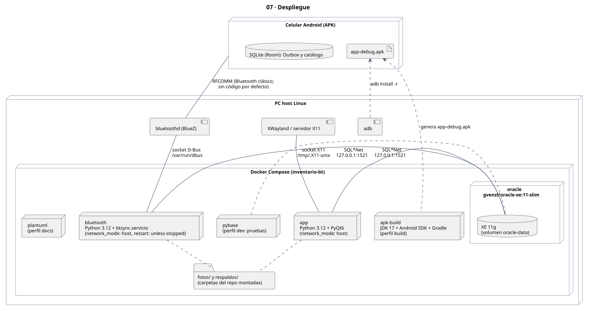
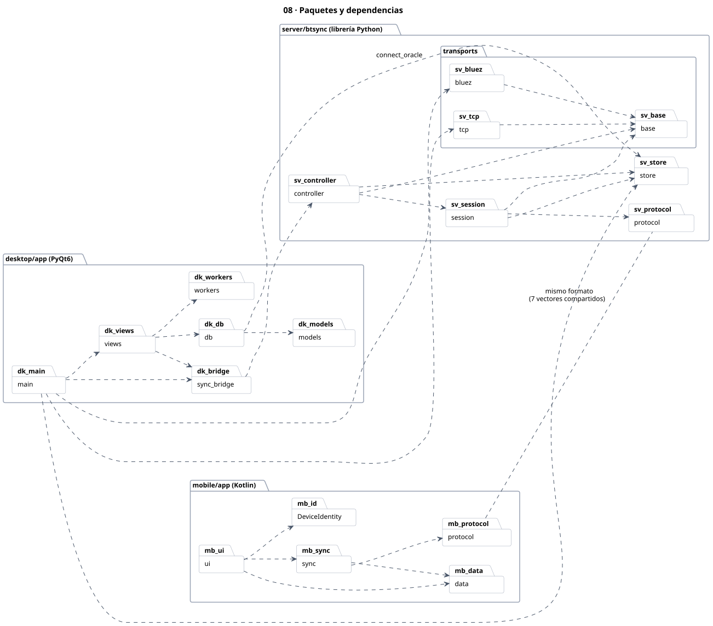
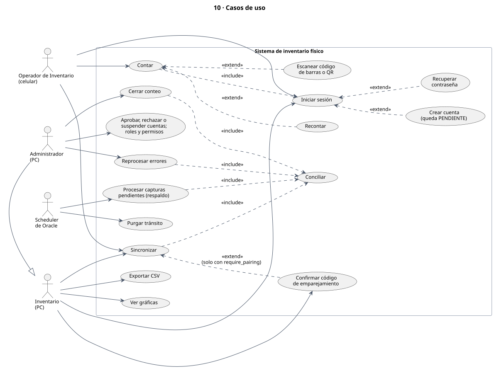
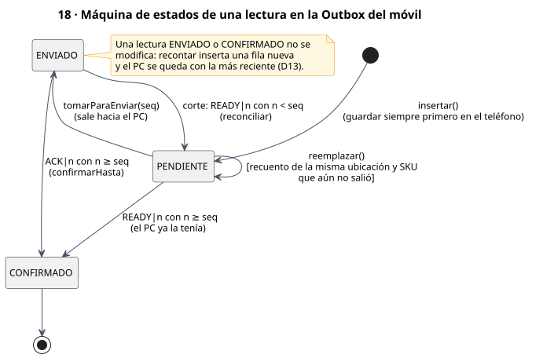
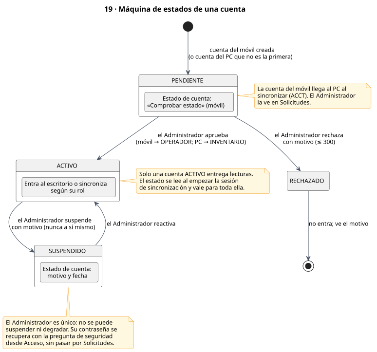
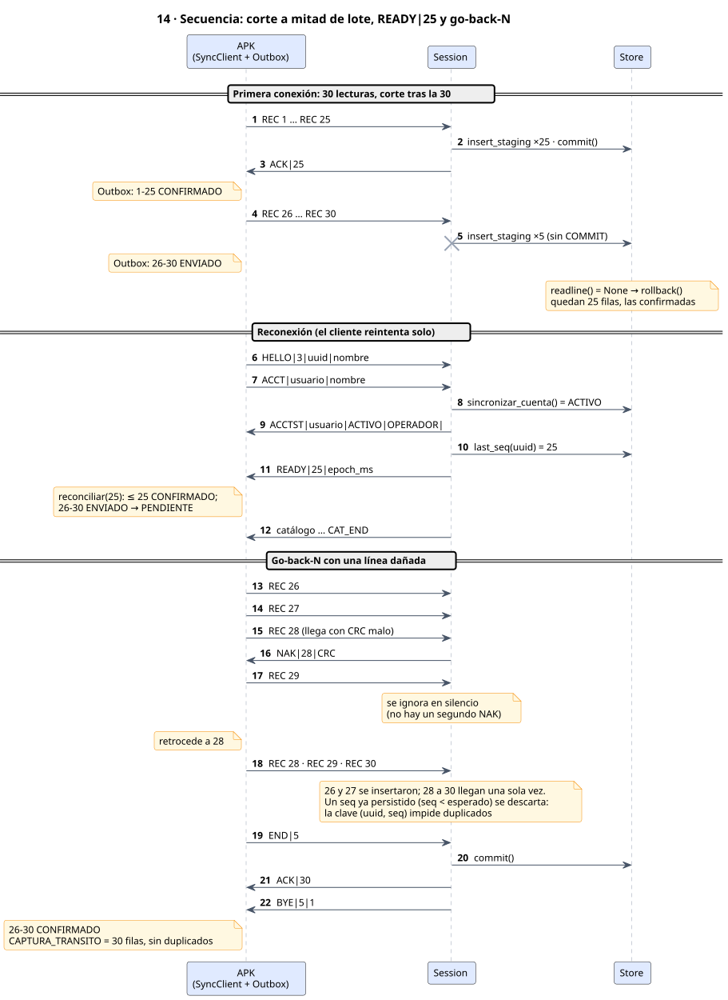
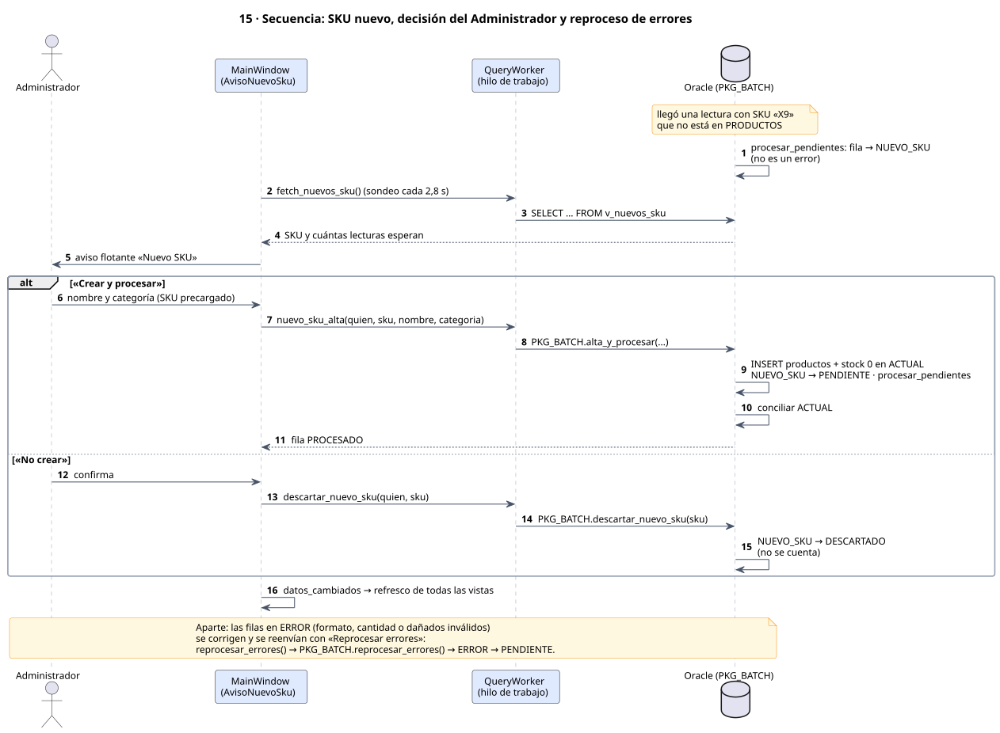
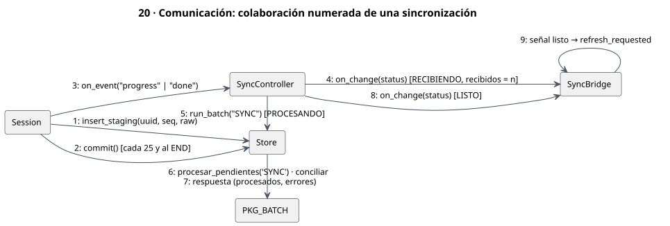
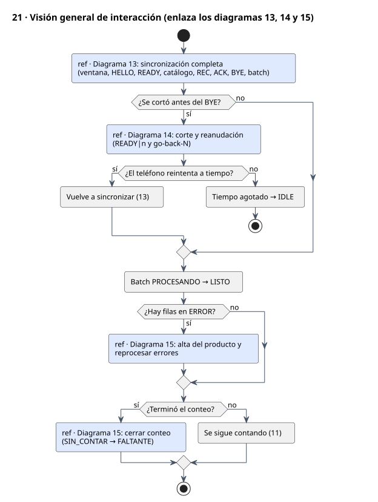

# Arquitectura

**Kardex** es un sistema de **toma de inventario físico sin red**: un operador cuenta productos con una APK Android (escáner de
códigos de barras o digitación), el teléfono guarda todo localmente y, cuando está cerca del PC, lo sube por
**Bluetooth**. El PC recibe el conteo, lo guarda en **Oracle 11g**, dispara el **batch PL/SQL** que lo concilia
contra el stock del sistema y lo muestra y grafica en **una sola aplicación de escritorio**. El conteo es
**continuo**: siempre está abierto y el inventario se recalcula con cada batch. Todo el lado PC corre en Docker
sobre Linux.

Los diagramas son fuente PlantUML en [`uml/`](uml/) (índice en [`uml/README.md`](uml/README.md)) y se incrustan aquí
como SVG. El formato de línea del protocolo está en [`protocolo.md`](protocolo.md) y la prueba de Bluetooth desde
contenedor en [`spikes/bluez.md`](spikes/bluez.md).

## 1. Capas

```
 ┌────────────┐  Bluetooth   ┌──────────────────────────────────────────────┐   SQL*Net   ┌─────────────────────┐
 │ APK Android│ ───RFCOMM──▶ │ Servicio Bluetooth (btsync.servicio, Docker) │ ──────────▶ │ Oracle XE 11g       │
 │  Outbox    │  líneas+CRC  │  Transport → Session → Store                 │             │  CAPTURA_TRANSITO   │
 │  (Room)    │ ◀──ACK/NAK── │  SyncController (dispara el batch, D9)       │             │  PKG_BATCH (batch)  │
 └────────────┘              └──────────────────────────────────────────────┘             │  CONCILIACION, V_*  │
                             ┌──────────────────────────────────────────────┐   SQL*Net   │  SERVICIO_BT,       │
                             │ App de escritorio (PyQt6 + pyqtgraph)        │ ◀─────────▶ │  CONFIGURACION      │
                             │  lee V_*, ve y pausa el servicio (D29)       │             │                     │
                             └──────────────────────────────────────────────┘             └─────────────────────┘
```

| Capa | Dónde | Qué hace |
|---|---|---|
| 1. Captura móvil | `mobile/` | Cuenta sin red. Guarda **siempre primero** en la `Outbox` (Room/SQLite); nada depende de la conexión. |
| 2. Recepción Bluetooth | `server/btsync` (`transports`, `session`) | Acepta una conexión RFCOMM, valida cada línea (CRC, formato, secuencia), hace COMMIT cada 25 y responde `ACK`/`NAK`. |
| 3. Staging y batch | Oracle (`CAPTURA_TRANSITO`, `PKG_BATCH`, `DBMS_SCHEDULER`) | Valida y mueve lo recibido a `REGISTROS_PROCESADOS`, decide la lectura vigente y calcula `CONCILIACION` para `ACTUAL`. |
| 4. Presentación | `desktop/app` | Lee las vistas `V_*`, muestra tarjetas, tablas y gráficas, y ve (y pausa) el servicio Bluetooth. |

Las capas 2 y 4 son **dos procesos**: el servicio `bluetooth` (`python -m btsync.servicio`) mantiene siempre abierta
la recepción y, cuando una sesión termina, el **controlador** (no la sesión) ejecuta el batch. El escritorio lee el
estado del servicio en `SERVICIO_BT` cada 2 s y refresca cuando llega una sincronización. Se comunican solo por
Oracle; no hay otra interfaz de red.

### Cómo viaja un dato

1. El operador guarda `(SKU, cantidad, dañados, nota)` en la `Outbox` con el reloj del teléfono. El catálogo que
   recibió no trae el stock: el conteo es ciego.
2. Al sincronizar, el móvil manda `HELLO` y `ACCT`; el PC responde `ACCTST` con el estado de esa cuenta,
   `READY|<último seq>|<hora del servidor>` y el catálogo pseudo `CATALOGO` (`CATTAREA`, un `CATITEM` por producto,
   `CATPROD` y `CAT_END`). Sin cuenta `ACTIVO` no se acepta ninguna lectura.
3. El móvil envía `REC` con `id_conteo = ACTUAL` en ventanas de 50; el PC inserta en `CAPTURA_TRANSITO` (clave
   `(uuid, seq)`: idempotente), hace COMMIT cada 25 y responde `ACK|n` (acumulativo). Un `NAK|n|motivo` hace retroceder
   al móvil a `n` (go-back-N). `INICIO` se tolera y se ignora.
4. `END` → `ACK` final → `BYE`. La sesión termina; el controlador corre `PKG_BATCH.procesar_pendientes('SYNC')`.
5. El batch valida, inserta en `REGISTROS_PROCESADOS`, marca como no vigente la lectura anterior de ese SKU y
   concilia `ACTUAL`. La app de escritorio consulta las vistas y repinta. Una lectura con error queda en `ERROR` y no
   entra a la conciliación hasta que se corrija y se reprocese.

## 2. Patrones

**Escritorio: MVC con trabajadores.** *Modelo*: dataclasses de `models.py` más Oracle (las consultas salen de las
vistas `V_*`, funciones `fetch_*` de `db.py`). *Vista*: las pantallas de `views/` (Dashboard, Inventario, Gráficas,
Sincronización, Notificaciones, Perfil y, para el Administrador, Solicitudes, Empleados, Roles y permisos, Auditoría,
Configuración y Respaldos), más el acceso. *Controlador*: `ServicioRemoto` (lee el estado del servicio Bluetooth, que
corre en otro proceso, y lo convierte en señales Qt) y `QueryRunner` (corre cada consulta en un `QueryWorker` y
entrega el resultado al hilo de la interfaz). **Ninguna consulta corre en el hilo de la UI**; cada hilo de trabajo usa
su propia conexión Oracle y toda conexión pasa por `connect_oracle`, que las serializa.

**Android: MVVM.** *Vista*: las `Activity` (`ui/*Activity.kt`) dibujan con **Jetpack Compose y Material 3**; cada
pantalla es una función sin estado propio en `ui/pantallas/`, que recibe los datos y avisa de los toques. *ViewModel*:
`CountViewModel` (reglas de guardado, `StateFlow` de operador y SKU) y `SyncViewModel` + `SyncRunner` (reintentos y
estado de la sincronización). *Modelo*: `Outbox` y catálogo (Room), `SyncClient` y `Protocol`. La lógica está en
clases sin dependencia de pantallas, así que se prueba en la JVM.

**Preferencias por usuario.** `tema.py` e `i18n.py` en el escritorio, y `SettingsStore` + `Strings` en la APK,
leen y guardan tema e idioma por cuenta. El cambio se aplica en el acto y no requiere reiniciar la sesión.

**Transporte intercambiable.** `Transport`/`Connection` (`btsync.transports.base`) tienen dos implementaciones:
`BluezTransport` (Bluetooth real por D-Bus) y `TcpTransport` (pruebas y plan B). Una sesión no sabe cuál usa.

**Protocolo idéntico en dos lenguajes.** `protocol.py` y `Protocol.kt` pasan los mismos vectores de
[`protocol-vectors.json`](protocol-vectors.json); si uno falla, el protocolo es inconsistente.

## 3. Decisiones de diseño

| # | Decisión | Por qué |
|---|---|---|
| D1 | Toma de inventario físico ciego y continuo de una bodega o tienda (SKU, categoría, costo). | Caso real de terminal que cuenta offline y sube en lote; el conteo nunca se cierra. |
| D2 | Oracle XE 11g. | 11g no tiene `IDENTITY` ni funciones JSON: se usan secuencia + trigger y un formato de texto con `\|`. |
| D3 | La GUI usa X11: la app corre en contenedor y se dibuja en la pantalla del host por el socket X11 (o Wayland con el lanzador). | Cumple «todo el lado PC en Docker» con aplicación de escritorio. |
| D4 | Móvil: solo Android. | iOS no permite RFCOMM clásico a apps normales. |
| D5 | Emparejamiento nativo BlueZ con código de 6 dígitos, **opcional** (`BT_CON_CLAVE=1`). | El modo por defecto no pide código (D22); el modo con código queda para instalaciones que lo exijan. |
| D6 | Servicio RFCOMM registrado por D-Bus (`ProfileManager1`, UUID fijo). | `sdptool` está obsoleto; BlueZ entrega el socket ya conectado. |
| D7 | Los contenedores `bluetooth` y `app` usan `network_mode: host`, `NET_ADMIN/NET_RAW` y `/var/run/dbus`; `bluetoothd` queda en el host. | Patrón validado en el spike de BlueZ. |
| D8 | Sin cifrado propio de aplicación. | **Sustituida por D22 en el modo por defecto**; con código, el enlace emparejado lo cifra BlueZ. |
| D9 | El batch corre **fuera de la sesión**: `BYE` cuenta lo aceptado en staging; luego el controlador ejecuta `run_batch('SYNC')`. Un job del Scheduler cada intervalo lo respalda. | El móvil no espera al batch y las pruebas de la sesión no dependen de PL/SQL. |
| D10 | `REGISTROS_PROCESADOS.CANTIDAD` es `NUMBER`. | Hace falta para sumar y conciliar. |
| D11 | El PC es **una** aplicación de escritorio; el servicio Bluetooth es otro proceso. | Menos piezas para el usuario; la recepción no depende de la ventana. |
| D12 | Conteo ciego: el catálogo enviado al móvil no incluye el stock del sistema. | El operador no ve el teórico para no sesgar el conteo. |
| D13 | Recontar reemplaza: una lectura vigente por SKU; vale la más reciente y, a igual fecha, el `ID_TRANSITO` mayor. | Permite corregir sin duplicar, incluso entre dos teléfonos. |
| D14 | Código de barras = SKU; escáner ZXing embebido más digitación manual. El escáner lee también el **QR** del producto (SKU solo, `SKU:…`, JSON con `sku` o una dirección con `sku=`). | Sin Google Play Services: funciona sin red. |
| D15 | Reloj del móvil: `offset = hora del servidor − reloj del móvil` al recibir `READY`; se envía `ts_original + offset` y el original **no se modifica**; el offset no se acumula. | Sin red los relojes derivan y D13 depende de ellos. |
| D16 | Los errores no se pierden: quedan en `ERROR`, visibles en Sincronización, y se reprocesan tras dar de alta el SKU. | Aparece un producto sin alta y el Administrador lo registra después. |
| D17 | UML completo en PlantUML (22 diagramas, 13 tipos). | Una prueba evita que las clases se desvíen del código y que el índice pierda diagramas. |
| D18 | Identidad del dispositivo = UUID de instalación, con `allowBackup="false"`. | Android no da una MAC propia. Reinstalar crea un dispositivo nuevo con `seq` desde 1. |
| D19 | Una sincronización a la vez; las demás reciben `NAK\|0\|OCUPADO`. | Evita que un segundo teléfono pise el estado del primero. |
| D20 | Operador obligatorio (máx. 60) y nota (máx. 255); el batch trunca sin marcar error. El operador es el nombre de quien inició sesión. | Es lo que soporta el modelo de datos; el móvil ya limita. |
| D21 | Nombre Bluetooth visible `gestion_inventario` mientras el **servicio** está activo. | El operador busca la aplicación, no el equipo, y la recepción sigue con la ventana cerrada. |
| D22 | **Sin emparejamiento por defecto**: socket RFCOMM inseguro, agente silencioso, el teléfono recuerda al PC y conecta directo. El modo con código sigue disponible. | Quita pasos al operador. Costo de seguridad abajo. |
| D23 | **Cuentas locales del móvil**: solo Operador de Inventario; la contraseña vive en el teléfono (PBKDF2-SHA256 con sal) y se recupera con la pregunta de seguridad. Sin red no hay servidor que la valide. | La app es offline; el PC nunca recibe la clave. El correo es opcional y solo de perfil. |
| D24 | **Sin ubicaciones** (protocolo 2): ni en el `REC`, ni en el catálogo, ni en Oracle. Una lectura vigente por SKU. | Se cuenta una vez por producto; recontar reemplaza. |
| D25 | **Un solo Administrador**: la primera cuenta del PC; no se crea, aprueba ni promueve otro; no se puede suspender ni degradar. Su contraseña se recupera desde Acceso con la pregunta de seguridad. | Si hubiera dos, el único que aprueba solicitudes podría quedar fuera. La pregunta es la llave de recuperación. |
| D26 | **Cuentas en Oracle con estado** (`PENDIENTE`, `ACTIVO`, `RECHAZADO`, `SUSPENDIDO`) y rol (`ADMIN`, `INVENTARIO`, `OPERADOR`). Las del PC exigen correo único; las del móvil lo aceptan opcional. La matriz rol × módulo tiene **12 módulos** (`dashboard`, `inventario`, `graficas`, `sync`, `notificaciones`, `perfil`, `solicitudes`, `usuarios`, `permisos`, `auditoria`, `configuracion`, `respaldos`): el Administrador gestiona todo y su fila es intocable; Inventario gestiona las seis pantallas operativas; Operador tiene consulta en Notificaciones y gestión en Sync. El cambio rige en la barra desde el próximo inicio de sesión y se revalida en vivo al cambiar datos. La cuenta del móvil queda vinculada al UUID del teléfono; «Desvincular teléfono» la libera. El Administrador no resetea la contraseña del Operador. | La especificación pide aprobar toda cuenta nueva y una matriz editable, validada también al cambiar datos. El correo identifica a la persona en Empleados; no es el usuario de acceso. |
| D27 | **Conteo continuo `ACTUAL`**: una fila `Conteo continuo` siempre `ABIERTO`, stock por SKU y conciliación por SKU. El inventario muestra SKU, producto, categoría, contada y sistema; la cantidad contada queda vacía si no hubo lectura. `CONCILIACION` calcula diferencia y porcentaje, pero el inventario no los muestra ni clasifica filas. | Es el alcance aprobado: el inventario es básico y el conteo nunca se detiene; el Dashboard puede usar los indicadores como referencia. |
| D28 | **Fotos de evidencia**: protocolo 5; el archivo vive en `FOTOS_DIR/<uuid>/<seq>.jpg` y Oracle guarda la ruta relativa. La foto se abre desde el detalle de la lectura. **Auditoría** en la misma transacción que cada cambio. | Evidencia sin bloquear el texto (cola aparte, < 50 ms por registro) y rastro de toda modificación. |
| D29 | **Configuración, respaldos y servicio independiente**: `CONFIGURACION` guarda el intervalo del lote, el tamaño máximo de foto y la carpeta (solo lectura); al guardar se reaplican los jobs. El respaldo es un `.zip` con `manifest.json`, una tabla por `.jsonl` y las fotos; restaurar pausa el servicio, guarda un respaldo «previo», restaura en una transacción y cierra la sesión. El servicio Bluetooth (`btsync.servicio`, `restart: unless-stopped`) escribe estado y latido en `SERVICIO_BT`. | La recepción no depende de la ventana y el respaldo se restaura desde la pantalla, sin herramientas externas. |
| D30 | **Notificaciones**: tabla `NOTIFICACIONES` (a un rol o a un usuario; `(tipo, clave)` único cuando hay clave) y `NOTIFICACIONES_LEIDAS` (una fila por persona). La campana aparece solo con acceso al módulo. Eventos: sincronización recibida, solicitud nueva, respaldo automático, servicio caído. Una notificación se lee; una solicitud se aprueba o rechaza en Solicitudes. | Separa «algo pasó» de «algo espera tu decisión», sin perder el aviso de las solicitudes. |
| D31 | **Foto, tema e idioma por usuario**: editor de rotar, zoom, recortar y vista previa; formatos JPEG, PNG y WebP; tamaño máximo configurable (2 MB en el teléfono); avatar circular y archivo cuadrado. Tema claro/sistema/oscuro e idioma español/inglés, aplicados de inmediato y guardados por cuenta. En el móvil, el botón de apariencia de la barra superior abre el mismo selector en todas las pantallas; Acceso, Inicio y Estado de cuenta lo llevan arriba. | La especificación los pide para los tres roles y los dos clientes, sin privilegios de administración. |

## 4. Límites conocidos

- **D15 (reloj):** asume que nadie cambió la hora del móvil entre la captura y la sincronización, y no compensa la
  latencia de la conexión (≈ 1 s).
- **D22 (seguridad):** sin autenticación el enlace no va cifrado; cualquiera al alcance (~10 m) puede conectarse y
  subir lecturas falsas **mientras el servicio esté activo**. Mitigaciones: solo acepta un teléfono a la vez, valida
  cada línea y el Administrador puede pausar el servicio. El modo con código (`BT_CON_CLAVE=1`) existe para quien
  necesite emparejamiento.
- **D23/D25 (cuentas):** la contraseña del Operador vive solo en el teléfono; el Administrador no puede resetearla y
  la recuperación es la pregunta de seguridad (débil: quien conozca la respuesta entra). La contraseña del
  Administrador se recupera con su pregunta desde Acceso; no hay un segundo Administrador que apruebe.
- **D26 (permisos):** un cambio en la matriz rige en la interfaz desde el siguiente inicio de sesión; las funciones que
  cambian datos lo comprueban en vivo. La fila del Administrador no se puede editar.
- **D18:** desinstalar la APK borra la `Outbox` y las cuentas locales: las lecturas no enviadas se pierden.
- **D4:** iPhone no está soportado.
- **Cliente Android sin tiempo límite de lectura:** si el PC acepta la conexión y deja de responder sin cerrarla, el
  teléfono espera hasta que Android detecte la caída del enlace. Cancelar la pantalla cierra el socket.
- **minSdk 23** (Android 6): el plan decía 26, pero un HUAWEI P9 lite no pasa de Android 7.
- **Bluetooth desde contenedor** exige `network_mode: host` y el bus D-Bus del host (`bluetoothd` no corre en Docker).
- **Oracle XE 11g** solo existe para x86_64.
- **Windows:** el servicio Bluetooth no puede acceder al adaptador del PC desde un contenedor; el sistema se soporta
  en Linux. La app de escritorio y Oracle también corren en Linux.

## 5. Diagramas UML

### 5.1 Estructura

**01 · Clases del servidor.** La librería `btsync`: el controlador crea una sesión por conexión y ambos usan el
transporte y el repositorio Oracle.


**02 · Clases de la app de escritorio.** Las vistas consultan por `QueryRunner`; `ServicioRemoto` es la puerta hacia el
servicio Bluetooth (otro proceso), por Oracle.


**03 · Clases de la APK.** MVVM: pantallas, `CountViewModel`, `SyncRunner`, `SyncClient`, `Protocol` y la `Outbox`.


**04 · Modelo de datos.** Las tablas de Oracle, con sus claves y cardinalidades.


**05 · Instantánea de objetos.** Dos lecturas del SKU A-01 (la segunda es un recuento) hasta la fila de conciliación de
`ACTUAL`.


**06 · Componentes.** APK, app de escritorio, Oracle y BlueZ unidos por RFCOMM, D-Bus y SQL\*Net.


**07 · Despliegue.** Qué corre en el celular, en el host y en cada contenedor, y por qué enlaces se hablan.


**08 · Paquetes.** Módulos de `btsync`, `desktop.app` y `mobile` y sus dependencias.


**09 · Estructura compuesta.** El interior de `SyncController`: puertos y partes.


### 5.2 Comportamiento

**10 · Casos de uso.** Operador, Inventario, Administrador y Scheduler de Oracle, con sus casos.


**11 · Actividad: conteo en el móvil.** De iniciar sesión y abrir el catálogo a guardar y sincronizar.


**12 · Actividad: de la subida al batch.** Quién hace qué desde el `REC` hasta la conciliación de `ACTUAL`.


**16 · Estados del controlador.** De `IDLE` a `LISTO`/`ERROR`, con plazo, corte y cancelación.


**17 · Estados de una fila de tránsito.** `PENDIENTE → PROCESANDO → PROCESADO | ERROR`, con huérfanas y reproceso.


**18 · Estados de una lectura en la Outbox.** `PENDIENTE → ENVIADO → CONFIRMADO` y la vuelta tras un corte.


**19 · Estados de una cuenta.** `PENDIENTE → ACTIVO | RECHAZADO`, y `ACTIVO → SUSPENDIDO → ACTIVO`, con lo que ve
cada estado al entrar.


### 5.3 Interacción

**13 · Secuencia: sincronización completa.** Conexión, `HELLO`, `ACCT`, `READY`, catálogo `CATALOGO`, `REC`, `ACK`,
`BYE`, batch y refresco.


**14 · Secuencia: corte y reanudación.** `READY|25` y go-back-N sin duplicados.


**15 · Secuencia: errores y reproceso.** Fila en `ERROR`, alta del SKU y `Reprocesar errores`.


**20 · Comunicación.** La colaboración numerada entre `Session`, `Store`, `SyncController`, `PKG_BATCH` y el servicio.


**21 · Visión general de interacción.** El flujo de alto nivel que enlaza 13, 14 y 15.


**22 · Tiempos.** El latido del servicio y la ventana de 50 `REC` entre `ACK`.


El diagrama de **perfiles** no aplica: el proyecto no define ningún perfil UML propio.

## 6. Aplicación de escritorio

Tras iniciar sesión (o crear la primera cuenta) se ve una barra lateral con las pantallas del rol. El Administrador
tiene **Dashboard, Inventario, Solicitudes, Empleados, Roles y permisos, Auditoría, Configuración, Sincronización,
Respaldos y Notificaciones**; **Perfil** se abre desde el pie. Inventario tiene **Dashboard, Inventario, Gráficas,
Sincronización y Notificaciones**, también con Perfil al pie. La campana aparece solo si el rol tiene acceso a
Notificaciones.

- **Acceso:** usuario, contraseña con mostrar/ocultar, «¿Olvidaste tu contraseña?», Entrar y Crear cuenta. El correo
  es un campo de la cuenta (obligatorio y único en las del PC); no se entra con correo.
- **Estado de cuenta:** si la cuenta está pendiente, rechazada o suspendida, muestra el estado, el motivo y la fecha
  de registro. El Administrador no pasa por aquí: su cuenta no se puede suspender ni dejar sin rol.
- **Dashboard:** avance continuo (SKUs con lectura vigente sobre el total), contados, lecturas procesadas, errores,
  estado del batch y gráfica de diferencia por categoría como referencia.
- **Inventario:** cinco columnas (SKU, Producto, Categoría, Contada, Sistema), buscador, exportación CSV (las mismas
  cinco columnas, `;`, UTF-8 con BOM) y detalle de lecturas (cantidad, operador, fecha UTC, vigente, nota y foto).
- **Gráficas:** seis gráficas básicas con filtros por categoría y cantidad de SKU.
- **Sincronización:** estado del servicio, pausar/reanudar, aceptar/rechazar código, procesar ahora, reprocesar
  errores, errores con filtro por motivo y alta de SKU (solo Administrador).
- **Solicitudes:** cuentas pendientes y solicitudes de contraseña; aprobar o rechazar con motivo (máximo 300
  caracteres). Una cuenta del móvil solo puede aprobarse como Operador; una del PC, como Inventario.
- **Empleados:** avatar, correo, nombre completo, rol e insignia de estado; filtros por rol, estado y texto; cambiar
  rol, suspender con motivo, reactivar, poner contraseña nueva (solo cuentas del PC) y desvincular teléfono. La fila
  del Administrador deshabilita rol y estado.
- **Roles y permisos:** matriz de 12 módulos por rol, con Sin acceso, Consulta y Gestión; el Administrador tiene la
  fila bloqueada y el guardado es inmediato; si falla, se muestra el error y se relee.
- **Auditoría:** quién hizo qué y cuándo, con filtros por fecha, módulo y texto; no se edita.
- **Configuración:** intervalo del lote y tamaño máximo de foto; la carpeta de fotos se muestra y no se edita.
- **Respaldos:** lista con fecha, tamaño y origen; crear, restaurar (escribe `RESTAURAR`), abrir carpeta y programar el
  diario con hora y cuántos conservar.
- **Notificaciones:** avisos del sistema con filtro Todas / Sin leer, punto en las no leídas y «Marcar todas».
- **Perfil:** inicial o foto, nombre, usuario y rol; contraseña (el Administrador la cambia directo; Inventario la deja pendiente), foto con editor, tema, idioma y cerrar sesión.

## 7. Capturas de la APK

La app usa Jetpack Compose (Material 3) y guarda el tema y el idioma por cuenta. Las imágenes se generan con
`CapturasTest` y el motor gráfico de Android (Robolectric en modo nativo) a 1080 × 2340 px, con datos de ejemplo; no
son fotos de un teléfono físico.

Las 29 capturas de la versión final están en [`img/movil/`](img/movil/); incluyen Catálogo, Notificaciones, Estado de cuenta y el editor de foto. Para regenerarlas:
`docker compose --profile build run --rm apk-build ./gradlew cleanTestDebugUnitTest testDebugUnitTest --tests '*CapturasTest'`
y copiar `mobile/app/build/capturas/*.png` a `docs/img/movil/`.
