# Arquitectura

Sistema de **toma de inventario físico sin red**: un operario cuenta productos con una APK Android (escáner de
códigos de barras o digitación), el teléfono guarda todo localmente y, cuando está cerca del PC, lo sube por
**Bluetooth**. El PC corre **una sola aplicación de escritorio** que recibe el conteo, lo guarda en **Oracle 11g**,
dispara el **batch PL/SQL** que lo concilia contra el stock del sistema y muestra y grafica diferencias, exactitud y
avance. Todo el lado PC corre en Docker.

Los diagramas son fuente PlantUML en [`uml/`](uml/) (índice en [`uml/README.md`](uml/README.md)) y se incrustan aquí
como SVG. El formato de línea del protocolo está en [`protocolo.md`](protocolo.md) y la prueba de Bluetooth desde
contenedor en [`spikes/bluez.md`](spikes/bluez.md).

## 1. Capas

```
 ┌────────────┐  Bluetooth   ┌──────────────────────────────────────────────┐   SQL*Net   ┌─────────────────────┐
 │ APK Android│ ───RFCOMM──▶ │ App de escritorio (un proceso, en Docker)    │ ──────────▶ │ Oracle XE 11g       │
 │  Outbox    │  líneas+CRC  │  btsync: Transport → Session → Store         │             │  CAPTURA_TRANSITO   │
 │  (Room)    │ ◀──ACK/NAK── │  SyncController (dispara el batch, D9)       │             │  PKG_BATCH (batch)  │
 └────────────┘              │  Vistas PyQt6 + pyqtgraph (lee V_* de Oracle)│ ◀────────── │  CONCILIACION, V_*  │
                             └──────────────────────────────────────────────┘             └─────────────────────┘
```

| Capa | Dónde | Qué hace |
|---|---|---|
| 1. Captura móvil | `mobile/` | Cuenta sin red. Guarda **siempre primero** en la `Outbox` (Room/SQLite); nada depende de la conexión. |
| 2. Recepción Bluetooth | `server/btsync` (`transports`, `session`) | Acepta una conexión RFCOMM, valida cada línea (CRC, formato, secuencia), hace COMMIT cada 25 y responde `ACK`/`NAK`. |
| 3. Staging y batch | Oracle (`CAPTURA_TRANSITO`, `PKG_BATCH`, `DBMS_SCHEDULER`) | Valida y mueve lo recibido a `REGISTROS_PROCESADOS`, decide la lectura vigente y calcula `CONCILIACION`. |
| 4. Presentación | `desktop/app` | Lee las vistas `V_*`, muestra tarjetas, tablas y cinco gráficas, y es el botón que abre la sincronización. |

Las capas 2 y 4 son **un solo proceso** (D11): el botón «Iniciar sincronización» activa el servidor Bluetooth interno
(`SyncController`), la ventana muestra el estado y, cuando la sesión termina, el **controlador** (no la sesión)
ejecuta el batch y la ventana refresca. No hay API HTTP.

### Cómo viaja un dato

1. El clasificador guarda `(conteo, SKU, cantidad)` → fila `PENDIENTE` en la `Outbox` con el reloj del teléfono.
2. Al sincronizar, el móvil manda `HELLO` y `ACCT` (la cuenta del operador); el PC responde `ACCTST` con el estado de esa
   cuenta, `READY|<último seq>|<hora del servidor>` y el catálogo. Sin cuenta `ACTIVO` no se acepta ninguna lectura.
3. El móvil envía `REC` en ventanas de 50; el PC inserta en `CAPTURA_TRANSITO` (clave `(uuid, seq)`: idempotente),
   hace COMMIT cada 25 y responde `ACK|n` (acumulativo). Un `NAK|n|motivo` hace retroceder al móvil a `n` (go-back-N).
4. `END` → `ACK` final → `BYE`. La sesión termina; el controlador corre `PKG_BATCH.procesar_pendientes('SYNC')`.
5. El batch valida, inserta en `REGISTROS_PROCESADOS`, recalcula cuál lectura vale por `(conteo, SKU)` y
   concilia. La app de escritorio consulta las vistas y repinta.

## 2. Patrones

**Escritorio: MVC con trabajadores.** *Modelo*: dataclasses de `models.py` más Oracle (las consultas salen de las
vistas `V_*`, funciones `fetch_*` de `db.py`). *Vista*: las pantallas de `views/` (Dashboard, Inventario, Sincronización, Gráficas, Perfil y, para el administrador, Usuarios), más el acceso. *Controlador*: `SyncBridge`
(traduce los cambios de estado del `SyncController`, que vive en hilos propios, a señales Qt) y `QueryRunner`
(corre cada consulta en un `QueryWorker` y entrega el resultado al hilo de la interfaz). **Ninguna consulta corre en el
hilo de la UI**; cada hilo de trabajo usa su propia conexión Oracle y toda conexión pasa por `connect_oracle`, que las
serializa (abrir conexiones en paralelo con el cliente «thick» de Oracle abortaba el proceso).

**Android: MVVM.** *Vista*: las `Activity` (`ui/*Activity.kt`) dibujan con **Jetpack Compose y Material 3**; cada pantalla es una función sin estado propio en `ui/pantallas/`, que recibe los datos y avisa de los toques. *ViewModel*:
`CountViewModel` (reglas de guardado, `StateFlow` de operador y conteo) y `SyncViewModel` + `SyncRunner`
(reintentos y estado de la sincronización). *Modelo*: `Outbox` y catálogo (Room), `SyncClient` y `Protocol`. La lógica
está en clases sin dependencia de pantallas, así que se prueba en la JVM.

**Transporte intercambiable.** `Transport`/`Connection` (`btsync.transports.base`) tienen dos implementaciones:
`BluezTransport` (Bluetooth real por D-Bus) y `TcpTransport` (pruebas y plan B). Una sesión no sabe cuál usa.

**Protocolo idéntico en dos lenguajes.** `protocol.py` y `Protocol.kt` pasan los mismos 7 vectores de
[`protocol-vectors.json`](protocol-vectors.json); si uno falla, el protocolo es inconsistente.

## 3. Decisiones de diseño

| # | Decisión | Por qué |
|---|---|---|
| D1 | Tema: toma de inventario físico de una bodega o tienda (SKU, categoría, costo). | Elegido por el usuario; caso real de terminal que cuenta offline y sube en lote. |
| D2 | «Oracle X11» = Oracle XE 11g. | 11g no tiene `IDENTITY` ni funciones JSON: se usan secuencia + trigger y un formato de texto con `\|`. |
| D3 | La GUI usa X11: la app corre en contenedor y se dibuja en la pantalla del host por el socket X11. | Cumple «todo en Docker» con app de escritorio. |
| D4 | Móvil: solo Android. | iOS no permite RFCOMM clásico a apps normales. |
| D5 | Emparejamiento nativo BlueZ con código de 6 dígitos. | **Sustituida por D22 como modo por defecto**; sigue disponible (`require_pairing`). |
| D6 | Servicio RFCOMM registrado por D-Bus (`ProfileManager1`, UUID fijo). | `sdptool` está obsoleto; BlueZ entrega el socket ya conectado. |
| D7 | La app corre en un contenedor con `network_mode: host`, `NET_ADMIN/NET_RAW` y `/var/run/dbus`; `bluetoothd` queda en el host. | Patrón validado en el spike (Tarea 8). |
| D8 | Sin cifrado propio de aplicación. | **Sustituida por D22 en el modo por defecto**; con código, el enlace emparejado lo cifra BlueZ. |
| D9 | El batch corre **fuera de la sesión**: `BYE` cuenta lo aceptado en staging; luego el controlador ejecuta `run_batch('SYNC')`. Un job del Scheduler cada 60 s lo respalda. | El móvil no espera al batch y las pruebas de la sesión no dependen de PL/SQL. |
| D10 | `REGISTROS_PROCESADOS.CANTIDAD` es `NUMBER`. | Hace falta para sumar y conciliar. |
| D11 | El PC es **una** aplicación de escritorio. | Menos piezas; la demo sale de una sola ventana. |
| D12 | Conteo ciego: el catálogo enviado al móvil no incluye el stock del sistema. | El operario no ve el teórico para no sesgar el conteo. |
| D13 | Recontar reemplaza (**sin ubicaciones**: una lectura vigente por conteo y SKU); vale la lectura más reciente y, a igual fecha, el `ID_TRANSITO` mayor. | Permite corregir sin duplicar, incluso entre dos celulares. |
| D14 | Código de barras = SKU; escáner ZXing embebido más digitación manual. El escáner lee también el **QR** del producto (SKU solo, `SKU:…`, JSON con `sku` o una dirección web con `sku=`). | Sin Google Play Services: funciona sin red. |
| D15 | Reloj del móvil: `offset = hora del servidor − reloj del móvil` al recibir `READY`; se envía `ts_original + offset` y el original **no se modifica**; el offset no se acumula. | Sin red los relojes derivan y D13 depende de ellos. |
| D16 | Los errores no se pierden: quedan en `ERROR`, visibles, y se reprocesan tras corregir el catálogo. | Aparece un producto sin alta y el administrador lo registra después. |
| D17 | UML completo en PlantUML (22 diagramas, 13 tipos). | A pedido del usuario; una prueba evita que las clases se desvíen del código. |
| D18 | Identidad del dispositivo = UUID de instalación, con `allowBackup="false"`. | Android no da una MAC propia. Reinstalar crea un dispositivo nuevo con `seq` desde 1. |
| D19 | Una sincronización a la vez; las demás reciben `NAK\|0\|OCUPADO`. | Evita que un segundo teléfono pise el estado del primero. |
| D20 | Operador obligatorio (máx. 60) y nota (máx. 255); el batch trunca sin marcar error. Desde D23 el operador es el nombre de quien inició sesión. | Es lo que soporta el modelo de datos; el móvil ya limita. |
| D21 | Nombre Bluetooth visible `gestion_inventario` mientras la ventana está abierta; después recupera el del PC. | El operario busca la aplicación, no el equipo. |
| D22 | **Sin emparejamiento ni claves**: socket RFCOMM inseguro, agente silencioso, el teléfono recuerda al PC y conecta directo. | Quita pasos al operario. Costo de seguridad abajo. |
| D23 | **Acceso con cuentas locales** en la APK: crear cuenta, iniciar sesión, recuperar la contraseña con una pregunta de seguridad, cambiarla y cerrar sesión. Rol por defecto **Clasificador**; el **Supervisor** además puede cambiar el PC con el que sincroniza el teléfono. Contraseñas con PBKDF2 y sal; 5 fallos bloquean 30 s. | A pedido del usuario. La app trabaja sin red: no hay servidor que valide ni correo para recuperar. Las cuentas van en su propia base (`cuentas.db`) para no migrar la de las lecturas. |
| D24 | **Sin ubicaciones** (a pedido del usuario): se quitaron del `REC` (protocolo versión 2), del catálogo, de Oracle (tabla, columna y vistas) y de las dos aplicaciones. Una lectura vigente por `(conteo, SKU)`. | Se cuenta una vez por producto; recontar reemplaza. La APK conserva las lecturas guardadas al actualizarse (migración de Room 1 → 2). |
| D28 | **Fase 3: tareas de conteo asignables y diferencias** (a pedido del usuario). Una tarea **es un conteo** con columnas nuevas (`almacen`, `operador`, `instrucciones`, `iniciada`, `creada_por`, `creada`); sus productos son sus filas de `STOCK_SISTEMA`, con la cantidad de `EXISTENCIAS` del almacén al crearla (0 si no hay fila). Ids `T-001` (secuencia `SEQ_TAREAS`). El **estado se calcula al consultar** (`server/btsync/tareas.py`) y gana la primera regla: `CERRADA` (conteo cerrado), `CON_ERROR` (registros en `ERROR` en el staging), todos los productos contados → `CON_DIFERENCIAS` o `SINCRONIZADA`, alguna lectura → `ENVIADA_PARCIALMENTE`, el móvil avisó → `EN_PROGRESO`, si no `ASIGNADA`. **Diferencias**: las filas FALTANTE/SOBRANTE de la conciliación; Inventario las marca revisadas o pide recuento (`REVISIONES`, una fila por producto y conteo); la acción vale hasta que llega una lectura nueva. **Protocolo 4**: `CATTAREA` + `CATITEM` (las tareas del operador, sin cantidades: conteo ciego D12) e `INICIO` (el operador empezó una tarea). En el móvil, «Mis tareas» reemplaza a «Elegir conteo». Crear, reasignar (solo `ASIGNADA`) y cerrar exigen `GESTION` en `tareas`; revisar, `GESTION` en `diferencias`. | Calcular el estado no toca el paquete PL/SQL ni puede quedar desfasado del job. Reusar los conteos mantiene igual el job, la conciliación y la pantalla Inventario. Los conteos sin operador (los de antes) siguen llegando a todos los teléfonos como «conteo general». Los ajustes de existencias, entradas, salidas y movimientos van en la fase siguiente. |
| D27 | **Fase 2: categorías, almacenes y existencias** (a pedido del usuario). Tablas `CATEGORIAS` (el nombre es el mismo texto de `productos.categoria`; renombrar cambia también los productos), `ALMACENES` y `EXISTENCIAS` (producto × almacén), y la columna `productos.stock_minimo`. Estado de una existencia: Agotado (0), Stock bajo (menos que el mínimo) o Disponible. Desactivar no borra nada. Las crea y siembra `desktop/app/maestros.py::migrar()` al arrancar (las existencias de ejemplo salen del stock del conteo más reciente, en `ALM-01`). Escribir exige `GESTION` en el módulo `categorias` (Inventario); el Administrador consulta. | La especificación separa la gestión (Inventario) de la consulta (Administrador). Las entradas, salidas y ajustes moverán las existencias en fases siguientes; los conteos se enlazan en la Fase 3. |
| D26 | **Fase 1: estados de cuenta, rol Operador y matriz de permisos** (a pedido del usuario; reemplaza lo de cuentas de D23 y D25). Toda cuenta vive en `USUARIOS` de Oracle con estado `PENDIENTE`, `ACTIVO`, `RECHAZADO` o `SUSPENDIDO` y rol `ADMIN`, `INVENTARIO` u `OPERADOR`. El operador se registra en el móvil; su cuenta llega al PC con `ACCT` (protocolo 3) y el administrador la aprueba o la rechaza con motivo en «Solicitudes». Rechazar y suspender exigen motivo, que la persona ve en la pantalla de su estado («Regresar al inicio de sesión»). La matriz rol × módulo (`PERMISOS`: `NINGUNO`, `CONSULTA`, `GESTION`) la edita el administrador en «Roles y permisos»; se valida en la interfaz (la sesión la lleva) y en cada función que cambia datos. El administrador siempre gestiona Usuarios, Solicitudes y Permisos. | La especificación pide aprobación de toda cuenta nueva y una matriz editable validada también en el acceso a datos. La contraseña del móvil sigue siendo local (sin red); lo que viaja es el estado. Para que nadie use en otro teléfono el usuario de un operador aprobado, la cuenta queda vinculada al UUID del teléfono que la registró («Desvincular teléfono» en Empleados la libera). Una cuenta del celular solo puede ser Operador; una del PC, Administrador o Inventario. |
| D25 | **Cuentas del PC con roles ADMIN e INVENTARIO** (a pedido del usuario), en Oracle (`USUARIOS`, PBKDF2-SHA256). La primera cuenta es administradora; las demás, de inventario. Administrador: todo (cerrar conteos, reprocesar, administrar cuentas). Inventario: consulta, sincroniza y ve gráficas. Los clasificadores usan el celular (D23). | Roles separados por aplicación: el PC no recibe cuentas del teléfono ni al revés. |

## 4. Límites conocidos

- **D15 (reloj):** asume que nadie cambió la hora del móvil entre la captura y la sincronización, y no compensa la
  latencia de la conexión (≈ 1 s).
- **D22 (seguridad):** sin autenticación el enlace no va cifrado; cualquiera al alcance (~10 m) puede conectarse y
  subir lecturas falsas **mientras la ventana de sincronización esté abierta**. Mitigaciones: la ventana la abre el
  administrador y dura 120 s, solo acepta un teléfono a la vez y cada línea se valida. Si hace falta más, aprobar el
  UUID de instalación de cada dispositivo desde la app de escritorio es compatible con este diseño.
- **D23/D26 (cuentas del móvil):** la contraseña vive solo en el teléfono; a Oracle llega el usuario y el nombre, no la clave. El teléfono se entera de una aprobación o suspensión **solo al sincronizar** («Comprobar estado»). La pregunta de seguridad es una recuperación débil: quien conozca la respuesta entra.
- **D26 (permisos):** un cambio en la matriz rige en la interfaz desde el siguiente inicio de sesión; las funciones que cambian datos lo comprueban en vivo. Algunos botones (cerrar conteo, procesar y reprocesar) siguen reservados al rol administrador.
- **D18:** desinstalar la APK borra la `Outbox` y las cuentas: las lecturas no enviadas se pierden.
- **D4:** iPhone no está soportado.
- **Cliente Android sin tiempo límite de lectura:** si el PC acepta la conexión y deja de responder sin cerrarla, el
  teléfono espera hasta que Android detecte la caída del enlace. Cancelar la pantalla cierra el socket.
- **minSdk 23** (Android 6): el plan decía 26, pero un HUAWEI P9 lite no pasa de Android 7.
- **Bluetooth desde contenedor** exige `network_mode: host` y el bus D-Bus del host (`bluetoothd` no corre en Docker).
- **Oracle XE 11g** solo existe para x86_64.

## 5. Diagramas UML

### 5.1 Estructura

**01 · Clases del servidor.** La librería `btsync`: el controlador crea una sesión por conexión y ambos usan el
transporte y el repositorio Oracle.


**02 · Clases de la app de escritorio.** Seis vistas que consultan por `QueryRunner` y una puerta (`SyncBridge`) hacia el
controlador.
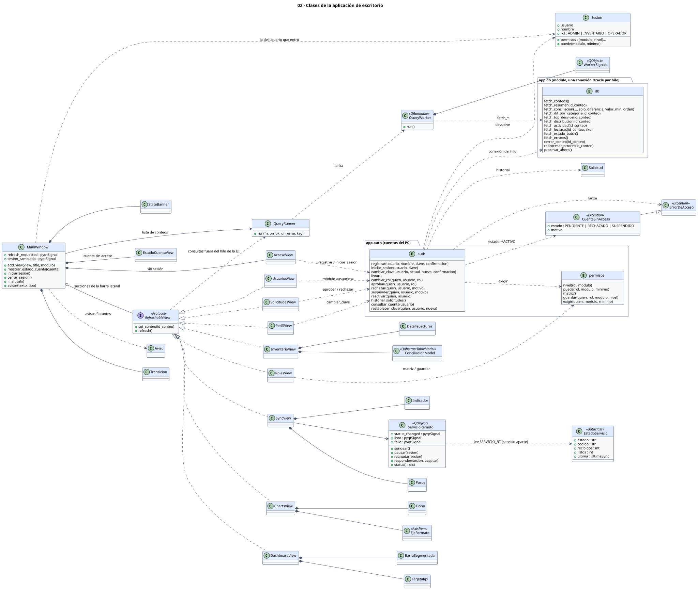

**03 · Clases de la APK.** MVVM: pantallas, `CountViewModel`, `SyncRunner`, `SyncClient`, `Protocol` y la `Outbox`.
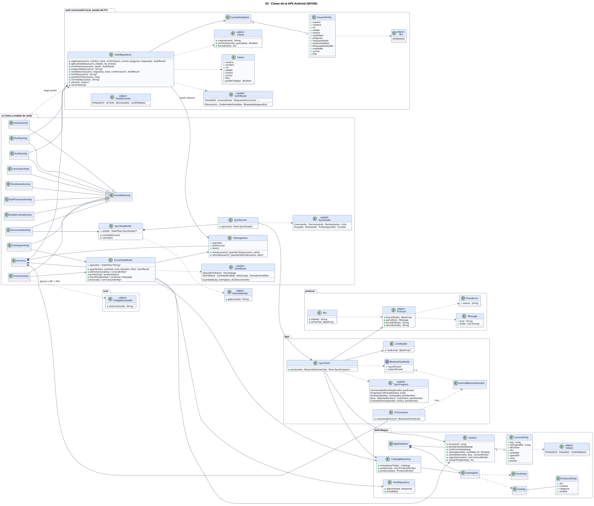

**04 · Modelo de datos.** Las diez tablas de Oracle, con sus claves y cardinalidades.
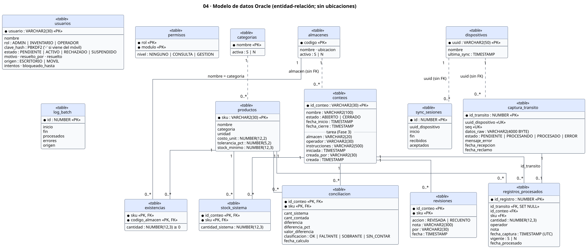

**05 · Instantánea de objetos.** Dos lecturas de A1 del escenario `T-01` (la segunda es un recuento) hasta la fila de conciliación.


**06 · Componentes.** APK, app de escritorio, Oracle y BlueZ unidos por RFCOMM, D-Bus y SQL\*Net.
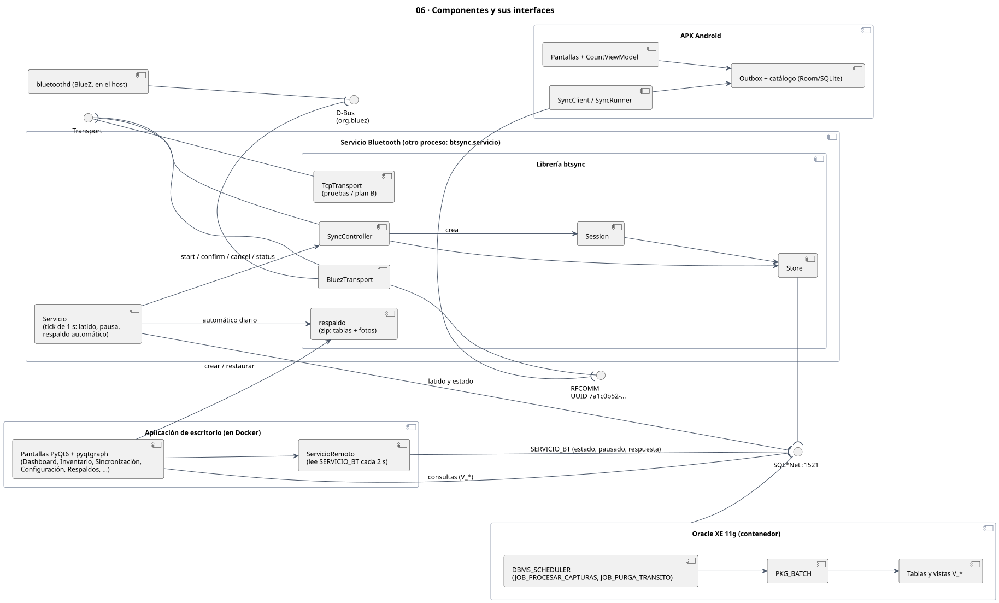

**07 · Despliegue.** Qué corre en el celular, en el host y en cada contenedor, y por qué enlaces se hablan.


**08 · Paquetes.** Módulos de `btsync`, `desktop.app` y `mobile` y sus dependencias.


**09 · Estructura compuesta.** El interior de `SyncController`: puertos y partes.


### 5.2 Comportamiento

**10 · Casos de uso.** Operario, Administrador y Scheduler de Oracle, con sus casos.


**11 · Actividad: conteo en el móvil.** De iniciar sesión y elegir el conteo a guardar y sincronizar.


**12 · Actividad: de la subida al batch.** Quién hace qué desde el `REC` hasta la conciliación.


**16 · Estados del controlador.** De `IDLE` a `LISTO`/`ERROR`, con plazo, corte y cancelación.


**17 · Estados de una fila de tránsito.** `PENDIENTE → PROCESANDO → PROCESADO | ERROR`, con huérfanas y reproceso.
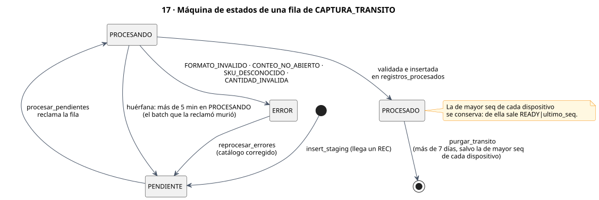

**18 · Estados de una lectura en la Outbox.** `PENDIENTE → ENVIADO → CONFIRMADO` y la vuelta tras un corte.


**19 · Estados del conteo.** `ABIERTO → CERRADO` y qué pasa con `SIN_CONTAR`.
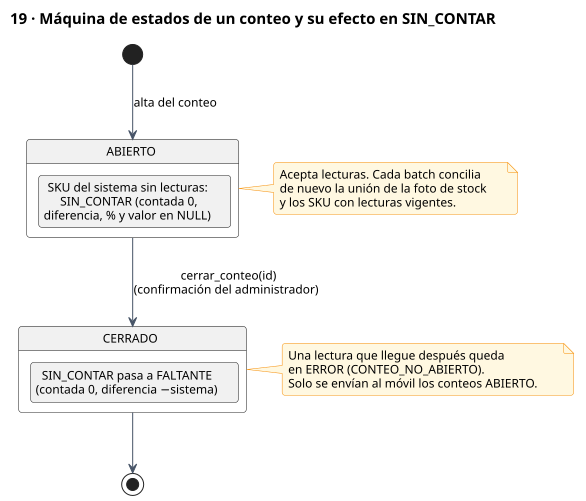

### 5.3 Interacción

**13 · Secuencia: sincronización completa.** Ventana, conexión, `HELLO`, `READY`, catálogo, `REC`, `ACK`, `BYE`, batch y
refresco.


**14 · Secuencia: corte y reanudación.** `READY|25` y go-back-N sin duplicados.


**15 · Secuencia: errores y cierre.** Fila en `ERROR`, alta del producto, reproceso y cierre del conteo.
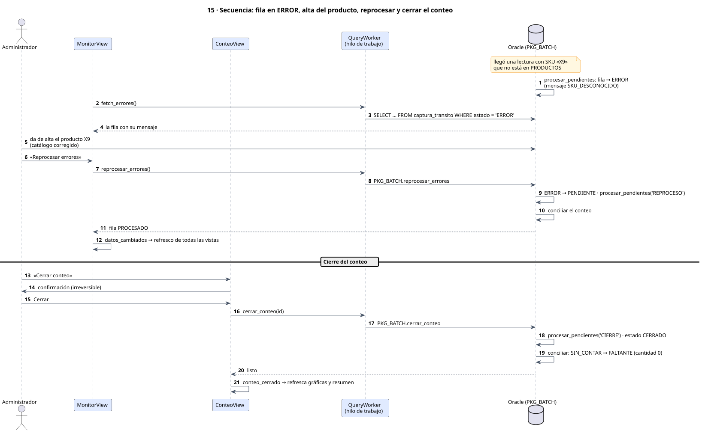

**20 · Comunicación.** La colaboración numerada entre `Session`, `Store`, `SyncController`, `PKG_BATCH` y `SyncBridge`.


**21 · Visión general de interacción.** El flujo de alto nivel que enlaza 13, 14 y 15.


**22 · Tiempos.** La ventana de 120 s y la ventana de 50 `REC` entre `ACK`.


El diagrama de **perfiles** no aplica: el proyecto no define ningún perfil UML propio.

## 6. Aplicación de escritorio

Tras iniciar sesión (o crear la cuenta) se ve una barra lateral con las pantallas: **Dashboard** (cuatro cifras, la
diferencia por categoría y el reparto de los SKU), **Inventario** (tabla con búsqueda, filtros por clasificación y
categoría, detalle de lecturas y exportación a CSV), **Sincronización** (el botón, el progreso y las lecturas con error),
**Gráficas** (seis, con filtro por categoría), **Tareas de conteo** (crear y asignar a un operador, reasignar mientras
no empezó, cerrar, filtros por estado y operador, y el avance por producto de la tarea elegida), **Diferencias**
(faltantes y sobrantes con la observación del operador; marcar revisada o pedir recuento), **Existencias** (producto × almacén, con filtros por almacén, categoría y
estado), **Categorías** y **Almacenes** (crear, editar y activar o desactivar) y **Perfil**; según la matriz de permisos, el administrador ve además
**Solicitudes** (aprobar con rol o rechazar con motivo, contraseñas olvidadas e historial), **Empleados** (filtros por rol,
estado y texto; suspender con motivo y reactivar) y **Roles y permisos**. Una cuenta pendiente, rechazada o suspendida
no entra: ve una pantalla con su estado (y el motivo, si lo hay). Las cifras cuentan
hasta su valor y las barras crecen al cambiar los datos; sin sesión no se consulta nada. Las imágenes las genera
`tools/capturas_escritorio.py` con **datos de ejemplo** y sin animaciones; no salen de la base ni de una pantalla real.

| | |
|---|---|
| 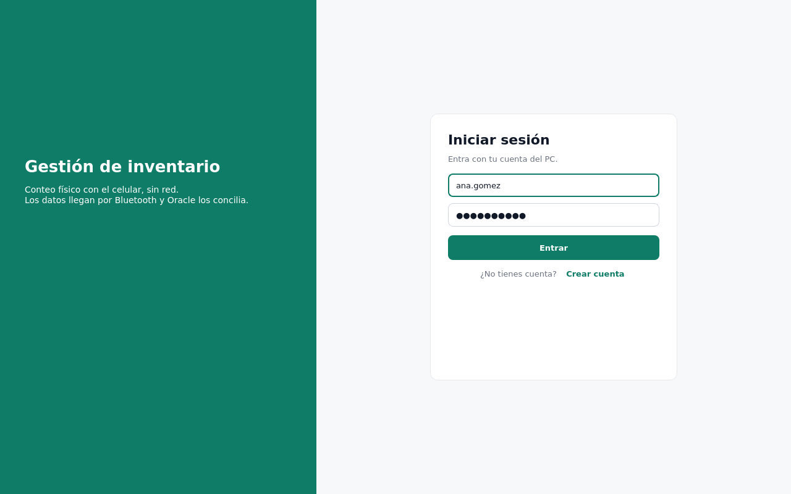 | 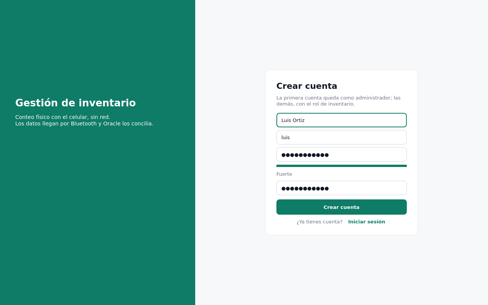 |
| 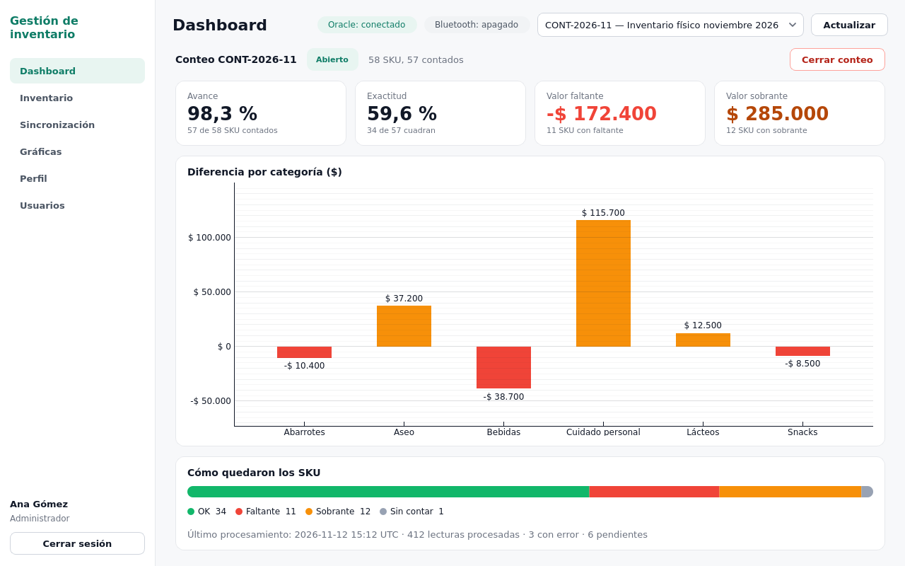 | 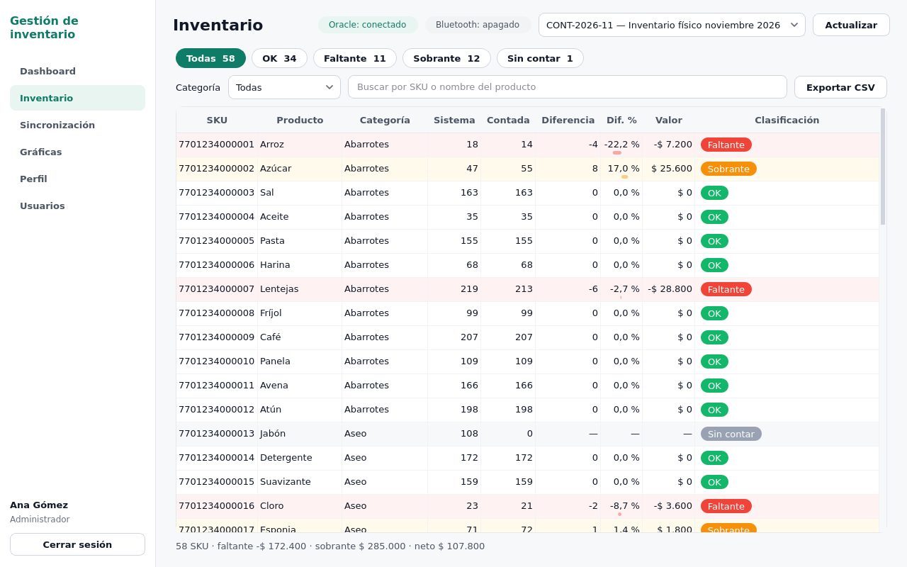 |
| 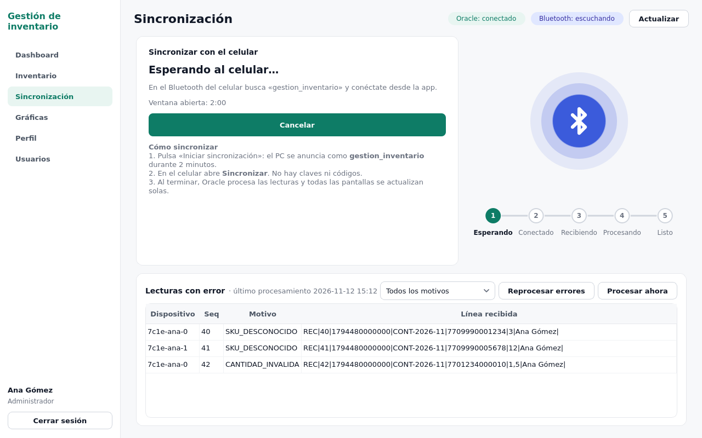 | 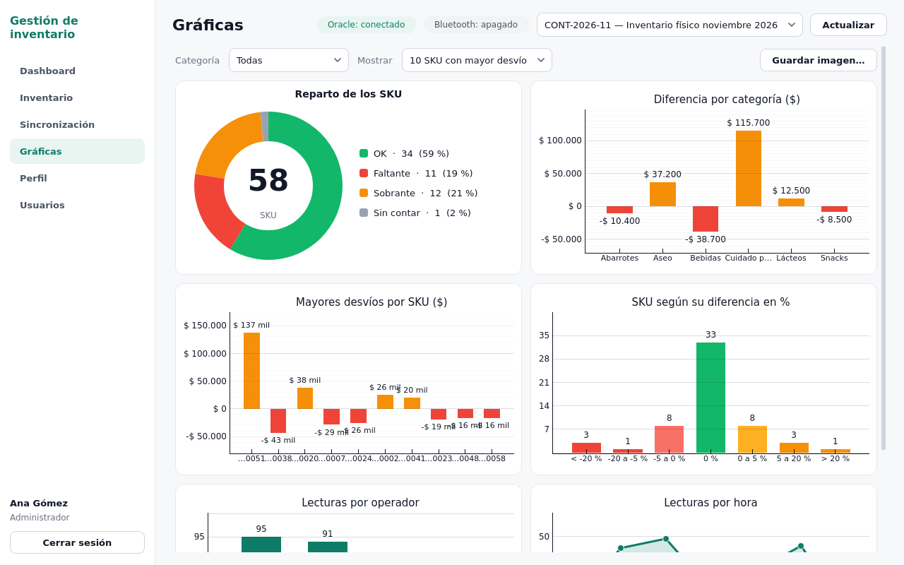 |
| 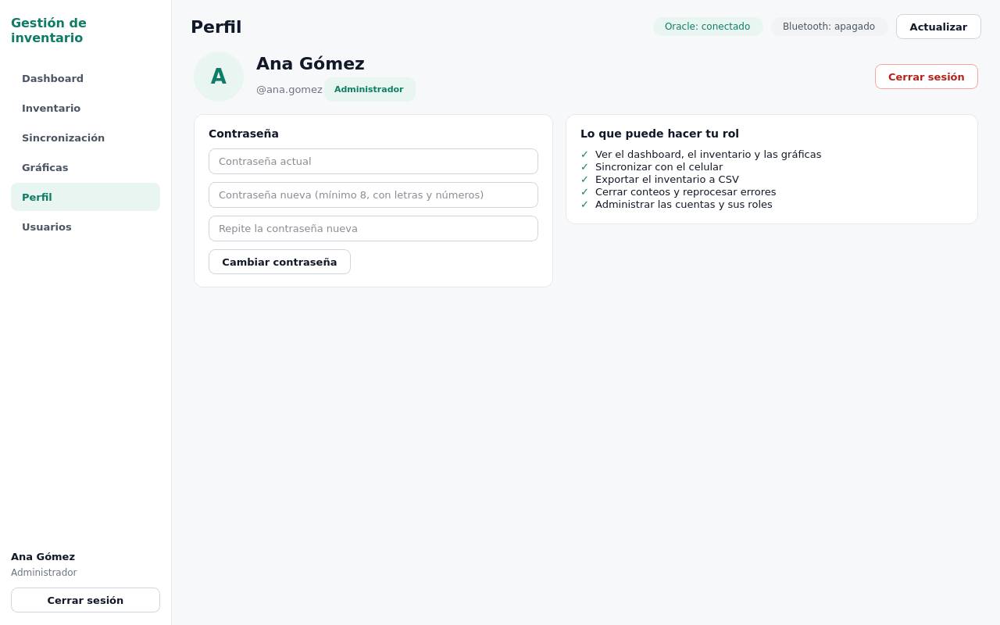 | 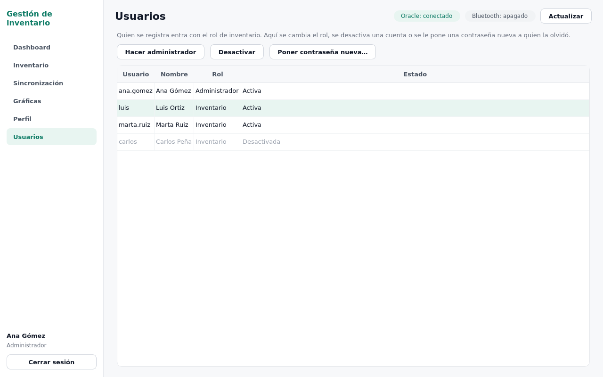 |

Roles: **Administrador** e **Inventario** en el PC, **Operador de Inventario** en el móvil (no entra al PC). Lo que ve
cada uno lo decide la matriz de permisos (D26); cerrar un conteo y procesar o reprocesar errores siguen siendo del
administrador.

## 7. Capturas de la APK

Interfaz en Jetpack Compose (Material 3) con animaciones: formularios de acceso que se relevan de lado, saludo que
cubre la pantalla al entrar, entrada escalonada de las tarjetas, cifras que cuentan, la cantidad que «salta» con cada
toque, ondas mientras conecta, anillo de progreso al enviar, visto con onda al guardar, y tres transiciones entre
pantallas (lateral con escala, hoja que sube y fundido con zoom). Las imágenes las genera
`CapturasTest` con el motor gráfico de Android (Robolectric en modo nativo) a 1080 × 2340 px, con datos de ejemplo;
no son fotos de un teléfono físico.

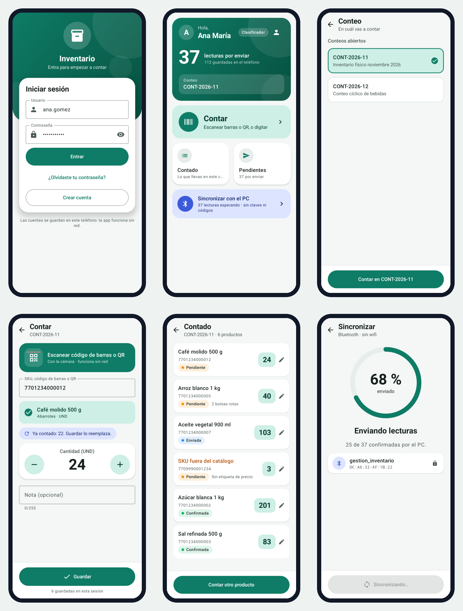

Cada pantalla por separado está en [`img/movil/`](img/movil/). Para regenerarlas:
`docker compose --profile build run --rm apk-build ./gradlew cleanTestDebugUnitTest testDebugUnitTest --tests '*CapturasTest'`
y copiar `mobile/app/build/capturas/*.png` a `docs/img/movil/`.
