# Aplicación captura Móvil y Procesamiento Batch Bluetooth hacia Oracle

**Documento técnico y documentación integral del sistema**

Jose Camilo Pérez Daza · Sebastian Fernando Revelo Meneses

Ingeniería de software, Universidad Manuela Beltrán · Computación móvil · Prof. Robert Osorio Torres

Bogotá D.C. · 17 de noviembre del año 2026


## 1. Resumen ejecutivo

El sistema **Inventario físico offline: APK → Bluetooth → Oracle → aplicación de escritorio** permite que un operador cuente productos con un teléfono Android sin conexión de red, que el conteo viaje por Bluetooth hasta un computador con Linux, que se almacene en Oracle 11g y que un proceso por lotes (*batch*) escrito en PL/SQL lo concilie contra el stock del sistema. Un único programa de escritorio presenta el resultado en tableros, tablas y gráficas. El conteo es **continuo**: no hay cierre de inventario, y la información se recalcula cada vez que el *batch* procesa nuevas lecturas.

El problema que resuelve es la toma de inventario físico en bodegas o tiendas donde no hay red confiable: el operador no puede depender de un servidor para registrar cada lectura, pero necesita que lo contado llegue de forma íntegra, sin duplicados y con trazabilidad al equipo central. El sistema está dirigido a tres roles: el **Operador de Inventario** (solo móvil), el rol **Inventario** y el **Administrador** (solo escritorio).

La solución se compone de cuatro piezas: (1) una aplicación Android escrita en Kotlin con Jetpack Compose, Room y ZXing; (2) un servicio Bluetooth en Python que recibe los datos por RFCOMM y los guarda en una tabla de tránsito; (3) una base Oracle XE 11g con el paquete `PKG_BATCH`, vistas `V_*` y trabajos de `DBMS_SCHEDULER`; y (4) una aplicación de escritorio en PyQt6 y pyqtgraph. Los componentes del lado del computador corren en contenedores Docker; la única interfaz entre el servicio Bluetooth y el escritorio es la propia base de datos.

La comunicación usa un protocolo propio de líneas de texto con CRC32, confirmaciones acumulativas (`ACK`), rechazos con retroceso (`NAK`, *go-back-N*), reanudación desde el último número de secuencia persistido y una clave única `(uuid, seq)` que impide duplicados. Los resultados técnicos comprobados durante la elaboración de este documento son: 115 pruebas unitarias de la APK sin fallos, 230 de 238 pruebas del servidor y 454 de 464 del escritorio aprobadas en una base limpia (los 18 fallos restantes se analizan en el capítulo 14), una sincronización real de extremo a extremo por el transporte TCP del proyecto, y capturas reales de las pantallas de escritorio de los dos roles que lo usan.


## 2. Introducción


### 2.1 Contexto del proyecto

El trabajo se desarrolla en la asignatura Computación móvil del programa de Ingeniería de software de la Universidad Manuela Beltrán. El proyecto integra una aplicación móvil de captura de datos, una comunicación inalámbrica de corto alcance y un procesamiento por lotes sobre una base de datos empresarial, tres temas centrales de la computación móvil: captura en el borde, sincronización diferida y persistencia centralizada.


### 2.2 Situación que origina la solución y problema identificado

En un conteo físico, el operador recorre estanterías con un dispositivo en la mano. Si cada lectura exige red, una zona sin cobertura detiene el trabajo; si se registra en papel, aparecen errores de transcripción y demoras. El proyecto asume, como decisión de diseño documentada (D1), que el terminal cuenta sin red y sube lo contado por lotes cuando está cerca del computador.


### 2.3 Importancia de la solución

La solución desacopla la captura de la conectividad: guardar una lectura nunca depende de la red. A cambio, exige resolver con cuidado la sincronización: orden, duplicados, cortes, relojes desfasados y cuentas no autorizadas. Estos problemas se abordan en los capítulos 9 y 10 con un protocolo verificable y con pruebas automáticas que se ejecutaron para este documento.


### 2.4 Alcance

Están dentro del alcance: la captura móvil con escáner de códigos de barras y QR, las cuentas locales del operador, el protocolo Bluetooth de versión 5, la persistencia en Oracle, el *batch* de conciliación, la aplicación de escritorio con doce módulos controlados por permisos, los respaldos y la auditoría. Quedan fuera: iOS (D4), Windows como sistema anfitrión del servicio Bluetooth, múltiples almacenes o ubicaciones (D24), el cierre de inventario y la valoración monetaria de diferencias.


### 2.5 Organización del documento

El capítulo 3 enuncia los objetivos; el 4 plantea el problema y su justificación; el 5 describe el sistema; el 6 analiza los requisitos; los capítulos 7 a 10 documentan arquitectura, datos, comunicación y flujos; el 11 describe cada módulo; los capítulos 12 y 13 tratan la experiencia de usuario y la seguridad; el 14, las pruebas; el 15, la instalación; los capítulos 16 y 17 presentan resultados y la evaluación frente a la rúbrica; y los capítulos 18 y 19 recogen conclusiones y trabajo futuro. Las referencias y los anexos cierran el documento.


## 3. Objetivos


### 3.1 Objetivo general

Diseñar, implementar y documentar un sistema de inventario físico que capture lecturas sin conexión en un dispositivo Android, las transfiera por Bluetooth a un computador, las almacene y concilie en Oracle mediante un proceso por lotes PL/SQL y las presente en una aplicación de escritorio con control de acceso por roles.


### 3.2 Objetivos específicos

- Construir una aplicación Android con catálogo local, escáner de códigos de barras y QR, cuentas locales y una bandeja de salida (*Outbox*) persistente que guarde primero y sincronice después.
- Definir e implementar un protocolo de líneas con CRC32, confirmaciones acumulativas, reanudación y retroceso ante errores, probado con los mismos vectores en Python y Kotlin.
- Implementar un servicio Bluetooth independiente de la interfaz que registre un perfil RFCOMM mediante BlueZ y guarde cada lectura de forma idempotente en una tabla de tránsito de Oracle.
- Escribir en PL/SQL el *batch* que valida las lecturas, determina la lectura vigente por SKU y calcula la conciliación contra el stock del sistema.
- Desarrollar una aplicación de escritorio con PyQt6 que consulte Oracle sin bloquear la interfaz y que restrinja cada módulo según una matriz de permisos rol × módulo.
- Validar el sistema con pruebas automáticas, una sincronización real de extremo a extremo y capturas de la aplicación en ejecución, y documentarlo con diagramas UML y manual de instalación.


## 4. Planteamiento del problema y justificación


### 4.1 Situación que busca resolver el sistema

El proyecto no documenta una organización cliente concreta ni cifras de un procedimiento anterior; por ello este capítulo se limita a lo que se desprende del diseño y de las decisiones registradas en `docs/arquitectura.md`. La necesidad es contar productos en un lugar sin conectividad garantizada y consolidar el resultado en una base de datos central que no debe recibir duplicados ni lecturas de personas no autorizadas.


### 4.2 Dificultades del proceso y necesidades de los usuarios

- **Falta de red durante el conteo:** la captura no puede depender de un servidor; por eso la APK guarda en una base local antes de cualquier envío (D1, D12).
- **Cortes de la conexión inalámbrica:** el enlace Bluetooth de corto alcance puede interrumpirse a mitad de un lote; el protocolo reanuda desde el último `seq` confirmado.
- **Sesgo del conteo:** si el operador viera la cantidad teórica del sistema, podría ajustar lo que cuenta; el catálogo que baja al teléfono nunca lleva el stock (conteo ciego, D12).
- **Productos no registrados:** aparecen SKU que no están en el catálogo; en lugar de perder la lectura, el Administrador decide si crea el producto o la descarta (D16).
- **Relojes desfasados:** sin red, el reloj del teléfono deriva; se corrige con la hora del servidor sin modificar la hora original (D15).
- **Control de acceso:** solo cuentas aprobadas pueden entregar lecturas y cada rol ve únicamente los módulos que le corresponden (D23 a D26).


### 4.3 Justificación de la solución tecnológica

Bluetooth clásico (RFCOMM) se eligió porque no requiere infraestructura de red y está disponible en cualquier teléfono Android. Oracle 11g se mantiene como destino porque es el motor del escenario académico; sus limitaciones (sin `IDENTITY` ni funciones JSON) llevaron a usar secuencias, disparadores y un formato de texto con separador `|` (D2). El *batch* se ejecuta en PL/SQL dentro de la base para acercar el procesamiento a los datos y poder programarlo con `DBMS_SCHEDULER`. El escritorio usa PyQt6 por su soporte de hilos y señales, que permite consultar Oracle sin congelar la ventana.


## 5. Descripción general del sistema


### 5.1 Propósito, aplicaciones y flujo general

El sistema está formado por **dos aplicaciones** (la APK Android y la aplicación de escritorio), **un servicio** (el servicio Bluetooth, que corre aparte de la ventana) y **una base de datos** (Oracle XE 11g). Las entradas son las lecturas del operador (SKU, cantidad, dañados, nota y foto opcional) y las acciones de los usuarios del escritorio. El procesamiento ocurre en tres etapas: validación y confirmación en el servicio Bluetooth, *batch* de conciliación en Oracle y consulta desde el escritorio. Las salidas son el inventario conciliado, los indicadores del *dashboard*, las gráficas, la exportación CSV, los respaldos y la auditoría.

El Figura 1 muestra las cuatro capas y los canales de comunicación reales entre ellas. La captura móvil es la única capa que funciona sin red; las demás dependen de Oracle.

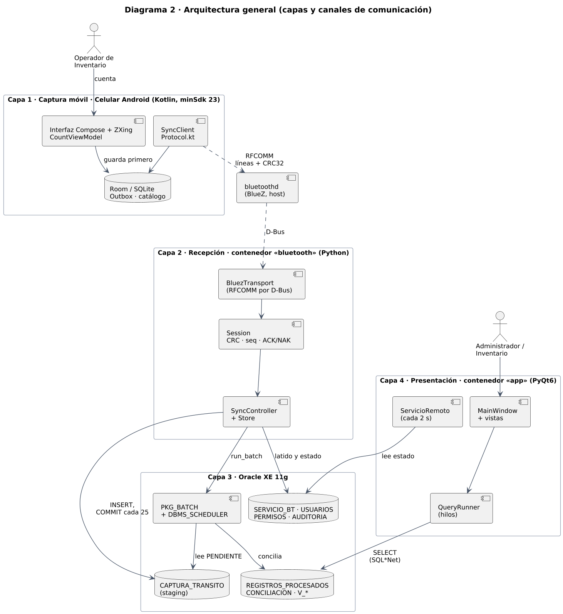

**Figura 1.** Arquitectura general del sistema: capas y canales de comunicación.  
Fuente: elaboración propia a partir del código. Fuente PlantUML: docs/documentacion/diagramas/plantuml/02_arquitectura_general.puml.  
Demuestra: separación en capas y canales reales (RFCOMM, D-Bus, SQL*Net). Criterio: Arquitectura y código fuente.  


### 5.2 Actores y roles

**Tabla 1.** _Roles del sistema y dónde ingresan_

| Rol | Dónde entra | Qué puede hacer |
|---|---|---|
| **Operador de Inventario** | Solo móvil | Catálogo, contar, contado, pendientes, sincronizar, notificaciones y mi cuenta. No ve la cantidad del sistema ni entra al escritorio. |
| **Inventario** | Solo escritorio | Dashboard, inventario completo, gráficas, sincronización, notificaciones y perfil. No administra cuentas, permisos, configuración ni respaldos. |
| **Administrador** | Solo escritorio | Todo lo anterior más solicitudes, empleados, roles y permisos, auditoría, configuración y respaldos. Hay uno solo (D25) y su fila de permisos está bloqueada. |
| **Scheduler de Oracle** | Proceso | Ejecuta `JOB_PROCESAR_CAPTURAS` (cada minuto por defecto) y `JOB_PURGA_TRANSITO` (diario). |

_Fuente: README.md y docs/arquitectura.md del proyecto._


### 5.3 Módulos del sistema

La Tabla 2 resume los módulos. Los doce módulos de la matriz de permisos son `dashboard`, `inventario`, `graficas`, `sync`, `notificaciones`, `perfil`, `solicitudes`, `usuarios`, `permisos`, `auditoria`, `configuracion` y `respaldos`; cada uno se describe con detalle en el capítulo 11.

**Tabla 2.** _Módulos del sistema_

| Módulo | Propósito | Funcionalidades | Actores | Componentes técnicos | Estado |
|---|---|---|---|---|---|
| Captura móvil | Contar sin red | Catálogo, escáner de barras/QR, digitación, dañados, nota, foto, recontar, Outbox | Operador | `mobile/` · Compose, Room, ZXing, `CountViewModel` | Implementado |
| Cuentas móviles | Identificar al operador | Registro, acceso, recuperación por pregunta, foto, tema, idioma | Operador | `auth/AuthRepository.kt` (PBKDF2) | Implementado |
| Sincronización móvil | Subir lo contado | Búsqueda del PC, conexión, envío en ventanas, reintentos | Operador | `SyncClient`, `SyncRunner`, `Protocol.kt` | Implementado |
| Servicio Bluetooth | Recibir y validar | Perfil RFCOMM, sesión, CRC, ACK/NAK, COMMIT cada 25, pausa | Sistema | `server/btsync` · `Session`, `SyncController`, `BluezTransport` | Implementado |
| Batch Oracle | Conciliar | Validar, lectura vigente, conciliar `ACTUAL`, alta de SKU | Scheduler / sistema | `db/init/03_pkg_batch.sql` | Implementado |
| Dashboard | Ver avance | Avance, contados, faltantes, sobrantes, diferencia por categoría | Admin, Inventario | `views/dashboard.py` | Implementado |
| Inventario | Consultar lo conciliado | 5 columnas, búsqueda, CSV, detalle con foto | Admin, Inventario | `views/inventario.py` | Implementado |
| Gráficas | Analizar | Seis gráficas con filtros | Inventario | `views/charts.py`, pyqtgraph | Implementado |
| Sincronización (PC) | Operar el servicio | Estado, pausar, reanudar, procesar, reprocesar errores, alta de SKU | Admin, Inventario | `views/sync.py`, `ServicioRemoto` | Implementado |
| Solicitudes / Empleados / Roles | Administrar cuentas | Aprobar o rechazar, suspender, desvincular, matriz de permisos | Administrador | `auth.py`, `permisos.py` | Implementado |
| Auditoría | Rastrear cambios | Quién, qué, cuándo; filtros | Administrador | `auditoria.py` | Implementado |
| Configuración / Respaldos | Mantener | Intervalo del lote, tamaño de foto, respaldo `.zip`, restaurar | Administrador | `configuracion.py`, `btsync/respaldo.py` | Implementado |
| Notificaciones / Perfil | Avisar y personalizar | Campana, foto, tema, idioma, contraseña | Todos los del PC | `bandeja.py`, `perfil.py` | Implementado |

_Fuente: Elaboración propia a partir del código y del README del proyecto._


### 5.4 Almacenamiento y sistemas externos

Cada teléfono guarda sus datos en SQLite (Room): `Outbox`, catálogo y cuentas locales. El computador guarda todo en Oracle XE 11g, más las fotos de evidencia (`fotos/<uuid>/<seq>.jpg`) y los respaldos `.zip` (`respaldos/`) en carpetas del proyecto. Los sistemas externos al código del proyecto son BlueZ (`bluetoothd`, que vive en el anfitrión), el bus D-Bus del sistema, el servidor gráfico X11 o Wayland y Docker.


## 6. Análisis de requisitos


### 6.1 Requisitos funcionales

Los requisitos se extrajeron del código y de la documentación del proyecto; todos están en estado **Implementado**. Cuando se indica una prueba, es una prueba automática existente en el repositorio; cuando se indica una figura, es una captura obtenida durante este trabajo.

**Tabla 3.** _Requisitos funcionales (1 de 2)_

| ID | Nombre | Descripción (entrada → proceso → resultado) | Actor | Módulo | Verificación |
|---|---|---|---|---|---|
| RF-001 | Registrar cuenta del PC | Usuario, nombre, correo, contraseña → la primera cuenta queda Administrador activo; las demás, pendientes | Visitante | `auth.registrar` | `test_auth.py` |
| RF-002 | Iniciar sesión en el PC | Usuario y contraseña → verifica hash; 5 intentos fallidos bloquean 30 s; audita | Admin, Inventario | `auth.iniciar_sesion` | `test_auth.py`, Figura 41 |
| RF-003 | Recuperar contraseña del Administrador | Respuesta a la pregunta de seguridad → nueva contraseña inmediata | Administrador | `auth.recuperar` | `test_auth.py` |
| RF-004 | Aprobar o rechazar solicitudes | Cuenta pendiente → rol (PC: Inventario; móvil: Operador) o rechazo con motivo | Administrador | `views/solicitudes.py` | `test_requests_only_allow…`, Figura 48 |
| RF-005 | Gestionar empleados | Suspender con motivo, reactivar, poner contraseña, desvincular teléfono | Administrador | `views/usuarios.py` | `test_usuarios_views.py`, Figura 49 |
| RF-006 | Editar matriz de permisos | 12 módulos × 3 niveles por rol; la fila del Administrador es intocable | Administrador | `permisos.py` | `test_roles_view.py`, Figura 50 |
| RF-007 | Auditar cambios | Cada cambio de datos escribe quién, qué y cuándo en la misma transacción | Administrador | `auditoria.py` | `test_auditoria.py`, Figura 51 |
| RF-008 | Cuenta local del operador | Registro, acceso y recuperación con pregunta de seguridad, en el teléfono | Operador | `auth/AuthRepository.kt` | `AuthRepositoryTest` |
| RF-009 | Ver catálogo sin stock | El PC envía productos sin cantidad del sistema → el teléfono los guarda | Operador | `Session`, `CatalogoScreen` | `test_catalog_never_contains_system_stock` |
| RF-010 | Contar | SKU por escáner (barras/QR) o digitado, cantidad, dañados, nota, foto → lectura en la Outbox | Operador | `CountViewModel`, `ContarScreen` | `CountViewModelTest` |
| RF-011 | Recontar reemplaza | Segunda lectura del mismo SKU sin enviar reemplaza a la pendiente; vale la vigente | Operador | `Outbox.reemplazar` | `OutboxTest` |
| RF-012 | Guardar sin red | Toda lectura se guarda primero en Room | Operador | `Outbox` | `OutboxTest` |
| RF-013 | Sincronizar por Bluetooth | Búsqueda del PC `gestion_inventario`, conexión RFCOMM, envío por protocolo v5 | Operador | `SyncClient` | `SyncClientTest` |
| RF-014 | Validar y confirmar | CRC, longitud, formato, secuencia; COMMIT cada 25 y `ACK`; `NAK` con motivo | Sistema | `Session` | `test_session.py` |

_Fuente: Elaboración propia._

**Tabla 4.** _Requisitos funcionales (2 de 2)_

| ID | Nombre | Descripción (entrada → proceso → resultado) | Actor | Módulo | Verificación |
|---|---|---|---|---|---|
| RF-015 | Reanudar y reintentar | `READY` informa el último `seq`; ante `NAK` el móvil retrocede; 3 reintentos de conexión | Sistema, Operador | `Session`, `SyncRunner` | `test_connection_cut_after_30_rec_keeps_25`, `SyncRunnerTest` |
| RF-016 | Conciliar por lotes | Filas pendientes → validación, lectura vigente, `CONCILIACION` de `ACTUAL` | Scheduler | `PKG_BATCH` | `test_batch.py`, `test_conciliacion.py` |
| RF-017 | Resolver SKU nuevo | SKU fuera del catálogo → aviso «Nuevo SKU»: crear y procesar, o no crear | Administrador | `aviso_nuevo_sku.py` | `test_nuevo_sku_views.py`, Figura 43 |
| RF-018 | Reprocesar errores | Lecturas en `ERROR` → nuevo intento tras corregir | Admin | `PKG_BATCH.reprocesar_errores` | `test_sync_views.py` |
| RF-019 | Dashboard continuo | Avance, contados, faltantes, sobrantes, diferencia por categoría | Admin, Inventario | `views/dashboard.py` | `test_dashboard_views.py`, Figura 43 |
| RF-020 | Inventario | Cinco columnas, búsqueda, CSV (`;`, UTF-8 con BOM), detalle con foto | Admin, Inventario | `views/inventario.py` | `test_inventario_views.py`, Figura 44 |
| RF-021 | Gráficas | Seis gráficas con filtro por categoría y cantidad de SKU | Inventario | `views/charts.py` | `test_charts_views.py`, Figura 45 |
| RF-022 | Operar el servicio | Ver estado, pausar y reanudar el servicio Bluetooth; procesar ahora | Admin, Inventario | `ServicioRemoto` | `test_servicio.py`, Figura 46 |
| RF-023 | Notificaciones | Campana con avisos por rol o usuario; marcar leídas | Admin, Inventario | `notificaciones.py` | `test_notificaciones_views.py` |
| RF-024 | Perfil | Foto con editor, tema claro/sistema/oscuro, idioma es/en, contraseña | Admin, Inventario | `views/perfil.py` | `test_perfil.py`, Figura 55 |
| RF-025 | Configuración | Intervalo del lote y tamaño máximo de foto; reaplica los jobs | Administrador | `configuracion.py` | `test_configuracion_views.py` |
| RF-026 | Respaldos | Crear `.zip`, programar diario, restaurar con confirmación `RESTAURAR` | Administrador | `btsync/respaldo.py` | `test_respaldo.py`, `test_respaldos.py` |
| RF-027 | Fotos de evidencia | Foto por lectura en partes `FOTO`, `FOTOOK`/`FOTOERR` | Operador | `Session._on_foto` | `test_fotos.py` |
| RF-028 | Una sincronización a la vez | Segundo teléfono recibe `NAK\|0\|OCUPADO` | Sistema | `SyncController` | `test_e2e_tcp.py` |

_Fuente: Elaboración propia._


### 6.2 Requisitos no funcionales

**Tabla 5.** _Requisitos no funcionales, cómo se abordan y evidencia_

| Categoría | Cómo se aborda técnicamente | Evidencia | Estado |
|---|---|---|---|
| Rendimiento | El móvil envía hasta 50 `REC` sin esperar `ACK`; el servidor hace COMMIT cada 25; las consultas del escritorio salen de vistas `V_*` en un pool de 8 hilos como máximo. | `Session`, `COMMIT_EVERY = 25`, `MAX_HILOS = 8`. No se midieron tiempos de transferencia: no se afirma ninguna cifra. | Implementado; sin medición |
| Seguridad | Contraseñas con PBKDF2-SHA256, 200 000 iteraciones y sal; bloqueo tras 5 intentos durante 30 s; permisos rol × módulo con revalidación en vivo; auditoría. | `auth.py`, `permisos.exigir`, `test_auth.py`, `test_permisos.py` | Implementado. Límite: el enlace Bluetooth por defecto no se cifra (D22) |
| Confiabilidad | Clave única `(uuid, seq)`, `ACK` acumulativo, *go-back-N*, `ROLLBACK` si se corta antes del `COMMIT`, `READY` con el último `seq`. | `test_connection_cut_after_30_rec_keeps_25`, `test_duplicate_rec_in_new_session_is_not_inserted` | Implementado y probado |
| Disponibilidad | El servicio Bluetooth es un proceso aparte con `restart: unless-stopped`; escribe un latido en `SERVICIO_BT`. | `docker-compose.yml`, `servicio.py` | Implementado |
| Mantenibilidad | Capas (Transport → Session → Store), MVC en escritorio, MVVM en Android, 22 diagramas UML y pruebas que comprueban que las clases UML existen en el código. | `server/tests/test_uml.py` | Implementado (una prueba UML falla, ver 14.4) |
| Escalabilidad | Una sola sincronización a la vez (D19); Oracle XE 11g tiene límites de procesos y memoria. | Documentado en `docs/arquitectura.md` §4 | Limitada; no demostrada |
| Usabilidad / adaptabilidad | Tema claro/oscuro, idioma es/en, estados vacíos y de error, barra lateral contraíble; ventana mínima 900 × 600. | Capítulo 12 y capturas reales | Implementado |
| Integridad de datos | Llaves primarias y foráneas, restricciones `CHECK` en estados, roles, temas e idiomas. | `db/init/01_schema.sql`, `test_schema.py` | Implementado |
| Gestión de errores | `NAK` con motivo, errores en `ERROR` con reproceso, mensajes en la interfaz, reintento ante `ORA-12516`. | `protocol.py`, `store.connect_oracle` | Implementado |
| Concurrencia | Conexión por hilo, `connect_oracle` serializada con candado, `QThreadPool`, señales Qt. | `workers.py`, `store.py` | Implementado |

_Fuente: Elaboración propia._


### 6.3 Casos de uso

El Figura 2 presenta los actores, los límites del sistema y las relaciones `include` y `extend` verificadas contra la implementación. El Scheduler de Oracle aparece como actor porque inicia el procesamiento por lotes sin intervención humana.

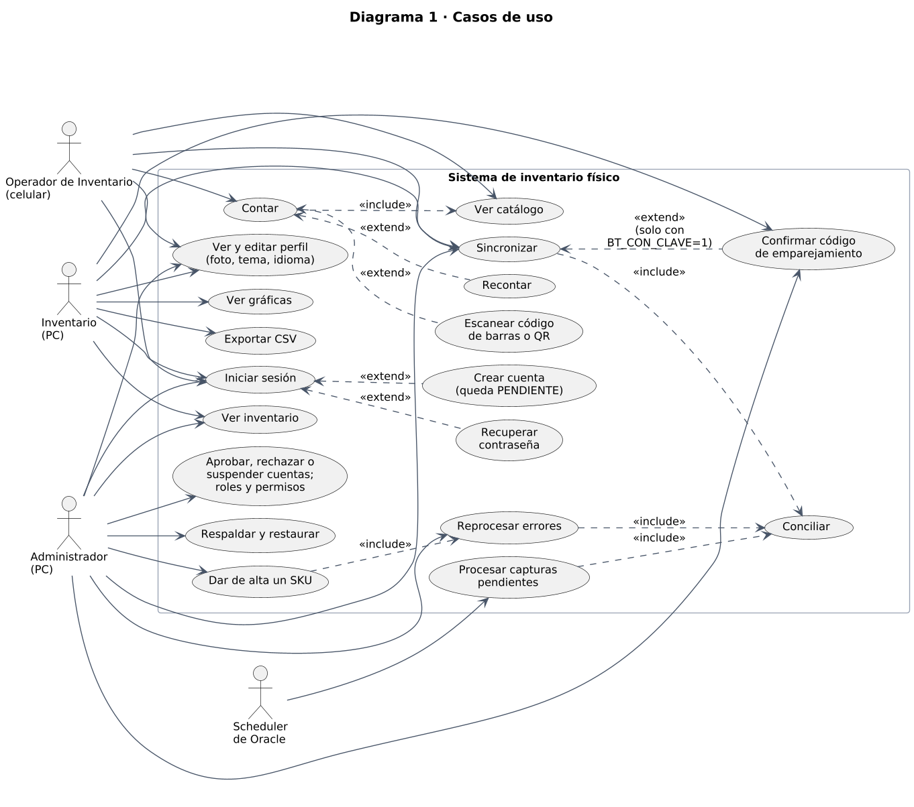

**Figura 2.** Diagrama de casos de uso.  
Fuente: elaboración propia. PlantUML: diagramas/plantuml/01_casos_uso.puml.  
Demuestra: actores, funcionalidades y límites del sistema. Criterio: Funcionalidad y requisitos.  

**Tabla 6.** _Especificación resumida de los casos de uso principales_

| Caso | Precondiciones | Flujo principal | Alternativos y excepciones | Postcondición |
|---|---|---|---|---|
| CU-01 Contar | Operador con sesión y catálogo descargado | Escanea o digita SKU → ingresa cantidad, dañados, nota → Guardar | SKU fuera del catálogo: se guarda y queda pendiente de alta. Cantidad inválida: se rechaza en pantalla. Recontar reemplaza la pendiente. | Lectura en `Outbox` como PENDIENTE |
| CU-02 Sincronizar | Lecturas pendientes; servicio activo; cuenta ACTIVO | Buscar `gestion_inventario` → `HELLO`/`ACCT` → `READY` → `REC` → `END` → `BYE` | PC ocupado: `NAK\|0\|OCUPADO`. Corte: reanuda desde `READY`. Cuenta no activa: `NAK CUENTA_NO_ACTIVA` y se conservan las lecturas. | Lecturas CONFIRMADO; filas en `CAPTURA_TRANSITO` |
| CU-03 Conciliar | Filas PENDIENTE en tránsito | `PKG_BATCH.procesar_pendientes` valida, inserta, marca vigente y concilia `ACTUAL` | Dato inválido: fila `ERROR`. SKU desconocido: `NUEVO_SKU`. | `CONCILIACION` actualizada |
| CU-04 Aprobar cuenta | Cuenta PENDIENTE; sesión de Administrador | Solicitudes → Aprobar con rol permitido por el origen | Rechazar exige motivo (≤ 300 caracteres). | Cuenta ACTIVO o RECHAZADO; auditoría |
| CU-05 Resolver SKU nuevo | Lectura en `NUEVO_SKU` | Aviso flotante → «Crear y procesar» (nombre, categoría) | «No crear» confirma y descarta. | Producto creado y lectura procesada, o descartada |
| CU-06 Respaldar y restaurar | Administrador | Respaldos → Crear; o Restaurar escribiendo `RESTAURAR` | Restaurar pausa el servicio y guarda un respaldo previo; cierra la sesión al terminar. | Archivo `.zip` o base restaurada |

_Fuente: Elaboración propia a partir de README.md, docs/protocolo.md y el código._


## 7. Arquitectura del software


### 7.1 Estilo arquitectónico

El sistema combina tres estilos que se pueden demostrar en el código. Primero, una **arquitectura por capas distribuida en procesos** (captura móvil, recepción, base de datos y presentación) cuyos únicos canales son RFCOMM, D-Bus y SQL\*Net. Segundo, **MVC con trabajadores** en el escritorio: el modelo son los *dataclasses* de `models.py` y las consultas de `db.py`; las vistas están en `desktop/app/views/`; y el controlador es `QueryRunner`, que ejecuta cada consulta en un `QueryWorker` y devuelve el resultado al hilo de la interfaz. Tercero, **MVVM** en Android: las pantallas Compose (`ui/pantallas/`) no tienen estado propio, `CountViewModel` y `SyncRunner` exponen estados, y el modelo está formado por `Outbox`, el catálogo en Room, `SyncClient` y `Protocol`.

No se etiqueta la arquitectura como un único patrón porque el código muestra una combinación; la evidencia de cada afirmación son los archivos citados y las capturas de código de las figuras de este capítulo.


### 7.2 Arquitectura lógica

**Tabla 7.** _Capas lógicas y sus responsabilidades_

| Capa | Ubicación | Responsabilidad | Dependencias |
|---|---|---|---|
| 1. Captura móvil | `mobile/` | Contar sin red. Guarda siempre primero en la `Outbox` (Room/SQLite). Cuentas locales. | Room, ZXing, Compose |
| 2. Recepción Bluetooth | `server/btsync` (`transports`, `session`, `controller`) | Acepta una conexión RFCOMM, valida cada línea (CRC, formato, secuencia), hace COMMIT cada 25 y responde `ACK`/`NAK`. El controlador ejecuta el *batch* al terminar. | BlueZ por D-Bus, `oracledb` |
| 3. Staging y *batch* | Oracle: `CAPTURA_TRANSITO`, `PKG_BATCH`, `DBMS_SCHEDULER` | Valida y mueve lo recibido a `REGISTROS_PROCESADOS`, decide la lectura vigente y calcula `CONCILIACION`. | — |
| 4. Presentación | `desktop/app` | Lee las vistas `V_*`, muestra tarjetas, tablas y gráficas, y ve y pausa el servicio Bluetooth. | PyQt6, pyqtgraph, `oracledb` |

_Fuente: docs/arquitectura.md, verificado contra el código._

Las capas 2 y 4 son **dos procesos**: la recepción sigue activa aunque se cierre la ventana del escritorio. Se comunican solo por Oracle: el servicio escribe su estado y latido en `SERVICIO_BT` y el escritorio lo lee cada 2 s (`ServicioRemoto`). Este acoplamiento débil es una decisión explícita (D11, D29).


### 7.3 Arquitectura física

El Figura 3 (en página horizontal) muestra dónde corre cada componente. Docker Compose define tres servicios permanentes (`oracle`, `app` y `bluetooth`) y cuatro de apoyo por perfiles (`pybase`, `apk-build`, `plantuml` y `bt-spike`). `app` y `bluetooth` usan `network_mode: host`, `NET_ADMIN`/`NET_RAW` y el bus D-Bus del anfitrión, porque `bluetoothd` no corre en contenedor (D7). Android y el computador se hablan solo por Bluetooth clásico.

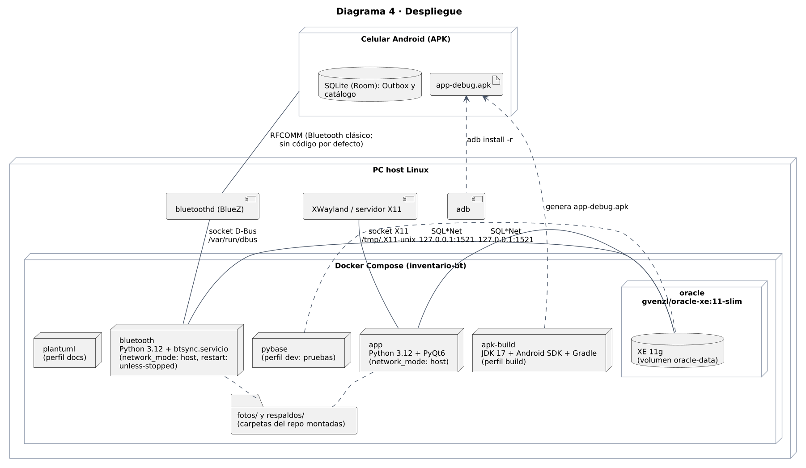

**Figura 3.** Diagrama de despliegue.  
Fuente: elaboración propia. PlantUML: diagramas/plantuml/04_despliegue.puml.  
Demuestra: ubicación física de cada componente y enlaces (RFCOMM, D-Bus, X11, SQL*Net). Criterio: Arquitectura y código fuente.  


### 7.4 Arquitectura de componentes

El Figura 4 muestra los componentes y las interfaces verdaderas (`Transport`, RFCOMM, D-Bus, SQL\*Net). `SyncController` depende de la interfaz `Transport`, no de una implementación concreta, de modo que `BluezTransport` y `TcpTransport` son intercambiables (plan B por TCP). El Figura 5 muestra las dependencias entre paquetes de Python y de Kotlin: las vistas del escritorio no importan el servicio Bluetooth; solo comparten `Store.connect_oracle`.

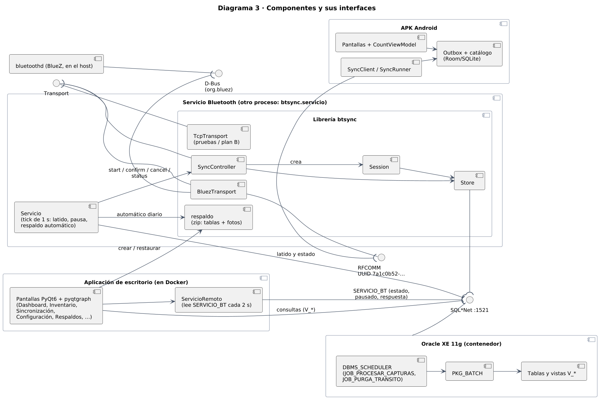

**Figura 4.** Diagrama de componentes.  
Fuente: elaboración propia. PlantUML: diagramas/plantuml/03_componentes.puml.  
Demuestra: módulos de software, dependencias e interfaces. Criterio: Arquitectura y código fuente.  

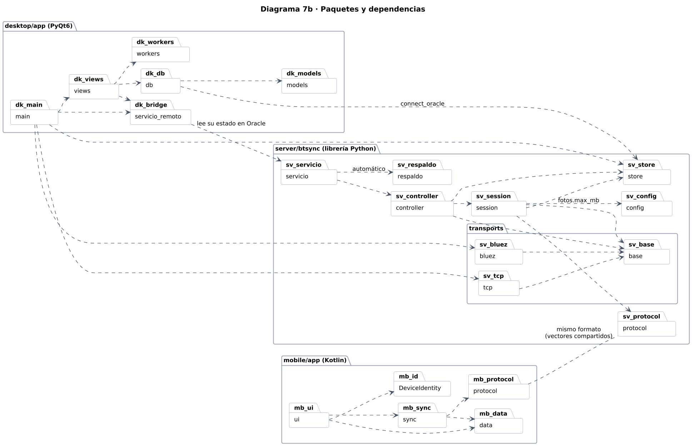

**Figura 5.** Diagrama de paquetes y dependencias.  
Fuente: elaboración propia. PlantUML: diagramas/plantuml/07b_paquetes.puml.  
Demuestra: dependencias entre `btsync`, `desktop.app` y `mobile`. Criterio: Arquitectura y código fuente.  

El Figura 6 (siguiente página horizontal) presenta las clases de la librería `btsync`: `Message`, `Rec` y `FrameError` (protocolo), `Store` (persistencia en Oracle), `Session` (una conversación con un teléfono), `SyncController` (máquina de estados) y los transportes. Las clases del escritorio y de la APK están en los anexos (figuras Figura 75 y Figura 76).

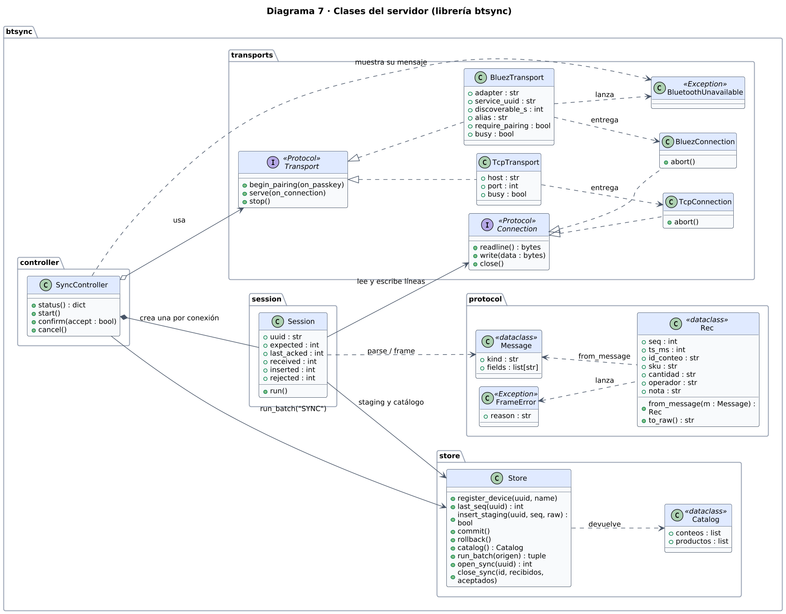

**Figura 6.** Diagrama de clases de la librería btsync.  
Fuente: elaboración propia. PlantUML: diagramas/plantuml/07_clases_paquetes.puml (fuente original: docs/uml/01-clases-servidor.puml).  
Demuestra: clases reales del servidor y sus relaciones. Criterio: Arquitectura y código fuente.  


### 7.5 Organización del código fuente

**Tabla 8.** _Directorios y archivos principales_

| Archivo o directorio | Responsabilidad | Elementos importantes | Relación con otros módulos |
|---|---|---|---|
| `server/btsync/protocol.py` (192 líneas) | Formato de línea y CRC32 | `frame`, `parse`, `Rec`, `FrameError`, `PROTOCOL_VERSION = "5"` | Lo usan `Session` y `fake_phone.py`; espejo de `Protocol.kt` |
| `server/btsync/session.py` (279) | Una conversación con un teléfono | `Session.run`, `_on_rec`, `_on_foto`, `_commit_and_ack` | Usa `Store` y `Connection` |
| `server/btsync/controller.py` (294) | Estados del ciclo de sincronización | `SyncController.start/confirm/cancel`, `_on_connection` | Crea sesiones; dispara `Store.run_batch` |
| `server/btsync/store.py` (338) | Acceso a Oracle | `connect_oracle`, `insert_staging`, `last_seq`, `catalog`, `run_batch` | Lo usan sesión, controlador y escritorio |
| `server/btsync/servicio.py` (207) | Proceso del servicio | `Servicio.tick`, `crear_transporte`, `main` | Publica estado en `SERVICIO_BT` |
| `server/btsync/transports/` (3 archivos) | RFCOMM y TCP | `BluezTransport`, `TcpTransport`, `Transport`, `Connection` | BlueZ por D-Bus (`dbus-fast`) |
| `server/btsync/respaldo.py` (466) | Respaldo y restauración | `.zip` con `manifest.json`, `.jsonl` por tabla y fotos | Lo usan servicio y pantalla Respaldos |
| `desktop/app/main.py` (1075) | Ventana principal y arranque | `MainWindow`, `build_window`, `main` | Registra las vistas y el `ServicioRemoto` |
| `desktop/app/views/` (≈40 archivos) | Vistas (MVC) | `dashboard`, `inventario`, `sync`, `usuarios`, `roles`, `respaldos`… | Consultan por `QueryRunner` |
| `desktop/app/auth.py` (673), `permisos.py` (159) | Cuentas y permisos | `iniciar_sesion`, `aprobar`, `exigir`, `INTOCABLES` | Todas las vistas administrativas |
| `desktop/app/db.py` (498), `workers.py` (47) | Consultas y trabajadores | `fetch_*`, `QueryWorker` | Vistas `V_*` de Oracle |
| `db/init/*.sql` (8 archivos) | Esquema, semilla, `PKG_BATCH`, jobs, vistas, permisos, configuración, demo | `01_schema.sql` … `08_demo.sql` | Se ejecutan al crear Oracle |
| `mobile/app/src/main/java/…/inventario/` (≈60 archivos Kotlin) | APK Android | `ui/` (Compose, ViewModel), `sync/`, `protocol/`, `data/`, `auth/` | Usa el protocolo del servidor |
| `tools/` (6 archivos) | Utilidades | `fake_phone.py`, `gen_seed.py`, `gen_demo.py`, `render_uml.sh` | Pruebas y demostración |
| `server/tests`, `desktop/tests`, `mobile/app/src/test` | Pruebas automáticas | 20 + 38 archivos de prueba Python; JUnit en Kotlin | Ver capítulo 14 |

_Fuente: Elaboración propia a partir del repositorio (conteo de líneas con `wc -l`)._

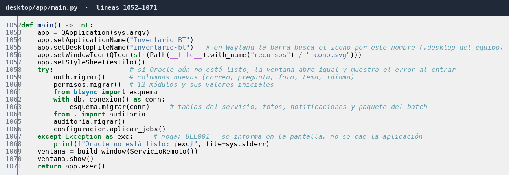

**Figura 7.** Punto de entrada de la aplicación de escritorio.  
Archivo: desktop/app/main.py (líneas 1052–1071). Función o elemento: `main()`.  
Demuestra: el arranque de la aplicación: tema, migraciones de Oracle, ventana y bucle de eventos. Criterio: Arquitectura y código.  

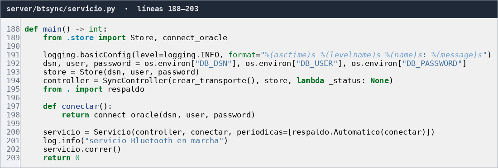

**Figura 8.** Punto de entrada del servicio Bluetooth.  
Archivo: server/btsync/servicio.py (líneas 188–203). Función o elemento: `main()`.  
Demuestra: el arranque del servicio Bluetooth como proceso independiente de la ventana. Criterio: Arquitectura y código.  

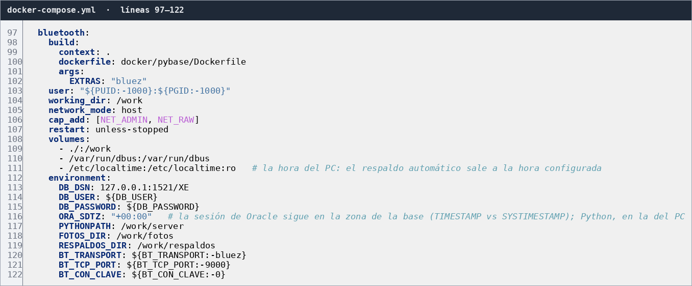

**Figura 9.** Configuración del servicio «bluetooth» en Docker Compose.  
Archivo: docker-compose.yml (líneas 97–122). Función o elemento: servicio `bluetooth`.  
Demuestra: la configuración de despliegue: red de host, capacidades, volúmenes, reinicio y variables de entorno. Criterio: Arquitectura / instalación.  

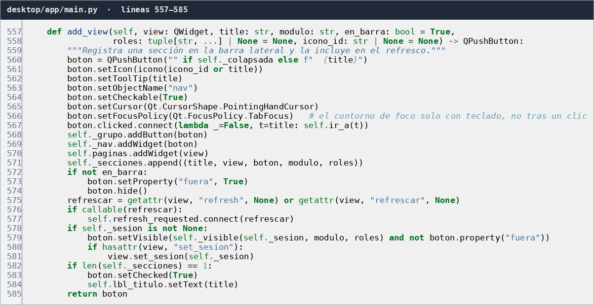

**Figura 10.** Composición de la ventana: registro de vistas y permisos.  
Archivo: desktop/app/main.py (líneas 557–585). Función o elemento: `MainWindow.add_view`.  
Demuestra: cómo cada vista se registra con su módulo y se oculta según la sesión y el rol. Criterio: Arquitectura y código.  


### 7.6 Patrones de diseño

- **Estrategia (Transport):** `Transport`/`Connection` tienen dos implementaciones, `BluezTransport` y `TcpTransport`; la sesión no sabe cuál usa.
- **Máquina de estados:** `SyncController` pasa por `IDLE`, `ESPERANDO_EMPAREJAMIENTO`, `CONECTADO`, `RECIBIENDO`, `PROCESANDO`, `LISTO` y `ERROR` (Figura 16).
- **Repositorio:** `Store` (Python) y `Outbox`/DAO de Room (Kotlin) encapsulan el acceso a datos.
- **Observador:** señales y ranuras de Qt (`ServicioRemoto.listo`, `refresh_requested`) y `Flow`/`StateFlow` en Android.
- **Idempotencia:** la clave única `(uuid_dispositivo, seq)` hace seguro reenviar una lectura.


### 7.7 Gestión de concurrencia

La Tabla 9 identifica los hilos y mecanismos asíncronos que existen en el código. Ninguna consulta a Oracle se ejecuta en el hilo de la interfaz del escritorio; en Android, la red y el disco se mueven a `Dispatchers.IO`.

**Tabla 9.** _Hilos, procesos y mecanismos de comunicación_

| Componente | Hilo o mecanismo | Qué ejecuta | Cómo vuelve a la interfaz o al llamador |
|---|---|---|---|
| Escritorio | Hilo principal de Qt | Dibujo, eventos y navegación | — |
| Escritorio | `QThreadPool` (hasta `MAX_HILOS = 8`) | `QueryWorker.run`: consultas a Oracle, una conexión por hilo | Señales `finished`/`failed` entregadas al hilo de la UI por `QueryRunner`; una `key` descarta resultados viejos |
| Escritorio | `ServicioRemoto` (temporizador de 2 s) | Lee `SERVICIO_BT` mediante `QueryRunner` | Señal `listo` → `refresh_requested` |
| Servicio | Hilo principal del proceso | `Servicio.correr`: `tick()` cada 1 s (latido, pausa, estado) | Escribe en `SERVICIO_BT` |
| Servicio | Hilo `bluez-bus` con bucle `asyncio` | Llamadas D-Bus de BlueZ y registro del perfil RFCOMM | `asyncio.run_coroutine_threadsafe` con plazo `_CALL_TIMEOUT` |
| Servicio | Hilo del transporte (uno por teléfono conectado) y hilo de tareas periódicas | `Session.run` (la llama `SyncController._on_connection` desde el hilo del transporte); respaldo automático | Eventos `on_event` y excepciones capturadas sin detener la recepción |
| Oracle | `DBMS_SCHEDULER` | `JOB_PROCESAR_CAPTURAS` (cada minuto por defecto) y `JOB_PURGA_TRANSITO` (diario) | Resultados en tablas; `LOG_BATCH` |
| Android | Corrutinas, `flowOn(Dispatchers.IO)` | `SyncClient.sync` devuelve `Flow<SyncProgress>`; `PcConnector.conectar` en `Dispatchers.IO` | `SyncRunner` traduce a `SyncEstado` que observa la pantalla |
| Ambos | `connect_oracle` con candado | Serializa `oracledb.connect()` | Evita `ORA-24550` observado con varios hilos y el Instant Client 19 |

_Fuente: Elaboración propia a partir del código; ver las figuras de código de esta sección._

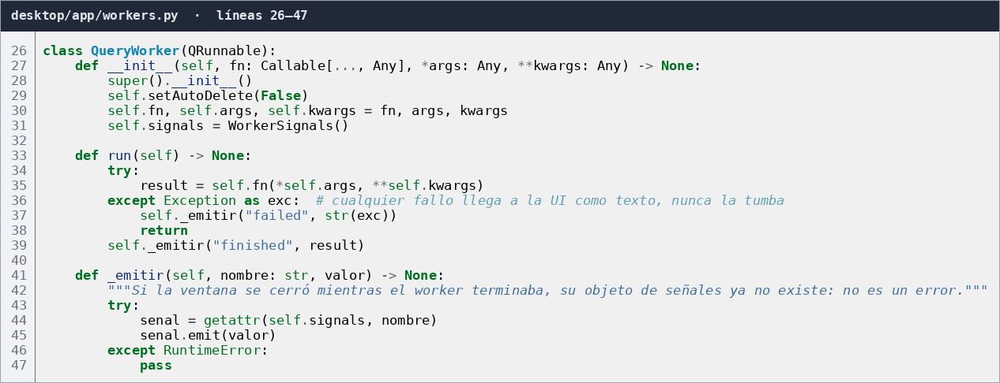

**Figura 11.** Concurrencia: QueryWorker (QRunnable) con señales Qt.  
Archivo: desktop/app/workers.py (líneas 26–47). Función o elemento: `QueryWorker`.  
Demuestra: una tarea `QRunnable` que ejecuta la consulta en un hilo del pool y emite señales con el resultado o el error. Criterio: Arquitectura / concurrencia.  

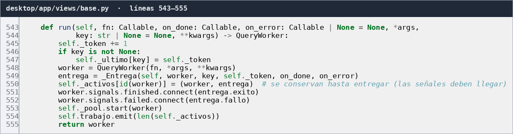

**Figura 12.** Concurrencia: QueryRunner entrega el resultado al hilo de la UI.  
Archivo: desktop/app/views/base.py (líneas 543–555). Función o elemento: `QueryRunner.run`.  
Demuestra: el despacho de consultas fuera del hilo de la interfaz y el descarte de resultados obsoletos por clave. Criterio: Arquitectura / concurrencia.  

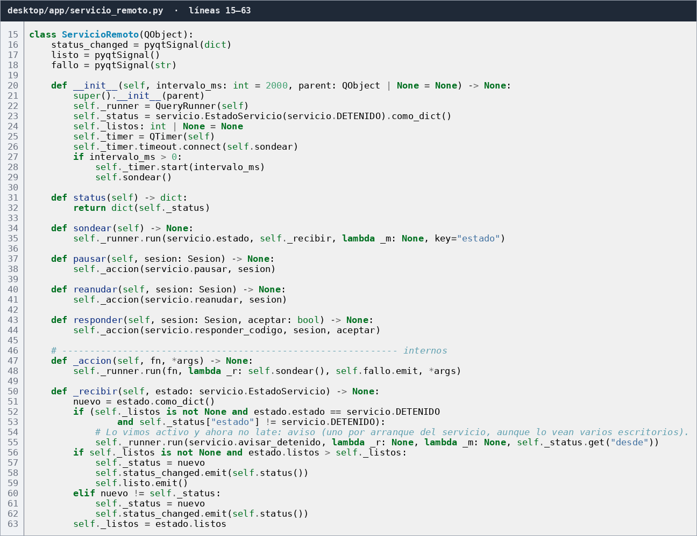

**Figura 13.** Señales: ServicioRemoto convierte el estado de Oracle en señales Qt.  
Archivo: desktop/app/servicio_remoto.py (líneas 15–63). Función o elemento: `ServicioRemoto`.  
Demuestra: la puerta hacia el servicio Bluetooth: sondeo periódico de Oracle y conversión del estado en señales Qt. Criterio: Arquitectura / señales.  

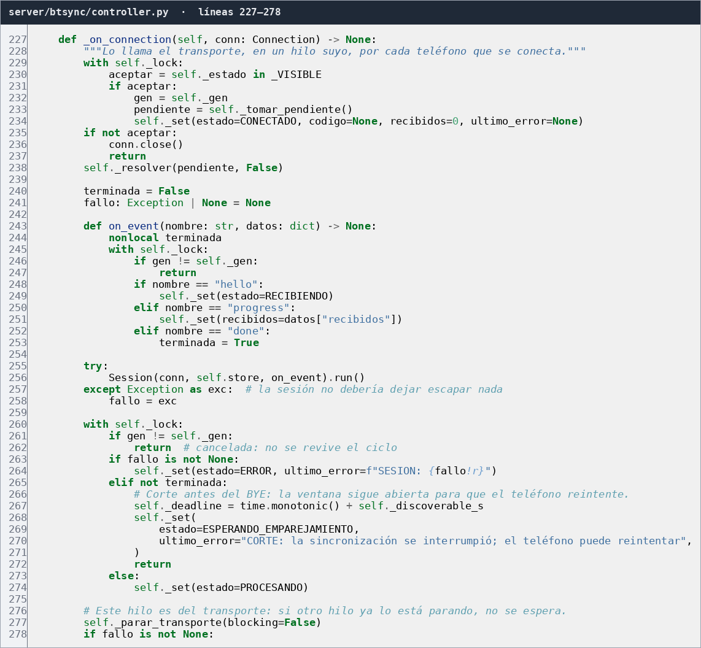

**Figura 14.** Controlador: una sesión por conexión y D19 (PC ocupado).  
Archivo: server/btsync/controller.py (líneas 227–278). Función o elemento: `SyncController._on_connection`.  
Demuestra: la creación de una sesión por conexión, el rechazo de un segundo teléfono (`OCUPADO`) y el cambio de estado. Criterio: Arquitectura / concurrencia.  

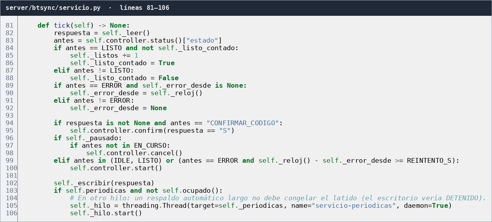

**Figura 15.** Servicio: latido, pausa y estado en SERVICIO_BT.  
Archivo: server/btsync/servicio.py (líneas 81–106). Función o elemento: `Servicio.tick`.  
Demuestra: el latido y la gestión de pausa que mantienen visible el estado del servicio en Oracle. Criterio: Arquitectura / concurrencia.  

Para la rúbrica de arquitectura, el punto que el código sí demuestra es que la interfaz del escritorio no se bloquea con consultas, y que la APK no hace red en su hilo principal. La Figura 16 ofrece la máquina de estados del controlador, el mecanismo que coordina estas piezas.

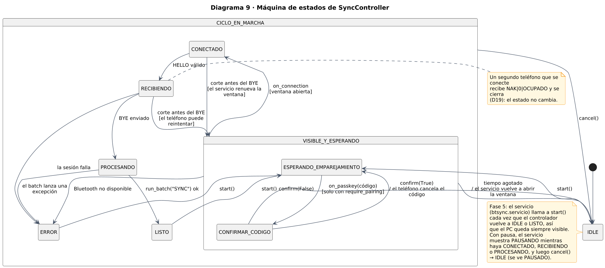

**Figura 16.** Máquina de estados del controlador de sincronización.  
Fuente: elaboración propia. PlantUML: diagramas/plantuml/09_estados.puml.  
Demuestra: estados reales de `SyncController` y sus transiciones. Criterio: Arquitectura y código fuente.  


### 7.8 Gestión de errores

- **Protocolo:** cada línea inválida produce `NAK|<seq esperado>|<motivo>` con motivos `CRC`, `FORMAT`, `LINEA_LARGA`, `SECUENCIA`, `DB_NO_DISPONIBLE`, `CUENTA_NO_ACTIVA` y `OCUPADO`.
- **Base de datos:** si Oracle no está disponible durante la sesión, `Session._db_unavailable` responde `NAK DB_NO_DISPONIBLE`; `connect_oracle` reintenta hasta tres veces ante `ORA-12516`.
- **Lecturas inválidas:** el *batch* las deja en `ERROR` con mensaje (por ejemplo `CANTIDAD_INVALIDA`) y no entran a la conciliación hasta reprocesarlas.
- **Interfaz:** `StateBanner` y avisos muestran errores de Oracle o del servicio; el servicio no se detiene si falla una tarea periódica.


## 8. Modelo de datos y base de datos


### 8.1 Motor, conexión y persistencia

El motor es **Oracle Database 11g Express Edition 11.2.0.2.0** (verificado con `v$version` en el contenedor `gvenzl/oracle-xe:11-slim`). Las aplicaciones Python se conectan con **python-oracledb 26.1.0 en modo *thick*** mediante el Instant Client 19.23, porque Oracle 11g lo exige. La conexión de la aplicación y del servicio se abre con el usuario `app`; las credenciales viven en el archivo `.env` y nunca se incluyen en este documento. La persistencia es un volumen Docker (`oracle-data`).

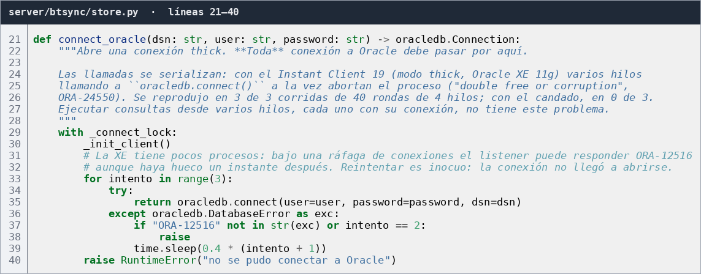

**Figura 17.** Conexión con Oracle (python-oracledb).  
Archivo: server/btsync/store.py (líneas 21–40). Función o elemento: `connect_oracle`.  
Demuestra: la apertura de conexiones serializada con candado y el reintento ante `ORA-12516`. Criterio: Conectividad / datos.  


### 8.2 Tablas y relaciones

El esquema tiene 17 tablas: catorce creadas por `db/init/01_schema.sql` y tres que crea la propia aplicación al arrancar (`AUDITORIA`, `NOTIFICACIONES` y `NOTIFICACIONES_LEIDAS`). La Tabla 10 resume las principales con sus claves; el Figura 18 muestra todas con sus relaciones.

**Tabla 10.** _Tablas principales del esquema_

| Tabla | Clave primaria | Claves foráneas y restricciones | Campos relevantes y propósito |
|---|---|---|---|
| `CONTEOS` | `ID_CONTEO` | `CHECK ESTADO = 'ABIERTO'` | Una sola fila `ACTUAL` («Conteo continuo»), siempre abierta |
| `PRODUCTOS` | `SKU` | — | Nombre, categoría, unidad, `COSTO_UNIT` `NUMBER(12,2)` |
| `STOCK_SISTEMA` | `(ID_CONTEO, SKU)` | FK a `CONTEOS` y `PRODUCTOS` | `CANTIDAD_SISTEMA` `NUMBER(12,3)`; el operador nunca la ve |
| `DISPOSITIVOS` | `UUID` | — | Nombre y última sincronización de cada teléfono |
| `CAPTURA_TRANSITO` | `ID_TRANSITO` | `UNIQUE (UUID_DISPOSITIVO, SEQ)`; `CHECK` de estado (`PENDIENTE`, `PROCESANDO`, `PROCESADO`, `ERROR`, `NUEVO_SKU`, `DESCARTADO`) | `DATOS_RAW` `VARCHAR2(4000 BYTE)`: la línea `REC` sin CRC |
| `REGISTROS_PROCESADOS` | `ID_REGISTRO` | `UNIQUE (ID_TRANSITO)`, FK a tránsito | `CANTIDAD`, `DANADOS`, `VIGENTE` `CHAR(1)`, `FECHA_CAPTURA` |
| `CONCILIACION` | `(ID_CONTEO, SKU)` | FK a `CONTEOS` y `PRODUCTOS` | `CANT_SISTEMA`, `CANT_CONTADA`, `DIFERENCIA`, `DIFERENCIA_PCT` |
| `FOTOS`, `SYNC_SESIONES`, `LOG_BATCH` | id o clave compuesta | FK a tránsito o dispositivos | Ruta de foto, sesiones de sincronización y corridas del *batch* |
| `USUARIOS` | `USUARIO` | `CHECK` de `ROL`, `ESTADO`, `ORIGEN`, `TEMA`, `IDIOMA`; correo obligatorio si `ORIGEN <> 'MOVIL'` | `CLAVE_HASH`, `INTENTOS`, `BLOQUEADO_HASTA`, pregunta y respuesta (hash) |
| `PERMISOS` | `(ROL, MODULO)` | `CHECK NIVEL IN (NINGUNO, CONSULTA, GESTION)` | 36 filas: 3 roles × 12 módulos |
| `CONFIGURACION`, `SERVICIO_BT` | `CLAVE`; `ID` | — | Seis claves de configuración; estado, latido y pausa del servicio (fila única) |
| `AUDITORIA`, `NOTIFICACIONES`, `NOTIFICACIONES_LEIDAS` | id | Creadas por la app | Rastro de cambios y avisos por rol o usuario |

_Fuente: db/init/01_schema.sql y docs/uml/04-modelo-datos.puml._

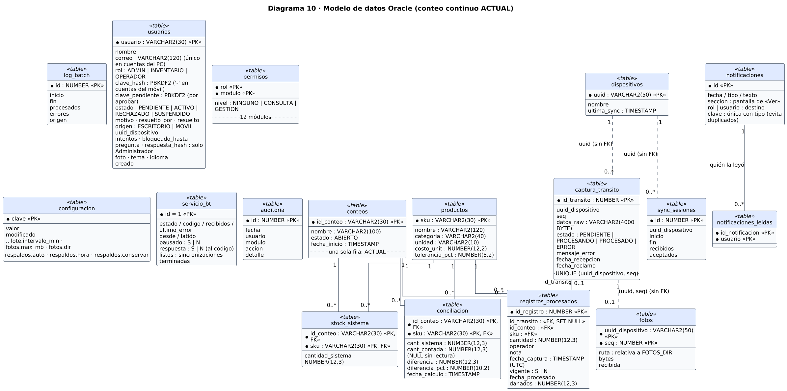

**Figura 18.** Diagrama del modelo de datos de Oracle (conteo continuo ACTUAL).  
Fuente: elaboración propia a partir de db/init/01_schema.sql. PlantUML: diagramas/plantuml/10_modelo_datos.puml.  
Demuestra: tablas, llaves y cardinalidades reales. Criterio: Funcionalidad / Arquitectura.  

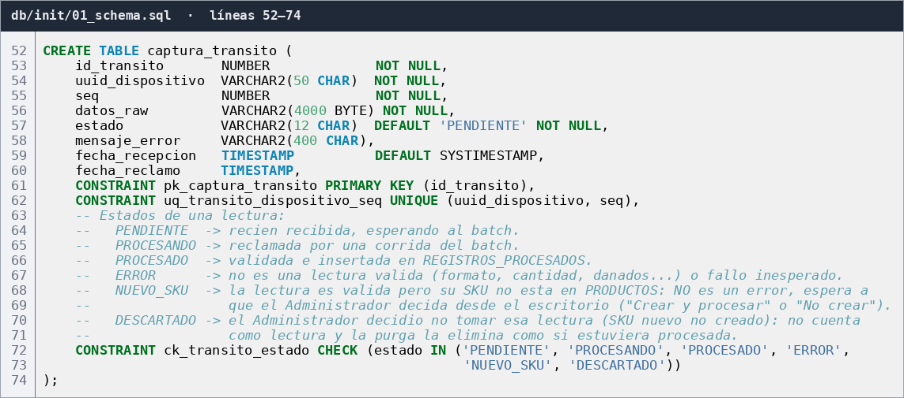

**Figura 19.** Modelo de datos: tabla de staging CAPTURA_TRANSITO.  
Archivo: db/init/01_schema.sql (líneas 52–74). Función o elemento: `CREATE TABLE captura_transito`.  
Demuestra: la tabla de *staging* con su clave única `(uuid, seq)` y los estados de una lectura. Criterio: Datos.  


### 8.3 Vistas, trabajos y consultas principales

**Tabla 11.** _Vistas, trabajos programados y consultas_

| Elemento | Tipo | Para qué se usa |
|---|---|---|
| `V_RESUMEN_CONTEO` | Vista | Avance, contados, faltantes, sobrantes (`fetch_resumen`) |
| `V_DIF_CATEGORIA`, `V_TOP_DESVIOS` | Vista | Diferencia por categoría y mayores desvíos (definidas en `05_views.sql`; las gráficas de la app calculan sus series con `fetch_por_categoria` y `fetch_series`) |
| `V_ACTIVIDAD` | Vista | Lecturas por operador (`fetch_actividad`) |
| `V_ESTADO_BATCH` | Vista | Última corrida y pendientes (`fetch_estado_batch`) |
| `V_NUEVOS_SKU`, `V_ERRORES_CAPTURA` | Vista | Lecturas con SKU nuevo y con error (`fetch_nuevos_sku`, `fetch_errores`) |
| `JOB_PROCESAR_CAPTURAS` | Trabajo `DBMS_SCHEDULER` | Ejecuta `PKG_BATCH.procesar_pendientes` (`FREQ=MINUTELY;INTERVAL=1` por defecto) |
| `JOB_PURGA_TRANSITO` | Trabajo `DBMS_SCHEDULER` | Purga filas de tránsito procesadas (`FREQ=DAILY`) |
| `PKG_BATCH` | Paquete PL/SQL | `procesar_pendientes`, `conciliar`, `reprocesar_errores`, `purgar_transito`, `alta_sku`, `alta_y_procesar`, `descartar_nuevo_sku` |

_Fuente: db/init/03_pkg_batch.sql, 04_jobs.sql, 05_views.sql y desktop/app/db.py._

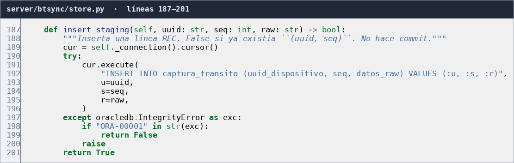

**Figura 20.** Persistencia: inserción idempotente en CAPTURA_TRANSITO.  
Archivo: server/btsync/store.py (líneas 187–201). Función o elemento: `Store.insert_staging`.  
Demuestra: la inserción idempotente: devuelve `False` si `(uuid, seq)` ya existía, sin duplicar. Criterio: Conectividad / datos.  

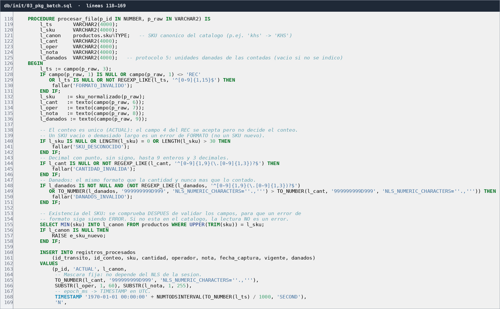

**Figura 21.** PKG_BATCH: validación y proceso de una lectura.  
Archivo: db/init/03_pkg_batch.sql (líneas 118–169). Función o elemento: `procesar_fila` en `PKG_BATCH`.  
Demuestra: la validación PL/SQL de cada lectura: SKU conocido, cantidad y dañados válidos; si no, queda en `ERROR`. Criterio: Datos / funcionalidad.  


### 8.4 Operaciones de escritura, transacciones y errores

- **Escritura del servicio:** `insert_staging` por lectura y `COMMIT` cada 25 inserciones o al `END`; un corte antes del `COMMIT` provoca `ROLLBACK` de las filas no confirmadas.
- **Escritura del *batch*:** cada fila se reclama (`PENDIENTE → PROCESANDO`), se inserta en `REGISTROS_PROCESADOS`, se recalcula la lectura vigente y se marca `PROCESADO`; las filas `PROCESANDO` de más de 5 minutos se devuelven a `PENDIENTE`.
- **Auditoría:** el escritorio escribe en `AUDITORIA` dentro de la misma transacción que cada cambio (D28).
- **Restauración:** se ejecuta en una transacción, tras pausar el servicio y guardar un respaldo previo (D29).
- **Errores de conexión:** el escritorio muestra «Oracle no está listo» y reintenta; el servicio responde `NAK DB_NO_DISPONIBLE`.

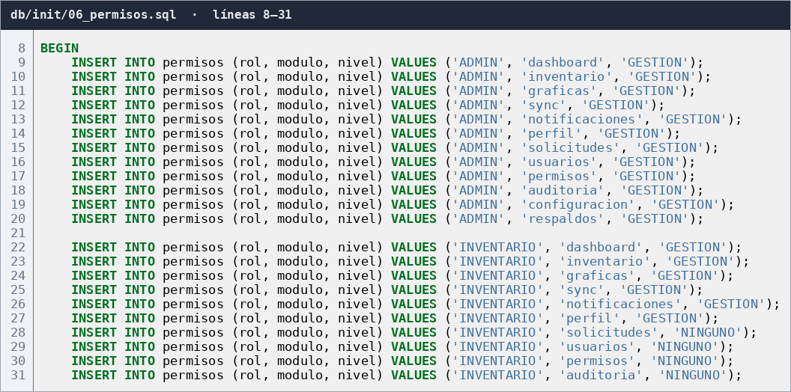

**Figura 22.** Matriz de permisos rol × módulo (Oracle).  
Archivo: db/init/06_permisos.sql (líneas 8–31). Función o elemento: bloque `BEGIN … INSERT INTO permisos`.  
Demuestra: la matriz de permisos inicial (rol × módulo × nivel) sembrada en Oracle. Criterio: Seguridad / datos.  


## 9. Conectividad y comunicación de datos


### 9.1 Mecanismos de comunicación implementados

El proyecto implementa cuatro canales de datos y no usa REST ni WebSockets: no existe ninguna interfaz HTTP en el código. Los canales son Bluetooth clásico RFCOMM entre la APK y el servicio, D-Bus entre el servicio y BlueZ, SQL\*Net entre las aplicaciones Python y Oracle, y un transporte TCP alterno que se usa en pruebas y como plan B de demostración (`BT_TRANSPORT=tcp`). Entre el servicio y el escritorio no hay canal directo: coordinan por la tabla `SERVICIO_BT`.

**Tabla 12.** _Canales de comunicación_

| Canal | Participantes | Protocolo | Dirección | Datos |
|---|---|---|---|---|
| Bluetooth RFCOMM | APK ↔ servicio `bluetooth` (vía BlueZ) | Líneas UTF-8 con `\|` y CRC32 (versión 5) | Bidireccional | `HELLO`, `ACCT`, `REC`, `FOTO`, `END` ↔ `ACCTST`, `READY`, catálogo, `ACK`, `NAK`, `BYE` |
| D-Bus (`org.bluez`) | Servicio ↔ `bluetoothd` | D-Bus del sistema (`dbus-fast`) | Bidireccional | `RegisterProfile`, `NewConnection(fd)`, alias y visibilidad del adaptador |
| SQL\*Net 1521 | Servicio y escritorio ↔ Oracle | Oracle Net (`oracledb`, modo thick) | Bidireccional | INSERT en tránsito, llamadas a `PKG_BATCH`, SELECT sobre vistas, `SERVICIO_BT` |
| TCP (alterno) | Teléfono simulado ↔ servicio | El mismo protocolo de líneas | Bidireccional | Pruebas y demostración; `TcpTransport` |

_Fuente: server/btsync/transports, docs/protocolo.md y docs/arquitectura.md._


### 9.2 Formato de mensajes

Cada mensaje es una línea UTF-8 terminada en `\n`. Los campos se separan con `|`; al final se añaden `*` y el CRC32 de los bytes anteriores en ocho dígitos hexadecimales mayúsculos. La longitud máxima es de 4000 bytes. Los caracteres `%`, `|`, `\r` y `\n` dentro de campos de texto se codifican como `%25`, `%7C`, `%0D` y `%0A`. Ejemplo calculado con la herramienta del proyecto (`python -m btsync.protocol --frame`): `HELLO|5|dev-0001|Bodega Norte*788FF277`.

**Tabla 13.** _Mensajes del protocolo (versión 5)_

| Sentido | Mensaje | Campos | Validación o efecto |
|---|---|---|---|
| Móvil → PC | `HELLO` | versión, `uuid_dispositivo`, nombre | Versión distinta de 5: `NAK\|0\|FORMAT` |
| Móvil → PC | `ACCT` | usuario, nombre | Usuario `[a-z0-9._-]{3,30}`, nombre de 1 a 60; crea la cuenta PENDIENTE si no existe |
| Móvil → PC | `REC` | `seq`, `epoch_ms`, `ACTUAL`, `sku`, `cantidad`, `operador`, `nota`, `danados` | Cantidad `^\d{1,9}(\.\d{1,3})?$`; `seq` contiguo por dispositivo |
| Móvil → PC | `FOTO` | `seq`, parte, total, `crc32`, base64 | Hasta 2700 caracteres por parte; CRC del archivo; máximo 2 MB |
| Móvil → PC | `END` | `n_registros` | Cierra el envío; `COMMIT` y `ACK` final |
| PC → móvil | `ACCTST` | usuario, estado, rol, motivo | Sin estado `ACTIVO` no se aceptan lecturas |
| PC → móvil | `READY` | último `seq` confirmado, hora del servidor | El móvil reconcilia su `Outbox` y corrige su reloj (D15) |
| PC → móvil | `CATTAREA`, `CATITEM`, `CATPROD`, `CAT_END` | catálogo sin stock | Conteo ciego (D12) |
| PC → móvil | `ACK` | `seq` | Acumulativo: todo `seq ≤ n` persistido con `COMMIT` |
| PC → móvil | `NAK` | `seq` esperado, motivo | El móvil retrocede a ese `seq` (*go-back-N*) |
| PC → móvil | `BYE` | aceptados, rechazados | Fin de la sesión; no informa del resultado del *batch* |

_Fuente: docs/protocolo.md contrastado con server/btsync/protocol.py._

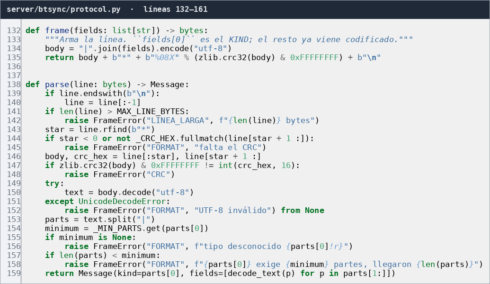

**Figura 23.** Protocolo: construcción y validación de tramas (longitud, CRC32, formato).  
Archivo: server/btsync/protocol.py (líneas 132–161). Función o elemento: `frame`, `parse`.  
Demuestra: la construcción de la trama con CRC32 y la validación de longitud, CRC y número de campos que produce `FrameError`. Criterio: Conectividad.  


### 9.3 Secuencia, validación y confirmación

El Figura 24 sigue el recorrido de un conteo desde la `Outbox` hasta la consulta del escritorio. La sesión valida cada `REC` en este orden: longitud, CRC, formato, cuenta activa y secuencia. Si el `seq` es menor al esperado es un duplicado y se ignora (lo cubre el siguiente `ACK`); si es mayor hay un hueco y se envía un único `NAK|esperado|SECUENCIA`; si es igual, se inserta.

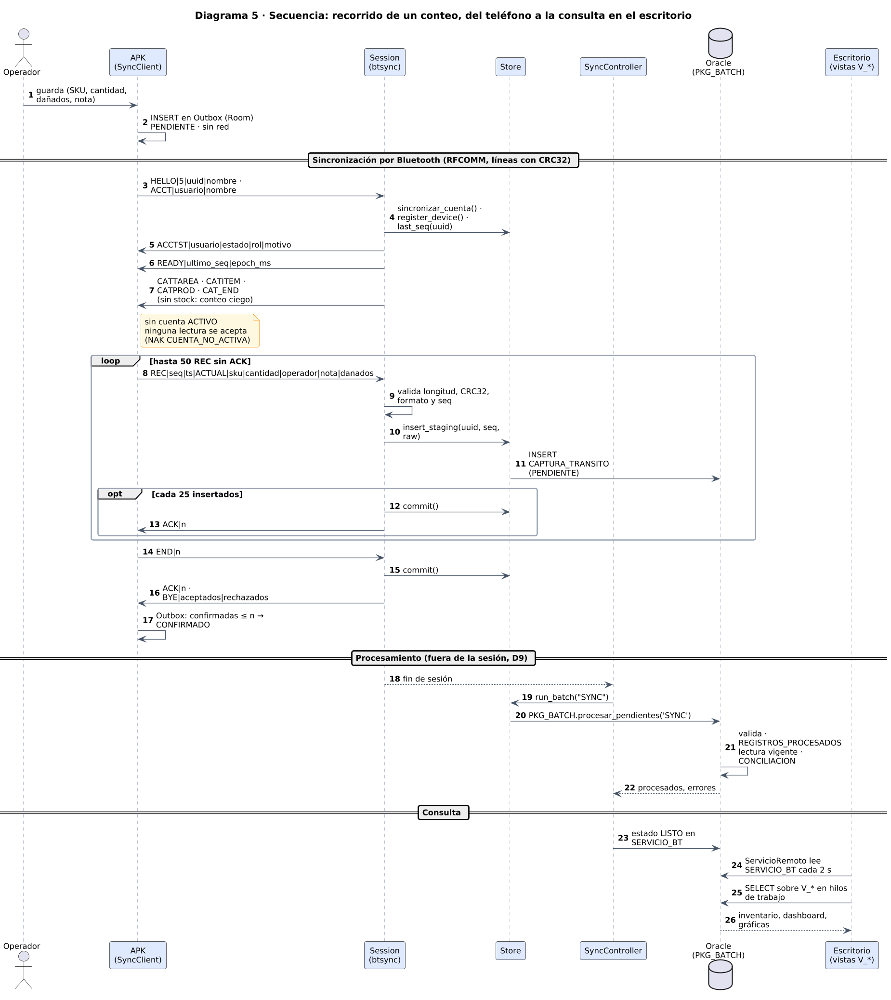

**Figura 24.** Diagrama de secuencia del flujo principal de datos.  
Fuente: elaboración propia a partir de session.py, controller.py y store.py. PlantUML: diagramas/plantuml/05_secuencia_flujo_datos.puml.  
Demuestra: el recorrido real de los datos del teléfono a Oracle y su consulta. Criterio: Conectividad y comunicación.  

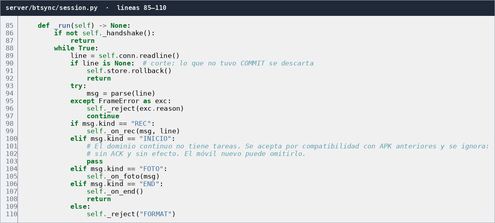

**Figura 25.** Sesión: bucle de recepción y despacho de mensajes.  
Archivo: server/btsync/session.py (líneas 85–110). Función o elemento: `Session._run`.  
Demuestra: el bucle de lectura y el despacho por tipo de mensaje dentro de una sesión. Criterio: Conectividad.  

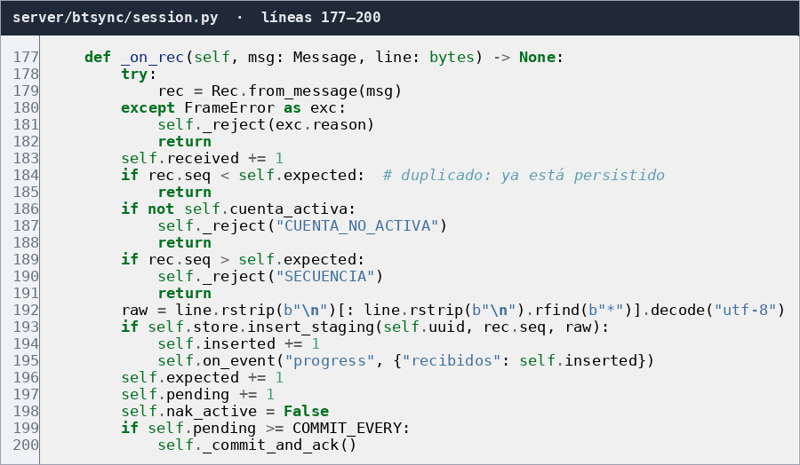

**Figura 26.** Sesión: validación de secuencia, inserción y NAK (go-back-N).  
Archivo: server/btsync/session.py (líneas 177–200). Función o elemento: `Session._on_rec`.  
Demuestra: la validación de secuencia, la inserción en staging y el `NAK` con retroceso. Criterio: Conectividad.  

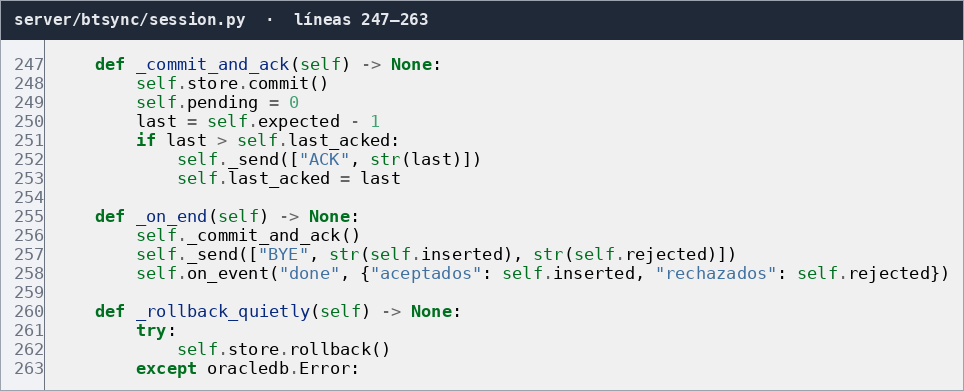

**Figura 27.** Sesión: COMMIT y confirmación acumulativa ACK.  
Archivo: server/btsync/session.py (líneas 247–263). Función o elemento: `Session._commit_and_ack`.  
Demuestra: el `COMMIT` y el envío del `ACK` acumulativo; el `ROLLBACK` silencioso ante fallos. Criterio: Conectividad.  

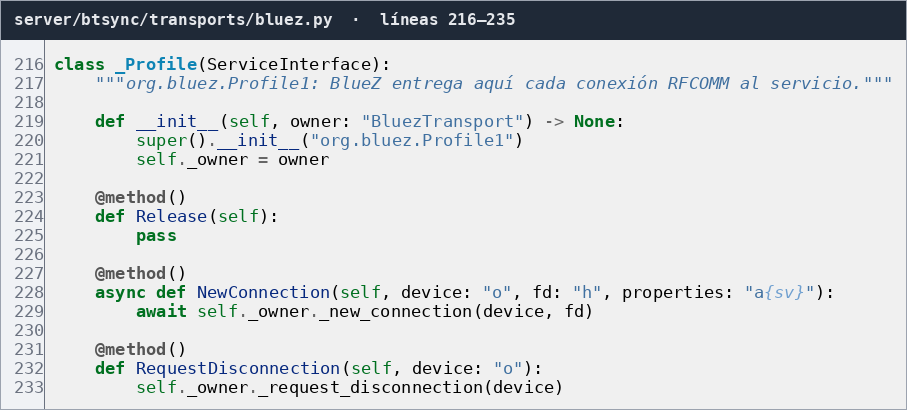

**Figura 28.** Transporte Bluetooth: perfil RFCOMM registrado por D-Bus (BlueZ ProfileManager1).  
Archivo: server/btsync/transports/bluez.py (líneas 216–235). Función o elemento: `_Profile`.  
Demuestra: la interfaz D-Bus que BlueZ invoca (`NewConnection`) cuando un teléfono se conecta al perfil RFCOMM. Criterio: Conectividad.  


### 9.4 Reintentos, cortes y reanudación

Si la conexión se corta antes del `COMMIT`, el servidor hace `ROLLBACK` y conserva solo lo confirmado. Al reconectar, el móvil recibe `READY|<último seq>` y reconcilia su `Outbox`: lo confirmado pasa a `CONFIRMADO` y lo enviado sin confirmar vuelve a `PENDIENTE`. `SyncRunner` reintenta la conexión hasta tres veces. El Figura 29 describe el caso probado con 30 lecturas, y la sección 9.5 muestra la misma situación ejecutada realmente.

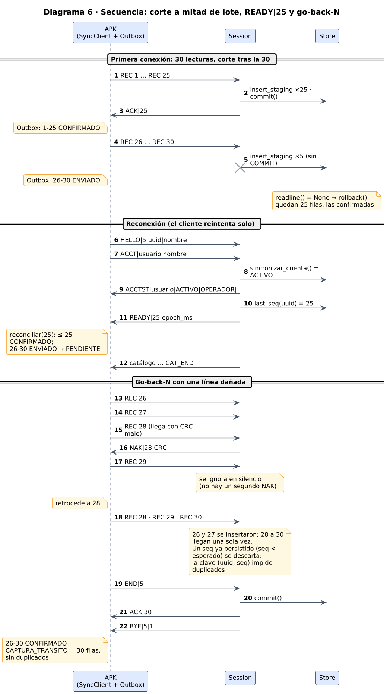

**Figura 29.** Diagrama de secuencia de comunicación: corte, READY y retroceso go-back-N.  
Fuente: elaboración propia a partir de la prueba `test_connection_cut_after_30_rec_keeps_25`. PlantUML: diagramas/plantuml/06_secuencia_comunicacion.puml.  
Demuestra: mensajes, confirmaciones, NAK y reanudación sin duplicados. Criterio: Conectividad y comunicación.  

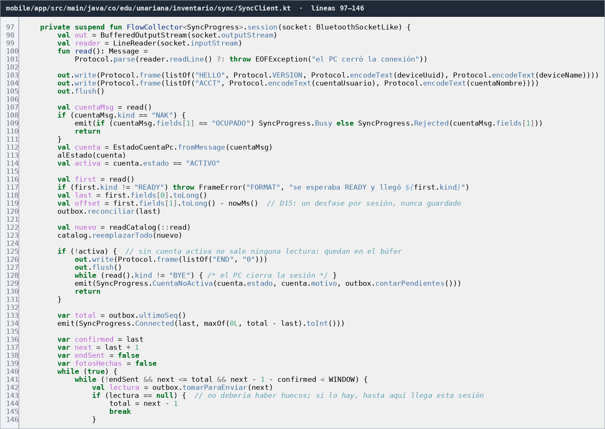

**Figura 30.** Android: SyncClient, protocolo de sincronización (HELLO, READY, REC, ACK).  
Archivo: mobile/app/src/main/java/co/edu/umariana/inventario/sync/SyncClient.kt (líneas 97–146). Función o elemento: `SyncClient.session`.  
Demuestra: el lado móvil del protocolo: lectura de `READY`, `ACCTST` y catálogo, y envío de `REC` en ventanas. Criterio: Conectividad.  

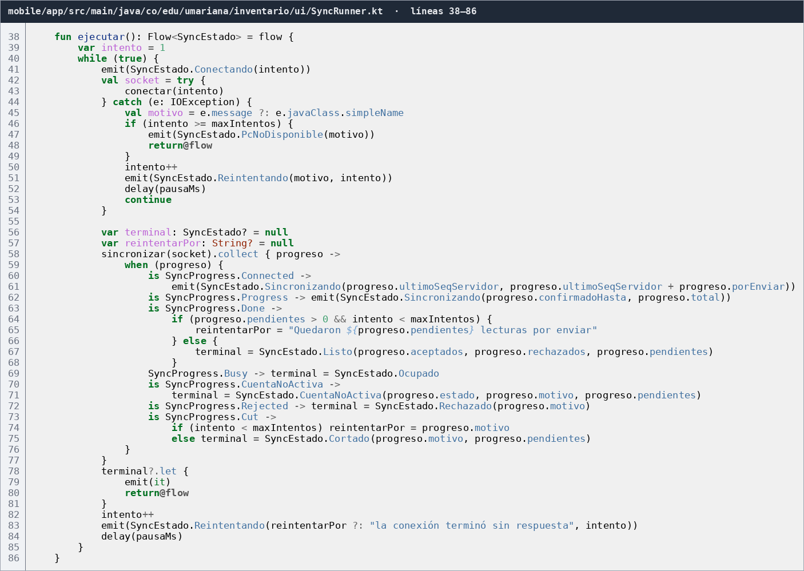

**Figura 31.** Android: SyncRunner con reintentos y estados.  
Archivo: mobile/app/src/main/java/co/edu/umariana/inventario/ui/SyncRunner.kt (líneas 38–86). Función o elemento: `SyncRunner.ejecutar`.  
Demuestra: los estados de la sincronización (`Conectando`, `Reintentando`, `Cortado`, `Listo`…) y el reintento de conexión. Criterio: Conectividad / UI.  

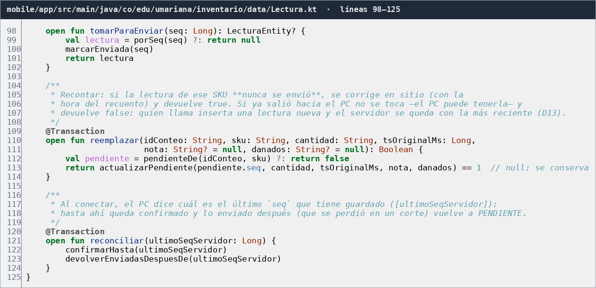

**Figura 32.** Android: Outbox (Room), envío y reconciliación tras un corte.  
Archivo: mobile/app/src/main/java/co/edu/umariana/inventario/data/Lectura.kt (líneas 98–125). Función o elemento: `Outbox.tomarParaEnviar`, `reemplazar`, `reconciliar`.  
Demuestra: cómo la bandeja local pasa lecturas por `PENDIENTE`, `ENVIADO` y `CONFIRMADO`, y se reconcilia con `READY`. Criterio: Conectividad / datos.  


### 9.5 Evidencia de funcionamiento real

En este equipo no hay un teléfono emparejado (`adb devices` no lista dispositivos), por lo que la evidencia de comunicación usa el **transporte TCP** del proyecto con el **teléfono simulado** `tools/fake_phone.py`, que habla el mismo protocolo que la APK. La prueba se ejecutó contra un Oracle independiente y limpio (puerto 1522) para no alterar los datos de demostración. No se afirma que el enlace Bluetooth físico se haya verificado en esta ejecución; la capa Bluetooth se comprueba con las pruebas de `BluezTransport` (con un bus D-Bus falso) y con la prueba de campo documentada en `docs/spikes/bluez.md`.

**Resultado de la sincronización.** Con la cuenta sin aprobar, el PC respondió que está pendiente y no aceptó lecturas (Figura 33). Tras la aprobación, el teléfono envió 126 lecturas; el servicio respondió `BYE|126|0` y el *batch* procesó 123, dejó 1 en `ERROR` (`CANTIDAD_INVALIDA`) y 2 en `NUEVO_SKU`, sin filas duplicadas (Figura 34).

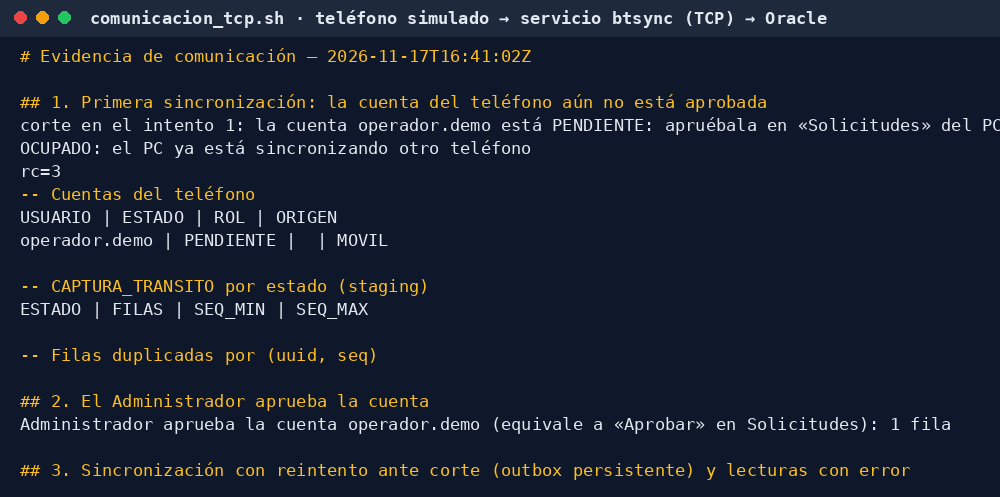

**Figura 33.** Ejecución real: cuenta pendiente, aprobación y envío de 126 lecturas.  
Fuente: docs/documentacion/anexos/registros/comunicacion_tcp.txt (generado por herramientas/comunicacion_tcp.sh, 17-nov-2026).  
Demuestra: validación de la cuenta y confirmación `BYE`. Criterio: Conectividad y comunicación.  

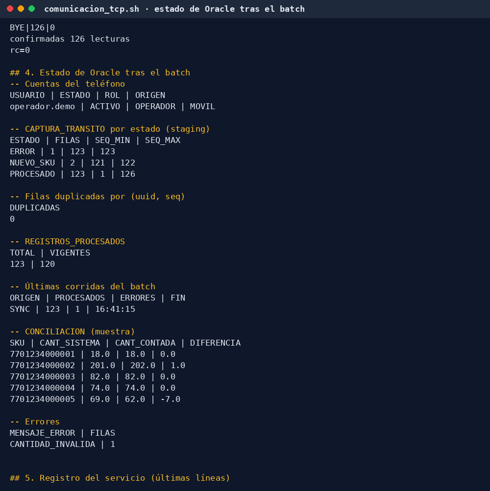

**Figura 34.** Ejecución real: estado de Oracle tras el batch.  
Fuente: comunicacion_tcp.txt. Consulta de solo lectura con herramientas/consulta_estado.py.  
Demuestra: persistencia posterior, ausencia de duplicados y conciliación calculada. Criterio: Conectividad y comunicación.  

**Corte y reanudación.** Un segundo teléfono simulado fue terminado con `SIGKILL` a los 4 s: en Oracle quedaron 50 filas confirmadas. Al relanzar con el mismo *outbox*, el servicio respondió con el último `seq` y el teléfono envió solo las 70 restantes (`BYE|70|0`): 120 filas en total, 0 duplicadas (Figura 35 y Figura 36).

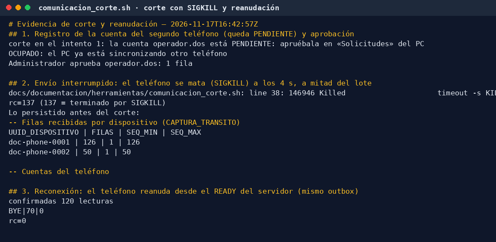

**Figura 35.** Ejecución real: corte del envío con SIGKILL y reanudación.  
Fuente: anexos/registros/comunicacion_corte.txt (herramientas/comunicacion_corte.sh).  
Demuestra: reintento y reanudación desde el último `seq` confirmado. Criterio: Conectividad y comunicación.  

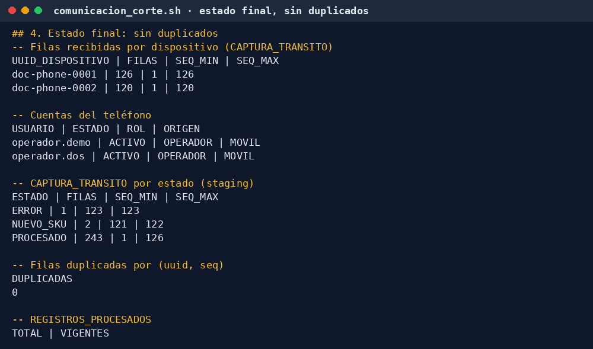

**Figura 36.** Ejecución real: estado final tras la reanudación, sin duplicados.  
Fuente: comunicacion_corte.txt.  
Demuestra: integridad `(uuid, seq)` tras un corte. Criterio: Conectividad y comunicación.  


### 9.6 Seguridad y límites del canal

Por decisión de diseño (D22) el modo por defecto **no empareja ni cifra** el enlace: el teléfono recuerda al PC y conecta directo. Quien esté al alcance (~10 m) podría conectarse y enviar lecturas falsas mientras el servicio esté activo; las mitigaciones documentadas son aceptar un solo teléfono a la vez, validar cada línea, exigir una cuenta aprobada y vinculada al UUID del teléfono, y permitir al Administrador pausar el servicio. Existe un modo con código de emparejamiento (`BT_CON_CLAVE=1`) que no se ejecutó en esta verificación. Por todo ello no se afirma que la comunicación sea «segura» en sentido de confidencialidad.

**Tabla 14.** _Escenarios de falla y mecanismo de tolerancia_

| Escenario | Mecanismo | Prueba o evidencia |
|---|---|---|
| Línea dañada (CRC) | `NAK\|n\|CRC` y retroceso | `test_bad_crc_naks_expected_seq_and_survives` |
| Hueco en la secuencia | Un solo `NAK\|n\|SECUENCIA`; se ignoran las siguientes | `test_seq_gap_naks_once_and_ignores_followers` |
| Línea mayor de 4000 bytes | `NAK\|…\|LINEA_LARGA` | `test_line_over_4000_bytes_naks_linea_larga` |
| Corte a mitad del lote | `ROLLBACK`, `READY` y reenvío | `test_connection_cut_after_30_rec_keeps_25`; sección 9.5 |
| Duplicado en una nueva sesión | Clave única `(uuid, seq)` | `test_duplicate_rec_in_new_session_is_not_inserted` |
| Oracle no disponible | `NAK DB_NO_DISPONIBLE` | `test_oracle_down_replies_nak_db_unavailable` |
| Cuenta pendiente | `NAK CUENTA_NO_ACTIVA`; el móvil conserva las lecturas | `test_rec_con_cuenta_pendiente_recibe_nak_cuenta_no_activa`; sección 9.5 |
| Otro teléfono con el mismo usuario | Estado `SUSPENDIDO` por vínculo al UUID | `test_otro_telefono_con_el_mismo_usuario_no_entrega_lecturas` |
| Segunda sincronización simultánea | `NAK\|0\|OCUPADO` | `test_bluez.py`, `test_e2e_tcp.py` |

_Fuente: server/tests/test_session.py, test_bluez.py y test_e2e_tcp.py; ejecución del capítulo 14._


## 10. Flujos de operación del sistema

Este capítulo describe los procesos de extremo a extremo con sus validaciones y errores. Los diagramas de secuencia de los flujos de datos se encuentran en el capítulo 9; aquí se añaden los diagramas de actividades y de estados.

**Tabla 15.** _Procesos principales de extremo a extremo_

| Proceso | Actor y componentes | Entradas y pasos | Validaciones y errores | Resultado |
|---|---|---|---|---|
| F1 · Acceso en el PC | Admin/Inventario; `AccesoView`, `auth` | Usuario y contraseña → hash PBKDF2 → sesión con permisos de Oracle | Mensaje genérico ante usuario o clave erróneos; bloqueo de 30 s tras 5 intentos; el Operador no entra al PC; cuenta no activa → Estado de cuenta | Ventana con las secciones del rol |
| F2 · Captura móvil | Operador; `ContarScreen`, `CountViewModel`, `Outbox` | SKU (escáner o digitado), cantidad, dañados, nota, foto → Guardar | Cantidad válida, dañados ≤ cantidad, longitudes máximas (operador 60, nota 255); SKU desconocido se guarda pendiente | Lectura PENDIENTE en `Outbox` |
| F3 · Sincronización | Operador; `SyncRunner`, `Session` | Pulsar Sincronizar → búsqueda → `HELLO` … `BYE` | CRC, formato, secuencia, cuenta activa, PC ocupado, corte | Lecturas CONFIRMADO y filas en tránsito |
| F4 · Procesamiento | Scheduler o controlador; `PKG_BATCH` | Filas PENDIENTE → reclamar → validar → insertar → vigente → conciliar | SKU desconocido → `NUEVO_SKU`; datos inválidos → `ERROR`; huérfanas se recuperan | `CONCILIACION` de `ACTUAL` |
| F5 · Consulta | Admin/Inventario; vistas y `QueryRunner` | Abrir Dashboard, Inventario o Gráficas → SELECT en hilo de trabajo | Estado de error de Oracle visible; resultados obsoletos descartados | Tarjetas, tablas, gráficas, CSV |
| F6 · SKU nuevo | Administrador; `aviso_nuevo_sku`, `PKG_BATCH.alta_y_procesar` | Aviso flotante → nombre y categoría → Crear y procesar | Nombre y categoría obligatorios; confirmación antes de descartar | Producto creado y lectura reflejada, o lectura descartada |
| F7 · Aprobación de cuentas | Administrador; `SolicitudesView` | Cuenta pendiente → Aprobar con rol o Rechazar con motivo | Rol restringido por origen; motivo ≤ 300 caracteres; auditoría | Cuenta ACTIVO o RECHAZADO |
| F8 · Respaldo y restauración | Administrador; `respaldo.py` | Crear `.zip`; restaurar escribiendo `RESTAURAR` | Se pausa el servicio y se guarda un respaldo previo; una transacción | Datos restaurados; sesión cerrada |

_Fuente: Elaboración propia a partir del código y de la documentación del proyecto._


### 10.1 Del teléfono al batch: diagrama de actividades

El Figura 37 reparte las responsabilidades en carriles: el móvil, la sesión del servicio, el controlador y Oracle. Muestra el ciclo de lectura de `REC` con validación, la confirmación cada 25 y el procesamiento por lotes con recuperación de filas huérfanas.

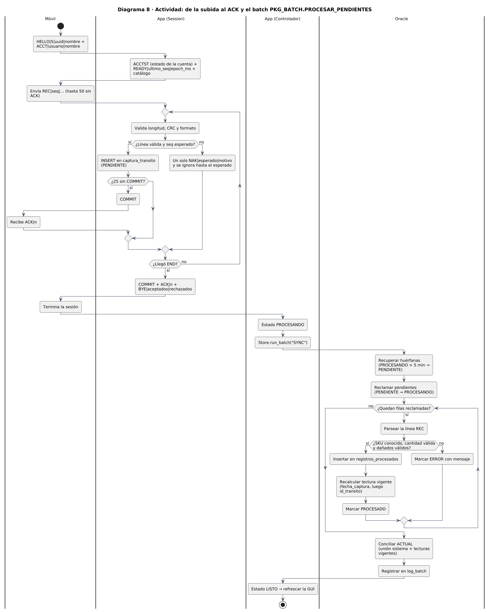

**Figura 37.** Diagrama de actividades: de la subida al ACK y el batch PKG_BATCH.PROCESAR_PENDIENTES.  
Fuente: elaboración propia. PlantUML: diagramas/plantuml/08_actividades.puml.  
Demuestra: flujo real de validación, confirmación y conciliación. Criterio: Funcionalidad y requisitos.  

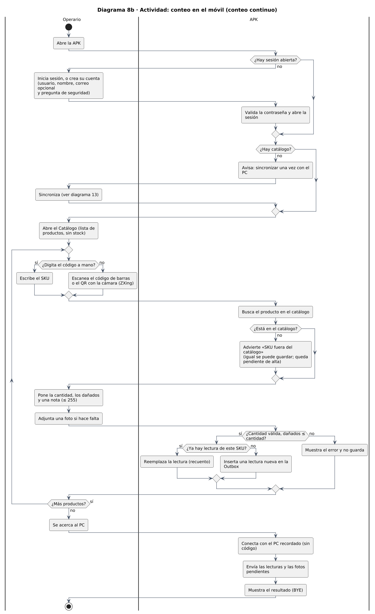

**Figura 38.** Diagrama de actividades del conteo en el móvil.  
Fuente: elaboración propia. PlantUML: diagramas/plantuml/08b_actividad_conteo_movil.puml.  
Demuestra: el flujo del operador desde el acceso hasta la sincronización. Criterio: Funcionalidad y requisitos.  


### 10.2 Estados de una lectura y de una cuenta

Una fila de tránsito recorre `PENDIENTE → PROCESANDO → PROCESADO | ERROR | NUEVO_SKU | DESCARTADO` (Figura 39). Una cuenta pasa por `PENDIENTE → ACTIVO | RECHAZADO` y `ACTIVO ⇄ SUSPENDIDO` (Figura 40). Ambos diagramas coinciden con las restricciones `CHECK` del esquema.

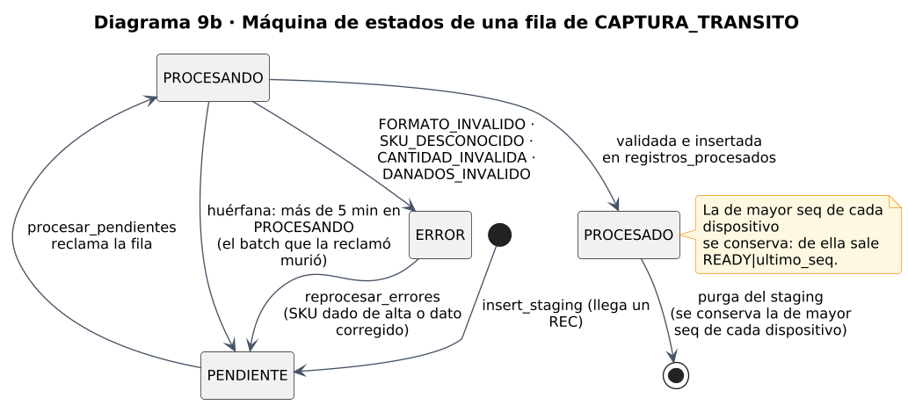

**Figura 39.** Estados de una fila de CAPTURA_TRANSITO.  
Fuente: elaboración propia. PlantUML: diagramas/plantuml/09b_estados_fila_transito.puml.  
Demuestra: ciclo de vida de una lectura en el staging. Criterio: Arquitectura y código fuente.  

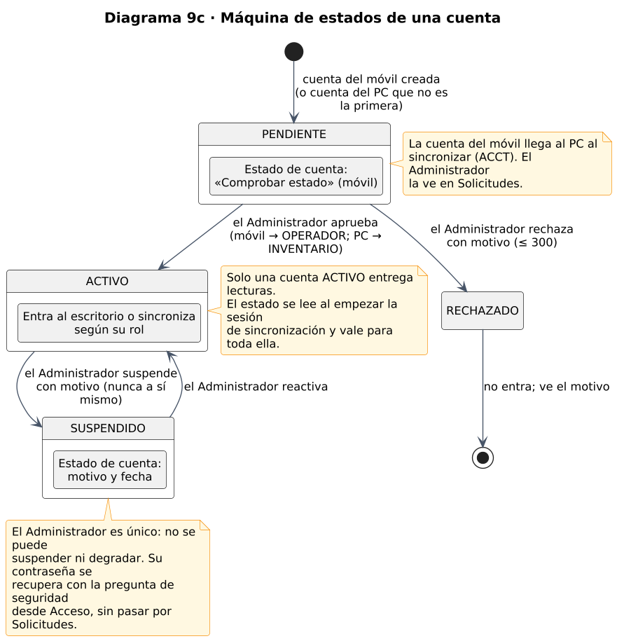

**Figura 40.** Estados de una cuenta de usuario.  
Fuente: elaboración propia. PlantUML: diagramas/plantuml/09c_estados_cuenta.puml.  
Demuestra: ciclo de vida de una cuenta y su acceso. Criterio: Seguridad / Funcionalidad.  


## 11. Descripción de los módulos y funcionalidades

Cada módulo se describe con una ficha y, cuando tiene interfaz, con una captura de la aplicación en ejecución. Las capturas del escritorio se obtuvieron ejecutando la ventana real (`app.main.build_window`) con las cuentas de demostración del README, en el contenedor de la aplicación con Qt en modo `offscreen`, y guardando el contenido de la ventana (`QWidget.grab`). Las de la APK son renderizados del código de Compose de la propia aplicación producidos por la prueba `CapturasTest`; no son fotografías de un teléfono físico. En todos los casos los datos que se ven son los de demostración del proyecto (`08_demo.sql`).

En las capturas del escritorio aparecen dos elementos transitorios reales: un aviso emergente «Servicio Bluetooth en pausa» (el servicio estaba pausado en la base de demostración) y el aviso flotante «Nuevo SKU» con dos lecturas de SKU no registrados. No se alteraron datos para ocultarlos.


### 11.1 Acceso y creación de cuenta (escritorio)

**Tabla 16.** _Ficha del módulo: Acceso_

| Atributo | Detalle |
|---|---|
| Propósito y usuarios | Autenticar a Administrador e Inventario y crear cuentas nuevas (quedan pendientes). |
| Funcionalidades | Usuario y contraseña con mostrar/ocultar, «Recordar usuario», «¿Olvidaste tu contraseña?» (pregunta de seguridad), «Crear cuenta» con indicador de fortaleza y correo obligatorio. |
| Entradas → proceso → salidas | Usuario y contraseña → `auth.iniciar_sesion` verifica PBKDF2, cuenta bloqueos y audita → `Sesion` con rol y permisos, o error genérico, o pantalla Estado de cuenta. |
| Código y dependencias | `views/acceso.py`, `views/estado_cuenta.py`, `auth.py`, `fortaleza.py`; Oracle (`USUARIOS`). |
| Manejo de errores | «Usuario o contraseña incorrectos.» sin distinguir la causa; bloqueo 30 s tras 5 intentos; el Operador recibe «Los operadores usan la app móvil.» |
| Pruebas | `test_auth.py`, `test_fortaleza.py`, `test_estado_cuenta.py`, `test_app.py::test_without_session_the_window_shows_only_the_login` (aprobadas en Oracle limpio). |
| Resultado de verificación | Verificado: captura de la pantalla real (Figura 41) y pruebas aprobadas. |

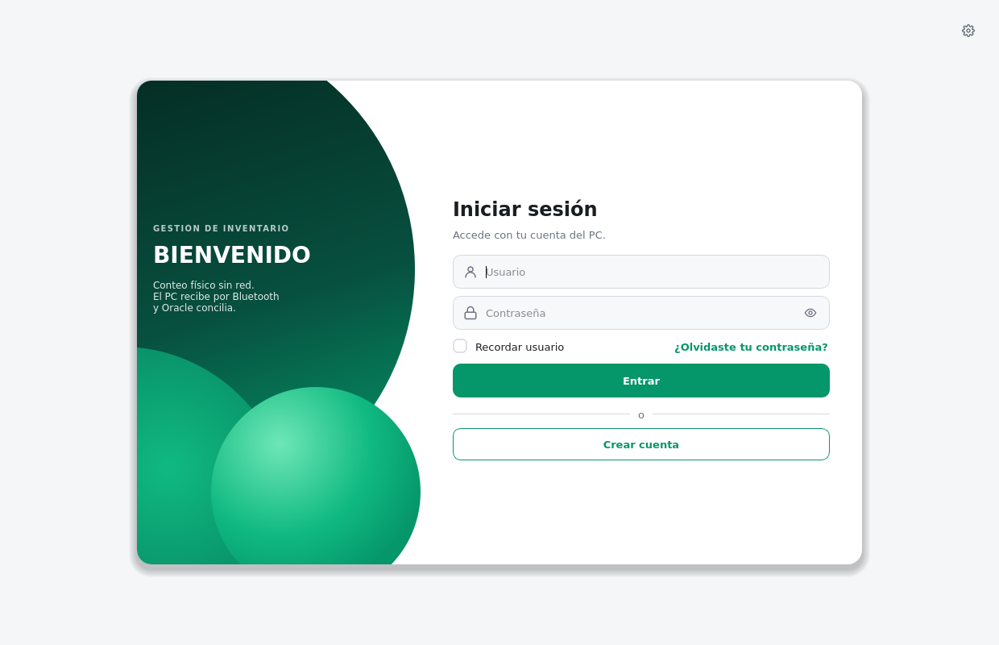

**Figura 41.** Pantalla de acceso de la aplicación de escritorio.  
Fuente: captura de la aplicación real en ejecución (PyQt6 sobre Oracle XE 11g); archivo docs/documentacion/capturas/aplicacion/acceso/01_acceso.png.  
Demuestra: la pantalla inicial real, con usuario, contraseña, recordar usuario, recuperación y alta de cuenta. Criterio: UI/UX y Funcionalidad.  

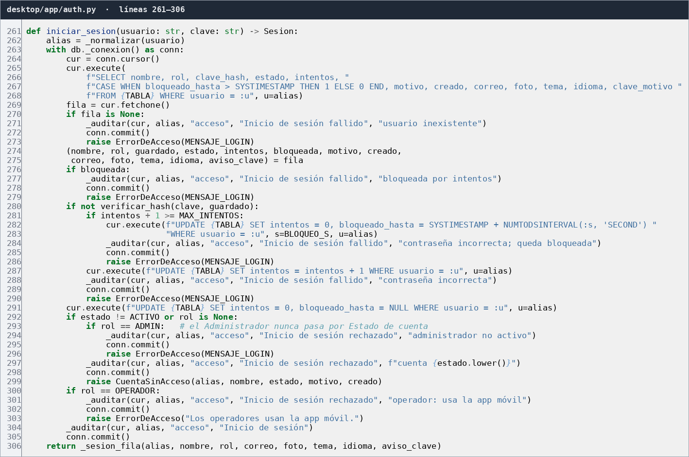

**Figura 42.** Autenticación: hash, bloqueo por intentos y auditoría.  
Archivo: desktop/app/auth.py (líneas 261–306). Función o elemento: `auth.iniciar_sesion`.  
Demuestra: la verificación de contraseña, el contador de intentos con bloqueo y la auditoría de cada intento. Criterio: Seguridad / funcionalidad.  


### 11.2 Dashboard

**Tabla 17.** _Ficha del módulo: Dashboard_

| Atributo | Detalle |
|---|---|
| Propósito y usuarios | Mostrar el avance del conteo continuo. Administrador e Inventario. |
| Funcionalidades | Tarjetas de avance (%), productos contados, faltantes y sobrantes; gráfica de diferencia por categoría; última sincronización; tarjetas y gráficas personalizables («Personalizar dashboard»). |
| Entradas → proceso → salidas | Vistas `V_RESUMEN_CONTEO`, `V_ESTADO_BATCH` y consultas por categoría → `QueryRunner` en hilos → tarjetas y gráfica pyqtgraph. |
| Código y dependencias | `views/dashboard.py`, `dashboard_paneles.py`, `dashboard_datos.py`, `rejilla_personal.py`, `db.py`. |
| Manejo de errores | Estado «Cargando…» mientras responde Oracle; banner de error si Oracle falla. |
| Pruebas | `test_dashboard_views.py`, `test_dashboard_personal.py`, `test_dashboard_motion.py`. En Oracle limpio fallan `test_kpis_del_conteo_continuo` (espera 6,2 % del seed de 60 SKU; con 120 SKU da 3,2 %) y dos pruebas de geometría/animación (ver 14.4). |
| Resultado de verificación | Verificado visualmente (Figura 43); las cifras mostradas (120 SKU, 100 contados, 83,3 %) son coherentes entre sí. Pruebas parcialmente fallidas por causas ajenas a la presentación. |

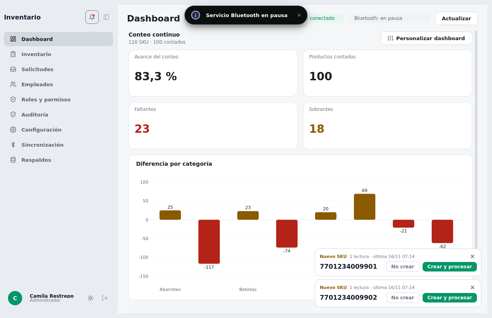

**Figura 43.** Dashboard visto por el Administrador.  
Fuente: captura de la aplicación real en ejecución (PyQt6 sobre Oracle XE 11g); archivo docs/documentacion/capturas/roles/administrador/01_dashboard.png.  
Demuestra: indicadores del conteo continuo, gráfica de diferencia por categoría, aviso emergente del servicio y aviso flotante «Nuevo SKU». Criterio: Funcionalidad y UI/UX.  


### 11.3 Inventario

**Tabla 18.** _Ficha del módulo: Inventario_

| Atributo | Detalle |
|---|---|
| Propósito y usuarios | Consultar lo conciliado por SKU. Administrador e Inventario. |
| Funcionalidades | Cinco columnas (SKU, Producto, Categoría, Contada, Sistema); búsqueda por SKU o nombre; «Filtros»; «Exportar CSV» (`;`, UTF-8 con BOM); doble clic abre el detalle de lecturas (cantidad, operador, fecha UTC, vigente, nota y foto). La cantidad contada queda vacía si no hubo lectura. |
| Entradas → proceso → salidas | Texto de búsqueda → `fetch_conciliacion` (hasta 1000 filas) en un hilo → tabla; `fetch_lecturas(sku)` para el detalle. |
| Código y dependencias | `views/inventario.py`, `lecturas.py`, `visor_foto.py`, `db.py`. |
| Manejo de errores | Mensaje de Oracle en el banner; estado vacío si no hay filas. |
| Pruebas | `test_inventario_views.py` (aprobadas), `test_visor_foto.py` (aprobadas). |
| Resultado de verificación | Verificado visualmente (Figura 44): 120 SKU, 100 contados, 20 sin contar, como indica el pie de la tabla. |

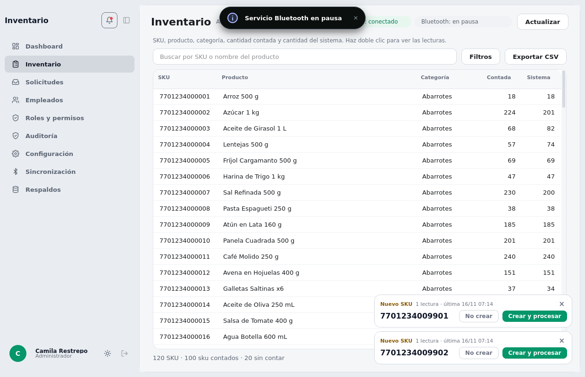

**Figura 44.** Módulo Inventario con datos.  
Fuente: captura de la aplicación real en ejecución (PyQt6 sobre Oracle XE 11g); archivo docs/documentacion/capturas/roles/administrador/02_inventario.png.  
Demuestra: tabla de cinco columnas con búsqueda, filtros y exportación; pie con totales. Criterio: Funcionalidad.  


### 11.4 Gráficas

**Tabla 19.** _Ficha del módulo: Gráficas_

| Atributo | Detalle |
|---|---|
| Propósito y usuarios | Análisis visual. Solo el rol Inventario (en el código la sección se registra con `roles=(auth.INVENTARIO,)`; el Administrador no la ve). |
| Funcionalidades | Seis gráficas con filtro por categoría y cantidad de categorías; entre ellas «Avance por categoría», «SKUs contados vs. pendientes», «Lecturas por hora (UTC)» y «Top categorías por lecturas»; «Personalizar gráficas» y «Guardar PNG»; clic en una categoría filtra el inventario. |
| Entradas → proceso → salidas | Filtros → `fetch_series` en hilo → gráficas pyqtgraph con movimiento. |
| Código y dependencias | `views/charts.py`, `graficas_interactivas.py`, `graficas_motion.py`, `grafico_personal.py`, pyqtgraph 0.14. |
| Pruebas | `test_charts_views.py`: en Oracle limpio fallan 2 de sus pruebas (una por cifras del seed de 60 SKU y otra de geometría). |
| Resultado de verificación | Verificado visualmente (Figura 45) con el usuario de rol Inventario. |

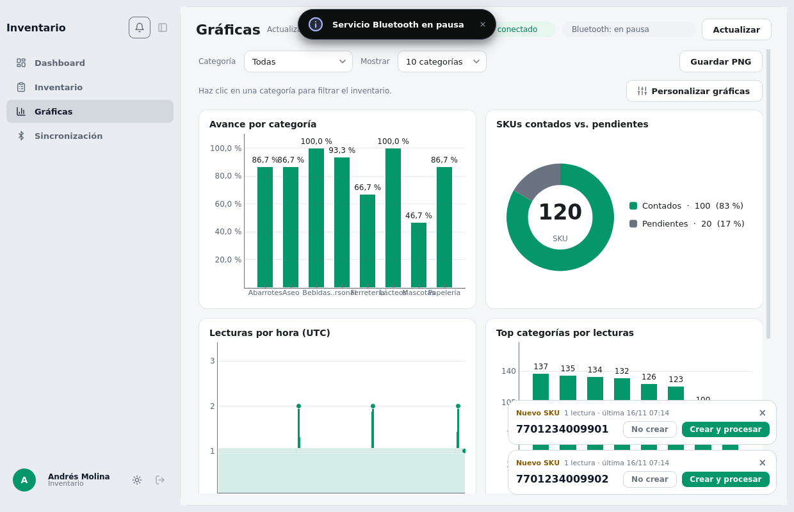

**Figura 45.** Módulo Gráficas (rol Inventario).  
Fuente: captura de la aplicación real en ejecución (PyQt6 sobre Oracle XE 11g); archivo docs/documentacion/capturas/roles/inventario/03_graficas.png.  
Demuestra: gráficas de avance por categoría, SKUs contados vs. pendientes y lecturas; filtros y exportación. Criterio: UI/UX y Funcionalidad.  


### 11.5 Sincronización (escritorio)

**Tabla 20.** _Ficha del módulo: Sincronización_

| Atributo | Detalle |
|---|---|
| Propósito y usuarios | Operar el servicio Bluetooth. Administrador e Inventario (el alta de SKU, solo el Administrador). |
| Funcionalidades | Estado del servicio (activo, en pausa), pausar y reanudar, indicadores de lecturas recibidas, pendientes y con error, flujo Android → Bluetooth → PC servidor → Oracle, aceptar o rechazar código, procesar ahora, reprocesar errores y errores con filtro por motivo. |
| Entradas → proceso → salidas | Acciones del usuario → `ServicioRemoto` escribe la orden en `SERVICIO_BT`; el servicio responde en el siguiente `tick`; la vista se actualiza por señales. |
| Código y dependencias | `views/sync.py`, `sync_ui.py`, `sync_datos.py`, `bluetooth_vivo.py`, `servicio_remoto.py`. |
| Manejo de errores | Mensajes «El servicio Bluetooth no está corriendo» y «Bluetooth no disponible»; errores de lecturas en tabla propia. |
| Pruebas | `test_sync_views.py`, `test_sync_centro.py`, `test_servicio.py` (aprobadas). |
| Resultado de verificación | Verificado visualmente: Figura 46 (1240 × 800) y Figura 47 (1920 × 1080). En 1240 px de ancho la columna derecha de indicadores queda recortada por el borde de la ventana; a 1920 px se ve completa. |

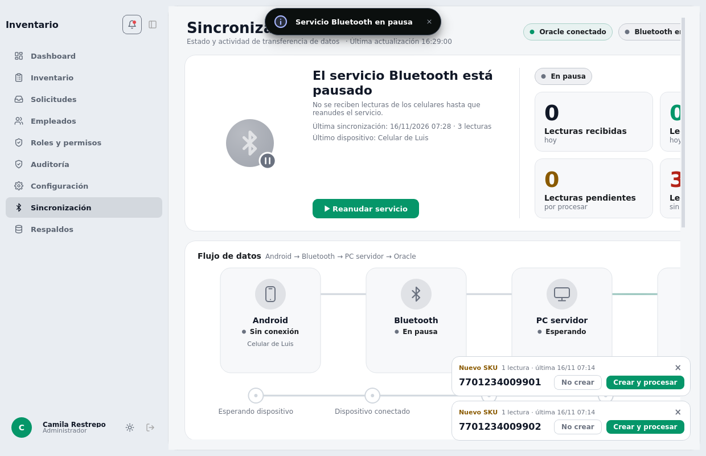

**Figura 46.** Módulo Sincronización con el servicio en pausa.  
Fuente: captura de la aplicación real en ejecución (PyQt6 sobre Oracle XE 11g); archivo docs/documentacion/capturas/roles/administrador/08_sincronizacion.png.  
Demuestra: estado del servicio, botón «Reanudar servicio» e indicadores de flujo de datos. Criterio: Conectividad y UI/UX.  

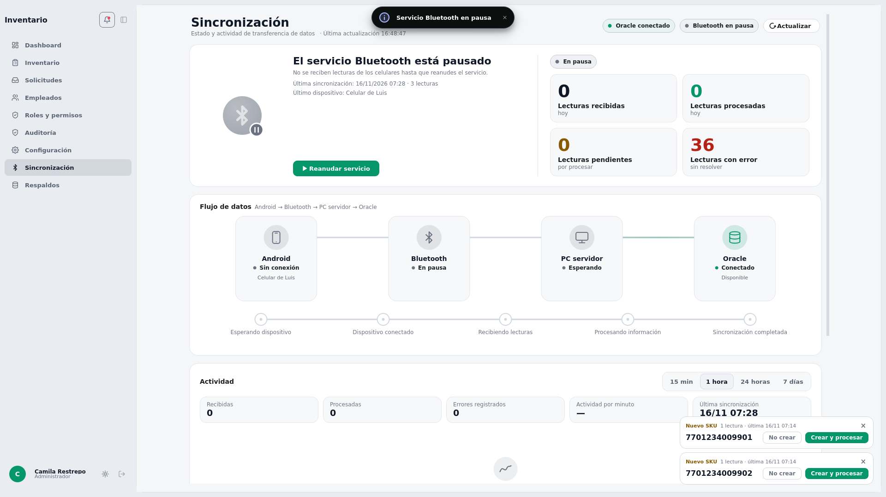

**Figura 47.** Sincronización a 1920 × 1080.  
Fuente: captura de la aplicación real en ejecución (PyQt6 sobre Oracle XE 11g); archivo docs/documentacion/capturas/aplicacion/resoluciones/sincronizacion_1920x1080.png.  
Demuestra: el mismo módulo con espacio suficiente para todos los indicadores. Criterio: UI/UX y adaptabilidad.  


### 11.6 Solicitudes, Empleados y Roles y permisos

**Tabla 21.** _Ficha del módulo: Solicitudes_

| Atributo | Detalle |
|---|---|
| Propósito y usuarios | Aprobar o rechazar cuentas nuevas y solicitudes de contraseña. Administrador. |
| Funcionalidades | Cuentas nuevas (PC o celular) con rol seleccionable según el origen; contraseñas por aprobar; historial de resoluciones. |
| Reglas | Una cuenta del PC solo puede aprobarse como Inventario; una del celular, como Operador; rechazar exige motivo (≤ 300 caracteres). |
| Código y pruebas | `views/solicitudes.py`, `auth.aprobar/rechazar/resolver_clave`; `test_requests_only_allow_inventory_for_pc_and_operator_for_mobile` y `test_auth.py` (aprobadas). |
| Resultado de verificación | Verificado visualmente (Figura 48): dos cuentas pendientes (PC y celular) y el historial. |

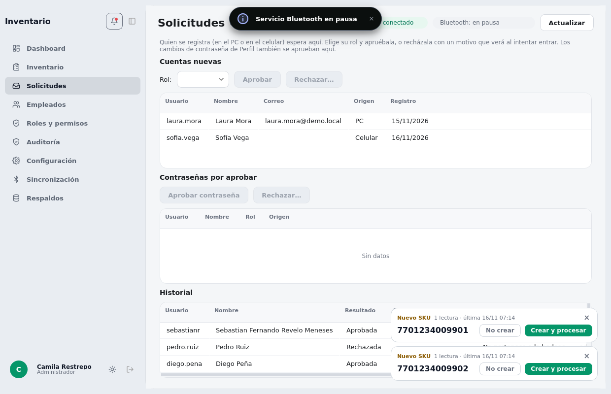

**Figura 48.** Módulo Solicitudes.  
Fuente: captura de la aplicación real en ejecución (PyQt6 sobre Oracle XE 11g); archivo docs/documentacion/capturas/roles/administrador/03_solicitudes.png.  
Demuestra: cuentas pendientes con su origen, contraseñas por aprobar e historial. Criterio: Funcionalidad y Seguridad.  

**Tabla 22.** _Ficha del módulo: Empleados_

| Atributo | Detalle |
|---|---|
| Propósito y usuarios | Administrar cuentas existentes. Administrador. |
| Funcionalidades | Tabla con avatar, correo, nombre, rol e insignia de estado; filtros por rol, estado y texto; suspender con motivo, reactivar, poner contraseña nueva (solo cuentas del PC) y desvincular teléfono. La fila del Administrador deshabilita rol y estado. |
| Código y pruebas | `views/usuarios.py`; `test_usuarios_views.py` (incluye `test_movil_se_suspende_con_motivo_y_se_reactiva` y `test_administrador_no_se_puede_suspender`, aprobadas). |
| Resultado de verificación | Verificado visualmente (Figura 49): siete cuentas activas, con rol y estado. |

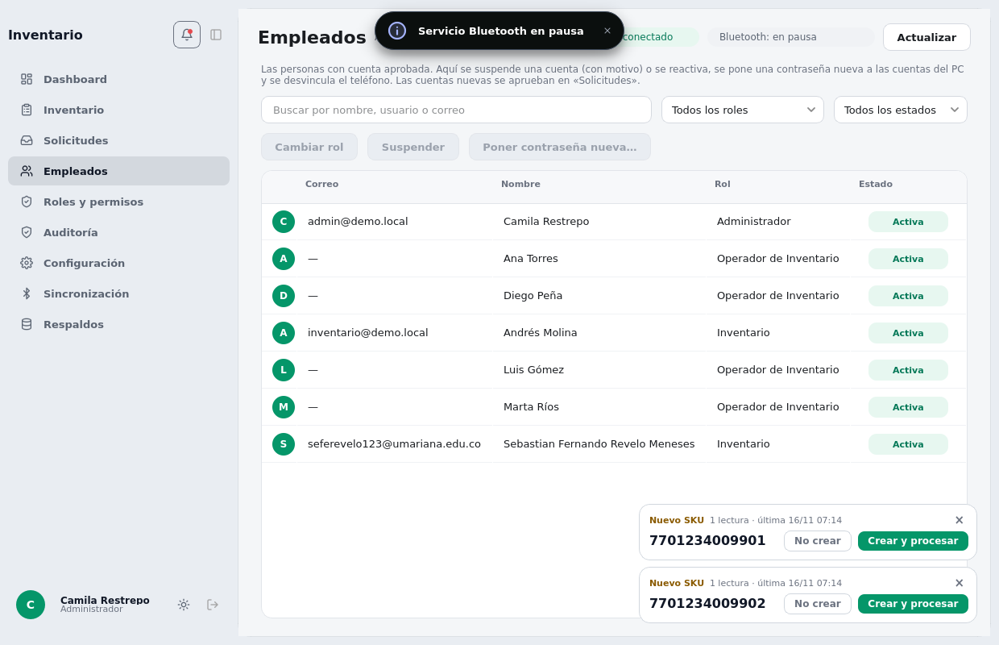

**Figura 49.** Módulo Empleados.  
Fuente: captura de la aplicación real en ejecución (PyQt6 sobre Oracle XE 11g); archivo docs/documentacion/capturas/roles/administrador/04_empleados.png.  
Demuestra: cuentas con rol y estado, filtros y acciones de administración. Criterio: Funcionalidad y Seguridad.  

**Tabla 23.** _Ficha del módulo: Roles y permisos_

| Atributo | Detalle |
|---|---|
| Propósito y usuarios | Definir qué ve y gestiona cada rol. Administrador. |
| Funcionalidades | Matriz de 12 módulos por tres roles con niveles Sin acceso, Consulta y Gestión; la fila del Administrador está bloqueada; el guardado es inmediato y si falla se relee. |
| Código y pruebas | `views/roles.py`, `permisos.py`; `test_roles_view.py`, `test_permisos.py` (aprobadas). |
| Resultado de verificación | Verificado visualmente (Figura 50) y comparando con la barra lateral de cada rol (sección 13.2). |

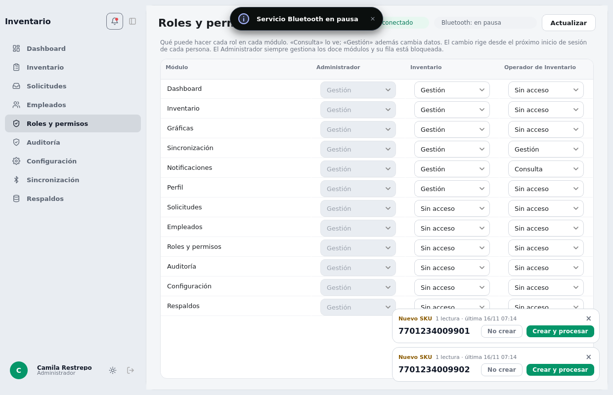

**Figura 50.** Módulo Roles y permisos.  
Fuente: captura de la aplicación real en ejecución (PyQt6 sobre Oracle XE 11g); archivo docs/documentacion/capturas/roles/administrador/05_roles_y_permisos.png.  
Demuestra: la matriz rol × módulo con la columna del Administrador deshabilitada. Criterio: Seguridad.  


### 11.7 Auditoría, Configuración y Respaldos

**Tabla 24.** _Ficha del módulo: Auditoría_

| Atributo | Detalle |
|---|---|
| Propósito y usuarios | Rastro de quién hizo qué y cuándo. Administrador. |
| Funcionalidades | Tabla de solo lectura con filtros por texto, usuario, módulo y rango de fechas; registra inicios de sesión (incluidos los fallidos), aprobaciones y cambios. |
| Código y pruebas | `auditoria.py`, `views/auditoria.py`; `test_auditoria.py`, `test_auditoria_views.py`, `test_selector_fecha.py` (aprobadas). |
| Resultado de verificación | Verificado visualmente (Figura 51); incluye los inicios de sesión generados por la captura de este documento y un intento fallido con «usuario inexistente». |


**Figura 51.** Módulo Auditoría.  
Fuente: captura de la aplicación real en ejecución (PyQt6 sobre Oracle XE 11g); archivo docs/documentacion/capturas/roles/administrador/06_auditoria.png.  
Demuestra: registro de accesos y acciones con filtros. Criterio: Seguridad.  

**Tabla 25.** _Ficha del módulo: Configuración_

| Atributo | Detalle |
|---|---|
| Propósito y usuarios | Ajustar el intervalo del lote y el tamaño máximo de foto. Administrador. |
| Funcionalidades | Intervalo de procesamiento en minutos y tamaño máximo en MB; la carpeta de fotos se muestra y no se edita (se define con `FOTOS_DIR`); al guardar se reaplican los jobs de Oracle; el cambio queda auditado. |
| Código y pruebas | `configuracion.py`, `views/configuracion.py`; `test_configuracion.py`, `test_configuracion_views.py` (aprobadas). |
| Resultado de verificación | Verificado visualmente (Figura 52). |


**Figura 52.** Módulo Configuración.  
Fuente: captura de la aplicación real en ejecución (PyQt6 sobre Oracle XE 11g); archivo docs/documentacion/capturas/roles/administrador/07_configuracion.png.  
Demuestra: parámetros editables y la carpeta de fotos de solo lectura. Criterio: Funcionalidad.  

**Tabla 26.** _Ficha del módulo: Respaldos_

| Atributo | Detalle |
|---|---|
| Propósito y usuarios | Copias de seguridad y restauración. Administrador. |
| Funcionalidades | Crear respaldo `.zip` (manifiesto, una tabla por `.jsonl` y fotos); respaldo automático diario (hora y cantidad a conservar); restaurar escribiendo `RESTAURAR`, con pausa del servicio y respaldo previo. |
| Código y pruebas | `btsync/respaldo.py`, `views/respaldos.py`; `test_respaldo.py`, `test_respaldos.py` (aprobadas) y `test_respaldos_views.py` (una prueba falla en Oracle limpio: `test_tras_restaurar_la_ventana_vuelve_al_login_con_el_aviso`, no diagnosticada). |
| Resultado de verificación | Verificado visualmente (Figura 53): estado vacío «Aún no hay respaldos»; no se creó ni restauró ningún respaldo sobre la base de demostración para no alterarla. |


**Figura 53.** Módulo Respaldos (estado vacío).  
Fuente: captura de la aplicación real en ejecución (PyQt6 sobre Oracle XE 11g); archivo docs/documentacion/capturas/roles/administrador/09_respaldos.png.  
Demuestra: creación manual, tabla vacía y programación del respaldo automático. Criterio: Funcionalidad y UI/UX (estado vacío).  


### 11.8 Notificaciones y Perfil

**Tabla 27.** _Ficha del módulo: Notificaciones y Perfil_

| Atributo | Detalle |
|---|---|
| Propósito y usuarios | Avisar eventos y personalizar la cuenta. Administrador e Inventario. |
| Funcionalidades | Campana con contador y hoja flotante: filtro Todas / Sin leer, «Marcar todas como leídas», «Ver» lleva al módulo. Perfil: foto con editor (rotar, zoom, recortar), tema claro/sistema/oscuro, idioma español/inglés, cambio de contraseña (el Administrador, directo; Inventario, pendiente de aprobación) y cerrar sesión. |
| Código y pruebas | `views/bandeja.py`, `notificaciones.py`, `views/perfil.py`, `views/foto.py`; `test_notificaciones*.py`, `test_perfil*.py`, `test_idioma.py`, `test_tema_sistema.py`. |
| Resultado de verificación | Verificado visualmente (Figura 54 y Figura 55). |


**Figura 54.** Hoja flotante de notificaciones.  
Fuente: captura de la aplicación real en ejecución (PyQt6 sobre Oracle XE 11g); archivo docs/documentacion/capturas/aplicacion/navegacion/notificaciones_hoja.png.  
Demuestra: avisos con indicador de no leídos y acción «Ver». Criterio: UI/UX.  


**Figura 55.** Módulo Perfil.  
Fuente: captura de la aplicación real en ejecución (PyQt6 sobre Oracle XE 11g); archivo docs/documentacion/capturas/roles/administrador/20_perfil.png.  
Demuestra: datos de la cuenta, seguridad, tema e idioma. Criterio: UI/UX y Seguridad.  


### 11.9 Captura móvil (APK Android)

**Tabla 28.** _Ficha del módulo: Cuentas, catálogo, captura y pendientes (móvil)_

| Atributo | Detalle |
|---|---|
| Propósito y usuarios | Contar sin red. Operador de Inventario. |
| Funcionalidades | Acceso, creación de cuenta con pregunta de seguridad y recuperación; inicio con contador de lecturas por enviar; Catálogo con búsqueda; Contar con escáner de barras o QR o digitación, cantidad con +/−, dañados, foto de evidencia (cámara o galería) y nota; aviso «SKU fuera del catálogo»; Contado y Pendientes con estados Pendiente, Enviada y Confirmada; Notificaciones; Mi cuenta con tema e idioma. |
| Entradas → proceso → salidas | SKU, cantidad, dañados, nota, foto → `CountViewModel.guardar` valida y escribe en la `Outbox` (Room) → lectura PENDIENTE y contador de pendientes. |
| Código y dependencias | `ui/pantallas/*.kt`, `ui/CountViewModel.kt`, `data/Lectura.kt`, `auth/AuthRepository.kt`; Room 2.6.1, ZXing 4.3.0, Compose BOM 2024.06. |
| Manejo de errores | Mensajes bajo cada campo, «Usuario o contraseña incorrectos», estado vacío «No hay productos en el catálogo». |
| Pruebas | `CountViewModelTest` (15), `OutboxTest`, `AuthRepositoryTest` (12), `CodigoEscaneadoTest`, `CompresorTest` y `CapturasTest` (29): 115 pruebas de la APK, todas aprobadas en la ejecución de este trabajo. |
| Resultado de verificación | Verificado con renderizados de la propia app (Figura 56, Figura 57 y Figura 59); no se probó en un teléfono físico (no hay uno conectado). |


**Figura 56.** Pantallas de acceso y cuenta de la APK.  
Fuente: renderizados de CapturasTest (mobile/app/src/test/.../ui/CapturasTest.kt) a 1080 × 2340 px; originales en capturas/movil/originales/. No son fotografías de un teléfono físico.  
Demuestra: acceso, alta de cuenta con pregunta de seguridad, recuperación, error de acceso, bienvenida y cuenta pendiente. Criterio: UI/UX.  


**Figura 57.** Pantallas de captura de la APK.  
Fuente: renderizados de CapturasTest (originales en capturas/movil/originales/).  
Demuestra: inicio, catálogo, contar con escáner o digitación, SKU fuera del catálogo, contado y pendientes. Criterio: Funcionalidad y UI/UX.  


### 11.10 Sincronización móvil

**Tabla 29.** _Ficha del módulo: Sincronización (móvil)_

| Atributo | Detalle |
|---|---|
| Propósito y usuarios | Subir lo contado al PC. Operador. |
| Funcionalidades | Búsqueda de `gestion_inventario`, selección del PC (se recuerda), conexión sin claves ni códigos, envío con progreso (porcentaje y lecturas confirmadas), resultado, PC ocupado, sin conexión y reintentos (3). |
| Código y dependencias | `sync/SyncClient.kt`, `ui/SyncRunner.kt`, `ui/SincronizarActivity.kt`, `sync/PcConnector.kt`, `protocol/Protocol.kt`. |
| Pruebas | `SyncClientTest` (16, con un PC falso `FakePc`), `SyncRunnerTest` (9), `ProtocolTest` (6): aprobadas. |
| Resultado de verificación | Estados verificados con renderizados (Figura 58); el protocolo, con la ejecución de la sección 9.5. El enlace Bluetooth físico no se ejecutó en esta verificación. |


**Figura 58.** Estados de la sincronización en la APK.  
Fuente: renderizados de CapturasTest (originales en capturas/movil/originales/).  
Demuestra: buscar, conectar, enviar, listo, PC ocupado y sin conexión. Criterio: Conectividad y UI/UX (estados de carga y error).  


**Figura 59.** Notificaciones, cuenta, editor de foto y tema oscuro en la APK.  
Fuente: renderizados de CapturasTest (originales en capturas/movil/originales/).  
Demuestra: avisos, perfil con preferencias, editor de foto y el tema oscuro. Criterio: UI/UX.  


### 11.11 Servicio Bluetooth y batch de Oracle

Estos dos módulos no tienen interfaz propia; su evidencia es la ejecución real descrita en la sección 9.5 y las pruebas del capítulo 14. El **servicio Bluetooth** (`btsync.servicio`) es el proceso que mantiene el perfil RFCOMM, crea una `Session` por teléfono, escribe su estado y latido en `SERVICIO_BT` y ejecuta el respaldo automático. El **batch** (`PKG_BATCH`) valida cada fila, calcula la lectura vigente y concilia `ACTUAL`; en la ejecución real procesó 123 lecturas con 1 error, sin duplicados.


## 12. Experiencia de usuario e interfaz gráfica

El análisis se hizo con la aplicación ejecutándose. Se distingue lo observado en las capturas de lo que el código declara, y se señalan también los defectos encontrados.


### 12.1 Diseño, jerarquía visual y navegación

- **Estructura:** barra lateral izquierda con iconos y texto, cabecera con título, estado de Oracle y de Bluetooth y botón «Actualizar», y contenido en tarjetas. El pie de la barra muestra avatar, nombre, rol, tema y cerrar sesión; la campana está junto al título de la barra.
- **Identidad visual:** verde esmeralda (`#10B981` y tonos) como color de acción, fondo gris claro y tarjetas blancas; rojo y ámbar para faltantes y sobrantes. La tipografía es la sans-serif por defecto del sistema (en el contenedor donde se tomaron las capturas, DejaVu Sans): el proyecto no incorpora una fuente propia.
- **Iconografía:** iconos de trazo para cada módulo (`views/iconos.py`).
- **Consistencia:** mismas cabeceras, tablas con encabezado fijo, botones primarios verdes y secundarios con borde en todas las pantallas.
- **Navegación por teclado:** atajos para ir a un módulo por número y para enfocar el buscador (`MainWindow._instalar_atajos`).


### 12.2 Estados de carga, vacío y error

- **Carga:** las tarjetas muestran «—» y «Cargando…» mientras Oracle responde (Figura 60).
- **Vacío:** Respaldos muestra «Aún no hay respaldos» y la tabla «Sin datos» (Figura 53); Solicitudes, «Sin datos» en la tabla de contraseñas (Figura 48); el catálogo móvil, «No hay productos en el catálogo» (Figura 57).
- **Error:** la APK muestra «PC ocupado» y «No se pudo conectar» con iconos y texto (Figura 58); el acceso muestra el mensaje de credenciales incorrectas (Figura 56); el escritorio muestra un aviso cuando el servicio está en pausa.
- **Confirmaciones y avisos:** avisos emergentes («Servicio Bluetooth en pausa»), confirmación al descartar un SKU nuevo y escritura de `RESTAURAR` para restaurar.


**Figura 60.** Dashboard en estado de carga.  
Fuente: captura de la aplicación real en ejecución (PyQt6 sobre Oracle XE 11g); archivo docs/documentacion/capturas/aplicacion/pantalla_principal/dashboard_estado_de_carga.png.  
Demuestra: el estado «Cargando…» con tarjetas provisionales mientras llegan los datos. Criterio: UI/UX (estados de carga).  


### 12.3 Adaptabilidad a distintas resoluciones

La ventana tiene un mínimo de 900 × 600 (`setMinimumSize`) y se probó a 900 × 600, 1240 × 800, 1366 × 768 y 1920 × 1080. A 900 px la barra lateral se contrae automáticamente a solo iconos (Figura 61); también se puede contraer a mano (Figura 62). A 1920 × 1080 el contenido aprovecha el ancho disponible y muestra más filas (Figura 63).


**Figura 61.** Dashboard a 900 × 600 (mínimo).  
Fuente: captura de la aplicación real en ejecución (PyQt6 sobre Oracle XE 11g); archivo docs/documentacion/capturas/aplicacion/resoluciones/dashboard_900x600.png.  
Demuestra: contracción automática de la barra lateral y reacomodo de las tarjetas. Criterio: UI/UX y adaptabilidad.  


**Figura 62.** Barra lateral contraída a 1240 × 800.  
Fuente: captura de la aplicación real en ejecución (PyQt6 sobre Oracle XE 11g); archivo docs/documentacion/capturas/aplicacion/navegacion/lateral_contraida.png.  
Demuestra: el modo de solo iconos que libera espacio horizontal. Criterio: UI/UX y adaptabilidad.  


**Figura 63.** Inventario a 1920 × 1080.  
Fuente: captura de la aplicación real en ejecución (PyQt6 sobre Oracle XE 11g); archivo docs/documentacion/capturas/aplicacion/resoluciones/inventario_1920x1080.png.  
Demuestra: la tabla ocupando el ancho disponible con más filas visibles. Criterio: UI/UX y adaptabilidad.  


**Figura 64.** Sincronización a 1366 × 768.  
Fuente: captura de la aplicación real en ejecución (PyQt6 sobre Oracle XE 11g); archivo docs/documentacion/capturas/aplicacion/resoluciones/sincronizacion_1366x768.png.  
Demuestra: comportamiento del módulo más ancho en una pantalla de portátil común. Criterio: UI/UX y adaptabilidad.  

La APK usa Jetpack Compose con Material 3; los renderizados se hicieron a 1080 × 2340 en vertical. **No se evaluó la orientación horizontal ni otros tamaños de teléfono o tableta**, por lo que la adaptabilidad móvil queda sin demostrar.


### 12.4 Experiencia por rol

La barra lateral muestra solo los módulos del rol: el Administrador ve nueve módulos más Perfil al pie y el rol Inventario cuatro más Perfil (Figura 68). El Operador no usa el escritorio. Las capturas de la sección 13.2 comparan ambas experiencias.


### 12.5 Animaciones y movimiento

El proyecto implementa transiciones de página, entradas escalonadas de tarjetas, gráficas con movimiento y arrastre de tarjetas en el Dashboard (`motion_global.py`, `graficas_motion.py`, `rejilla_personal.py`), controladas por la variable `APP_SIN_ANIMACIONES`. Las capturas se tomaron con las animaciones desactivadas para obtener el estado final; **no se grabó video ni GIF** de estas transiciones, de modo que su fluidez no se demuestra visualmente en este documento; solo existen pruebas automáticas (`test_dashboard_motion.py`, `test_motion_admin.py`, `test_sync_motion.py`).


### 12.6 Defectos y limitaciones observados

- A 1240 × 800 el aviso emergente superior solapa el título y los chips de estado de la cabecera (se aprecia en las capturas de este documento); es transitorio.
- A 1240 × 800 el módulo Sincronización queda recortado a la derecha (Figura 46); a 1366 px y 1920 px se ve completo.
- El aviso flotante «Nuevo SKU» se superpone al contenido por diseño y tapa filas de la parte inferior derecha.
- La tipografía depende de la fuente del sistema; no hay fuente embebida.


## 13. Seguridad y control de acceso


### 13.1 Medidas verificables

**Tabla 30.** _Medidas de seguridad implementadas y su evidencia_

| Medida | Implementación | Evidencia |
|---|---|---|
| Autenticación (PC) | Usuario y contraseña; contraseña guardada como `pbkdf2-sha256$200000$sal$hash` (`hashlib.pbkdf2_hmac`, sal de 16 bytes aleatorios); mensaje único ante error | `auth.crear_hash`, `auth.iniciar_sesion` (Figura 42) |
| Protección contra fuerza bruta | 5 intentos fallidos bloquean la cuenta 30 s; cada intento se audita | `MAX_INTENTOS, BLOQUEO_S = 5, 30`; `test_auth.py` |
| Autenticación (móvil) | Cuenta local con PBKDF2-SHA256 y sal; recuperación con pregunta de seguridad; la contraseña nunca viaja al PC | `auth/Claves.kt`, `AuthRepositoryTest`, docs/protocolo.md |
| Autorización por rol | Matriz `PERMISOS` rol × módulo × nivel; la barra lateral oculta lo que el rol no puede ver; `permisos.exigir` revalida en vivo antes de cambiar datos | `permisos.py`, `test_permisos.py`, `test_roles_view.py` |
| Cuentas con aprobación | Toda cuenta nueva queda PENDIENTE; un solo Administrador; roles limitados por origen (PC → Inventario, móvil → Operador) | `auth.ROLES_POR_ORIGEN`, `test_there_is_never_a_second_admin` |
| Control de lecturas entrantes | Solo una cuenta ACTIVO entrega lecturas; la cuenta queda vinculada al UUID del teléfono; un rol sin permiso `sync` es suspendido | `Session`, `test_otro_telefono_con_el_mismo_usuario_no_entrega_lecturas` |
| Conteo ciego | El catálogo enviado al teléfono nunca incluye el stock del sistema | `test_catalog_never_contains_system_stock` |
| Validación de entradas | Formato y CRC de cada línea, regex de cantidades y de usuario, longitudes máximas, tamaño y formato de fotos (JPEG, PNG, WebP; 2 MB) | `protocol.py`, `session.py`, `test_fotos.py` |
| Consultas parametrizadas | Las consultas del escritorio usan variables de enlace (`:u`, `:c`, `:n`) | `auth.py`, `db.py` |
| Auditoría | Quién, qué y cuándo en la misma transacción que el cambio | `auditoria.py`, Figura 51 |
| Secretos | Credenciales en `.env` (no versionado); `.env.example` solo trae valores de desarrollo local | .gitignore, README.md |

_Fuente: Elaboración propia a partir del código._


**Figura 65.** Contraseñas: PBKDF2 con sal.  
Archivo: desktop/app/auth.py (líneas 133–137). Función o elemento: `auth.crear_hash`.  
Demuestra: el derivado PBKDF2-HMAC-SHA256 con sal aleatoria de 16 bytes y 200 000 iteraciones. Criterio: Seguridad.  


**Figura 66.** Permisos: matriz inicial de 12 módulos y niveles Sin acceso / Consulta / Gestión.  
Archivo: desktop/app/permisos.py (líneas 17–54). Función o elemento: `_MATRIZ_INICIAL`, `INTOCABLES`, `alcanza`.  
Demuestra: la matriz de 12 módulos y los niveles de acceso, con la fila del Administrador intocable. Criterio: Seguridad.  


**Figura 67.** Permisos: revalidación en vivo antes de cambiar datos.  
Archivo: desktop/app/permisos.py (líneas 86–95). Función o elemento: `permisos.exigir`.  
Demuestra: la revalidación en vivo del nivel del rol antes de ejecutar una acción que cambia datos. Criterio: Seguridad.  


### 13.2 Acceso según el rol

La Tabla 31 compara lo que ve cada rol en el escritorio, comprobado con las capturas y con el resultado de `MainWindow.secciones()` impreso durante la captura. El Administrador ve nueve secciones más Perfil; el rol Inventario, cuatro más Perfil. El Operador no puede iniciar sesión en el escritorio: recibe «Los operadores usan la app móvil».

**Tabla 31.** _Secciones visibles por rol (resultado de la ejecución)_

| Rol | Secciones de la barra lateral | Perfil |
|---|---|---|
| Administrador (`admin`) | Dashboard, Inventario, Solicitudes, Empleados, Roles y permisos, Auditoría, Configuración, Sincronización, Respaldos (+ campana de Notificaciones) | Pie de la barra |
| Inventario (`inventario`) | Dashboard, Inventario, Gráficas, Sincronización (+ campana de Notificaciones) | Pie de la barra |
| Operador de Inventario | No entra al escritorio; usa la app móvil (catálogo, contar, contado, pendientes, sincronizar, notificaciones, mi cuenta) | Mi cuenta (móvil) |

_Fuente: Salida de capturar_pantallas.py: «admin ADMIN […]» e «inventario INVENTARIO […]»._


**Figura 68.** Experiencia del rol Inventario (cuatro secciones más Perfil).  
Fuente: captura de la aplicación real con la cuenta `inventario` (docs/documentacion/capturas/roles/inventario/01_dashboard.png).  
Demuestra: la barra lateral restringida del rol Inventario frente a la del Administrador (Figura 43). Criterio: Seguridad y UI/UX.  

**Restricciones comprobadas:** el rol Inventario no tiene Solicitudes, Empleados, Roles y permisos, Auditoría, Configuración ni Respaldos en su barra, y no puede cambiar la matriz; el Administrador no ve el módulo Gráficas. La prueba de que un módulo sin permiso no se abre es `ir_a` (que ignora títulos fuera de `secciones()`) y `test_app.py::test_admin_sidebar_exact_order_and_profile_at_the_footer` junto con `test_inventory_sidebar_exact_order`.


### 13.3 Límites de seguridad

- El enlace Bluetooth por defecto no se cifra ni se empareja (D22); el modo con código (`BT_CON_CLAVE=1`) existe pero no se ejecutó aquí.
- La recuperación de contraseña por pregunta de seguridad es débil: quien conozca la respuesta entra (D23, D25).
- Desinstalar la APK borra la `Outbox` y las cuentas locales (D18).
- No se realizó una auditoría de seguridad ni pruebas de penetración; solo se documentan las medidas verificables.


## 14. Pruebas y validación


### 14.1 Qué es existente y qué se ejecutó

Se distinguen tres tipos de evidencia. **(a) Pruebas existentes en el repositorio:** `server/tests` (pytest, contra Oracle), `desktop/tests` (pytest-qt, Qt `offscreen`, contra Oracle) y `mobile/app/src/test` (JUnit en la JVM). **(b) Pruebas ejecutadas durante la elaboración de este documento** el 17 de noviembre de 2026, con los comandos del capítulo 15 y los scripts de `docs/documentacion/herramientas/`; su salida íntegra está en `docs/documentacion/anexos/registros/`. **(c) Verificaciones manuales o visuales:** la inspección de las capturas de la aplicación en ejecución. No se midieron cobertura de código ni tiempos de transferencia, por lo que no se reporta ninguna cifra de cobertura ni de rendimiento.


### 14.2 Resultados de las suites

**Tabla 32.** _Resultados de las suites ejecutadas (17-nov-2026)_

| Suite | Base de datos | Aprobadas | Fallidas | Total | Evidencia |
|---|---|---|---|---|---|
| Servidor (`pytest server/tests`) | Oracle limpio (sin `08_demo.sql`) | 230 | 8 | 238 | Figura 69 |
| Servidor | Oracle de trabajo (con datos de demostración) | 227 | 11 | 238 | Figura 72 |
| Escritorio (`pytest desktop/tests`) | Oracle limpio | 454 | 10 | 464 | Figura 70 |
| Escritorio | Oracle de trabajo (demostración) | 449 | 15 | 464 | Figura 73 |
| APK (`./gradlew testDebugUnitTest --rerun-tasks`) | No usa Oracle | 115 | 0 | 115 | Figura 71 |

_Fuente: Registros en docs/documentacion/anexos/registros/._

Se usaron dos bases porque las pruebas fueron escritas para la base **limpia** de la semilla del proyecto; el Oracle de trabajo contiene los 13 meses de datos de demostración y rompe más aserciones numéricas. Las dos ejecuciones se comparan en la tabla anterior. **Las suites fueron ejecutadas en serie** porque comparten base (como exige el propio proyecto) y no se modificó ningún archivo de producto para que pasaran.


**Figura 69.** Resultado de las pruebas del servidor (Oracle limpio).  
Fuente: anexos/registros/pruebas_servidor_limpia.txt (herramientas/pruebas_limpia.sh). 230 aprobadas, 8 fallidas.  
Demuestra: ejecución real y fallos conocidos de las pruebas. Criterio: Funcionalidad y Documentación.  


**Figura 70.** Resultado de las pruebas del escritorio (Oracle limpio).  
Fuente: anexos/registros/pruebas_escritorio_limpia.txt. 454 aprobadas, 10 fallidas.  
Demuestra: ejecución real de las pruebas de la interfaz con Qt offscreen. Criterio: UI/UX y Funcionalidad.  


**Figura 71.** Resultado de las pruebas unitarias de la APK.  
Fuente: anexos/registros/pruebas_android.txt (herramientas/pruebas_android.sh). 115 pruebas, 0 fallos.  
Demuestra: ejecución real de las pruebas Kotlin en la JVM. Criterio: Funcionalidad y Conectividad.  


**Figura 72.** Pruebas del servidor sobre la base con datos de demostración.  
Fuente: anexos/registros/pruebas_servidor.txt.  
Demuestra: el efecto de los datos de demostración sobre las aserciones. Criterio: Funcionalidad.  


**Figura 73.** Pruebas del escritorio sobre la base con datos de demostración.  
Fuente: anexos/registros/pruebas_escritorio.txt.  
Demuestra: el mismo efecto en las pruebas de la interfaz. Criterio: Funcionalidad.  


### 14.3 Casos de prueba representativos

**Tabla 33.** _Casos de prueba representativos y su resultado_

| ID | Nombre y objetivo | Precondiciones y datos | Pasos | Resultado esperado | Resultado obtenido | Estado | Evidencia |
|---|---|---|---|---|---|---|---|
| CP-01 | Vectores del protocolo (`test_frame_matches_all_vectors`, `test_parse_matches_all_vectors`): mismo formato en Python y Kotlin | `docs/protocol-vectors.json` | `frame` y `parse` de cada vector | Salida idéntica al vector | Idéntica en Python; `ProtocolTest` también aprobada | Aprobado | Figura 69, Figura 71 |
| CP-02 | CRC dañado (`test_crc_mismatch_raises_crc`, `test_bad_crc_naks_expected_seq_and_survives`) | Sesión TCP con Oracle | Enviar una línea con CRC alterado | `FrameError(CRC)` / `NAK\|n\|CRC` y la sesión sigue | Cumplido | Aprobado | Figura 69 |
| CP-03 | Camino feliz (`test_happy_path_sends_ready_catalog_acks_and_bye`) | Cuenta ACTIVO | `HELLO`, `ACCT`, `REC`, `END` | `READY`, catálogo, `ACK`, `BYE` | Cumplido | Aprobado | Figura 69 |
| CP-04 | Duplicado en sesión nueva (`test_duplicate_rec_in_new_session_is_not_inserted`) | Lecturas ya persistidas | Reenviar el mismo `(uuid, seq)` | No se inserta fila nueva | Cumplido | Aprobado | Figura 69 |
| CP-05 | Corte a mitad del lote (`test_connection_cut_after_30_rec_keeps_25`) | 30 `REC` enviados | Cortar tras 30; reconectar | Quedan 25 filas; `READY\|25` | Cumplido | Aprobado | Figura 69 |
| CP-06 | Hueco de secuencia (`test_seq_gap_naks_once_and_ignores_followers`) | — | Enviar `seq` 1 y 3 | Un solo `NAK\|2\|SECUENCIA` | Cumplido | Aprobado | Figura 69 |
| CP-07 | Conteo ciego (`test_catalog_never_contains_system_stock`) | Producto con stock | Pedir el catálogo | Sin cantidad del sistema | Cumplido | Aprobado | Figura 69 |
| CP-08 | Cuenta pendiente (`test_rec_con_cuenta_pendiente_recibe_nak_cuenta_no_activa`) | Cuenta PENDIENTE | Enviar `REC` | `NAK\|seq\|CUENTA_NO_ACTIVA` | Cumplido | Aprobado | Figura 69; Figura 33 |
| CP-09 | Batch PL/SQL (`test_batch.py`) | Filas en tránsito | `procesar_pendientes` | Procesadas, errores y vigentes correctos | 48 de 48 aprobadas | Aprobado | Figura 69 |
| CP-10 | Sincronización real extremo a extremo (sección 9.5) | Oracle limpio, servicio TCP, cuenta aprobada | `fake_phone.py` con 126 lecturas | `BYE\|126\|0`; filas procesadas; 0 duplicadas | 123 procesadas, 1 `ERROR`, 2 `NUEVO_SKU`, 0 duplicadas | Aprobado | Figura 33, Figura 34 |
| CP-11 | Corte y reanudación real (sección 9.5) | Segundo teléfono simulado | `SIGKILL` a los 4 s; relanzar | Sin duplicados; reanuda del último `seq` | 50 + 70 = 120 filas, 0 duplicadas | Aprobado | Figura 35, Figura 36 |
| CP-12 | Barras por rol (`test_admin_sidebar_exact_order…`, `test_inventory_sidebar_exact_order`) | Sesiones de prueba | Abrir la ventana con cada rol | Orden y secciones exactas del rol | Cumplido; ver también capturas | Aprobado | Figura 43, Figura 68 |
| CP-13 | Aprobación por origen (`test_requests_only_allow_inventory_for_pc_and_operator_for_mobile`), un solo administrador (`test_there_is_never_a_second_admin`) | Cuentas de prueba (`usuarios_tst`) | Aprobar con un rol no permitido | Se rechaza | Cumplido | Aprobado | Figura 70 |
| CP-14 | Conciliación y semilla (`test_resumen_matches_scenario_exactly`, `test_seed_counts`…) | Semilla de 60 SKU esperada | Cargar el escenario y comparar | 65 filas y 6,15 % (valores de la semilla antigua) | La semilla actual tiene 120 SKU: 125 filas y 3,2 % | Fallido | Figura 69 |
| CP-15 | Dashboard: orden de tarjetas y animación (`test_dashboard_personal.py`) | Qt offscreen | Simular hover y desplazamiento | Cifra visible y barra de desplazamiento activa | 2 de 33 fallan en el entorno offscreen | Fallido (parcial) | Figura 70 |
| CP-16 | Android: sincronización con PC falso (`SyncClientTest`, `SyncRunnerTest`) | `FakePc` en la JVM | 16 + 9 escenarios | Reintentos, rechazos y cortes tratados | 25 de 25 aprobadas | Aprobado | Figura 71 |

_Fuente: Resultados tomados de los registros de ejecución del 17-nov-2026._


### 14.4 Fallos encontrados y su análisis

En la base limpia fallan 8 pruebas del servidor y 10 del escritorio. **No se corrigió ningún archivo** para no alterar el producto evaluado; se clasifican así:

**Tabla 34.** _Clasificación de las pruebas fallidas en Oracle limpio_

| Causa | Pruebas | Análisis |
|---|---|---|
| Aserciones con cifras de la semilla antigua (60 SKU) mientras la actual crea 120 SKU en 8 categorías | Servidor: `test_resumen_matches_scenario_exactly`, `test_concurrent_batches_leave_same_conciliation…`, `test_seed_counts`, `test_truth_json_covers_all_seeded_skus`, `test_sesion_envia_un_pseudo_catalogo…`, `test_catalog_is_a_single_pseudo_catalogo`, `test_tcp_transport_real_store_end_to_end`. Escritorio: `test_seis_graficas_y_sus_datos`, `test_kpis_del_conteo_continuo`, `test_fetch_resumen…`, `test_fetch_conciliacion_cinco_columnas`, `test_fetch_series_seis_graficas` | Deriva entre las pruebas y `02_seed.sql`: los mensajes de error muestran 125 filas frente a 65 esperadas, `'120'` frente a `'60'`. El código evaluado funciona; las pruebas quedaron desactualizadas. |
| Diagrama UML 02 con una clase inexistente en el código | Servidor: `test_class_diagrams_match_code` | `02-clases-escritorio.puml` declara `Transicion`, que ya no existe en `desktop/app`. Es deriva documental. |
| Pruebas de geometría, desplazamiento y animación en el entorno `offscreen` | Escritorio: `test_una_grafica_se_redimensiona_con_el_asa…`, `test_actividad_reciente_se_desplaza…`, `test_la_cifra_de_una_tarjeta_nunca_queda_invisible…` | El resultado difiere del esperado (por ejemplo, el alto de una baldosa o el máximo de la barra de desplazamiento). No se diagnosticó si es del entorno sin pantalla o del código. |
| Preexistentes y no diagnosticadas | Escritorio: `test_charts_follow_the_system_scheme_when_it_changes`, `test_tras_restaurar_la_ventana_vuelve_al_login_con_el_aviso` | La primera ya estaba registrada como fallo preexistente; la segunda no se analizó. |

_Fuente: Mensajes de error en anexos/registros/pruebas_*_limpia.txt._

Con la base de demostración los fallos suben a 11 en el servidor y 15 en el escritorio, porque además cambian las sumas por categoría y por operador. Los registros completos permiten comprobarlo.


### 14.5 Pruebas por categoría

**Tabla 35.** _Cobertura de categorías de prueba_

| Categoría | Dónde existe | Estado en esta verificación |
|---|---|---|
| Unitarias | `test_protocol.py` (11), `test_store.py`, `test_auth.py` (20), `ClavesTest`, `OutboxTest`, `CountViewModelTest` | Ejecutadas; aprobadas salvo `test_store.py` (1 de 4, por la semilla) |
| Integración con Oracle | `test_batch.py` (48), `test_schema.py`, `test_conciliacion.py`, `test_oracle_connect.py`, `test_concurrent_connect.py` | Ejecutadas; aprobadas salvo las de cifras de la semilla |
| Comunicación | `test_session.py` (22), `test_bluez.py` (36, con bus D-Bus falso), `test_e2e_tcp.py` (6), `SyncClientTest` | Ejecutadas; aprobadas salvo 1 de catálogo |
| Funcionales | `test_respaldo.py` (19), `test_fotos.py` (14), `test_notificaciones.py` (8), `test_servicio.py` (9) | Ejecutadas; aprobadas |
| Interfaz y navegación | `test_app.py`, `test_interactividad.py` (11), `test_capas.py`, vistas del escritorio | Ejecutadas; 10 fallos en total en el escritorio |
| Por rol | `test_permisos.py` (18), `test_roles_view.py`, `test_app.py` (barras por rol), `test_usuarios_views.py` | Ejecutadas; aprobadas |
| Rendimiento | No hay pruebas de rendimiento ni mediciones | No aplica; no se afirma ninguna cifra |
| Bluetooth físico | Prueba de campo en `docs/spikes/bluez.md` (documentada por el proyecto) | No ejecutada: no hay teléfono emparejado en este equipo |

_Fuente: Conteos tomados de los registros de ejecución._


## 15. Instalación, configuración y ejecución

Los comandos de este capítulo provienen del `README.md` y del `docker-compose.yml` del proyecto y se ejecutaron o usaron en la verificación (contenedores `oracle`, `bluetooth`, `app` y las suites de prueba). Las rutas del proyecto pueden tener espacios (`/home/t1an/movil oracle bluetooth`): deben entrecomillarse.


### 15.1 Requisitos

**Tabla 36.** _Requisitos de hardware y software_

| Componente | Requisito | Observación |
|---|---|---|
| Anfitrión | Linux x86_64 con Docker y Docker Compose | Oracle XE 11g solo existe para x86_64. Verificado: Linux 7.3.3 x86_64, Docker 29.9.3 |
| Bluetooth real | BlueZ (`bluetoothd`) activo en el anfitrión y adaptador `hci0` encendido | `bluetoothd` y `adb` viven en el anfitrión |
| Pantalla | Sesión X11 o Wayland con XWayland (`DISPLAY`) | Sin XWayland: `tools/run_escritorio_wayland.sh` |
| Teléfono | Android 6.0 o superior (`minSdk 23`) con depuración USB | Sin iPhone (D4) |
| Oracle | Oracle Database 11g Express Edition 11.2.0.2 (imagen `gvenzl/oracle-xe:11-slim`) | Verificado con `v$version` |
| Python | 3.12 (imagen `python:3.12-slim-bookworm`), `oracledb` 26.1.0, PyQt6 6.12.0, pyqtgraph 0.14.0, `dbus-fast` 5.2.0 | Versiones leídas dentro de la imagen de la app |
| Oracle Instant Client | 19.23 Basic Lite (modo thick) | Obligatorio para Oracle 11g |
| Android | Kotlin 1.9.24, AGP 8.5.2, Compose BOM 2024.06.00, Room 2.6.1, ZXing 4.3.0, `compileSdk`/`targetSdk` 34 | `mobile/build.gradle.kts`, `mobile/app/build.gradle.kts` |
| Compilación Android | JDK 17 + Android SDK + Gradle en el contenedor `apk-build` | Sin instalar nada en el anfitrión |

_Fuente: README.md, docker/pybase/Dockerfile, build.gradle.kts y entorno.txt._


### 15.2 Variables de entorno

Las variables se definen en el archivo `.env` (copiado de `.env.example`, que contiene valores de desarrollo local; no se reproducen aquí). El archivo `.env` no se versiona.

**Tabla 37.** _Variables de entorno_

| Variable | Uso |
|---|---|
| `ORACLE_PASSWORD`, `APP_USER`, `APP_USER_PASSWORD` | Creación de la base y del usuario de aplicación en el contenedor Oracle |
| `DB_USER`, `DB_PASSWORD` | Credenciales con las que los contenedores Python se conectan |
| `PUID`, `PGID` | UID y GID con los que corren los contenedores Python |
| `DB_DSN` | Destino de Oracle (en Compose: `127.0.0.1:1521/XE` o `oracle:1521/XE`) |
| `BT_TRANSPORT`, `BT_TCP_PORT`, `BT_CON_CLAVE` | `bluez` (por defecto) o `tcp`; puerto TCP; emparejamiento con código (`1`) |
| `FOTOS_DIR`, `RESPALDOS_DIR` | Carpetas de fotos y de respaldos |
| `DISPLAY`, `XAUTHORITY` | Pantalla del anfitrión para la ventana del escritorio |

_Fuente: docker-compose.yml y .env.example (solo nombres)._


### 15.3 Puesta en marcha (orden de inicio)

```bash
cp .env.example .env
```

```bash
docker compose up -d --wait oracle
```

```bash
docker compose up -d bluetooth app
```

```bash
tools/run_escritorio_wayland.sh
```

```bash
BT_TRANSPORT=tcp docker compose up -d bluetooth app
```

```bash
docker compose --profile build run --rm apk-build ./gradlew assembleDebug
adb install -r mobile/app/build/outputs/apk/debug/app-debug.apk
```

**Cuentas.** Con los datos de demostración existen `admin` (Administrador) e `inventario`, con la contraseña de demostración que indica el README; `laura.mora` y `sofia.vega` quedan pendientes en Solicitudes. Con una base sin demostración (borrando `08_demo.sql` antes de crearla) la primera cuenta del PC se convierte en el Administrador.


### 15.4 Verificaciones iniciales

- `docker compose ps` debe mostrar `oracle` como `healthy`, y `bluetooth` y `app` como `Up` (evidencia: Figura 74).
- `docker compose logs -f bluetooth` muestra «servicio Bluetooth en marcha»; `docker compose logs -f app` y `./logs/app.log` registran el arranque de la ventana.
- En el escritorio, la pantalla **Sincronización** muestra el estado del servicio; en el teléfono, el PC se anuncia como `gestion_inventario`.
- Pruebas: `docker compose run --rm pybase pytest server/tests -v`, `docker compose run --rm -e QT_QPA_PLATFORM=offscreen app pytest desktop/tests -v` y `docker compose --profile build run --rm apk-build ./gradlew testDebugUnitTest`.


**Figura 74.** Estado real de los contenedores y versiones del entorno.  
Fuente: anexos/registros/entorno.txt (herramientas/entorno.sh).  
Demuestra: servicios en marcha y versiones de las tecnologías. Criterio: Documentación (instalación).  


### 15.5 Solución de problemas frecuentes

**Tabla 38.** _Síntomas y acciones (README del proyecto)_

| Síntoma | Qué hacer |
|---|---|
| «Bluetooth no disponible» / `NotReady` | `rfkill list`; si hay `Soft blocked: yes`, `rfkill unblock bluetooth` y `bluetoothctl power on`; revisar `systemctl status bluetooth`. |
| «El servicio Bluetooth no está corriendo» | `docker compose up -d bluetooth`; mensajes con `docker compose logs -f bluetooth`. |
| El celular no encuentra `gestion_inventario` | El servicio debe estar activo y sin pausa; en Android 10 o anterior, la ubicación del teléfono debe estar encendida para buscar dispositivos. |
| «El PC está atendiendo a otro teléfono» | Esperar: solo se sincroniza un teléfono a la vez (D19). |
| `could not connect to display` | Comprobar `echo $DISPLAY $XAUTHORITY` en la terminal que lanza `docker compose`; como último recurso, `xhost +local:` (revertir con `xhost -local:`). |
| `ORA-12541`, `ORA-12514` o «connection refused» | Oracle aún no está listo: `docker compose ps` y `docker compose logs oracle`. |
| `ORA-12516` | Demasiadas conexiones al listener: `docker compose restart oracle` y volver a abrir la app. |
| `DPI-1050` u `ORA-28040` | Cambiar `IC_DIR`, `IC_FILE` e `IC_FOLDER` en `docker/pybase/Dockerfile` al Instant Client 12.2 y reconstruir con `docker compose build pybase`. |
| `INSTALL_FAILED_OLDER_SDK` | El teléfono es anterior a Android 6.0 (`minSdk 23`). |
| Empezar con la base limpia | `docker compose down`, `docker volume rm inventario-bt_oracle-data` y `docker compose up -d --wait oracle` (**borra todos los datos de Oracle**). |

_Fuente: README.md del proyecto._


## 16. Resultados y análisis


### 16.1 Relación con los objetivos

**Tabla 39.** _Objetivos específicos y resultados comprobados_

| Objetivo | Resultado comprobado | Evidencia |
|---|---|---|
| APK con catálogo, escáner, cuentas y `Outbox` | Implementada; 115 pruebas aprobadas; pantallas renderizadas con el código real | Figura 56–Figura 59, Figura 71 |
| Protocolo con CRC, `ACK`, reanudación y retroceso | Implementado y probado en Python y Kotlin con los mismos vectores | Figura 23, Figura 29, Figura 69 |
| Servicio Bluetooth independiente con persistencia idempotente | Servicio en marcha en Docker; sesiones probadas; sincronización real por TCP sin duplicados. Enlace Bluetooth físico no ejecutado aquí | Figura 34, Figura 36, Figura 74 |
| *Batch* PL/SQL de conciliación | `test_batch.py` 48 de 48; ejecución real: 123 procesadas, 1 error, 2 SKU nuevos | Figura 21, Figura 34 |
| Escritorio sin bloqueo y con permisos por rol | Consultas en hilos; dos roles verificados visualmente; matriz y barras probadas | Figura 12, Figura 68, Figura 50 |
| Validación y documentación | Este documento: 16 diagramas PlantUML (10 obligatorios y 6 complementarios), 26 capturas de código, 24 figuras de la aplicación en ejecución y 10 registros de ejecución | Anexo C |

_Fuente: Elaboración propia._


### 16.2 Funcionalidades comprobadas, limitaciones y problemas

- **Comprobado en ejecución:** acceso, dashboard, inventario, gráficas (rol Inventario), sincronización, solicitudes, empleados, roles y permisos, auditoría, configuración, respaldos (vista vacía), notificaciones y perfil en el escritorio; sincronización de 126 lecturas y reanudación tras un corte por el transporte TCP; batch con conciliación; 115 pruebas de la APK.
- **Limitaciones:** no se ejecutó el enlace Bluetooth físico ni un teléfono real; no se probaron la orientación horizontal ni otros tamaños en Android; no se midió rendimiento; no se creó ni restauró un respaldo sobre la base de demostración; una sola sincronización a la vez; sin cifrado por defecto.
- **Problemas identificados:** 18 pruebas fallidas en Oracle limpio por deriva de cifras (semilla de 120 SKU), una clase UML inexistente tres pruebas de geometría sin diagnosticar y dos preexistentes (14.4); recorte del módulo Sincronización a 1240 px; solapamiento transitorio del aviso emergente con la cabecera.
- **Inconsistencias documentales halladas:** el README describe al Administrador con acceso a «todo», pero el módulo Gráficas solo se registra para el rol Inventario; `docs/verificacion.md` cita 60 productos y 216 + 166 + 110 pruebas, cifras anteriores a la semilla actual (120 SKU, 238 + 464 + 115 pruebas).
- **Código residual:** `desktop/app/views/iconos.py` conserva iconos de pantallas retiradas y `web/` es un directorio no rastreado ajeno al sistema (observaciones O3 y O4 de `docs/verificacion.md`).


### 16.3 Mejoras posibles

Las mejoras se priorizan en el capítulo 19; aquí solo se aclara que ninguna de ellas está implementada.


## 17. Evaluación según la rúbrica

La Tabla 40 presenta una **autoevaluación técnica razonada**. No es la calificación oficial: el nivel lo asigna el evaluador. Se usa la escala de la rúbrica (Excelente 5,0; Satisfactorio 4,0; En desarrollo 3,0; Insuficiente 1,0–2,0) con valores intermedios solo cuando la evidencia cumple parte de un nivel superior.

**Tabla 40.** _Autoevaluación frente a la rúbrica_

| Criterio y peso | Evidencias disponibles | Fortalezas verificadas | Debilidades o limitaciones | Nivel estimado | Justificación técnica |
|---|---|---|---|---|---|
| 1. Funcionalidad y requisitos técnicos (25 %) | Capítulos 6 y 11; capturas de 13 módulos; 115 pruebas de la APK; sincronización real | Los 28 requisitos funcionales están implementados; captura, sincronización, batch y consulta funcionan de extremo a extremo en la ejecución real | 18 pruebas fallidas por deriva; sin Bluetooth físico ni teléfono real en esta verificación; sin prueba de rendimiento | 4,2 (entre Satisfactorio y Excelente) | Cumple casi todos los requisitos con evidencia; los fallos son de pruebas desactualizadas y no de un módulo, pero el enlace físico no se demostró |
| 2. Conectividad y comunicación de datos (25 %) | Capítulo 9; secuencias; registros 06–09; pruebas de sesión, BlueZ y TCP | CRC, `ACK`/`NAK`, reanudación, idempotencia y reintentos demostrados con un corte real; 36 pruebas de `BluezTransport` | Enlace sin cifrado por defecto (D22); transporte físico no ejecutado aquí; sin medición de pérdidas | 4,3 | Maneja reintentos y desconexiones con evidencia; no se afirma «segura» porque el canal por defecto no cifra |
| 3. Arquitectura y código fuente (20 %) | Capítulos 7 y 8; diagramas 2, 3, 7; 29 capturas de código | Capas, MVC con trabajadores, MVVM, transporte intercambiable; consultas fuera del hilo de la UI; código documentado con docstrings | Archivos muy grandes (`sync_ui.py` 2223 líneas, `main.py` 1075); un diagrama UML desactualizado | 4,5 | Estructura clara y concurrencia correcta demostrable; la deriva de pruebas y los archivos extensos impiden el máximo |
| 4. Experiencia de usuario y adaptabilidad (15 %) | Capítulo 12; capturas a 900, 1240, 1366 y 1920 px; 4 montajes móviles | Interfaz coherente, tema claro/oscuro, idioma, estados de carga, vacío y error, barra contraíble | Solapamientos del aviso emergente; recorte de Sincronización a 1240 px; sin orientación horizontal, sin video de animaciones | 4,0 | Funcional, clara y pulida, con adaptación demostrada en el escritorio; la móvil solo en vertical |
| 5. Documentación y presentación (15 %) | Este documento, README, `docs/`, 16 diagramas PlantUML con fuente, índice de evidencias | Manual de instalación y de arquitectura, diagramas de flujo y de secuencia, evidencias reproducibles con scripts | Inconsistencias en la documentación previa (16.2); la exposición oral no se evalúa aquí | 4,5 | Documentación completa y trazable; el máximo depende de la demostración presencial |

_Fuente: Elaboración propia. Autoevaluación; no sustituye la calificación del evaluador._

**Cálculo ponderado indicativo:** 0,25 × 4,2 + 0,25 × 4,3 + 0,20 × 4,5 + 0,15 × 4,0 + 0,15 × 4,5 = **4,3 / 5,0**. Se presenta solo como resumen de la autoevaluación: depende de las valoraciones intermedias asignadas arriba, que son juicios de los autores del documento, no mediciones.


## 18. Conclusiones

- **Arquitectura.** El sistema separa captura, recepción, procesamiento y presentación en procesos distintos que solo se acoplan por Oracle y por un protocolo explícito; el código muestra MVC con trabajadores en el escritorio y MVVM en Android, y un transporte intercambiable que permitió probar la comunicación sin Bluetooth.
- **Funcionalidad.** Los 28 requisitos funcionales identificados están implementados y los flujos de extremo a extremo (captura, sincronización, conciliación y consulta) se ejecutaron realmente con resultados coherentes.
- **Comunicación.** El protocolo con CRC32, `ACK` acumulativo, `NAK` con retroceso y clave `(uuid, seq)` resistió un corte forzado sin pérdidas ni duplicados (50 + 70 filas). La seguridad del canal por defecto es limitada por diseño (D22) y no debe presentarse como confidencial.
- **Base de datos.** El modelo de 17 tablas con restricciones, vistas y un paquete PL/SQL mantiene la integridad; la clave única y el *staging* separan la recepción del procesamiento.
- **Interfaz.** La aplicación de escritorio es coherente, se adapta de 900 a 1920 px y tiene estados de carga, vacío y error; quedan defectos menores de solapamiento y la adaptabilidad móvil sin demostrar.
- **Calidad y validación.** Se ejecutaron 799 pruebas aprobadas (230 + 454 + 115) en la base limpia; 18 fallan por pruebas desactualizadas y casos de geometría sin diagnosticar, lo que indica que el mantenimiento de las pruebas no siguió el de la semilla.
- **Alcance logrado.** El objetivo general se cumple en el ámbito verificado; el enlace Bluetooth físico, la orientación horizontal en Android y la medición de rendimiento quedan fuera de lo demostrado en este documento.


## 19. Trabajo futuro

**Tabla 41.** _Mejoras posibles por prioridad (no implementadas)_

| Prioridad | Mejora | Motivo |
|---|---|---|
| Alta | Actualizar las pruebas con las cifras de la semilla de 120 SKU y corregir el diagrama UML 02 | Explican 12 de los 18 fallos y devolverían confiabilidad a la suite como puerta de calidad |
| Alta | Ejecutar y documentar la prueba de campo con un teléfono Android real y el adaptador Bluetooth, con captura de pantalla del teléfono | Cierra la principal brecha de evidencia de conectividad física |
| Alta | Evaluar el emparejamiento con código o el cifrado de la aplicación como opción por defecto | El canal por defecto no autentica ni cifra (D22) |
| Media | Diagnosticar las tres pruebas de geometría y la de restauración | Descartar defectos reales de interfaz |
| Media | Grabar secuencias o GIF de transiciones y validar la orientación horizontal y otros tamaños en Android | Demostrar fluidez y adaptabilidad móvil |
| Media | Corregir el solapamiento del aviso emergente con la cabecera y el recorte de Sincronización a 1240 px | Defectos observados en las capturas |
| Media | Medir tiempos de transferencia y de procesamiento del *batch* para lotes grandes | Sustentar el requisito de rendimiento con datos |
| Baja | Dividir archivos muy extensos (`sync_ui.py`, `main.py`) y retirar el código residual | Mantenibilidad |
| Baja | Soporte para varios teléfonos en paralelo | Hoy hay una sola sincronización a la vez (D19) |

_Fuente: Elaboración propia._


## 20. Referencias

Android Open Source Project. (s. f.). *Bluetooth overview*. Android Developers. https://developer.android.com/develop/connectivity/bluetooth

Android Open Source Project. (s. f.). *Jetpack Compose*. Android Developers. https://developer.android.com/jetpack/compose

Android Open Source Project. (s. f.). *Save data in a local database using Room*. Android Developers. https://developer.android.com/training/data-storage/room

BlueZ Project. (s. f.). *BlueZ: Official Linux Bluetooth protocol stack*. https://www.bluez.org/

Bluetooth SIG. (s. f.). *Bluetooth specifications*. https://www.bluetooth.com/specifications/specs/

D-Bus Project. (s. f.). *D-Bus specification*. freedesktop.org. https://dbus.freedesktop.org/doc/dbus-specification.html

Docker, Inc. (s. f.). *Docker Compose overview*. Docker Docs. https://docs.docker.com/compose/

Google. (s. f.). *Material Design 3*. https://m3.material.io/

JetBrains. (s. f.). *Kotlin documentation*. https://kotlinlang.org/docs/home.html

JetBrains. (s. f.). *Asynchronous Flow*. Kotlin Docs. https://kotlinlang.org/docs/flow.html

Journeyapps. (s. f.). *ZXing Android Embedded* [Repositorio]. GitHub. https://github.com/journeyapps/zxing-android-embedded

Moriarty, K., Kaliski, B., & Rusch, A. (2017). *PKCS #5: Password-Based Cryptography Specification Version 2.1* (RFC 8018). Internet Engineering Task Force. https://www.rfc-editor.org/rfc/rfc8018

Oracle. (s. f.). *Oracle Database 11g Release 2 documentation*. https://docs.oracle.com/cd/E11882_01/index.htm

Oracle. (s. f.). *python-oracledb documentation*. https://python-oracledb.readthedocs.io/

PlantUML. (s. f.). *PlantUML language reference guide*. https://plantuml.com/

PyQtGraph. (s. f.). *PyQtGraph documentation*. https://www.pyqtgraph.org/

pytest-dev. (s. f.). *pytest documentation*. https://docs.pytest.org/

Python Software Foundation. (s. f.). *Python 3.12 documentation*. https://docs.python.org/3.12/

Python Software Foundation. (s. f.). *zlib: Compression compatible with gzip* (zlib.crc32). Python 3.12 documentation. https://docs.python.org/3.12/library/zlib.html

Riverbank Computing. (s. f.). *PyQt6 reference guide*. https://www.riverbankcomputing.com/static/Docs/PyQt6/

Roborazzi. (s. f.). *Roborazzi* [Repositorio]. GitHub. https://github.com/takahirom/roborazzi

The Qt Company. (s. f.). *Qt 6 documentation*. https://doc.qt.io/qt-6/

Documentación del propio proyecto consultada: `README.md`, `docs/arquitectura.md`, `docs/protocolo.md`, `docs/verificacion.md`, `docs/uml/` y `docs/spikes/bluez.md`.


## 21. Anexos

Los anexos reúnen las evidencias completas. Los archivos originales (capturas, diagramas fuente y renderizados, registros de ejecución y scripts) están en `docs/documentacion/` del repositorio y se enumeran en `INDICE_EVIDENCIAS.md`.


### 21.1 Anexo A. Resultados de las pruebas por archivo

**Tabla 42.** _Servidor: resultados por archivo (Oracle limpio)_

| Archivo | Aprobadas | Fallidas | Total | Estado |
|---|---|---|---|---|
| `test_batch.py` | 48 | 0 | 48 | Aprobado |
| `test_bluez.py` | 36 | 0 | 36 | Aprobado |
| `test_conciliacion.py` | 9 | 2 | 11 | Con fallos |
| `test_concurrent_connect.py` | 1 | 0 | 1 | Aprobado |
| `test_config.py` | 12 | 0 | 12 | Aprobado |
| `test_controller.py` | 12 | 1 | 13 | Con fallos |
| `test_cuentas.py` | 7 | 0 | 7 | Aprobado |
| `test_e2e_tcp.py` | 6 | 0 | 6 | Aprobado |
| `test_fotos.py` | 14 | 0 | 14 | Aprobado |
| `test_notificaciones.py` | 8 | 0 | 8 | Aprobado |
| `test_oracle_connect.py` | 3 | 0 | 3 | Aprobado |
| `test_protocol.py` | 11 | 0 | 11 | Aprobado |
| `test_respaldo.py` | 19 | 0 | 19 | Aprobado |
| `test_schema.py` | 5 | 2 | 7 | Con fallos |
| `test_servicio.py` | 9 | 0 | 9 | Aprobado |
| `test_session.py` | 22 | 1 | 23 | Con fallos |
| `test_store.py` | 3 | 1 | 4 | Con fallos |
| `test_uml.py` | 4 | 1 | 5 | Con fallos |

_Fuente: anexos/registros/pruebas_servidor_limpia.txt_

**Tabla 43.** _Escritorio: resultados por archivo (Oracle limpio)_

| Archivo | Aprobadas | Fallidas | Total | Estado |
|---|---|---|---|---|
| `test_app.py` | 22 | 1 | 23 | Con fallos |
| `test_auditoria.py` | 5 | 0 | 5 | Aprobado |
| `test_auditoria_views.py` | 2 | 0 | 2 | Aprobado |
| `test_auth.py` | 20 | 0 | 20 | Aprobado |
| `test_capas.py` | 11 | 0 | 11 | Aprobado |
| `test_charts_views.py` | 13 | 2 | 15 | Con fallos |
| `test_configuracion.py` | 5 | 0 | 5 | Aprobado |
| `test_configuracion_views.py` | 2 | 0 | 2 | Aprobado |
| `test_dashboard_motion.py` | 30 | 0 | 30 | Aprobado |
| `test_dashboard_personal.py` | 31 | 2 | 33 | Con fallos |
| `test_dashboard_views.py` | 2 | 1 | 3 | Con fallos |
| `test_db.py` | 16 | 3 | 19 | Con fallos |
| `test_estado_cuenta.py` | 4 | 0 | 4 | Aprobado |
| `test_fortaleza.py` | 7 | 0 | 7 | Aprobado |
| `test_idioma.py` | 4 | 0 | 4 | Aprobado |
| `test_interactividad.py` | 11 | 0 | 11 | Aprobado |
| `test_inventario_views.py` | 9 | 0 | 9 | Aprobado |
| `test_motion_admin.py` | 25 | 0 | 25 | Aprobado |
| `test_notificaciones.py` | 5 | 0 | 5 | Aprobado |
| `test_notificaciones_views.py` | 5 | 0 | 5 | Aprobado |
| `test_nuevo_sku_views.py` | 13 | 0 | 13 | Aprobado |
| `test_perfil.py` | 4 | 0 | 4 | Aprobado |
| `test_perfil_layout.py` | 7 | 0 | 7 | Aprobado |
| `test_permisos.py` | 18 | 0 | 18 | Aprobado |
| `test_respaldos.py` | 9 | 0 | 9 | Aprobado |
| `test_respaldos_views.py` | 5 | 1 | 6 | Con fallos |
| `test_roles_view.py` | 4 | 0 | 4 | Aprobado |
| `test_selector_fecha.py` | 61 | 0 | 61 | Aprobado |
| `test_servicio.py` | 8 | 0 | 8 | Aprobado |
| `test_sync_centro.py` | 22 | 0 | 22 | Aprobado |
| `test_sync_motion.py` | 29 | 0 | 29 | Aprobado |
| `test_sync_views.py` | 4 | 0 | 4 | Aprobado |
| `test_tema_sistema.py` | 3 | 0 | 3 | Aprobado |
| `test_usuarios_views.py` | 2 | 0 | 2 | Aprobado |
| `test_visor_foto.py` | 19 | 0 | 19 | Aprobado |
| `test_workers.py` | 5 | 0 | 5 | Aprobado |

_Fuente: anexos/registros/pruebas_escritorio_limpia.txt_

**Tabla 44.** _APK: resultados por clase de prueba_

| Clase | Pruebas | Fallos | Errores | Estado |
|---|---|---|---|---|
| `DeviceIdentityTest` | 1 | 0 | 0 | Aprobado |
| `auth.AuthRepositoryTest` | 12 | 0 | 0 | Aprobado |
| `auth.ClavesTest` | 3 | 0 | 0 | Aprobado |
| `auth.MigracionCuentasTest` | 1 | 0 | 0 | Aprobado |
| `data.MigracionTest` | 2 | 0 | 0 | Aprobado |
| `data.NotificacionesTest` | 1 | 0 | 0 | Aprobado |
| `data.OutboxTest` | 3 | 0 | 0 | Aprobado |
| `fotos.CompresorTest` | 3 | 0 | 0 | Aprobado |
| `imagen.RecorteFotoTest` | 2 | 0 | 0 | Aprobado |
| `protocol.ProtocolTest` | 6 | 0 | 0 | Aprobado |
| `scan.CodigoEscaneadoTest` | 5 | 0 | 0 | Aprobado |
| `sync.SyncClientTest` | 16 | 0 | 0 | Aprobado |
| `ui.AparienciaTest` | 1 | 0 | 0 | Aprobado |
| `ui.BotonAparienciaTest` | 2 | 0 | 0 | Aprobado |
| `ui.CapturasTest` | 29 | 0 | 0 | Aprobado |
| `ui.CorreccionTest` | 3 | 0 | 0 | Aprobado |
| `ui.CountViewModelTest` | 15 | 0 | 0 | Aprobado |
| `ui.SyncRunnerTest` | 9 | 0 | 0 | Aprobado |
| `ui.TextosTest` | 1 | 0 | 0 | Aprobado |

_Fuente: anexos/registros/pruebas_android.txt_


### 21.2 Anexo B. Diagramas complementarios

Los dos diagramas de clases siguientes son de gran tamaño: impresos a página completa quedan a escala reducida y su texto no es legible en papel. Por eso se adjuntan como SVG vectorial (`diagramas/renderizados/07c_clases_escritorio.svg` y `07d_clases_android.svg`), que se pueden ampliar sin pérdida de calidad; el PNG incrustado tiene alta resolución y admite zoom en el visor.


**Figura 75.** Diagrama de clases de la aplicación de escritorio.  
Fuente: elaboración propia. PlantUML: diagramas/plantuml/07c_clases_escritorio.puml (original docs/uml/02-clases-escritorio.puml). SVG en diagramas/renderizados/.  
Demuestra: MainWindow, vistas, QueryRunner, ServicioRemoto y el módulo db. Criterio: Arquitectura y código fuente.  


**Figura 76.** Diagrama de clases de la APK Android (MVVM).  
Fuente: elaboración propia. PlantUML: diagramas/plantuml/07d_clases_android.puml (original docs/uml/03-clases-android.puml). SVG en diagramas/renderizados/.  
Demuestra: pantallas, CountViewModel, SyncRunner, SyncClient, Protocol y la Outbox. Criterio: Arquitectura y código fuente.  


### 21.3 Anexo C. Índice de evidencias

Cada figura del documento se corresponde con un archivo del repositorio. El mismo índice se entrega en `INDICE_EVIDENCIAS.md`.

**Tabla 45.** _Índice de evidencias_

| ID | Figura | Archivo | Tipo | Descripción | Criterio relacionado |
|---|---|---|---|---|---|
| E-001 | 1 | `diagramas/renderizados/02_arquitectura_general.png` | Diagrama PlantUML | Arquitectura general del sistema: capas y canales de comunicación | Arquitectura y código fuente |
| E-002 | 2 | `diagramas/renderizados/01_casos_uso.png` | Diagrama PlantUML | Diagrama de casos de uso | Funcionalidad y requisitos |
| E-003 | 3 | `diagramas/renderizados/04_despliegue.png` | Diagrama PlantUML | Diagrama de despliegue | Arquitectura y código fuente |
| E-004 | 4 | `diagramas/renderizados/03_componentes.png` | Diagrama PlantUML | Diagrama de componentes | Arquitectura y código fuente |
| E-005 | 5 | `diagramas/renderizados/07b_paquetes.png` | Diagrama PlantUML | Diagrama de paquetes y dependencias | Arquitectura y código fuente |
| E-006 | 6 | `diagramas/renderizados/07_clases_paquetes.png` | Diagrama PlantUML | Diagrama de clases de la librería btsync | Arquitectura y código fuente |
| E-007 | 7 | `capturas/codigo/codigo_01_entrada_escritorio.png` | Captura de código | Punto de entrada de la aplicación de escritorio | Arquitectura y código |
| E-008 | 8 | `capturas/codigo/codigo_02_entrada_servicio.png` | Captura de código | Punto de entrada del servicio Bluetooth | Arquitectura y código |
| E-009 | 9 | `capturas/codigo/codigo_03_configuracion_compose.png` | Captura de código | Configuración del servicio «bluetooth» en Docker Compose | Arquitectura / instalación |
| E-010 | 10 | `capturas/codigo/codigo_04_composicion_ventana.png` | Captura de código | Composición de la ventana: registro de vistas y permisos | Arquitectura y código |
| E-011 | 11 | `capturas/codigo/codigo_15_hilos_worker.png` | Captura de código | Concurrencia: QueryWorker (QRunnable) con señales Qt | Arquitectura / concurrencia |
| E-012 | 12 | `capturas/codigo/codigo_16_hilos_runner.png` | Captura de código | Concurrencia: QueryRunner entrega el resultado al hilo de la UI | Arquitectura / concurrencia |
| E-013 | 13 | `capturas/codigo/codigo_17_remoto.png` | Captura de código | Señales: ServicioRemoto convierte el estado de Oracle en señales Qt | Arquitectura / señales |
| E-014 | 14 | `capturas/codigo/codigo_13_controlador_conexion.png` | Captura de código | Controlador: una sesión por conexión y D19 (PC ocupado) | Arquitectura / concurrencia |
| E-015 | 15 | `capturas/codigo/codigo_14_servicio_tick.png` | Captura de código | Servicio: latido, pausa y estado en SERVICIO_BT | Arquitectura / concurrencia |
| E-016 | 16 | `diagramas/renderizados/09_estados.png` | Diagrama PlantUML | Máquina de estados del controlador de sincronización | Arquitectura y código fuente |
| E-017 | 17 | `capturas/codigo/codigo_11_store_conexion.png` | Captura de código | Conexión con Oracle (python-oracledb) | Conectividad / datos |
| E-018 | 18 | `diagramas/renderizados/10_modelo_datos.png` | Diagrama PlantUML | Diagrama del modelo de datos de Oracle (conteo continuo ACTUAL) | Funcionalidad / Arquitectura |
| E-019 | 19 | `capturas/codigo/codigo_22_sql_tabla_transito.png` | Captura de código | Modelo de datos: tabla de staging CAPTURA_TRANSITO | Datos |
| E-020 | 20 | `capturas/codigo/codigo_10_store_insert.png` | Captura de código | Persistencia: inserción idempotente en CAPTURA_TRANSITO | Conectividad / datos |
| E-021 | 21 | `capturas/codigo/codigo_23_sql_batch.png` | Captura de código | PKG_BATCH: validación y proceso de una lectura | Datos / funcionalidad |
| E-022 | 22 | `capturas/codigo/codigo_24_sql_permisos.png` | Captura de código | Matriz de permisos rol × módulo (Oracle) | Seguridad / datos |
| E-023 | 23 | `capturas/codigo/codigo_05_protocolo_trama.png` | Captura de código | Protocolo: construcción y validación de tramas (longitud, CRC32, formato) | Conectividad |
| E-024 | 24 | `diagramas/renderizados/05_secuencia_flujo_datos.png` | Diagrama PlantUML | Diagrama de secuencia del flujo principal de datos | Conectividad y comunicación |
| E-025 | 25 | `capturas/codigo/codigo_07_sesion_bucle.png` | Captura de código | Sesión: bucle de recepción y despacho de mensajes | Conectividad |
| E-026 | 26 | `capturas/codigo/codigo_08_sesion_rec.png` | Captura de código | Sesión: validación de secuencia, inserción y NAK (go-back-N) | Conectividad |
| E-027 | 27 | `capturas/codigo/codigo_09_sesion_ack.png` | Captura de código | Sesión: COMMIT y confirmación acumulativa ACK | Conectividad |
| E-028 | 28 | `capturas/codigo/codigo_12_bluez_perfil.png` | Captura de código | Transporte Bluetooth: perfil RFCOMM registrado por D-Bus (BlueZ ProfileManager1) | Conectividad |
| E-029 | 29 | `diagramas/renderizados/06_secuencia_comunicacion.png` | Diagrama PlantUML | Diagrama de secuencia de comunicación: corte, READY y retroceso go-back-N | Conectividad y comunicación |
| E-030 | 30 | `capturas/codigo/codigo_25_android_sync.png` | Captura de código | Android: SyncClient, protocolo de sincronización (HELLO, READY, REC, ACK) | Conectividad |
| E-031 | 31 | `capturas/codigo/codigo_26_android_runner.png` | Captura de código | Android: SyncRunner con reintentos y estados | Conectividad / UI |
| E-032 | 32 | `capturas/codigo/codigo_27_android_outbox.png` | Captura de código | Android: Outbox (Room), envío y reconciliación tras un corte | Conectividad / datos |
| E-033 | 33 | `capturas/pruebas/registro_06_comunicacion_a.png` | Registro de ejecución | Ejecución real: cuenta pendiente, aprobación y envío de 126 lecturas | Conectividad y comunicación |
| E-034 | 34 | `capturas/pruebas/registro_07_comunicacion_b.png` | Registro de ejecución | Ejecución real: estado de Oracle tras el batch | Conectividad y comunicación |
| E-035 | 35 | `capturas/pruebas/registro_08_corte.png` | Registro de ejecución | Ejecución real: corte del envío con SIGKILL y reanudación | Conectividad y comunicación |
| E-036 | 36 | `capturas/pruebas/registro_09_corte_final.png` | Registro de ejecución | Ejecución real: estado final tras la reanudación, sin duplicados | Conectividad y comunicación |
| E-037 | 37 | `diagramas/renderizados/08_actividades.png` | Diagrama PlantUML | Diagrama de actividades: de la subida al ACK y el batch PKG_BATCH.PROCESAR_PENDIENTES | Funcionalidad y requisitos |
| E-038 | 38 | `diagramas/renderizados/08b_actividad_conteo_movil.png` | Diagrama PlantUML | Diagrama de actividades del conteo en el móvil | Funcionalidad y requisitos |
| E-039 | 39 | `diagramas/renderizados/09b_estados_fila_transito.png` | Diagrama PlantUML | Estados de una fila de CAPTURA_TRANSITO | Arquitectura y código fuente |
| E-040 | 40 | `diagramas/renderizados/09c_estados_cuenta.png` | Diagrama PlantUML | Estados de una cuenta de usuario | Seguridad / Funcionalidad |
| E-041 | 41 | `capturas/aplicacion/acceso/01_acceso.png` | Captura de la aplicación | Pantalla de acceso de la aplicación de escritorio | UI/UX y Funcionalidad |
| E-042 | 42 | `capturas/codigo/codigo_18_autenticacion.png` | Captura de código | Autenticación: hash, bloqueo por intentos y auditoría | Seguridad / funcionalidad |
| E-043 | 43 | `capturas/roles/administrador/01_dashboard.png` | Captura de la aplicación | Dashboard visto por el Administrador | Funcionalidad y UI/UX |
| E-044 | 44 | `capturas/roles/administrador/02_inventario.png` | Captura de la aplicación | Módulo Inventario con datos | Funcionalidad |
| E-045 | 45 | `capturas/roles/inventario/03_graficas.png` | Captura de la aplicación | Módulo Gráficas (rol Inventario) | UI/UX y Funcionalidad |
| E-046 | 46 | `capturas/roles/administrador/08_sincronizacion.png` | Captura de la aplicación | Módulo Sincronización con el servicio en pausa | Conectividad y UI/UX |
| E-047 | 47 | `capturas/aplicacion/resoluciones/sincronizacion_1920x1080.png` | Captura de la aplicación | Sincronización a 1920 × 1080 | UI/UX y adaptabilidad |
| E-048 | 48 | `capturas/roles/administrador/03_solicitudes.png` | Captura de la aplicación | Módulo Solicitudes | Funcionalidad y Seguridad |
| E-049 | 49 | `capturas/roles/administrador/04_empleados.png` | Captura de la aplicación | Módulo Empleados | Funcionalidad y Seguridad |
| E-050 | 50 | `capturas/roles/administrador/05_roles_y_permisos.png` | Captura de la aplicación | Módulo Roles y permisos | Seguridad |
| E-051 | 51 | `capturas/roles/administrador/06_auditoria.png` | Captura de la aplicación | Módulo Auditoría | Seguridad |
| E-052 | 52 | `capturas/roles/administrador/07_configuracion.png` | Captura de la aplicación | Módulo Configuración | Funcionalidad |
| E-053 | 53 | `capturas/roles/administrador/09_respaldos.png` | Captura de la aplicación | Módulo Respaldos (estado vacío) | Funcionalidad y UI/UX (estado vacío) |
| E-054 | 54 | `capturas/aplicacion/navegacion/notificaciones_hoja.png` | Captura de la aplicación | Hoja flotante de notificaciones | UI/UX |
| E-055 | 55 | `capturas/roles/administrador/20_perfil.png` | Captura de la aplicación | Módulo Perfil | UI/UX y Seguridad |
| E-056 | 56 | `capturas/movil/movil_montaje_1_acceso.png` | Render de la APK | Pantallas de acceso y cuenta de la APK | UI/UX |
| E-057 | 57 | `capturas/movil/movil_montaje_2_captura.png` | Render de la APK | Pantallas de captura de la APK | Funcionalidad y UI/UX |
| E-058 | 58 | `capturas/movil/movil_montaje_3_sincronizacion.png` | Render de la APK | Estados de la sincronización en la APK | Conectividad y UI/UX (estados de carga y error) |
| E-059 | 59 | `capturas/movil/movil_montaje_4_apariencia.png` | Render de la APK | Notificaciones, cuenta, editor de foto y tema oscuro en la APK | UI/UX |
| E-060 | 60 | `capturas/aplicacion/pantalla_principal/dashboard_estado_de_carga.png` | Captura de la aplicación | Dashboard en estado de carga | UI/UX (estados de carga) |
| E-061 | 61 | `capturas/aplicacion/resoluciones/dashboard_900x600.png` | Captura de la aplicación | Dashboard a 900 × 600 (mínimo) | UI/UX y adaptabilidad |
| E-062 | 62 | `capturas/aplicacion/navegacion/lateral_contraida.png` | Captura de la aplicación | Barra lateral contraída a 1240 × 800 | UI/UX y adaptabilidad |
| E-063 | 63 | `capturas/aplicacion/resoluciones/inventario_1920x1080.png` | Captura de la aplicación | Inventario a 1920 × 1080 | UI/UX y adaptabilidad |
| E-064 | 64 | `capturas/aplicacion/resoluciones/sincronizacion_1366x768.png` | Captura de la aplicación | Sincronización a 1366 × 768 | UI/UX y adaptabilidad |
| E-065 | 65 | `capturas/codigo/codigo_19_hash.png` | Captura de código | Contraseñas: PBKDF2 con sal | Seguridad |
| E-066 | 66 | `capturas/codigo/codigo_20_permisos.png` | Captura de código | Permisos: matriz inicial de 12 módulos y niveles Sin acceso / Consulta / Gestión | Seguridad |
| E-067 | 67 | `capturas/codigo/codigo_21_exigir.png` | Captura de código | Permisos: revalidación en vivo antes de cambiar datos | Seguridad |
| E-068 | 68 | `capturas/roles/inventario/01_dashboard.png` | Captura de la aplicación | Experiencia del rol Inventario (cuatro secciones más Perfil) | Seguridad y UI/UX |
| E-069 | 69 | `capturas/pruebas/registro_01_servidor_limpia.png` | Registro de ejecución | Resultado de las pruebas del servidor (Oracle limpio) | Funcionalidad y Documentación |
| E-070 | 70 | `capturas/pruebas/registro_02_escritorio_limpia.png` | Registro de ejecución | Resultado de las pruebas del escritorio (Oracle limpio) | UI/UX y Funcionalidad |
| E-071 | 71 | `capturas/pruebas/registro_03_android.png` | Registro de ejecución | Resultado de las pruebas unitarias de la APK | Funcionalidad y Conectividad |
| E-072 | 72 | `capturas/pruebas/registro_04_servidor_demo.png` | Registro de ejecución | Pruebas del servidor sobre la base con datos de demostración | Funcionalidad |
| E-073 | 73 | `capturas/pruebas/registro_05_escritorio_demo.png` | Registro de ejecución | Pruebas del escritorio sobre la base con datos de demostración | Funcionalidad |
| E-074 | 74 | `capturas/pruebas/registro_10_entorno.png` | Registro de ejecución | Estado real de los contenedores y versiones del entorno | Documentación (instalación) |
| E-075 | 75 | `diagramas/renderizados/07c_clases_escritorio.png` | Diagrama PlantUML | Diagrama de clases de la aplicación de escritorio | Arquitectura y código fuente |
| E-076 | 76 | `diagramas/renderizados/07d_clases_android.png` | Diagrama PlantUML | Diagrama de clases de la APK Android (MVVM) | Arquitectura y código fuente |

_Fuente: Generado automáticamente al construir el documento._


### 21.4 Anexo D. Configuración no sensible

**Tabla 46.** _Servicios de Docker Compose (`docker-compose.yml`)_

| Servicio | Imagen o construcción | Configuración relevante |
|---|---|---|
| `oracle` | `gvenzl/oracle-xe:11-slim` | Puerto `127.0.0.1:1521`; volumen `oracle-data`; `db/init` en solo lectura; *healthcheck* `healthcheck.sh` |
| `app` | `desktop/Dockerfile` (sobre `pybase`) | `network_mode: host`; `NET_ADMIN`/`NET_RAW`; `restart: on-failure:5`; X11 y D-Bus montados; `XDG_CONFIG_HOME=/work/config` |
| `bluetooth` | `docker/pybase/Dockerfile` (extras `bluez`) | `network_mode: host`; `restart: unless-stopped`; comando `python -m btsync.servicio` |
| `pybase` (perfil `dev`) | `docker/pybase/Dockerfile` (extras `dev,bluez`) | Pruebas del servidor |
| `apk-build` (perfil `build`) | `mobile/Dockerfile` | JDK 17, Android SDK y Gradle; volumen `gradle-home` |
| `plantuml` (perfil `docs`) | `plantuml/plantuml:1.2024.7` | Renderiza `docs/uml/*.puml` a SVG |
| `bt-spike` (perfil `spike`) | `docker/pybase/Dockerfile` | Prueba desechable de BlueZ desde contenedor |

_Fuente: docker-compose.yml._

**Tabla 47.** _Constantes técnicas relevantes_

| Constante | Valor | Dónde |
|---|---|---|
| Versión del protocolo | 5 | `protocol.py` (`PROTOCOL_VERSION`) |
| Longitud máxima de línea | 4000 bytes | `protocol.py` (`MAX_LINE_BYTES`) |
| Parte de foto | 2700 caracteres base64 | `protocol.py` (`FOTO_PARTE`) |
| `COMMIT` cada | 25 inserciones | `session.py` (`COMMIT_EVERY`) |
| Ventana de envío | 50 `REC` sin `ACK` | `fake_phone.py` (`WINDOW`) y `SyncClient` |
| Iteraciones PBKDF2 | 200 000 | `auth.py` (`ITERACIONES`) |
| Bloqueo por intentos | 5 intentos, 30 s | `auth.py` (`MAX_INTENTOS`, `BLOQUEO_S`) |
| Hilos de consulta | 8 como máximo | `views/base.py` (`MAX_HILOS`) |
| Sondeo del servicio | 2 s (escritorio) y 1 s (`tick`) | `servicio_remoto.py`, `servicio.py` |
| Job del *batch* | `FREQ=MINUTELY;INTERVAL=1` | `db/init/04_jobs.sql` |

_Fuente: Código fuente del proyecto._


### 21.5 Anexo E. Regeneración de las evidencias

Todas las evidencias de este documento se pueden regenerar con los scripts de `docs/documentacion/herramientas/`, ejecutados desde la raíz del repositorio con el Oracle del proyecto en marcha.

**Tabla 48.** _Scripts de evidencias_

| Script | Qué genera |
|---|---|
| `capturar.sh` + `capturar_pantallas.py`, `capturar_extra.py` | Capturas reales de la aplicación de escritorio (Qt offscreen) para los roles Administrador e Inventario y varias resoluciones |
| `capturar_codigo.py` | Capturas del código fuente con Pygments, con ruta y líneas reales |
| `renderizar_diagramas.sh` | SVG y PNG de los `.puml` con PlantUML 1.2024.7 en Docker |
| `pruebas.sh`, `pruebas_limpia.sh`, `pruebas_android.sh` | Ejecución y registro de las suites |
| `oracle_limpio.sh` | Segundo Oracle XE sin datos de demostración (puerto 1522) |
| `comunicacion_tcp.sh`, `comunicacion_corte.sh` | Sincronización real y corte con reanudación por el transporte TCP |
| `preparar_capturas_movil.py`, `capturar_registros.py`, `entorno.sh` | Montajes de la APK, imágenes de los registros y versiones del entorno |
| `construir_documento.py` | Este documento (DOCX sobre la plantilla, PDF y Markdown) y el índice de evidencias |

_Fuente: docs/documentacion/herramientas/._


### 21.6 Anexo F. Matriz de trazabilidad con la rúbrica

La matriz relaciona cada criterio de la rúbrica con los requisitos que debe demostrar, el componente, la evidencia técnica, las capturas, las pruebas y el resultado de la verificación. Las referencias son a figuras y tablas de este documento.

**Tabla 49.** _Matriz de trazabilidad con la rúbrica de evaluación_

| Criterio (peso) | Requisito que se debe demostrar | Funcionalidad o componente | Evidencia técnica | Captura de código | Captura de ejecución | Prueba relacionada | Resultado |
|---|---|---|---|---|---|---|---|
| 1. Funcionalidad y requisitos (25 %) | Captura de datos sin red | RF-009 a RF-012; `CountViewModel`, `Outbox` | Cap. 6 y 11.9; Tabla 3 | Figura 10 | Figura 57 | `CountViewModelTest`, `OutboxTest` (115 de 115 en la APK) | Verificado |
|  | Conectividad con la base de datos y batch | RF-014, RF-016; `Session`, `PKG_BATCH` | Cap. 8 y 9; Figura 18 | Figura 21, Figura 20 | Figura 34 | `test_batch.py` (48 de 48) | Verificado |
|  | Módulos del escritorio operativos | RF-001 a RF-007, RF-017 a RF-026 | Cap. 11; Tabla 2 | Figura 42 | Figura 43 a Figura 55 | Suites del escritorio (454 de 464 en Oracle limpio) | Verificado, con fallos de pruebas (14.4) |
| 2. Conectividad y comunicación (25 %) | Transferencia con validación y confirmación | RF-013, RF-014; protocolo v5 | Cap. 9; Tabla 13 | Figura 23, Figura 26, Figura 27 | Figura 33, Figura 34 | `test_session.py` (22 de 23), `test_e2e_tcp.py` (6 de 6) | Verificado por TCP |
|  | Reintentos y desconexiones | RF-015; `SyncRunner`, `READY`, go-back-N | Figura 29; Tabla 14 | Figura 31, Figura 32 | Figura 35, Figura 36 | `test_connection_cut_after_30_rec_keeps_25`; `SyncRunnerTest` | Verificado por TCP |
|  | Enlace Bluetooth y seguridad del canal | `BluezTransport`; D22 | Cap. 9.6 | Figura 28 | No ejecutado en esta verificación (sin teléfono) | `test_bluez.py` (36 de 36, bus falso) | Parcial |
| 3. Arquitectura y código (20 %) | Estructura MVC/MVVM y capas | `views/`, `ui/pantallas/`, `btsync` | Cap. 7; Figura 1, Figura 4, Figura 6 | Figura 7, Figura 10, Figura 9 | — | `test_uml.py` (4 de 5) | Verificado |
|  | Hilos sin congelar la interfaz | `QueryWorker`, `QueryRunner`, `Dispatchers.IO` | Tabla 9 | Figura 11, Figura 12, Figura 13 | Figura 60 | `test_workers.py` (5 de 5) | Verificado |
| 4. UI/UX y adaptabilidad (15 %) | Interfaz clara, estados de carga y error | Cap. 12 | Figura 60, Figura 58 | — | Figura 43, Figura 56 | Verificación visual manual | Verificado |
|  | Adaptación a resoluciones y roles | Barra lateral contraíble; roles | Tabla 31 | — | Figura 61, Figura 63, Figura 68 | `test_app.py` (barras por rol) | Verificado (móvil: solo vertical) |
| 5. Documentación y presentación (15 %) | Manual de arquitectura e instalación | Cap. 7 y 15 | Tabla 36, Tabla 38 | — | Figura 74 | Comandos verificados contra README y `docker-compose.yml` | Verificado |
|  | Diagramas de flujo y de secuencia | 16 diagramas PlantUML | Figura 24, Figura 29, Figura 37 | — | — | `test_uml.py::test_every_puml_has_start_end_and_title` | Verificado |

_Fuente: Elaboración propia._

