# Diagramas del proyecto

Este directorio reúne los **diagramas PlantUML** que documentan la arquitectura real del sistema *Inventario físico
offline: APK → Bluetooth → Oracle → aplicación de escritorio*. Cada diagrama tiene dos versiones con el mismo nombre:

- **Fuente editable** `plantuml/NN_nombre.puml` (texto; se modifica con cualquier editor).
- **Imagen renderizada** `renderizados/NN_nombre.png` (PNG a 130 dpi, para Word y PDF) y `renderizados/NN_nombre.svg`
  (vectorial, para acercar los diagramas grandes).

Se abren como imágenes sin renderizar nada. Los nombres de clases, mensajes, estados y tablas son los del código; los
diagramas de clases los comprueba la prueba `server/tests/test_uml.py` (ver [Validación](#validación)).

> **Organización.** El proyecto ya tenía esta carpeta como parte de la documentación técnica
> ([`../Documento_Tecnico_Proyecto.docx`](../Documento_Tecnico_Proyecto.docx) inserta las imágenes desde aquí), por eso se
> conserva `plantuml/` como carpeta de fuentes en lugar de crear otra llamada `fuentes/`. El inventario detallado está en
> [`inventario.md`](inventario.md).

## Inventario de diagramas

Los diez diagramas pedidos son los de ID `01`–`10`; los sufijos `b`, `c` y `d` son variantes del mismo tipo (paquetes,
clases del escritorio y de Android; actividad del móvil; estados de fila y de cuenta).

| ID | Diagrama | Descripción | Archivo PUML | Imagen renderizada |
|---|---|---|---|---|
| 01 | Diagrama de casos de uso | Actores (Operador, Inventario, Administrador, Scheduler de Oracle) y las funciones del sistema, con sus `«include»` y `«extend»`. | [`plantuml/01_casos_uso.puml`](plantuml/01_casos_uso.puml) | [PNG](renderizados/01_casos_uso.png) · [SVG](renderizados/01_casos_uso.svg) |
| 02 | Arquitectura general | Las cuatro capas (captura móvil, recepción Bluetooth, Oracle y presentación de escritorio) y los canales entre ellas: RFCOMM con CRC32, D-Bus, SQL*Net. | [`plantuml/02_arquitectura_general.puml`](plantuml/02_arquitectura_general.puml) | [PNG](renderizados/02_arquitectura_general.png) · [SVG](renderizados/02_arquitectura_general.svg) |
| 03 | Diagrama de componentes | APK, aplicación de escritorio, servicio Bluetooth, Oracle y BlueZ con las interfaces que exponen y consumen. | [`plantuml/03_componentes.puml`](plantuml/03_componentes.puml) | [PNG](renderizados/03_componentes.png) · [SVG](renderizados/03_componentes.svg) |
| 04 | Diagrama de despliegue | Celular, PC anfitrión y contenedores Docker (`oracle`, `bluetooth`, `app`), con sus enlaces de red y los volúmenes montados. | [`plantuml/04_despliegue.puml`](plantuml/04_despliegue.puml) | [PNG](renderizados/04_despliegue.png) · [SVG](renderizados/04_despliegue.svg) |
| 05 | Secuencia del flujo principal de datos | Recorrido de un conteo: del teléfono al `ACK`, el batch `PKG_BATCH` y la consulta en el escritorio. | [`plantuml/05_secuencia_flujo_datos.puml`](plantuml/05_secuencia_flujo_datos.puml) | [PNG](renderizados/05_secuencia_flujo_datos.png) · [SVG](renderizados/05_secuencia_flujo_datos.svg) |
| 06 | Secuencia de comunicación | Corte a mitad de un lote, `READY\|25` y reenvío go-back-N sin duplicados. | [`plantuml/06_secuencia_comunicacion.puml`](plantuml/06_secuencia_comunicacion.puml) | [PNG](renderizados/06_secuencia_comunicacion.png) · [SVG](renderizados/06_secuencia_comunicacion.svg) |
| 07 | Clases del servidor (`btsync`) | `Message`, `Rec`, `Store`, `Session`, `SyncController`, `Transport` y sus transportes `BluezTransport` y `TcpTransport`. | [`plantuml/07_clases_paquetes.puml`](plantuml/07_clases_paquetes.puml) | [PNG](renderizados/07_clases_paquetes.png) · [SVG](renderizados/07_clases_paquetes.svg) |
| 07b | Paquetes y dependencias | Módulos de `btsync`, `desktop.app` y `mobile` y qué módulo importa a cuál. | [`plantuml/07b_paquetes.puml`](plantuml/07b_paquetes.puml) | [PNG](renderizados/07b_paquetes.png) · [SVG](renderizados/07b_paquetes.svg) |
| 07c | Clases de la aplicación de escritorio | `MainWindow`, las vistas por rol, `ServicioRemoto`, `QueryRunner`/`QueryWorker` y el módulo `db`. Diagrama grande: use el SVG para leerlo con zoom. | [`plantuml/07c_clases_escritorio.puml`](plantuml/07c_clases_escritorio.puml) | [PNG](renderizados/07c_clases_escritorio.png) · [SVG](renderizados/07c_clases_escritorio.svg) |
| 07d | Clases de la APK Android (MVVM) | Pantallas Compose, `AuthRepository`, `CountViewModel`, `SyncRunner`, `SyncClient`, `Protocol`, `Outbox` y el catálogo en Room. Diagrama grande: use el SVG. | [`plantuml/07d_clases_android.puml`](plantuml/07d_clases_android.puml) | [PNG](renderizados/07d_clases_android.png) · [SVG](renderizados/07d_clases_android.svg) |
| 08 | Actividades: de la subida al batch | Carriles Móvil / App / Oracle: de la subida de lecturas al `ACK` y a `PKG_BATCH.PROCESAR_PENDIENTES`. | [`plantuml/08_actividades.puml`](plantuml/08_actividades.puml) | [PNG](renderizados/08_actividades.png) · [SVG](renderizados/08_actividades.svg) |
| 08b | Actividades: conteo en el móvil | Flujo del operador: iniciar sesión, abrir el catálogo, escanear o digitar, guardar y sincronizar. | [`plantuml/08b_actividad_conteo_movil.puml`](plantuml/08b_actividad_conteo_movil.puml) | [PNG](renderizados/08b_actividad_conteo_movil.png) · [SVG](renderizados/08b_actividad_conteo_movil.svg) |
| 09 | Estados de `SyncController` | `IDLE … LISTO \| ERROR`, con eventos y guardas (plazo, cancelación, corte, ocupado). | [`plantuml/09_estados.puml`](plantuml/09_estados.puml) | [PNG](renderizados/09_estados.png) · [SVG](renderizados/09_estados.svg) |
| 09b | Estados de una fila de `CAPTURA_TRANSITO` | `PENDIENTE → PROCESANDO → PROCESADO \| ERROR` (y `NUEVO_SKU`/`DESCARTADO`), con recuperación de filas huérfanas. | [`plantuml/09b_estados_fila_transito.puml`](plantuml/09b_estados_fila_transito.puml) | [PNG](renderizados/09b_estados_fila_transito.png) · [SVG](renderizados/09b_estados_fila_transito.svg) |
| 09c | Estados de una cuenta | `PENDIENTE → ACTIVO \| RECHAZADO` y `ACTIVO ⇄ SUSPENDIDO`, y qué ve la persona en cada estado. | [`plantuml/09c_estados_cuenta.puml`](plantuml/09c_estados_cuenta.puml) | [PNG](renderizados/09c_estados_cuenta.png) · [SVG](renderizados/09c_estados_cuenta.svg) |
| 10 | Entidad-relación de Oracle | Las tablas del esquema `APP` con claves, llaves foráneas y cardinalidades. | [`plantuml/10_modelo_datos.puml`](plantuml/10_modelo_datos.puml) | [PNG](renderizados/10_modelo_datos.png) · [SVG](renderizados/10_modelo_datos.svg) |

## 01. Diagrama de casos de uso

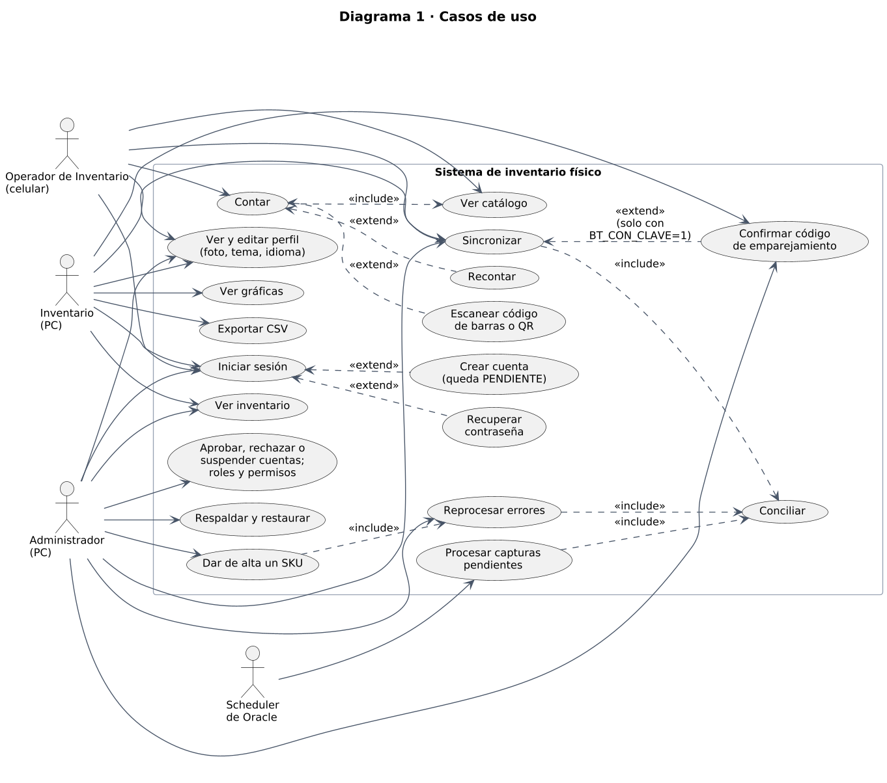

**Archivo fuente:** [`plantuml/01_casos_uso.puml`](plantuml/01_casos_uso.puml) · **Vectorial:** [SVG](renderizados/01_casos_uso.svg)

**Descripción:** Actores (Operador, Inventario, Administrador, Scheduler de Oracle) y las funciones del sistema, con sus `«include»` y `«extend»`.

## 02. Arquitectura general

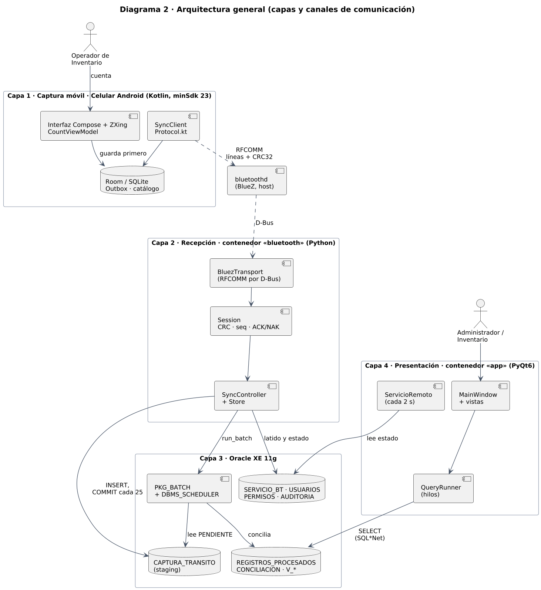

**Archivo fuente:** [`plantuml/02_arquitectura_general.puml`](plantuml/02_arquitectura_general.puml) · **Vectorial:** [SVG](renderizados/02_arquitectura_general.svg)

**Descripción:** Las cuatro capas (captura móvil, recepción Bluetooth, Oracle y presentación de escritorio) y los canales entre ellas: RFCOMM con CRC32, D-Bus, SQL*Net.

## 03. Diagrama de componentes

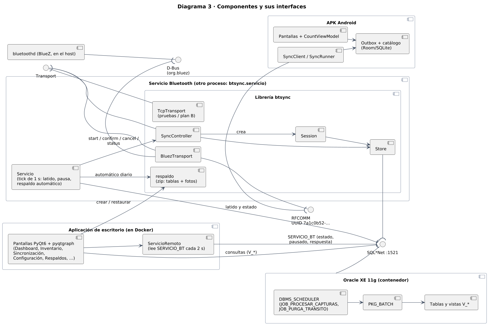

**Archivo fuente:** [`plantuml/03_componentes.puml`](plantuml/03_componentes.puml) · **Vectorial:** [SVG](renderizados/03_componentes.svg)

**Descripción:** APK, aplicación de escritorio, servicio Bluetooth, Oracle y BlueZ con las interfaces que exponen y consumen.

## 04. Diagrama de despliegue

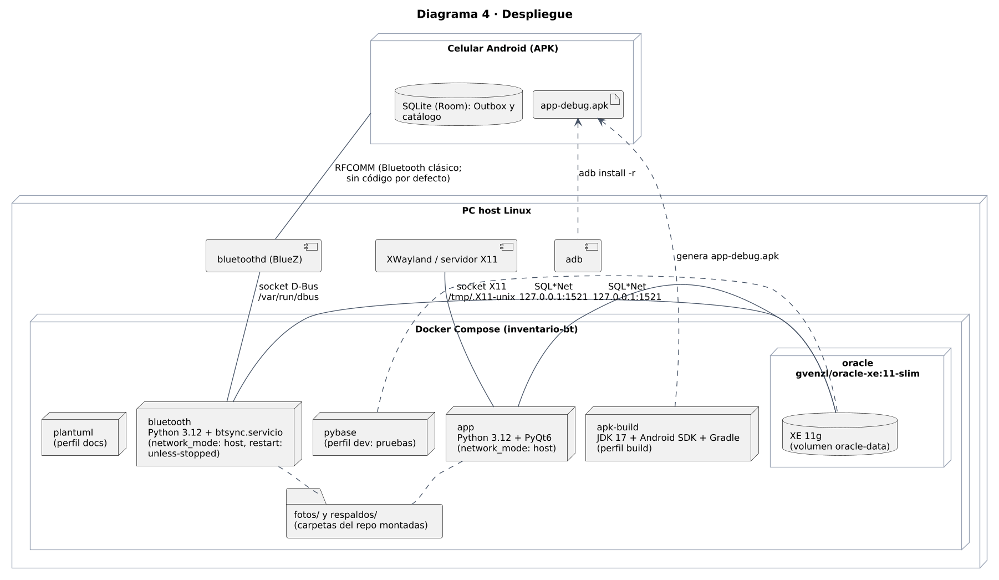

**Archivo fuente:** [`plantuml/04_despliegue.puml`](plantuml/04_despliegue.puml) · **Vectorial:** [SVG](renderizados/04_despliegue.svg)

**Descripción:** Celular, PC anfitrión y contenedores Docker (`oracle`, `bluetooth`, `app`), con sus enlaces de red y los volúmenes montados.

## 05. Secuencia del flujo principal de datos

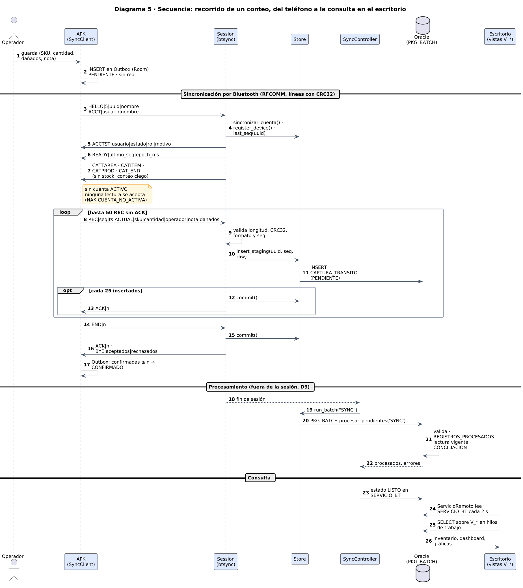

**Archivo fuente:** [`plantuml/05_secuencia_flujo_datos.puml`](plantuml/05_secuencia_flujo_datos.puml) · **Vectorial:** [SVG](renderizados/05_secuencia_flujo_datos.svg)

**Descripción:** Recorrido de un conteo: del teléfono al `ACK`, el batch `PKG_BATCH` y la consulta en el escritorio.

## 06. Secuencia de comunicación

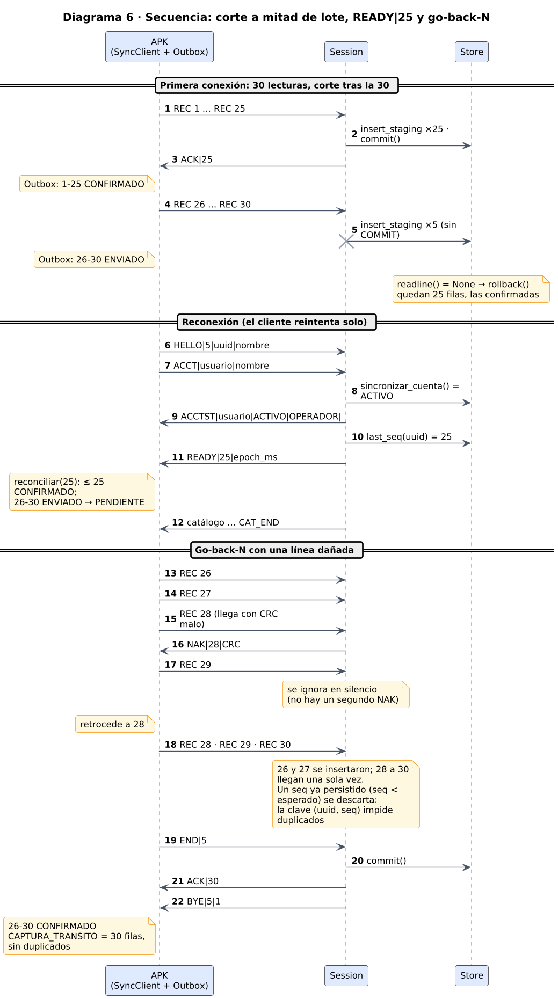

**Archivo fuente:** [`plantuml/06_secuencia_comunicacion.puml`](plantuml/06_secuencia_comunicacion.puml) · **Vectorial:** [SVG](renderizados/06_secuencia_comunicacion.svg)

**Descripción:** Corte a mitad de un lote, `READY|25` y reenvío go-back-N sin duplicados.

## 07. Clases del servidor (`btsync`)


**Archivo fuente:** [`plantuml/07_clases_paquetes.puml`](plantuml/07_clases_paquetes.puml) · **Vectorial:** [SVG](renderizados/07_clases_paquetes.svg)

**Descripción:** `Message`, `Rec`, `Store`, `Session`, `SyncController`, `Transport` y sus transportes `BluezTransport` y `TcpTransport`.

## 07b. Paquetes y dependencias

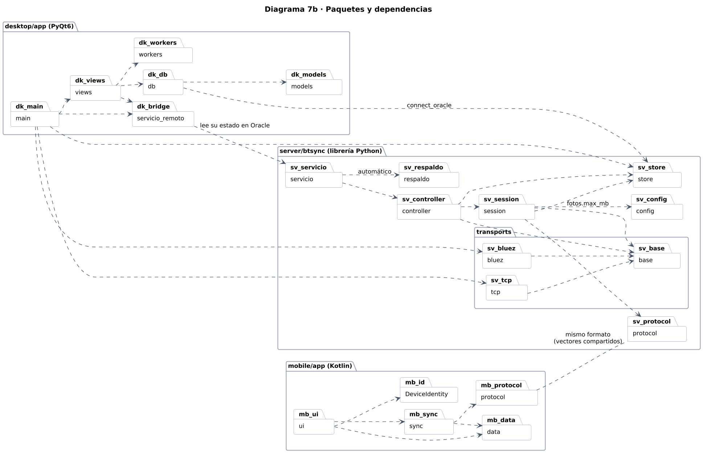

**Archivo fuente:** [`plantuml/07b_paquetes.puml`](plantuml/07b_paquetes.puml) · **Vectorial:** [SVG](renderizados/07b_paquetes.svg)

**Descripción:** Módulos de `btsync`, `desktop.app` y `mobile` y qué módulo importa a cuál.

## 07c. Clases de la aplicación de escritorio

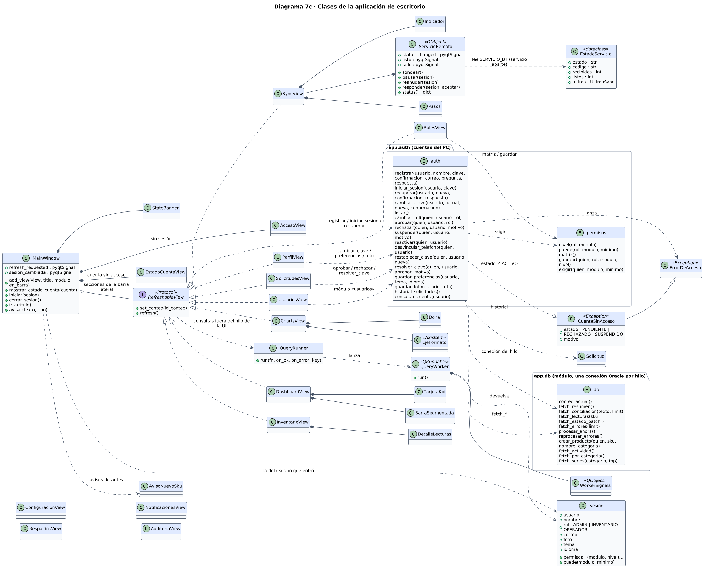

**Archivo fuente:** [`plantuml/07c_clases_escritorio.puml`](plantuml/07c_clases_escritorio.puml) · **Vectorial:** [SVG](renderizados/07c_clases_escritorio.svg)

**Descripción:** `MainWindow`, las vistas por rol, `ServicioRemoto`, `QueryRunner`/`QueryWorker` y el módulo `db`. Diagrama grande: use el SVG para leerlo con zoom.

## 07d. Clases de la APK Android (MVVM)

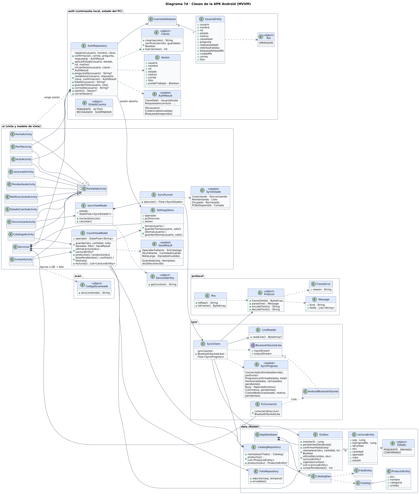

**Archivo fuente:** [`plantuml/07d_clases_android.puml`](plantuml/07d_clases_android.puml) · **Vectorial:** [SVG](renderizados/07d_clases_android.svg)

**Descripción:** Pantallas Compose, `AuthRepository`, `CountViewModel`, `SyncRunner`, `SyncClient`, `Protocol`, `Outbox` y el catálogo en Room. Diagrama grande: use el SVG.

## 08. Actividades: de la subida al batch

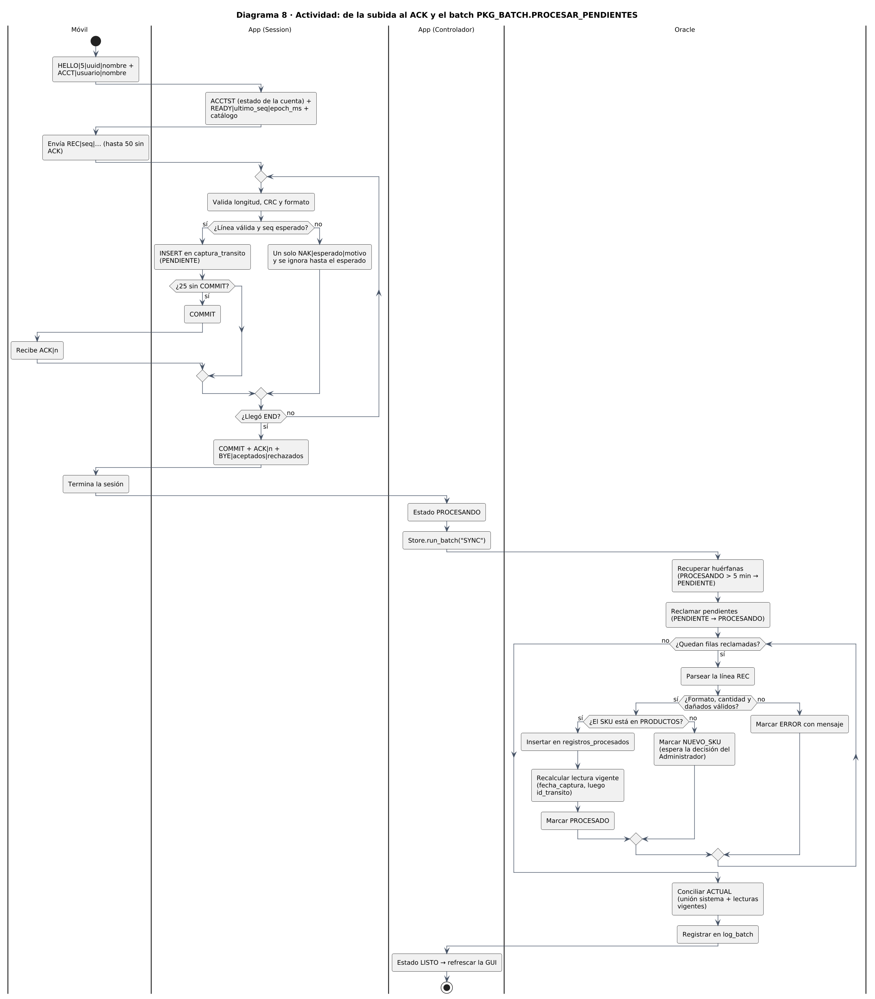

**Archivo fuente:** [`plantuml/08_actividades.puml`](plantuml/08_actividades.puml) · **Vectorial:** [SVG](renderizados/08_actividades.svg)

**Descripción:** Carriles Móvil / App / Oracle: de la subida de lecturas al `ACK` y a `PKG_BATCH.PROCESAR_PENDIENTES`.

## 08b. Actividades: conteo en el móvil

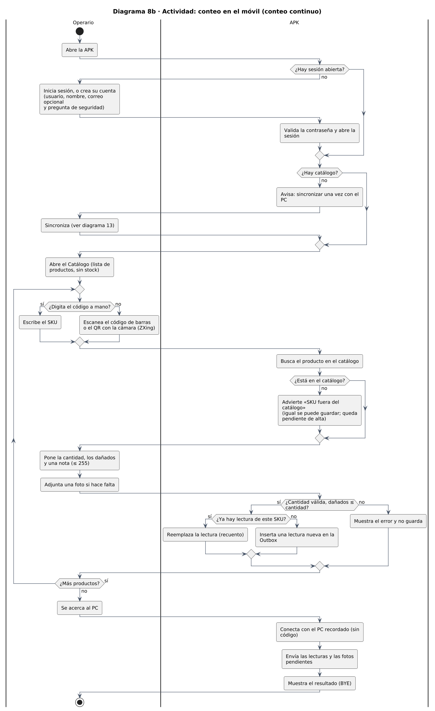

**Archivo fuente:** [`plantuml/08b_actividad_conteo_movil.puml`](plantuml/08b_actividad_conteo_movil.puml) · **Vectorial:** [SVG](renderizados/08b_actividad_conteo_movil.svg)

**Descripción:** Flujo del operador: iniciar sesión, abrir el catálogo, escanear o digitar, guardar y sincronizar.

## 09. Estados de `SyncController`


**Archivo fuente:** [`plantuml/09_estados.puml`](plantuml/09_estados.puml) · **Vectorial:** [SVG](renderizados/09_estados.svg)

**Descripción:** `IDLE … LISTO | ERROR`, con eventos y guardas (plazo, cancelación, corte, ocupado).

## 09b. Estados de una fila de `CAPTURA_TRANSITO`


**Archivo fuente:** [`plantuml/09b_estados_fila_transito.puml`](plantuml/09b_estados_fila_transito.puml) · **Vectorial:** [SVG](renderizados/09b_estados_fila_transito.svg)

**Descripción:** `PENDIENTE → PROCESANDO → PROCESADO | ERROR` (y `NUEVO_SKU`/`DESCARTADO`), con recuperación de filas huérfanas.

## 09c. Estados de una cuenta

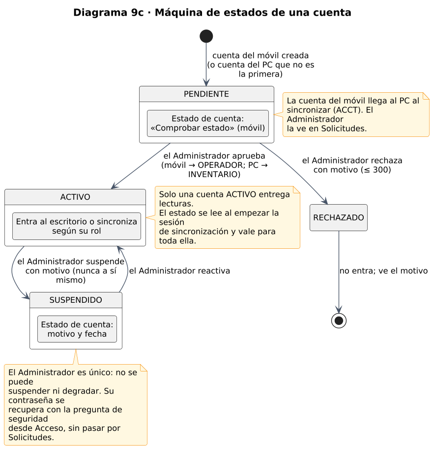

**Archivo fuente:** [`plantuml/09c_estados_cuenta.puml`](plantuml/09c_estados_cuenta.puml) · **Vectorial:** [SVG](renderizados/09c_estados_cuenta.svg)

**Descripción:** `PENDIENTE → ACTIVO | RECHAZADO` y `ACTIVO ⇄ SUSPENDIDO`, y qué ve la persona en cada estado.

## 10. Entidad-relación de Oracle

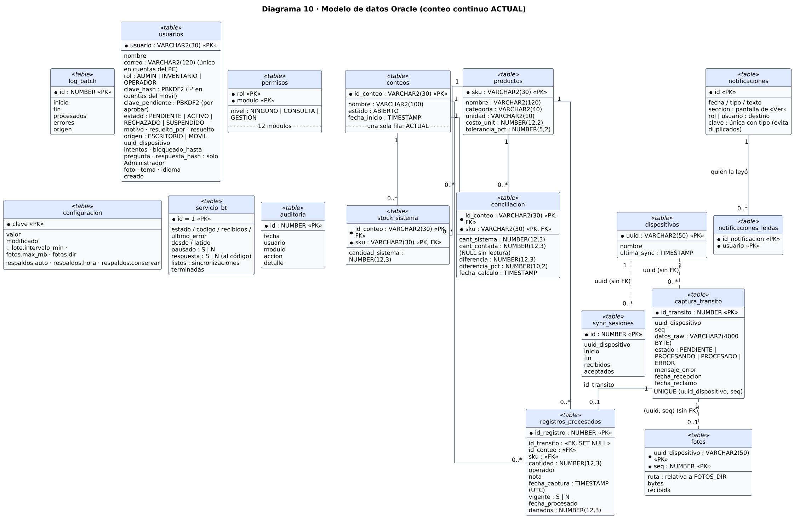

**Archivo fuente:** [`plantuml/10_modelo_datos.puml`](plantuml/10_modelo_datos.puml) · **Vectorial:** [SVG](renderizados/10_modelo_datos.svg)

**Descripción:** Las tablas del esquema `APP` con claves, llaves foráneas y cardinalidades.

## Diagramas UML complementarios (`docs/uml`)

Además de los 16 diagramas anteriores, el proyecto mantiene 22 diagramas UML de 13 tipos en [`../../uml/`](../../uml/README.md)
(fuente en `docs/uml/*.puml`, imágenes en `docs/img/uml/` en SVG y PNG). Los 16 de esta carpeta se derivan de ellos con
[`../herramientas/preparar_puml.py`](../herramientas/preparar_puml.py); estos siete aportan tipos que aquí no se repiten:

| ID | Diagrama | Descripción | Archivo PUML | Imagen renderizada |
|---|---|---|---|---|
| U05 | Objetos: instantánea de una lectura | De la línea `REC` a la fila de `CONCILIACION` (SKU A-01). | [`docs/uml/05-objetos-instantanea.puml`](../../uml/05-objetos-instantanea.puml) | [PNG](../../img/uml/05-objetos-instantanea.png) · [SVG](../../img/uml/05-objetos-instantanea.svg) |
| U09 | Estructura compuesta de `SyncController` | Puertos y partes internas del controlador. | [`docs/uml/09-estructura-compuesta.puml`](../../uml/09-estructura-compuesta.puml) | [PNG](../../img/uml/09-estructura-compuesta.png) · [SVG](../../img/uml/09-estructura-compuesta.svg) |
| U15 | Secuencia: SKU nuevo y reproceso | Fila en `NUEVO_SKU`, aviso «Nuevo SKU» (**Crear y procesar** o **No crear**) y `REPROCESAR_ERRORES`. | [`docs/uml/15-secuencia-errores-y-reproceso.puml`](../../uml/15-secuencia-errores-y-reproceso.puml) | [PNG](../../img/uml/15-secuencia-errores-y-reproceso.png) · [SVG](../../img/uml/15-secuencia-errores-y-reproceso.svg) |
| U18 | Estados de una lectura en la Outbox | `PENDIENTE → ENVIADO → CONFIRMADO` y el regreso tras un corte. | [`docs/uml/18-estados-lectura-outbox.puml`](../../uml/18-estados-lectura-outbox.puml) | [PNG](../../img/uml/18-estados-lectura-outbox.png) · [SVG](../../img/uml/18-estados-lectura-outbox.svg) |
| U20 | Comunicación (colaboración numerada) | Colaboración entre `Session`, `Store`, `SyncController`, `PKG_BATCH` y `ServicioRemoto`. | [`docs/uml/20-comunicacion.puml`](../../uml/20-comunicacion.puml) | [PNG](../../img/uml/20-comunicacion.png) · [SVG](../../img/uml/20-comunicacion.svg) |
| U21 | Visión general de interacción | Flujo de alto nivel que enlaza los diagramas 13, 14 y 15. | [`docs/uml/21-vision-interaccion.puml`](../../uml/21-vision-interaccion.puml) | [PNG](../../img/uml/21-vision-interaccion.png) · [SVG](../../img/uml/21-vision-interaccion.svg) |
| U22 | Tiempos | Latido del servicio (1 s; `DETENIDO` a los 10 s) y ventana de 50 `REC` entre `ACK`. | [`docs/uml/22-tiempos.puml`](../../uml/22-tiempos.puml) | [PNG](../../img/uml/22-tiempos.png) · [SVG](../../img/uml/22-tiempos.svg) |

### U05. Objetos: instantánea de una lectura

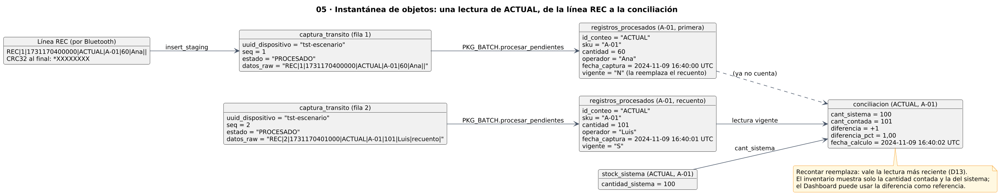

**Archivo fuente:** [`docs/uml/05-objetos-instantanea.puml`](../../uml/05-objetos-instantanea.puml)

**Descripción:** De la línea `REC` a la fila de `CONCILIACION` (SKU A-01).

### U09. Estructura compuesta de `SyncController`


**Archivo fuente:** [`docs/uml/09-estructura-compuesta.puml`](../../uml/09-estructura-compuesta.puml)

**Descripción:** Puertos y partes internas del controlador.

### U15. Secuencia: SKU nuevo y reproceso

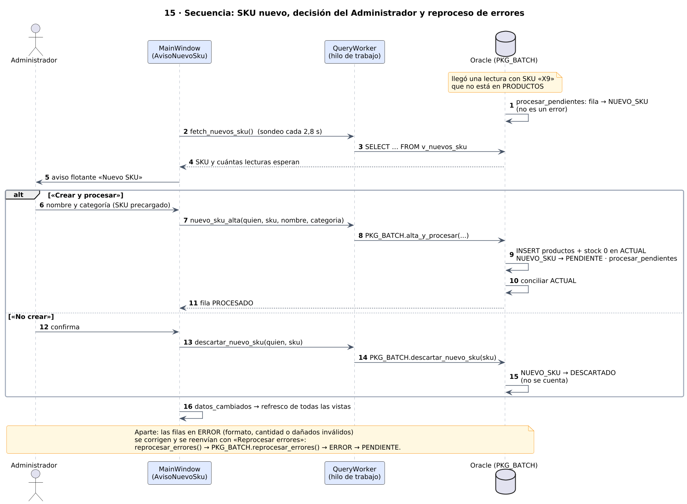

**Archivo fuente:** [`docs/uml/15-secuencia-errores-y-reproceso.puml`](../../uml/15-secuencia-errores-y-reproceso.puml)

**Descripción:** Fila en `NUEVO_SKU`, aviso «Nuevo SKU» (**Crear y procesar** o **No crear**) y `REPROCESAR_ERRORES`.

### U18. Estados de una lectura en la Outbox

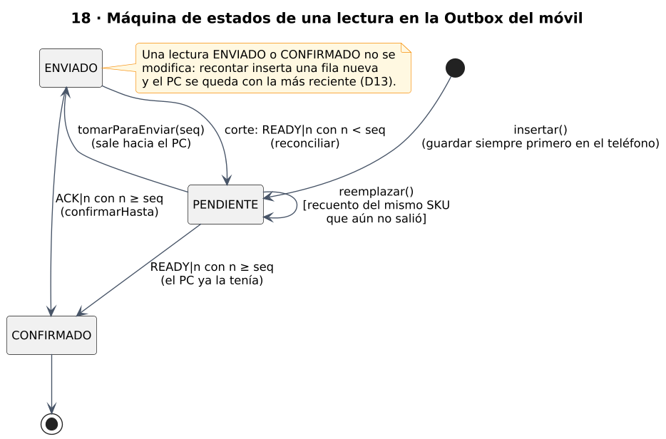

**Archivo fuente:** [`docs/uml/18-estados-lectura-outbox.puml`](../../uml/18-estados-lectura-outbox.puml)

**Descripción:** `PENDIENTE → ENVIADO → CONFIRMADO` y el regreso tras un corte.

### U20. Comunicación (colaboración numerada)

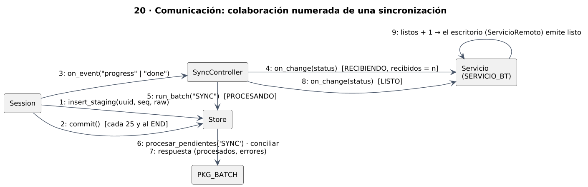

**Archivo fuente:** [`docs/uml/20-comunicacion.puml`](../../uml/20-comunicacion.puml)

**Descripción:** Colaboración entre `Session`, `Store`, `SyncController`, `PKG_BATCH` y `ServicioRemoto`.

### U21. Visión general de interacción

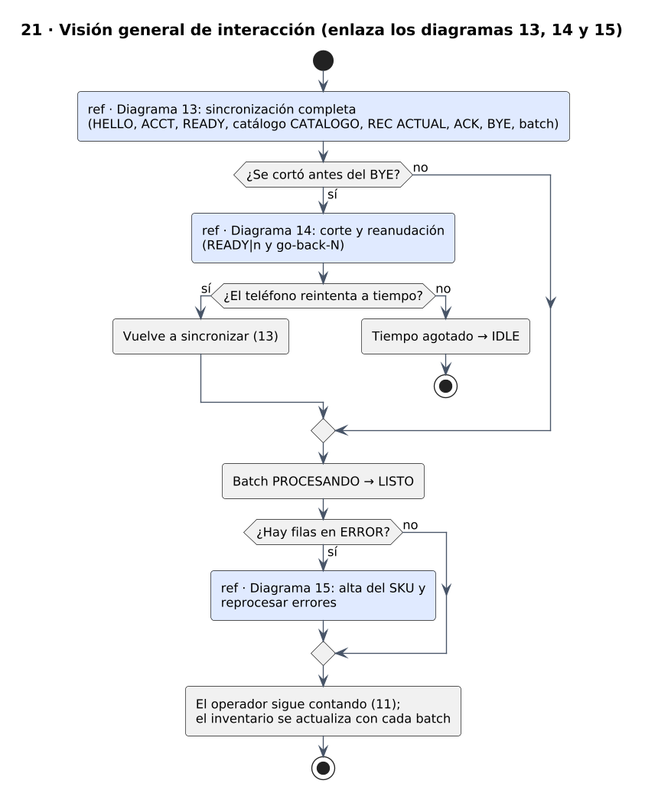

**Archivo fuente:** [`docs/uml/21-vision-interaccion.puml`](../../uml/21-vision-interaccion.puml)

**Descripción:** Flujo de alto nivel que enlaza los diagramas 13, 14 y 15.

### U22. Tiempos

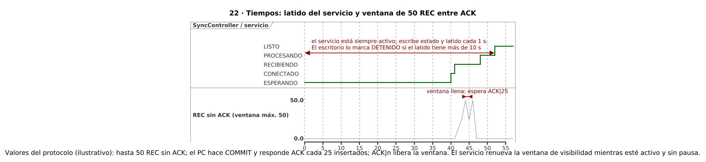

**Archivo fuente:** [`docs/uml/22-tiempos.puml`](../../uml/22-tiempos.puml)

**Descripción:** Latido del servicio (1 s; `DETENIDO` a los 10 s) y ventana de 50 `REC` entre `ACK`.

## Edición y renderizado

Requisito: Docker (es el único software necesario; PlantUML corre en la imagen fija `plantuml/plantuml:1.2024.7`).

1. Edite el `.puml` de `plantuml/` (todos incluyen `estilo.iuml`, que fija colores y tipografía comunes).
2. Regenere las imágenes de esta carpeta, desde la raíz del repositorio (genera SVG y PNG y termina con error si hay un
   error de sintaxis):

```bash
docs/documentacion/herramientas/renderizar_diagramas.sh
```

3. Para los diagramas de `docs/uml` (SVG y PNG en `docs/img/uml/`):

```bash
tools/render_uml.sh
```

4. Si el cambio debe verse en el documento técnico, reconstruya Word y PDF con
   `docs/documentacion/herramientas/construir_documento.py <plantilla.docx> <carpeta_de_salida>` (necesita la plantilla
   `.docx` original; ver [`../INDICE_EVIDENCIAS.md`](../INDICE_EVIDENCIAS.md)).

Cada `.puml` empieza con `title Diagrama N · …`; el número del título debe coincidir con el ID de este inventario.
Si un diagrama de clases cambia, actualice también su línea `' @code:` (la raíz de código que verifica `tools/check_uml.py`).

## Validación

```bash
docker compose run --rm pybase pytest server/tests/test_uml.py -v
```

Comprueba que cada `.puml` de `docs/uml` tenga `@startuml`, `@enduml` y `title`, y que las clases de los diagramas 01, 02 y
03 existan en el código. El renderizado con `-failonerror` valida además la sintaxis de los 38 archivos (16 + 22).
