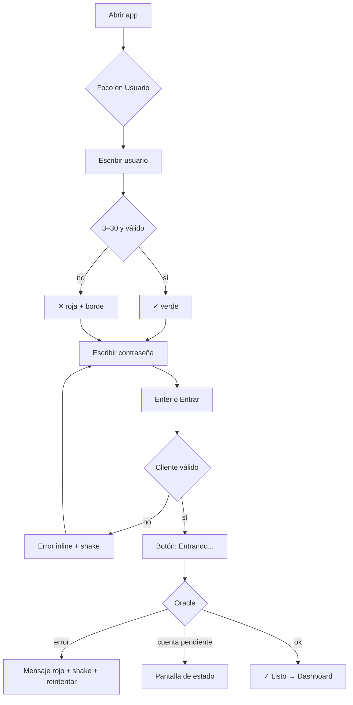
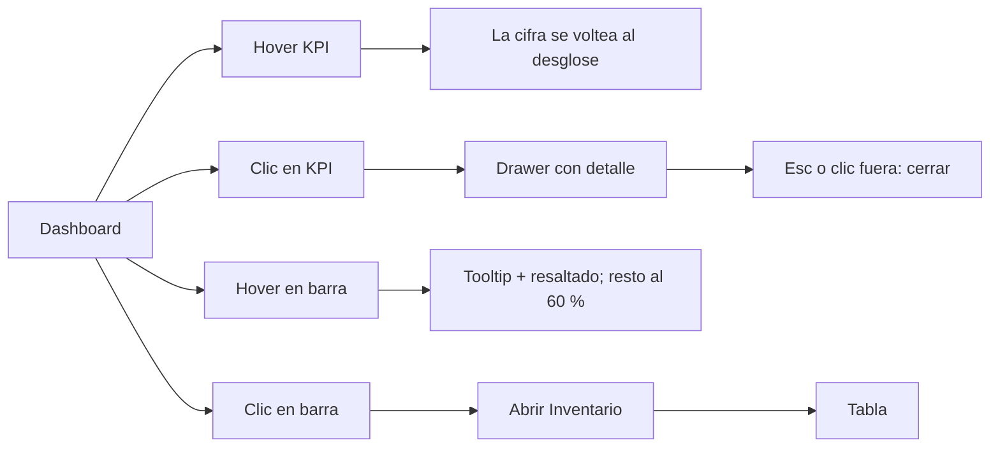
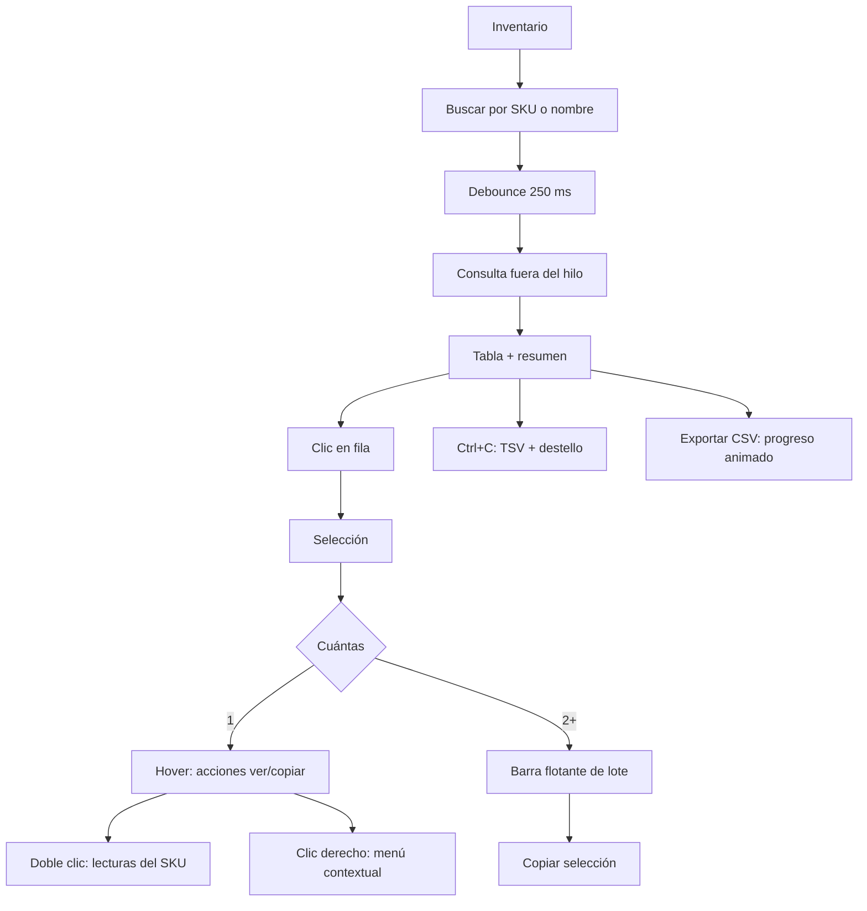
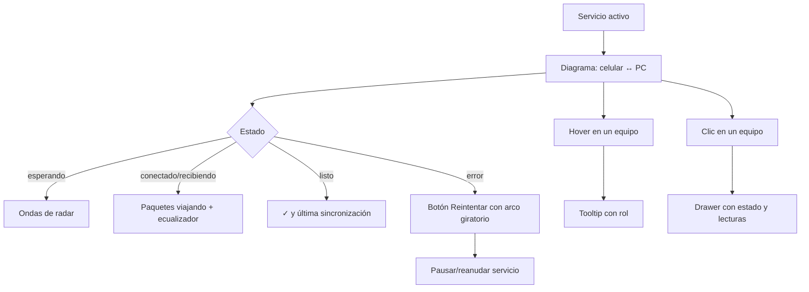
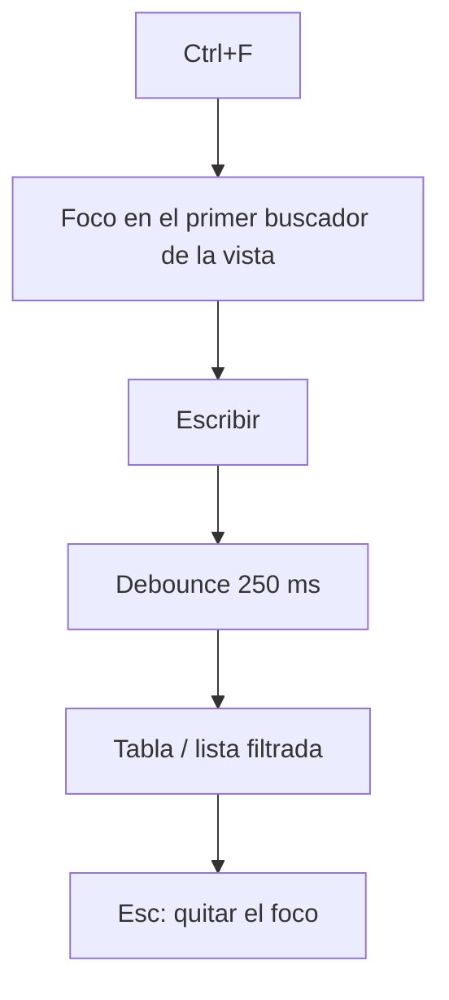
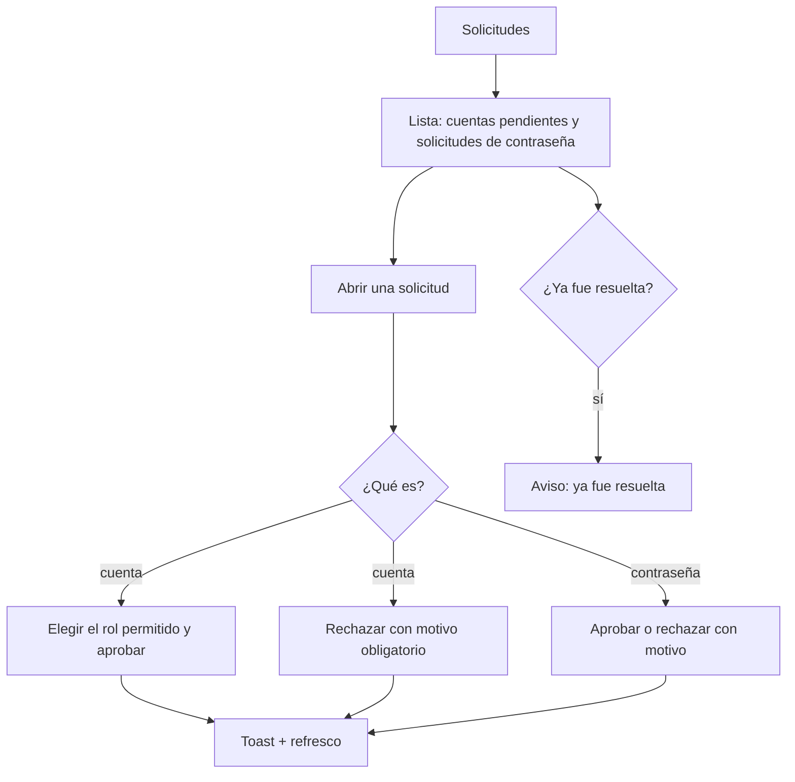
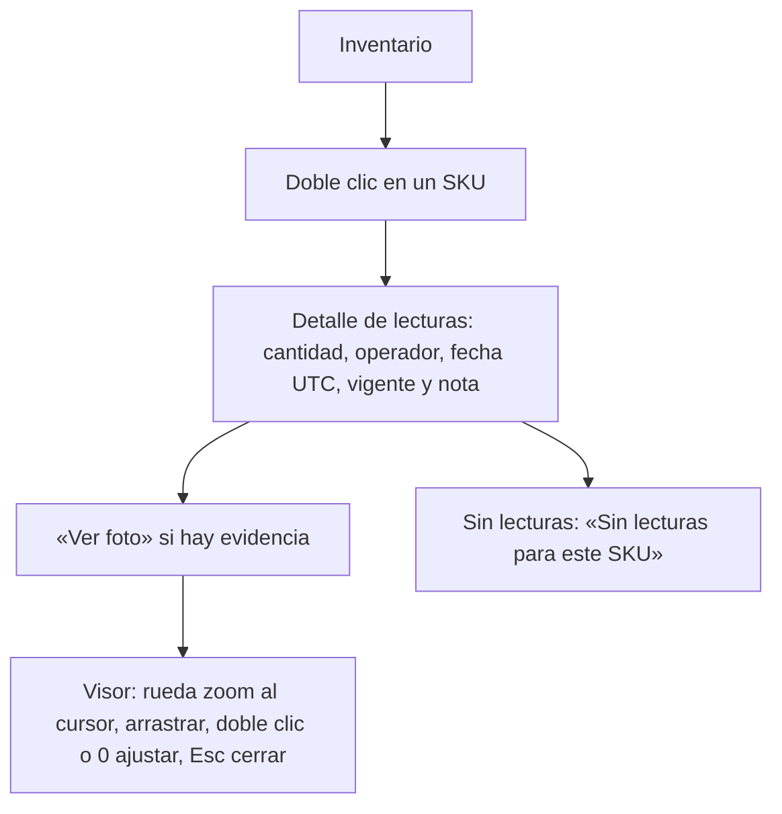
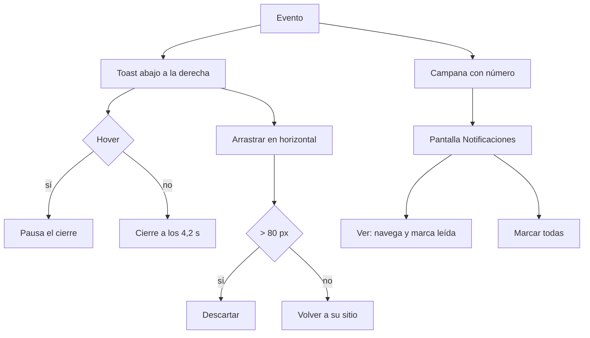
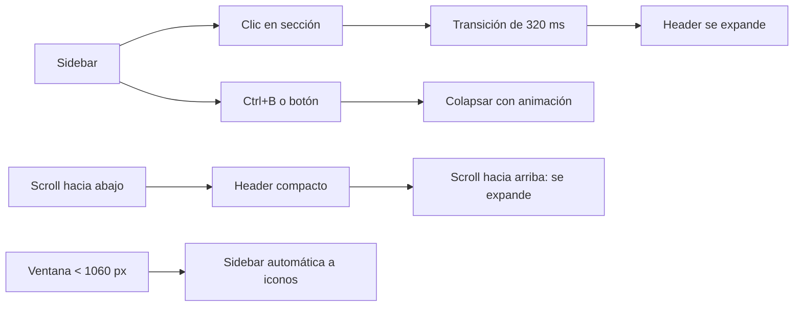

# Flujos interactivos por pantalla

Diagramas de la interacción (no del modelo de datos). El estado final de cada acción se ve sin esperar animación; los
tiempos son los del sistema de motion (`docs/interactividad/03-estados-y-componentes.md`).

## 1. Login

## 2. Dashboard: KPI y drill-down

## 3. Inventario y tablas

## 4. Sincronización / Bluetooth

## 5. Búsqueda en la vista

## 6. Solicitudes

## 7. Detalle de inventario y foto

## 8. Notificaciones y toasts

## 9. Navegación y encabezado

