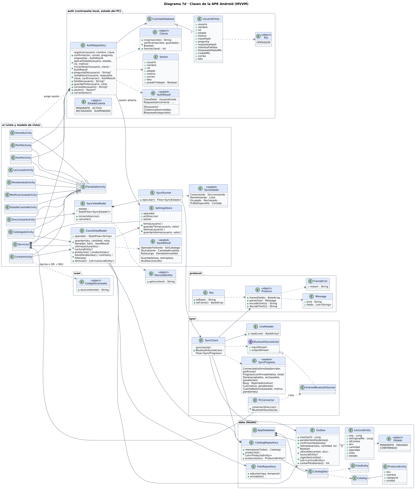
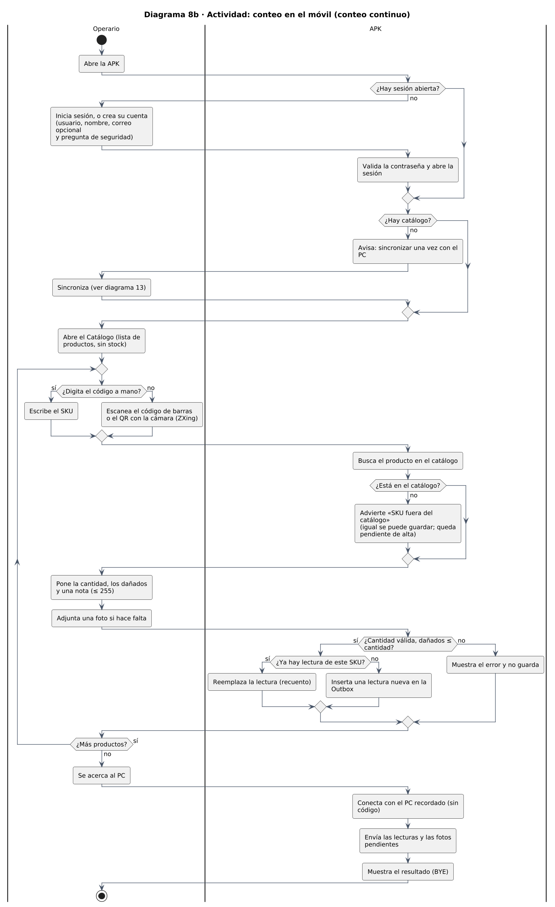

# Aplicación móvil (APK Android)

App del **Operador de Inventario**: cuenta productos sin red (escaneando código de barras o QR, o digitando el SKU), guarda
cada lectura en el teléfono y, cuando está cerca del PC, las sincroniza por **Bluetooth clásico (RFCOMM)**. Kotlin, Jetpack
Compose (Material 3) y Room; `minSdk 23` (Android 6.0), `targetSdk 34`, `namespace co.edu.umariana.inventario`.

Principios que explican el diseño:

- **Guardar primero**: la lectura se escribe en la bandeja de salida (`Outbox`, tabla `lecturas` de Room) antes de cualquier
  envío; sin red el conteo no se pierde.
- **Conteo ciego**: el catálogo que baja del PC nunca trae la cantidad del sistema.
- **Sin servicios de Google**: el escáner usa ZXing embebido (`zxing-android-embedded`), sin Google Play Services (D14).
- **Cuentas locales**: el Operador se registra en el teléfono (contraseña con PBKDF2-HMAC-SHA256, pregunta de seguridad) y
  llega al PC al sincronizar, donde el Administrador la aprueba.

## Arquitectura



Fuente: [`07d_clases_android.puml`](../docs/documentacion/diagramas/plantuml/07d_clases_android.puml) (vectorial:
[SVG](../docs/documentacion/diagramas/renderizados/07d_clases_android.svg)).



Fuente: [`08b_actividad_conteo_movil.puml`](../docs/documentacion/diagramas/plantuml/08b_actividad_conteo_movil.puml).

## Estructura

```text
mobile/
├── Dockerfile               imagen apk-build: JDK 17, Android SDK 34 y Gradle 8.7
├── build.gradle.kts, settings.gradle.kts, gradle.properties, gradlew
└── app/
    ├── build.gradle.kts     dependencias (Room 2.6.1 con KSP, Compose BOM 2024.06.00, ZXing 4.3.0, coroutines)
    └── src/
        ├── main/java/co/edu/umariana/inventario/   código → README.md de ese directorio
        └── test/java/co/edu/umariana/inventario/   pruebas unitarias y CapturasTest
```

Detalle de paquetes, clases y flujo: [`app/src/main/java/co/edu/umariana/inventario/README.md`](app/src/main/java/co/edu/umariana/inventario/README.md).

## Permisos de Android

| Permiso | Para qué |
|---|---|
| `BLUETOOTH_CONNECT`, `BLUETOOTH_SCAN` (`neverForLocation`) | Android 12 o posterior: buscar y conectar con el PC |
| `BLUETOOTH`, `BLUETOOTH_ADMIN` (hasta API 30) | Android 11 o anterior |
| `ACCESS_FINE_LOCATION` (hasta API 30) | Android 10 o anterior exige la ubicación encendida para buscar dispositivos Bluetooth |
| `CAMERA` | Escáner de barras/QR y foto de la lectura |

## Compilar, probar e instalar

Todo en Docker; no hace falta instalar el SDK en el host.

```bash
docker compose --profile build run --rm apk-build ./gradlew assembleDebug
docker compose --profile build run --rm apk-build ./gradlew testDebugUnitTest
adb install -r mobile/app/build/outputs/apk/debug/app-debug.apk     # celular por USB con depuración activa
```

Las ~115 pruebas unitarias (JUnit, Robolectric y Roborazzi) cubren el protocolo (con los mismos vectores que el servidor), la bandeja de
salida, las cuentas, el cliente de sincronización, las fotos y las pantallas. `CapturasTest` genera las capturas de
[`../docs/img/movil/`](../docs/img/movil/):

```bash
docker compose --profile build run --rm apk-build ./gradlew cleanTestDebugUnitTest testDebugUnitTest --tests '*CapturasTest'
```

> **No desinstale la APK con lecturas pendientes**: la bandeja de salida vive en el teléfono y se borra con la aplicación
> (D18); reinstalar crea un dispositivo nuevo con `seq` desde 1.

## Uso resumido

1. Crear cuenta (usuario, nombre, correo opcional, pregunta de seguridad) o iniciar sesión; una cuenta nueva queda **pendiente**
   hasta que sincroniza y el Administrador la aprueba como Operador en **Solicitudes** del PC.
2. **Sincronizar** para bajar el catálogo; la primera vez se busca y elige `gestion_inventario`, después conecta directo.
3. **Catálogo → Contar**: escanear o digitar el SKU, cantidad, dañados, nota y foto opcional; **Guardar** (sin red).
4. **Sincronizar** de nuevo para subir las lecturas. Solo se sincroniza un teléfono a la vez (D19).

Capturas de cada pantalla: [`../docs/img/movil/`](../docs/img/movil/). Protocolo: [`../docs/protocolo.md`](../docs/protocolo.md).
Lado PC: [`../server/btsync/README.md`](../server/btsync/README.md).
