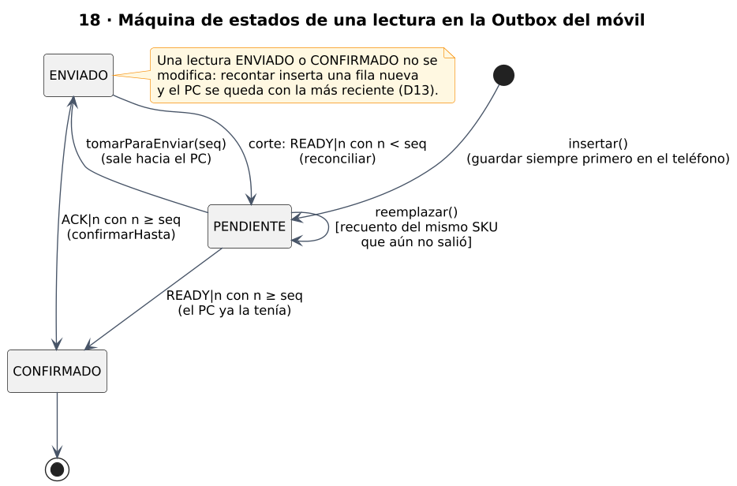
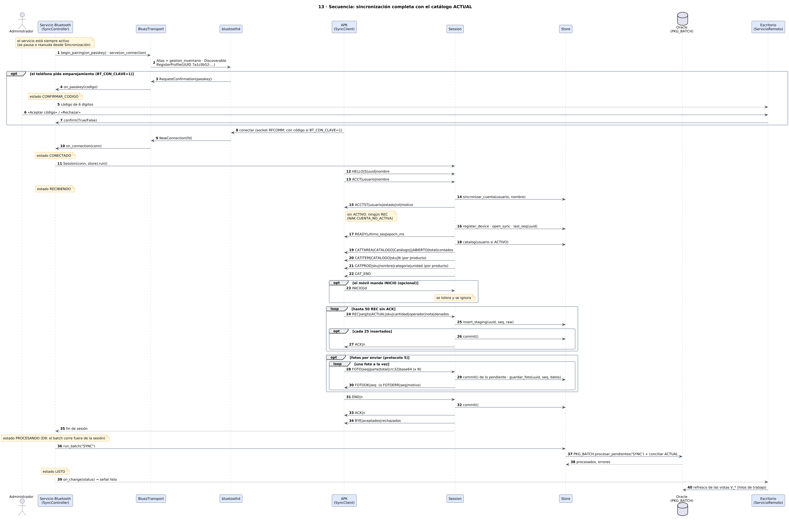

# Paquete `co.edu.umariana.inventario`: código de la APK

Organización por responsabilidad. Visión general, compilación y permisos: [`../../../../../../../../README.md`](../../../../../../../../README.md)
(`mobile/README.md`).

## Paquetes

| Paquete | Responsabilidad | Piezas principales |
|---|---|---|
| `protocol` | Protocolo de líneas (espejo de `btsync/protocol.py`; ambos pasan los mismos vectores) | `Protocol`, `Message`, `Rec`, `FrameError`, `EstadoCuentaPc` |
| `sync` | Cliente de sincronización y conexión Bluetooth | `SyncClient` (flujo `SyncProgress`), `PcConnector` (RFCOMM inseguro, D22), `AndroidBluetoothSocket`, `BluetoothSocketLike`, `LineReader` |
| `data` | Persistencia local con Room (`AppDatabase`, versión 5) | `Outbox` + `LecturaEntity` (tabla `lecturas`), `CatalogRepository` + `ProductoEntity`, `FotoRepository` + `FotoEntity`, `NotificacionRepository` + `NotificacionEntity` |
| `auth` | Cuentas locales del Operador | `AuthRepository` (`registrar`, `iniciarSesion`, `restablecer`, `aplicarEstado`), `Claves` (PBKDF2-HMAC-SHA256), `UsuarioEntity`, `Rol`, `EstadoCuenta`, `Sesion` |
| `fotos`, `imagen` | Compresión de la foto de la lectura y recorte del avatar | `Compresor`, `RecorteFoto` |
| `scan` | Interpretación del código leído (barras o QR) | `CodigoEscaneado` |
| `ui` | Actividades, `ViewModel`s y estado de la interfaz | `CountViewModel`, `SyncViewModel`, `SyncRunner` (`SyncEstado`), `Servicios`, `SettingsStore`, `Textos` (español/inglés), `Apariencia` |
| `ui/pantallas` | Pantallas Compose sin lógica: reciben un estado `…Ui` y emiten eventos | `AuthScreen`, `HomeScreen`, `CatalogoScreen`, `ContarScreen`, `SincronizarScreen`, `ListasScreen` (contado y pendientes), `NotificacionesScreen`, `PerfilScreen`, `EstadoCuentaScreen`, `FotoEditorScreen` |
| `ui/componentes`, `ui/theme` | Componentes reutilizables y tema (`InventarioTheme`, `Marca`) | `Componentes.kt`, `BotonApariencia` |
| (raíz) | Identidad del dispositivo | `DeviceIdentity`: UUID generado en el primer uso (D18) |

Actividades declaradas en el manifiesto: `HomeActivity` (lanzadora), `AuthActivity`, `EstadoCuentaActivity`, `PerfilActivity`,
`CatalogoActivity`, `ContarActivity`, `LecturasActivity`, `PendientesActivity`, `SincronizarActivity`, `NotificacionesActivity`
y `FotoEditorActivity`; todas en vertical.

## Bandeja de salida (`Outbox`)

Estados de una lectura (`data/Lectura.kt`, objeto `Estado`): `PENDIENTE` (capturada, aún se puede recontar en sitio) →
`ENVIADO` (salió, sin confirmación) → `CONFIRMADO` (el PC la tiene: `ACK` o `READY`). `seq` lo asigna SQLite
(AUTOINCREMENT) y es contiguo desde 1; la hora original (`tsOriginalMs`) no se modifica al sincronizar. Tras un corte,
`reconciliar(ultimoSeqServidor)` devuelve a `PENDIENTE` lo enviado que el PC no confirmó.



Fuente: [`18-estados-lectura-outbox.puml`](../../../../../../../../../docs/uml/18-estados-lectura-outbox.puml).

## Flujo de una sincronización (`SyncRunner` → `SyncClient`)

1. `SincronizarActivity` pide a `SyncViewModel` iniciar; `SyncRunner` abre el socket con `PcConnector` (hasta 3 intentos, 3 s de pausa).
2. `SyncClient.sync(socket)` envía `HELLO` y `ACCT`, recibe `ACCTST`, `READY|<seq>` y el catálogo (`CATTAREA`, `CATITEM`, `CATPROD`).
   Si la cuenta no está `ACTIVO`, termina con `END|0` y emite `CuentaNoActiva`: no se envía ninguna lectura.
3. Envía los `REC` pendientes con una **ventana** de 50 lecturas sin confirmar (`SyncClient.WINDOW`); ante `NAK|n|motivo` reenvía desde `n` (go-back-N).
4. Corrige la hora con el desfase del servidor (D15): se envía `tsOriginalMs + offset`, sin tocar la fila.
5. Envía las fotos (`FOTO`), cierra con `END` y espera `BYE`. Emite `Done(aceptados, rechazados, pendientes)`; un corte emite
   `Cut(motivo, pendientes)` y lo no confirmado queda en la bandeja para el siguiente intento. Un PC ocupado (`NAK|0|OCUPADO`)
   emite `Busy` y no se reintenta.



Fuente: [`13-secuencia-sincronizacion.puml`](../../../../../../../../../docs/uml/13-secuencia-sincronizacion.puml).

## Estado de la interfaz

Cada pantalla Compose recibe un `data class …Ui` y callbacks; las actividades traducen resultados del dominio a mensajes
(`ui/Pantalla.kt`: `SaveResult`, `AuthResult`). Los textos están en `ui/Textos.kt` (español e inglés; el idioma y el tema se
guardan por cuenta en `SettingsStore`).

## Ejemplo: probar el protocolo sin teléfono

`SyncClient` recibe un `BluetoothSocketLike`, así que las pruebas lo ejercitan con sockets en memoria
(`src/test/.../sync/SyncClientTest.kt` con el PC simulado `FakePc.kt`; `PcConnector`, que necesita el radio, no interviene):

```bash
docker compose --profile build run --rm apk-build ./gradlew testDebugUnitTest --tests '*SyncClientTest'
```

## Pruebas relacionadas

`src/test/java/co/edu/umariana/inventario/`: `protocol/` (vectores de `docs/protocol-vectors.json`), `data/` (bandeja,
catálogo, migraciones), `auth/`, `sync/`, `fotos/`, `imagen/`, `scan/` y `ui/` (`CountViewModelTest`, `SyncRunnerTest`,
`CapturasTest`).
