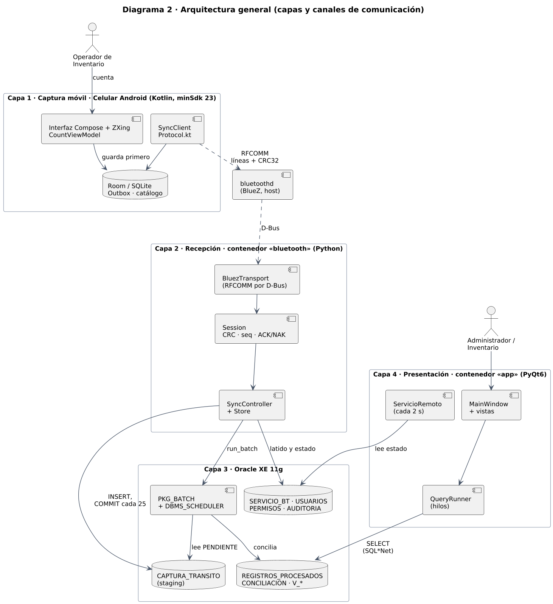
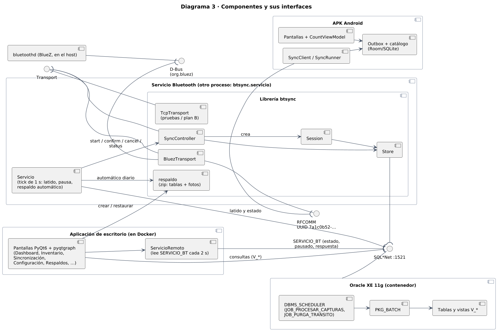

# Servidor: librería `btsync` y servicio Bluetooth

Servidor de **Kardex**. Paquete Python (`server/pyproject.toml`, nombre `btsync`, Python ≥ 3.12, dependencia `oracledb`) que recibe lo que el
teléfono cuenta y lo deja en Oracle. No tiene API HTTP: habla **Bluetooth RFCOMM** con la APK y **SQL\*Net** con Oracle.
Lo usan dos procesos:

| Proceso | Cómo arranca | Qué usa de `btsync` |
|---|---|---|
| **Servicio Bluetooth** (`bluetooth` en Docker) | `python -m btsync.servicio` | `servicio`, `SyncController`, `Session`, `Store`, `respaldo.Automatico` |
| **Aplicación de escritorio** (`desktop/`) | `python -m app.main` (con `PYTHONPATH=/work/server:/work/desktop`) | `store.connect_oracle`, `config`, `respaldo`, `notificaciones`, `esquema` |

## Arquitectura



Fuente: [`02_arquitectura_general.puml`](../docs/documentacion/diagramas/plantuml/02_arquitectura_general.puml).
La capa 2 (recepción) es este paquete: `BluezTransport` → `Session` → `SyncController`/`Store` → Oracle.



Fuente: [`03_componentes.puml`](../docs/documentacion/diagramas/plantuml/03_componentes.puml).

## Estructura

```text
server/
├── pyproject.toml        paquete btsync; extras: dev (pytest) y bluez (dbus-fast)
├── btsync/               librería y servicio (ver btsync/README.md)
│   └── transports/       BluezTransport (RFCOMM por D-Bus) y TcpTransport (ver transports/README.md)
├── tests/                pruebas con pytest (18 archivos `test_*.py`, ~215 pruebas)
└── spikes/               experimentos desechables de Bluetooth desde un contenedor (ver ../docs/spikes/bluez.md)
```

## Instalación y ejecución

Todo corre en Docker; la imagen `pybase` (`docker/pybase/Dockerfile`) instala `btsync` con el Instant Client de Oracle.

```bash
docker compose up -d --wait oracle          # base de datos
docker compose up -d bluetooth              # servicio de recepción (BlueZ real)
BT_TRANSPORT=tcp docker compose up -d bluetooth   # sin Bluetooth: escucha TCP (pruebas y plan B)
docker compose logs -f bluetooth            # mensajes del servicio
```

### Variables de entorno

| Variable | Obligatoria | Efecto |
|---|---|---|
| `DB_DSN`, `DB_USER`, `DB_PASSWORD` | Sí | Conexión a Oracle (`store.connect_oracle`). Las fija `docker-compose.yml` a partir de `.env`. |
| `BT_TRANSPORT` | No (`bluez`) | `bluez` o `tcp` (`servicio.crear_transporte`). |
| `BT_TCP_HOST`, `BT_TCP_PORT` | No | Dirección (`127.0.0.1`) y puerto (`9000`) del transporte TCP; solo con `BT_TRANSPORT=tcp`. |
| `BT_CON_CLAVE` | No (`0`) | `1` exige emparejamiento con código; por defecto el socket es inseguro (D22). |
| `FOTOS_DIR` | No | Carpeta donde se guardan las fotos de las lecturas. |
| `RESPALDOS_DIR` | No | Carpeta de los respaldos `.zip` (por defecto `respaldos/`). |
| `ORA_SDTZ` | Recomendada | Zona horaria de la sesión de Oracle (`+00:00` en compose). |

## Pruebas

```bash
docker compose run --rm pybase pytest server/tests -v
```

| Archivo | Cubre |
|---|---|
| `test_protocol.py`, `fixtures/` | Líneas, CRC32, escapes y vectores compartidos con la APK |
| `test_session.py`, `test_e2e_tcp.py` | Sesión completa (ACK/NAK, go-back-N, cuentas) y de punta a punta por TCP |
| `test_controller.py`, `test_servicio.py`, `test_concurrent_connect.py` | Máquina de estados, pausa/reanudación, una sola sincronización a la vez |
| `test_bluez.py` | `BluezTransport` con un bus D-Bus falso |
| `test_store.py`, `test_cuentas.py`, `test_fotos.py` | Acceso a Oracle, cuentas del móvil, fotos |
| `test_batch.py`, `test_conciliacion.py`, `test_schema.py` | `PKG_BATCH`, conciliación y esquema |
| `test_config.py`, `test_notificaciones.py`, `test_respaldo.py` | Configuración, avisos y respaldos |
| `test_uml.py` | Los diagramas `.puml` existen y las clases declaradas están en el código |

Las pruebas que tocan Oracle usan tablas con sufijo `_tst` y dispositivos `tst-`: necesitan la base de desarrollo
(`docker compose up -d --wait oracle`) y no deben apuntarse a datos reales.

## Ver también

- [`btsync/README.md`](btsync/README.md): módulos, clases y flujo de una sincronización.
- [Protocolo móvil ↔ PC](../docs/protocolo.md) y [arquitectura](../docs/arquitectura.md).
- [`db/README.md`](../db/README.md): el esquema y `PKG_BATCH` con el que dialoga `Store`.
