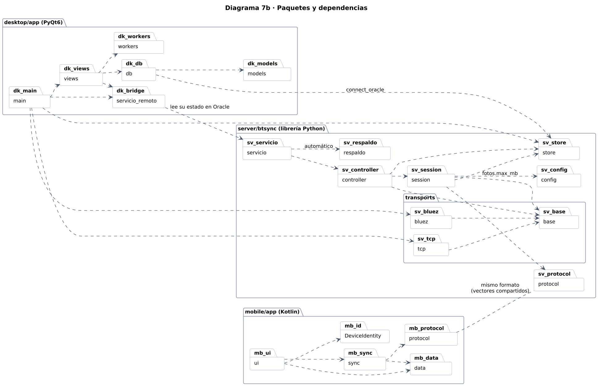
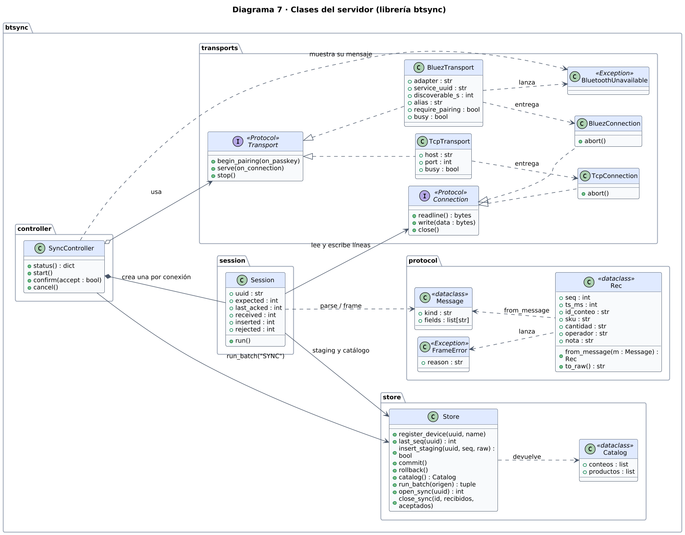
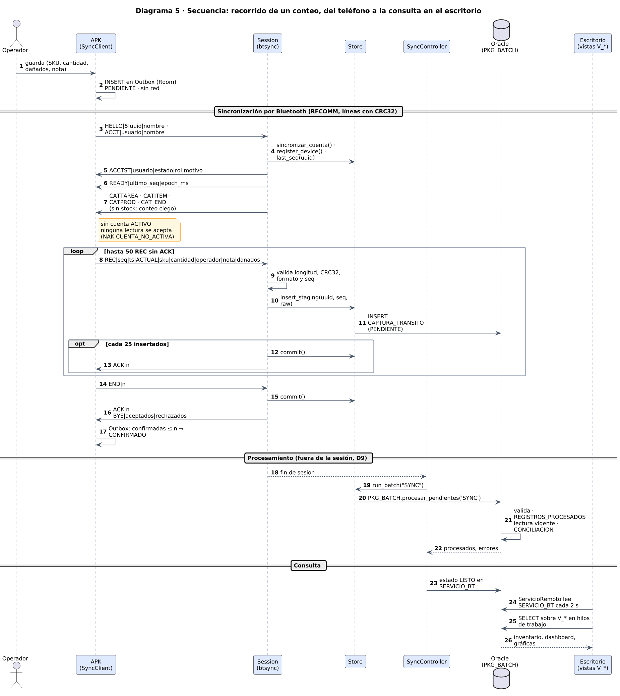
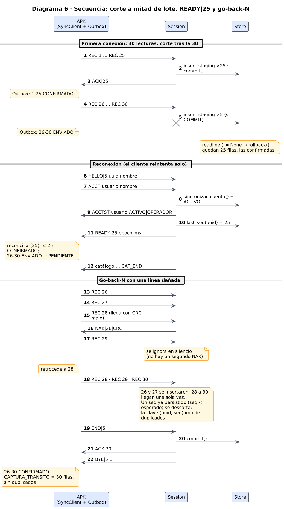
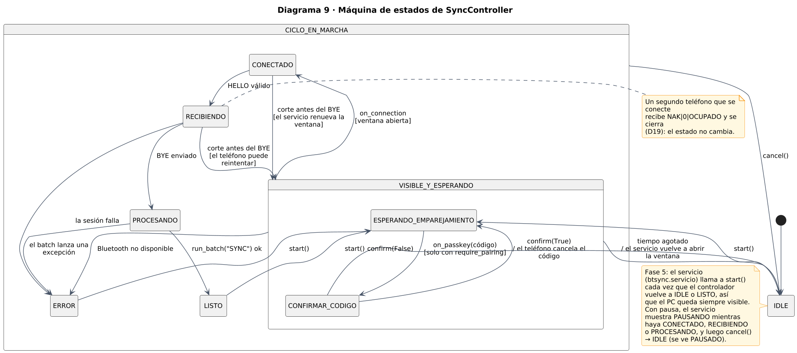

# `btsync`: módulos del servidor

Librería que implementa el lado PC de la sincronización: el protocolo de líneas, una sesión por teléfono, el acceso a
Oracle y el servicio que mantiene abierta la recepción. Contexto del paquete, instalación y variables de entorno:
[`../README.md`](../README.md).

## Módulos

| Módulo | Responsabilidad | Piezas principales |
|---|---|---|
| [`protocol.py`](protocol.py) | Formato de línea `KIND\|campo…*CRC32`, escapes y la lectura `REC` | `Message`, `Rec`, `FrameError`, `frame()`, `parse()`, `encode_text()`/`decode_text()`, `foto_lineas()`, `PROTOCOL_VERSION` (= `"5"`) |
| [`session.py`](session.py) | Una sincronización con un teléfono: `HELLO → ACCT → ACCTST + READY + catálogo → REC* → FOTO* → END → BYE` | `Session.run()`, `COMMIT_EVERY = 25` |
| [`store.py`](store.py) | Todo el acceso a Oracle de una sesión; **una conexión por instancia** | `connect_oracle()`, `Store` (`register_device`, `sincronizar_cuenta`, `last_seq`, `insert_staging`, `catalog`, `guardar_foto`, `run_batch`, `open_sync`/`close_sync`), `Catalog`, `EstadoCuenta`, `ddl_tolerante()` |
| [`controller.py`](controller.py) | Máquina de estados de la ventana de sincronización; una sola sincronización a la vez (D19) | `SyncController` (`start`, `confirm`, `cancel`, `status`), constantes de estado |
| [`servicio.py`](servicio.py) | Proceso independiente: reabre la ventana, escribe el latido en `SERVICIO_BT` y lee pausa/respuesta del escritorio | `Servicio`, `crear_transporte()`, `main()` |
| [`transports/`](transports/README.md) | Cómo llegan los bytes: BlueZ real o TCP | `Transport`, `Connection`, `BluezTransport`, `TcpTransport` |
| [`config.py`](config.py) | Configuración editable guardada en Oracle (`CONFIGURACION`) | `DEFAULTS`, `RANGOS`, `valido()`, `leer()`, `escribir()`, `migrar()` |
| [`notificaciones.py`](notificaciones.py) | Avisos de la campana creados por eventos del servidor | `crear()`, `avisar_nuevos_sku()`, `migrar()` |
| [`respaldo.py`](respaldo.py) | Respaldo y restauración completa (`.zip` con `manifest.json`, `datos/*.jsonl` y `fotos/`) | `crear()`, `listar()`, `podar()`, `restaurar()`, `Automatico`, `Respaldo`, `ErrorRespaldo` |
| [`esquema.py`](esquema.py) | Mantiene `PKG_BATCH` al día al arrancar | `paquete_al_dia()`, `migrar()` |

## Dependencias entre módulos



Fuente: [`07b_paquetes.puml`](../../docs/documentacion/diagramas/plantuml/07b_paquetes.puml). En resumen:
`servicio → controller → session → store`, y `session`/`controller` dependen de `protocol` y del contrato
`transports.base`. Solo `store` (y los módulos de datos `config`, `notificaciones`, `respaldo`, `esquema`) hablan con Oracle.



Fuente: [`07_clases_paquetes.puml`](../../docs/documentacion/diagramas/plantuml/07_clases_paquetes.puml).

## Flujo de una sincronización

1. `Servicio` (cada segundo, `tick`) deja que `SyncController.start()` abra una ventana de `discoverable_s` segundos
   (120 por defecto); el transporte hace visible al PC como `gestion_inventario`.
2. Al conectarse un teléfono, `Transport` llama a `on_connection` y el controlador crea una `Session` con su propio `Store`.
3. `Session.run()` valida `HELLO` (versión `5`) y la cuenta (`ACCT`); responde `ACCTST` y `READY|<último seq>` y envía el
   catálogo (`CATTAREA`, `CATITEM`, `CATPROD`, `CAT_END`) **sin la cantidad del sistema**. Solo una cuenta `ACTIVO` entrega lecturas.
4. Cada `REC` válido se inserta en `CAPTURA_TRANSITO` (`Store.insert_staging`, idempotente por `(uuid, seq)`); se hace
   `COMMIT` cada 25 y se responde `ACK|seq`; ante un hueco o un CRC malo responde `NAK|seq|motivo` y el móvil retrocede (go-back-N).
5. Las fotos (`FOTO`) llegan después de las lecturas; `END` cierra con `BYE`. La sesión **no** ejecuta el batch (D9).
6. El controlador pasa a `PROCESANDO` y llama `Store.run_batch(origen)`, que ejecuta `PKG_BATCH.PROCESAR_PENDIENTES`
   (ver [`../../db/README.md`](../../db/README.md)) y avisa en la campana de los SKU nuevos.



Fuente: [`05_secuencia_flujo_datos.puml`](../../docs/documentacion/diagramas/plantuml/05_secuencia_flujo_datos.puml).



Fuente: [`06_secuencia_comunicacion.puml`](../../docs/documentacion/diagramas/plantuml/06_secuencia_comunicacion.puml).

## Estados del controlador

`IDLE → ESPERANDO_EMPAREJAMIENTO ⇄ CONFIRMAR_CODIGO → CONECTADO → RECIBIENDO → PROCESANDO → LISTO | ERROR`. Sin conexión al
vencer el plazo, o con `cancel()`, vuelve a `IDLE`. `on_change(status)` se invoca desde hilos propios en cada transición:
quien lo use (la GUI) debe convertirlo en una señal Qt. `status()` devuelve `estado`, `codigo`, `recibidos`, `restante_s`
y `ultimo_error`.



Fuente: [`09_estados.puml`](../../docs/documentacion/diagramas/plantuml/09_estados.puml).

## Servicio independiente (`servicio.py`)

Escribe una fila en `SERVICIO_BT` (`id = 1`) cada segundo: estado, código de emparejamiento, recibidos, latido y
`pausado`. El escritorio la lee (`desktop/app/servicio.py`) y pide pausa (`pausado = 'S'`) o responde al código
(`respuesta`). Estados propios: `PAUSANDO`, `PAUSADO` y `DETENIDO` (sin latido durante 10 s). Un fallo de Oracle en un
tick se registra y el siguiente lo reintenta; tras un `ERROR` espera 10 s antes de reabrir. También ejecuta
`respaldo.Automatico` a la hora configurada.

```bash
docker compose up -d bluetooth && docker compose logs -f bluetooth
```

## Ejemplo de uso del protocolo

```python
from btsync.protocol import frame, parse, Rec

linea = frame(["HELLO", "5", "dev-0001", "Bodega Norte"])   # b'HELLO|5|dev-0001|Bodega Norte*788FF277\n'
mensaje = parse(linea)                                       # Message(kind='HELLO', fields=['5', 'dev-0001', 'Bodega Norte'])
```

`parse` lanza `FrameError` con `reason` = `CRC`, `FORMAT` o `LINEA_LARGA`. Los vectores compartidos con la APK están en
[`../../docs/protocol-vectors.json`](../../docs/protocol-vectors.json) y la especificación en [`../../docs/protocolo.md`](../../docs/protocolo.md).

## Pruebas relacionadas

`test_protocol.py`, `test_session.py`, `test_controller.py`, `test_servicio.py`, `test_store.py`, `test_cuentas.py`,
`test_fotos.py`, `test_config.py`, `test_notificaciones.py`, `test_respaldo.py`, `test_e2e_tcp.py`. Cómo ejecutarlas:
[`../README.md#pruebas`](../README.md#pruebas).
